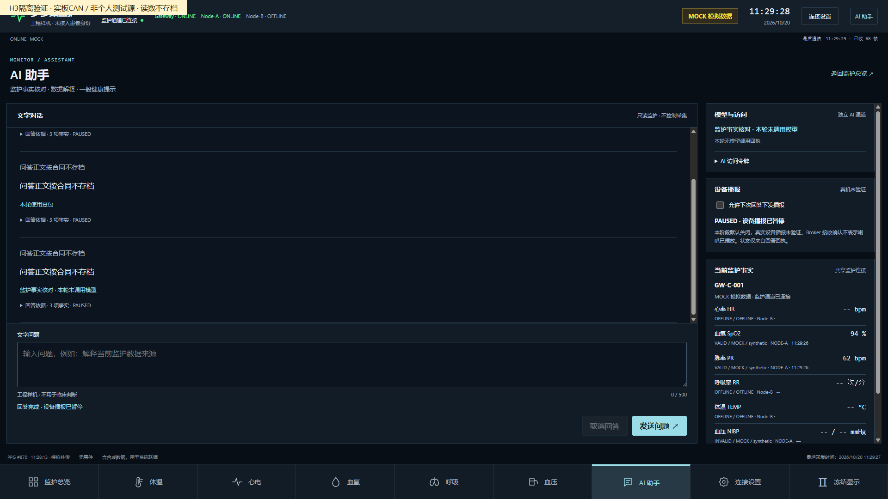

# H3_NODEA_CLOUD_DOUBAO_HANDOFF

交接日期：2026-10-20。最终裁定：**H3_BLOCKED（已有部分真实链路通过；未正式发布）**。

本轮遵循MPM-H3-001同一合同连续执行。最后正常断电重启A时，C输出 `GW CAN_FAULT_NETWORK_CLOSED_STOP` 后关闭网络并永久停留，未捕获重启Boot-up/新会话；按合同自动停止条款停止真机操作及正式切换。未绕过锁止、重新烧录或把之前通过窗口写成整体H3_PASS。操作者最后报告A已拔下J-Link、独立上电且两屏正常；这不能代替C捕获新Boot-up的验收证据。

## 代码身份与保护基线

| 对象 | 实际SHA/状态 |
|---|---|
| 独立工作区 | `E:/medical-monitor-h3` |
| 集成分支 | `dev/h3-nodea-cloud-ai-integration` |
| 最近代码提交 | `41ddc066b92ccdb46b6ecd442d669a9d1db26b14`，已正常推送 |
| C实板镜像对应源码 | `71eb0948b3e54cbf049f4e23c7c2462a9b3953f9` |
| A固定基线 | `3fa14b00a0823d2855e9dd8bd1c6c8545abb8dc5`，未修改/烧录A |
| P6固定基线 | `77dd14d1ca761a488956f7a4ebf28cb3174835e4`，按路径移植AI/Web，未整分支合并 |
| P4 / main | `67f5f57bd82c6e326e9e78ec9540481c80105e5f` / `50699048010c57ba10f8573461844c525b022a07`，远端复核未变 |
| 仓库 | 按先前明确授权改PRIVATE，保留历史；未强推/PR/合并/正式Security Gate |

本交接及最后停机/清理证据的提交SHA由包含本文件的Git提交确定，最终HEAD另在提交回执中报告；不伪造文件自包含自身提交SHA。

主要修改范围：完整联网独立物理CAN target引入H2R IRQ/128槽队列、保持RPDO→Adapter逐帧顺序；8MHz HSE与新鲜SNTP采样；各层累计计数与受限应用下载工具；只读Backend/AI与第七页整合；保留五槽历史、用持久事务流水替代累计五次上限；保留完整AI API路径；版本化隔离部署、正式发布准备及回滚工具。P4模拟回环及原核心QoS1/PUBACK/AT/TLS门禁未替换，未增加ASR/麦克风/真实TTS播报。

## 真实链路与故障结果

| 项目 | 真实结果与证据 |
|---|---|
| 活跃负载 | 420.080s端到端观察，新鲜PPG连续348.261s，退出0；`cloud/evidence/h3/e2e-probe-restored-observer-console.json` |
| 正常300秒计数 | 03:37:41–03:42:41 UTC精确300.000s；PPG PDO增加14424、0x381/0x481各300、0x681增加320，真实TXOK增加630、TIME增加30；FIFO/软件队列/Router/UART/Host新增丢失及发布失败0；`gateway/physical_can/evidence/h3/fresh-sntp-active-300s.json` |
| MQTT→Backend→WSS | MQTT1226、QoS1收到891、QoS0收到335，内存匹配值/样本差异0；Backend拒收2209→2209、丢弃0；匹配次数包含重复快照，不等同唯一包数 |
| 来源/有效性 | 现场声明非个人测试源，A标MOCK/synthetic；C自身LIVE。A ONLINE时可有源质量INVALID；B全程OFFLINE；无效值可见0，不填充读数/波形 |
| 真实授时 | 实际UDP SNTP样本RTT61ms/估计不确定性30ms；断网后新样本80ms/40ms；新消息年龄中位数PPG306ms、PR504ms、SpO2 383ms，非旧RTC年份检查替代 |
| 断网恢复 | 实际D命令断开Wi-Fi30s，180.058s观察退出0，STALE/OFFLINE后恢复新PPG；B非OFFLINE0、旧值冒充当前0、REPLAY作为当前0；`cloud/evidence/h3/wifi-disconnect-fresh-sntp-recovery.json` |
| 故障缓存 | 断网时32槽历史缓存溢出53条，独立记录，累计不清零；不与正常窗口混为零丢失 |
| 停探头 | 已实际停源，PPG正确STALE、SpO2/PR INVALID并隐藏值；现场确认曾取下探头，失败的连续窗口原样保留 |
| A正常断电重启 | **阻断**：拔下J-Link真断电后C锁止，未获得重启Boot-up与新会话；`gateway/physical_can/evidence/h3/uart-20261020T034336Z-result.json`、对应log、`node-a-power-cycle-stop.json` |
| NIBP | 当前INVALID。没有本轮新的有效血压源，真实有效值及90秒过期完整路径PENDING；不要求连续袖带测量，不声称临床准确度 |

原辅助“三流同时持续VALID300s”指标退出1、最长87.687s，保留在同一结果。新增显式active-ppg门禁对应合同活跃传感器300s，并检查5秒新鲜度、真实非空PPG、A在线、B严格离线及有效SpO2/PR匹配；未把源质量INVALID改为VALID，也未放宽生产TTL。早先600/360秒退出1均保留，不能删除后宣称从未失败。

### 最后阻断的已知事实及推断边界

源码 `gateway/physical_can/src/link_policy.h:21` 在TX等待100ms、TERR或BOFF时锁止；`bxcan_network_irq.c`使物理链路失效；`main.c:100`随即关闭网络并进入无限等待。只有A/C两节点时，A断电后C缺少其他ACK节点，与该严格策略冲突，是当前最强的软件归因方向。最后完整诊断在故障发生前仍显示FOVR/SW/UART/BOFF为0；致命分支没有最终ESR/TSR快照，**不能据此断言本次已实测Bus-off，也不能排除协议复位等其他失效路径**。

下一步应先补充停机原因快照与有界状态机Host/ARM测试，区分预期对端缺席与真实总线故障，在保持时效/累计计数及故障保护前提下审查重入策略；当前固件不应直接转正式使用。本次不继续板端复位/Flash写入。

## 普通测试、退出码与失败原件

| 检查 | 结果/退出码 | 证据入口 |
|---|---|---|
| Node-A Host/Keil | Host编译/运行0；ARMCC5.06u7退出0；A应用源码未改 | `node-a/evidence/a1-host-exit.json`、`a1-keil-exit.json`及同名日志；继承原A验证证据 |
| 物理协议/接收顺序/时钟 | Host 0；旧合并顺序参考故意失败3 | `gateway/physical_can/evidence/h3/host-result.json`、`rx-order-host-result.json`、`hse-regression/` |
| P5原逻辑/IRQ | 42项退出0 | `gateway/physical_can/evidence/h3/hse-regression/`、`fresh-sntp-regression/p5-legacy.json` |
| 新鲜SNTP | 原短读未累计退出1；修复后44项退出0 | `fresh-sntp-regression/p5-fresh.json`与`p5-fresh-final.json`及原始日志 |
| ARM隔离/正常 | 两种fresh-SNTP构建0 | `fresh-sntp-regression/arm-isolated-corrected.json`、`arm-normal-fresh.json` |
| AI/Backend/下载工具 | 既有联合79/后续107/本轮118项退出0；最新定向18项退出0 | `cloud/evidence/h3/ai-backend-joint.log`、`host-observation-regression.json`、`host-observation-targeted.log`与fresh/hse目录 |
| Web | 15项通过，失败0，构建及本地浏览器/监护连接通过 | `cloud/evidence/h3/web-final-test.log`、`browser/` |
| 真实浏览器 | 5项0，新增一次真实豆包调用；桌面/手机无横向溢出 | `cloud/evidence/h3/fresh-sntp-browser/result.json` |
| 真实AI路由 | 已验证保留前缀、401/404/405/超时及合法请求；事实解释可不调用模型 | 隔离AI/Web证据及上述browser目录 |
| Host日志中止 | Windows PermissionError导致原下载工具整体1，Flash读回/保护区仍通过；被动重接后连续记录 | `c-download-20261020T031423Z.json`、`uart-20261020T031546Z-host-failure.json` |
| 其他保留失败 | 原Backend取消异常、错误测试路径退出4、SNTP首次退出1、观察/串口/来源中断退出1；测试夹具缺目录1已修正 | HSE/fresh目录、`host-observation-regression.json`、历史E2E结果 |
| 本轮重启 | DEVICE_STOP / 退出1 | `uart-20261020T034336Z-result.json`，**本轮最终阻断** |

离线AI补测首次session_id格式错误422，未调用模型；修正请求时已恢复网络，200/NOT_CALLED仅证明恢复后事实解释，未冒称本次抓到离线AI。更早真实断网AI结果保留于 `actual-wifi-offline-ai.json`。

## 豆包、用量与截图

实际模型 `doubao-seed-2-0-mini-260428`，服务端DOUBAO/MONITOR；ARK密钥始终在服务器安全配置。浏览器仅临时持独立应用令牌。第三方模型输入仅已授权的来源/有效性最小元数据及一般问题，不传原始PPG/生理数值/人员身份/完整问答历史。

持久流水：旧3次3578 Token完整保留，H3新增7次3918 Token，合计**10请求/7496 Token**，H3七次均VALIDATED；没有累计调用上限，无自动无限重试。并发4、分钟速率12、超时/失败熔断仍有效。账户仅由操作者确认免费额度或安心体验；未核到账单金额，不把费用写成零。明细见 `cloud/evidence/h3/usage-after-fresh-sntp-browser.json`；历史mtime纠正单独记录，不改旧审计字节。

截图来自实际CAN接入的隔离UI，辅助来源标签为非个人测试源；不能称正式HTTPS上线截图。设备播报默认关闭、真实喇叭播放未验证。

## 实际服务版本、资源与正式入口

- 实板C：40928B，镜像SHA256 `35d91a1e8db7762af06ef39b289ee871e20ac10cd74046ac988fbf9d9c00ebe4`；仅应用sector0–2，范围0x08000000–0x08009FDF；当前在锁止分支，未恢复原应用。
- ARM text40832/data88/bss123040；镜像比原26660B bench增加14268B。另预留SRAM512B、实际注入312B配置，非Flash持久配置。sector7/11各128KiB摘要及选项字节逐次未变。
- 隔离Backend实际运行过 `runtime-2ffd1d372ace`（源码bd0b5bd5a2169b785a9dd2bd168f83146688ce79），loopback18775；隔离AI `runtime-d32d9b2c1688`，loopback18776，关键AI源哈希与2ffd一致。
- 诊断隔离Broker8884为本轮独立凭据/ACL，未改正式Broker。最终已停止上述3个活动隔离服务并撤销本轮主机8884临时规则；用量流水、凭据受限目录、镜像与备份保留。PC独占Wi-Fi配置/探针Broker角色已恢复/清理。
- 最新发布准备包 `runtime-37808287a557`，源码41ddc066b92ccdb46b6ecd442d669a9d1db26b14，包SHA `37808287a557176031cac5134d2379b09bd71498b34ea802ed157b7b77e81858`。阶段目录 `/opt/medical-monitor-h3/formal/20261020T034945Z`，仅PREPARED；nginx语法0，尚未安装/启动候选正式unit。新增正式Backend配置使用独立MQTT client_id，避免踢掉隔离进程。
- 原Backend/Broker/AI PID分别845095/851111/394625，最终均active且未变；Nginx/静态入口配置原哈希不变。正式AI仍为原版本，旧累计五次限制**尚未由正式入口替换**。
- 原静态release仍为 `stitch-ui-interaction-20260922-113809`；正式HTML SHA `92a48ceea4afb3a3c5b6f34fadd7d3b56063e725321aa2471e3a9285db7a48f0`，正式Nginx片段SHA `8e9509551d97489c6cd6a92d4d44f9d6ef06392f031db285e0b1f05d30143ca2`。
- 正式HTTPS原站保持原样，没有本轮新上线地址；真实入口见本机受限 `C:/Users/Serendipity/.codex/private/medical-monitor-production.json` 的browser_url，连接地址不抄入Git。候选发布后操作入口应为原站 `/medical-monitor/#/ai`，当前不得声称已正式可用。未取得最终公网受众/权限发布窗口确认。

## 回滚结果与停止状态

1. **C应用回滚实际通过**：原sector0–2共49152B SHA `1185e8d74ce5bf320ed3b92a3dfc5d8771b66a99502d0e2ccd31491c83c370a0` 已回写并完整读回，见 `gateway/physical_can/evidence/h3/c-download-20261019T131801Z.json`；随后应用候选。C没有整片备份，不宣称整片可恢复。A原两份1MiB备份SHA `0fd4a4e8417b87a157fdf3e4f7c5a2a553c5aa9f69b4417fcac03c3a73d91516` 保留仓库外。
2. **正式云端未切换**：原路由/服务/静态哈希实际复核未变，见 `cloud/evidence/h3/final-isolation-cleanup.json`。原Web、Nginx、AI unit/env和Backend env备份只在服务器受限stage/backup。不能把nginx语法检查或“未切换”称为已完成正式切换后回滚验收。
3. 将来获准发布后可使用 `cloud/deploy/h3/formal_release.py activate/rollback --plan <上述stage>/plan.json`，仅经SSH别名在服务器执行；本次activate/rollback均未执行。正式unit启动/健康失败自动清理自己的候选；备份/源文件/env/config哈希变更即停止。回滚原路由后正式HTTPS复验仍PENDING。
4. 当前A现场报告正常独立启动，C物理链路锁止、网络关闭、COM15监听已结束。电脑睡眠/USB掉电会丢失C RAM配置，不能以正常Flash配置启动；后续需明确恢复窗口。BOOT0仍为现场下载接线，未擅自移动。

## 待处理事项与后续准入

- 优先修复并验证“A断电/重新上电时C的无ACK锁止和恢复”及停机原因最终快照；通过Host/ARM后在受限硬件窗口复测，捕获实际Boot-up、新会话、旧值失效。不得把强设PC/MSP/VTOR作为验收。
- NIBP有效输入与90秒真实过期路径仍PENDING，需要本轮获准的合格非个人血压测试源；不填示例数值。
- C RAM配置及临时Broker尚不具备重启持久性；正式持久方案须明确保护区与配置写入范围，未授权不改sector7/11。正常生产来源模式尚未实板验收，当前测试源标签必须保留。
- 上述阻断解决后，仍须合同H3-3的一次现场发布窗口与公网数据范围/受众/权限确认，再执行实际HTTPS七页/AI四类问答及真实回滚，不新拆合同，也不把准备包视为已上线。
- 操作者此前新增的腾讯云安全组8884规则尚需在控制台撤销或按后续批准范围收敛；本轮临时主机放行已撤销，未改其他安全组条目。
- 原仓库曾公开且历史有真人来源日志；现PRIVATE不等于撤回既有外部副本，历史未改写。

按用户最后要求保存、正常提交并推送后停止本轮工作并让电脑休眠/睡眠。系统当前支持S3；启用休眠命令因缺少管理员权限退出1，未自行提权。若执行S3将在最终回执准确标明，不把安排请求写成已确认进入电源状态。
