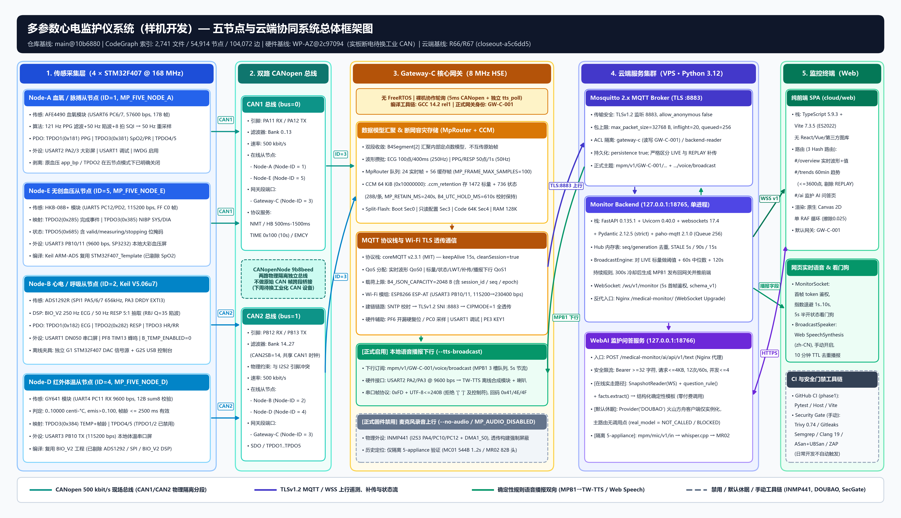
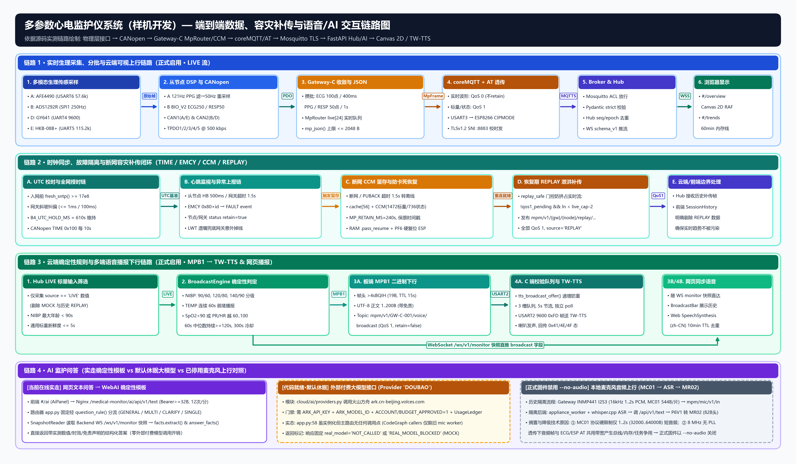

# 多参数心电监护仪系统（样机开发）— 项目计划书与代码架构基线说明书

> **编写依据与事实边界声明**：本文档严格依据本机代码仓库（`main` 分支 `@ 10b6880`）、本机 CodeGraph 静态代码知识图谱（`2,741` 文件 / `54,914` 节点 / `104,072` 边）、已同步的[工程问题与复盘文档](01-ISSUES-AND-ENGINEERING-REVIEW.md)及仓库源码实测配置编写。所有 MCU 型号、主频、外设引脚、CANopen 映射、MQTT Topic、二进制帧头结构体、软件依赖版本号及禁用/休眠边界均直接对照源码核验；源码中未出现的能力或未上线的组件均明确标示其未启用或隔离状态，不作任何推演或虚构。
>
> **状态快照时间**：`2026-11-13 CST`（结项工程基线 `2026-11-12 America/Chicago` + R66/R67 断电重部署 + 本机分支与 CodeGraph 整理）。

---

## 1. 项目定位与当前工程基线

本项目旨在构建一套面向**多参数生理体征监护样机**的**“五板分布式嵌入式采集 + 双路 CANopen 现场总线 + MQTT/TLS 物联网网关 + 云端实时监护后端与 AI 问答服务 + 浏览器大屏可视化与双通道语音播报”**全链路工程系统，采集参数覆盖：

- **波形通道（3 路）**：单导心电（`ECG`, `250 Hz`, `mV`）、胸阻抗呼吸波（`RESP`, `50 Hz`, `relative`）、光电容积脉搏波（`PPG`, `50 Hz`, `relative`）。
- **标量与测量参数（6 项）**：血氧饱和度（`SpO2`, `%`）、脉率（`PR`, `bpm`）、心率（`HR`, `bpm`）、呼吸率（`RR`, `breaths/min`）、红外体温（`TEMP`, `degC`）、无创袖带血压（`NIBP` `[SYS, DIA]`, `mmHg`）。
- **监控与语音能力**：网关/从节点在线状态与 CANopen 异常事件（`NODE_STATUS` / `GATEWAY_STATUS` / `FAULT`）、云端确定性临床阈值规律播报（`MPB1` 下行至板端 `TW-TTS` 喇叭 + 浏览器 `SpeechSynthesis`）以及浏览器端监护指标问答（`WebAI`）。

### 1.1 当前真实基线状态（截至 2026-11-13）

| 维度 | 当前状态与基线版本 | 关键事实与边界说明 |
| --- | --- | --- |
| **仓库默认主线** | `main @ 10b6880` | 包含五节点构建、R65 结项基线、[`docs/closeout/02-ARCHITECTURE-AND-STACK.md`](docs/closeout/02-ARCHITECTURE-AND-STACK.md) 与 PR `#20` (`websockets 17.4`) 等主线修复。 |
| **待合入远端增量** | `origin/codex/r66-closeout-redeploy`、`origin/claude/closeout-ai-wss-test-fix` | 含 R66/R67 云端部署回执与 `b11e04a` WebAI `CancelledError` 确定性测试修复；**当前按要求保留为未合并分支，暂不修改/推送 GitHub**。 |
| **硬件五板基线** | `WP-AZ @ 2c97094`（Gateway-C）及各从节点冻结构建 | C 端采用 Split-Flash（boot `392 B` + code `61,228 B`）；**当前全部实板处于断电暂停状态**，拟于下周更换工业级 CAN/CANFD 网桥（规划选型：[`GCAN-GT-246 系列`](docs/hardware/GCAN-GT-246-USER-MANUAL.md)，当前尚未接线实测）后再继续实板长测与 CAN 裕量/故障注入试验。 |
| **云端运行环境** | R66/R67 已重部署并断电核验（`closeout-a5c6dd5`） | `webbackend` 已切换 `websockets==17.4`，`webai` 已按 `GW-C-001` 与 `P6_SNAPSHOT_MODE=MONITOR` 启动运行；Mosquitto Broker（`:8883`）与前端站点沿用 R65 基线；仅完成断电 API/鉴权/跨网关隔离核验。 |
| **本机开发态** | 9 个活跃本地分支、CodeGraph 索引就绪 | 本地旧分支由 40 条缩减至 9 条、冗余干净 worktree 已清理，且所有远端历史分支均有 `archive/20261112/*` 标签备份。 |

---

## 2. CodeGraph 全仓代码索引与工程拓扑

本机通过 `codegraph` 对仓库全量代码建立了 SQLite知识图谱索引（`.codegraph/codegraph.db`，`136.79 MB` WAL 模式，已写入 `.git/info/exclude` 防误提交），统计结果如下：

| 索引指标 / 语言类别 | 数量 / 占比说明 | 对应代码子系统 |
| --- | --- | --- |
| **总索引规模** | **2,741 个文件** · **54,914 个代码节点** · **104,072 条调用/引用边** | 覆盖全部嵌入式 C 源码、第三方协议栈、Python 后端/AI/工具、TypeScript 前端与 YAML 配置 |
| **C (`c`) / C++ (`cpp`)** | `2,254` + `6` 文件 | `node-a/`、`node-b/`、`node-d/`、`node-e/`、`gateway/`、`ecg-source/`（含 STM32F4 SPL、CANopenNode、coreMQTT v2.3.1） |
| **Python (`python`)** | `422` 文件 | `cloud/backend/`、`cloud/ai/`、`cloud/microphone/`、`tools/`、`gateway/**/build*.py`、`node-b/tools/` |
| **TypeScript / JS** | `32` + `3` 文件 | `cloud/web/src/`、`cloud/web/tests/` |
| **YAML / 其他配置** | `16` + `2` 文件 | `.github/workflows/`、`tools/security_gate/`、部署环境变量模板等 |
| **主要符号构成** | 函数 `24,489` · 导入 `8,691` · 变量 `6,761` · 结构体 `4,233` · 枚举成员 `4,011` · 方法 `2,020` · 类 `357` | 支持跨端精确追踪（如确认 `Provider.explain` 仅在旧 `cloud/microphone/worker.py` 调用，主 AI 路由未调用） |

### 2.1 仓库核心目录职责映射

- **从节点固件**：[`node-a/`](node-a/STM32F407_HOSPITAL/USER/main.c)（SpO2/PPG）、[`node-b/`](node-b/canopen/b_canopen_app.c)（ECG/RESP/HR/RR 含 [`build_b4_arm.py`](node-b/tools/build_b4_arm.py) 冻结构建及历史归档回执）、[`node-d/`](node-d/main.c)（GY641 体温）、[`node-e/`](node-e/main.c)（HKB-08B+ 无创血压）。
- **网关固件与中间件**：[`gateway/dual_can/`](gateway/dual_can/b4_gateway.c)（双 CAN 控制器与串口捕获）、[`gateway/storage/`](gateway/storage/router.h)（`MpRouter` 实时/离线环与 CCM 留存）、[`gateway/data_model/`](gateway/data_model/model.h)（统一 `MpFrame` 与 JSON 序列化）、[`gateway/b5/`](gateway/b5/network_main.c)（正式网络主循环、断电恢复与策略）、[`gateway/mqtt/`](gateway/mqtt/src/gateway_transport.c)（coreMQTT 传输与 ESP8266 AT 状态机）、[`gateway/voice/`](gateway/voice/tts_broadcast.c)（`MPB1` 解码与 `TW-TTS` 串口驱动）、[`gateway/microphone/`](gateway/microphone/README.md)（独立 I2S3/INMP441 台架与历史语音上行协议）。
- **离线信号源与宿主机工具**：[`ecg-source/`](ecg-source/README.md)（G1 离线 DAC 波形源与 G2S USB 控制台）、[`tools/build_five_node.py`](tools/build_five_node.py)（五板联合编排构建与主机联合桩）。
- **规划更换工业 CAN 设备手册**：[`docs/hardware/GCAN-GT-246-USER-MANUAL.md`](docs/hardware/GCAN-GT-246-USER-MANUAL.md)（广成科技 GCAN-GT-246 系列工业级 CAN/CANFD 网桥用户手册 `V1.10` 无损转换版及设备/接线配图；注：**拟选型接入设备，当前尚未上电接线或纳入实板验证**）。
- **云端服务与前端**：[`cloud/backend/`](cloud/backend/app/main.py)（Mosquitto 消费、Pydantic 校验、Hub 状态机、Deterministic `BroadcastEngine`、WebSocket 服务）、[`cloud/ai/`](cloud/ai/app.py)（规则问答 `WebAI` 与孤立 `5-appliance` 音频桥接）、[`cloud/web/`](cloud/web/package.json)（零运行时框架 TypeScript + Canvas 2D 前端）、[`cloud/broker/`](cloud/broker/mosquitto.conf) 与 [`cloud/deploy/`](cloud/deploy/medical-monitor.service)（Mosquitto 配置、ACL、Nginx 与 systemd 模板）。

---

## 3. 系统总体架构

### 3.1 系统框架图（Python 渲染）

### 3.2 五层架构设计解析

1. **层 1 — 感知与从节点采集层（4 × STM32F407 @ 168 MHz）**
   - 四个生理参数从节点采用独立 STM32F407ZG/ZGT6 单片机跑满 `168 MHz` 主频（`PCLK1 = 42 MHz`），各自负责专用医疗传感器的底层采集、数字滤波/特征识别、独立本地大彩（Dacai）串口屏驱动及硬件看门狗。
   - 统一由 [`tools/build_five_node.py`](tools/build_five_node.py) 管理五角色分离编译：
     - **Node-A（`Node-ID = 1`, `MP_FIVE_NODE_A`）**：通过 `USART6`（`PC6/PC7`, `57600 bps`）读取 AFE4490 血氧模块 17 B `0A FA 0A 00 02` 帧；运行 `121 Hz` PPG 高/低通与 50 Hz 二阶陷波、8 拍 SQI 门控算法（[`dc_hmi.c`](node-a/STM32F407_HOSPITAL/HARDWARE/HMI/dc_hmi.c)），并线性重采样为 `50 Hz` 上送 CANopen `TPDO1`；在五节点配置下已显式关闭历史残留血压代码 `app_bp` 与 `TPDO2`。
     - **Node-B（`Node-ID = 2`）**：由 [`build_b4_arm.py`](node-b/tools/build_b4_arm.py) 冻结工程基于 Keil ARMCC V5.06u7 构建，通过 `SPI1`（`PA5/6/7`, `656.25 kHz`）+ `EXTI3`（`PA3 DRDY`）以 `250 SPS` 驱动 ADS1292R；经 `BIO_V2` 确定性 DSP（RBJ `Q=35` 50/100 Hz 陷波、12–160 ms QRS 宽度门限、5 间期中位数一致性 `±20%`）输出 `250 Hz` ECG、`50 Hz` RESP（5:1 抽取）及 HR/RR。五节点模式下 `B_TEMP_ENABLED=0`（体温由 Node-D 接管）。
     - **Node-D（`Node-ID = 4`, `MP_FIVE_NODE_D`）**：复用 `BIO_V2` 工程框架但编译期剔除 ADS1292/SPI/BIO_V2，专门通过 `UART4`（`PC11` 只收, `9600 bps`）解析 GY641 红外测温 12 B 校验帧（[`gy641.c`](node-b/temperature/gy641.c)），校验 `0 < emis <= 100` 且帧龄 `<= 2500 ms` 后上送 `TPDO3`。
     - **Node-E（`Node-ID = 5`, `MP_FIVE_NODE_E`）**：复用 `STM32F407_Template` 但编译期剔除 SpO2/UNO 模块，通过 `UART5`（`PC12/PD2`, `115200 bps`）驱动 HKB-08B+ 无创血压模块（[`bp_sensor.h`](node-a/STM32F407_HOSPITAL/HARDWARE/bp_sensor.h)），通过 `TPDO2`/`TPDO3`/`TPDO5` 发布测量完成事件、`SYS/DIA` 与袖带工作状态。
2. **层 2 — 双路物理隔离 CANopen 现场总线（500 kbit/s）**
   - 根据 [`b4_gateway.c`](gateway/dual_can/b4_gateway.c) 与 [`b4_bxcan.c`](gateway/dual_can/b4_bxcan.c)，Gateway-C 启用双独立 bxCAN 控制器且**不做跨总线 CAN 报文透传**：
     - **`CAN1`（`bus=0`, `PA11/PA12 AF9`, 滤波器组 `0..13`）**：挂载 `Node-A`（`ID=1`）与 `Node-E`（`ID=5`），Gateway-C 本段端口为 `Node-ID = 3`。
     - **`CAN2`（`bus=1`, `PB12/PB13 AF9`, 滤波器组 `14..27`, `CAN2SB=14`）**：挂载 `Node-B`（`ID=2`）与 `Node-D`（`ID=4`），Gateway-C 本段端口同为 `Node-ID = 3`。（注意 `PB12/PB13` 与板载 `I2S2` 引脚物理复用冲突，WM8978 未启用）。
   - 两总线统一运行于 `500 kbit/s`，以各节点 32 位固定点内部模型汇总到网关共享 `MpRouter`。
3. **层 3 — 核心网关 Gateway-C（STM32F407ZG @ 8 MHz HSE 直通）**
   - **时钟与调度差异**：与 4 个 `168 MHz` 从节点不同，Gateway-C 为保证串口/CAN/HSE 时钟一致性刻意运行在外部 `8 MHz` HSE 直通（**不开 PLL，SYSCLK = AHB = APB1 = APB2 = 8 MHz**，HSE 失败即 `GW FAIL HSE_CLOCK` 停机），由 **Arm GNU Toolchain `14.2 rel1`**（`-Os -std=c11 -Werror -flto`）与 STM32F4 SPL v1.4.0 编译。
   - **无 RTOS 裸机协作架构**：全固件不引入 FreeRTOS/RTOS，主循环 [`network_main.c`](gateway/b5/network_main.c) 以 `B5_SERVICE_MS`（`5 ms`）步进调度 CANopen 双总线服务，并在外层通过非阻塞轮询状态机协同驱动 ESP-AT 透传、coreMQTT、断网补传及独立 [`tts_broadcast_poll()`](gateway/voice/tts_broadcast.c)（避免被 5 ms 门控或发送队列阻塞）。
   - **Split-Flash 与安全内存布局**：由 [`flash.ld`](gateway/b5/flash.ld) 与 [`build_arm.py`](gateway/dual_can/build_arm.py) 划分 `BOOT` Sector 0（`0x08000000`, `16 KiB`）、只读配置区 Sector 3（`0x0800C000`, 存放 `H3ConfigRecord` 与 `GatewayConfig`，运行时固件只读不写）、主代码区 Sector 4（`0x08010000`, `64 KiB`）、`128 KiB SRAM`（含 `.pass_resume` 跨复位恢复段）与 `64 KiB CCM`（`0x10000000`, `.ccm_retention` 断网留存环）。
   - **音频模块正式边界**：正式云联调构建 `--b5 --egress-final --tri --unified --split-flash --five-node --esp-passthrough --formal-cloud --tts-broadcast` 中，`--esp-passthrough` 在 [`build_arm.py`](gateway/dual_can/build_arm.py#L72) 强制置位 `args.no_audio = True`（定义 `MP_AUDIO_DISABLED`），即**正式固件屏蔽了 `INMP441/I2S3` 本地录音上行，仅保留 `--tts-broadcast` 经 `USART2` (`PA2/PA3`, `9600 bps`) 驱动 `TW-TTS` 离线语音播报模块**。
4. **层 4 — 云端服务集群（VPS · Linux · Python 3.12）**
   - **Mosquitto 2.x MQTT Broker（[`mosquitto.conf`](cloud/broker/mosquitto.conf)）**：监听 `TLSv1.2 :8883`，强制账密鉴权（`allow_anonymous false`）、ACL 按主题前缀读写隔离（[`acl`](cloud/broker/acl) 中的 `gateway-c` / `backend-reader` / `mock-publisher`）、开启消息持久化（`persistence true`）并限制单包上限 `32,768 B`。
   - **Monitor Backend（[`cloud/backend/app/main.py`](cloud/backend/app/main.py)）**：`127.0.0.1:18765` Uvicorn 单进程（不可多 worker，因全量状态与订阅者在进程内存 `Hub` 维护），使用 `FastAPI 0.135.1`、`websockets 17.4`、`Pydantic 2.12.5`（严格校验禁止隐式转型与 `NaN`）、`paho-mqtt 2.1.0`。提供 `Hub` 去重保序、`BroadcastEngine` 规则播报下发及 `/ws/v1/monitor` 快照推送。
   - **WebAI 监护问答服务（[`cloud/ai/app.py`](cloud/ai/app.py)）**：`127.0.0.1:18766` 独立 FastAPI 进程，通过 `SnapshotReader`（连接 `/ws/v1/monitor`）获取实时体征快照，当前主路径经确定性规则给出数值解读。
   - **Nginx 反向代理（[`medical-monitor.conf`](cloud/deploy/nginx/medical-monitor.conf)）**：统一承载 `/medical-monitor/` 至 `18765`（含 WebSocket Upgrade）及 `/medical-monitor/ai/` 至 `18766`。
5. **层 5 — Web 浏览器监控终端（[`cloud/web/`](cloud/web/package.json)）**
   - 纯 `TypeScript 5.9.3 + Vite 7.3.5`（`ES2022`），**零第三方 UI/图表运行时依赖**；单 `requestAnimationFrame` 循环驱动 Canvas 2D 扫描擦除波形，内置 3 个 Hash 路由（`#/overview`、`#/trends`、`#/ai`），并提供需用户手动开启的浏览器 `SpeechSynthesis`（`zh-CN`）同步语音播报。

---

## 4. 端到端链路与容灾、语音/AI 交互流程

### 4.1 端到端数据、容灾与语音链路图（Python 渲染）

### 4.2 四大核心业务链路详述

1. **链路 1 — 实时生理采集、攒批与低延迟可视化上行（LIVE 流）**
   - 从节点实时采集与 DSP 计算后按角色分别写入 `TPDO1..TPDO5`：Node-B 输出 `250 Hz` ECG（`TPDO1`）与 `50 Hz` RESP（`TPDO2`）；Node-A 输出 `50 Hz` 重采样 PPG（`TPDO1`）与 `1 Hz` SpO2/PR（`TPDO3`）；Node-D/E 输出 `1 Hz` TEMP（`TPDO3`）与 NIBP 事件/结果（`TPDO2`/`TPDO3`）。
   - Gateway-C [`MpRouter`](gateway/storage/router.h) 将高频样本攒批打包进定点数 `MpFrame`（正式 B4/B5 构建设 `MP_FRAME_MAX_SAMPLES = 100`，`MP_LIVE_CAPACITY = 24` 实时帧 + `MP_CACHE_CAPACITY = 56` 缓存帧）：**ECG 每 100 点（400 ms）成一帧，PPG/RESP 每 50 点（1 s）成一帧**；[`mp_json()`](gateway/data_model/model.c) 在边界处完成单位换算与 JSON 序列化（上限 `B4_JSON_CAPACITY = 2048 B`）。
   - 发送策略实现 **QoS 分级防阻塞**：所有实时波形（`sample_rate > 0 && !replay`）采用 **QoS 0, `retain=false`**，标量与状态采用 **QoS 1**；通过 `USART3`（`115200 -> 230400 bps`）送入已进入 `CIPMODE=1` 透传的 ESP8266，经 `TLSv1.2 :8883` 抵达 Broker，再由 Backend [`MqttAdapter`](cloud/backend/app/mqtt_adapter.py) 有界队列（`256` 槽）摄入 `Hub`，最终以 `100 ms` 间隔或波形批直推（`MONITOR_WAVE_BATCH_DELIVERY=1`）通过 `WS /ws/v1/monitor`（`schema_version=1`）渲染到网页 `#/overview` Canvas 2D 与 `#/trends` 60 分钟内存趋势。
2. **链路 2 — 时钟同步、CAN 异常监视与断网 CCM 容灾补传闭环**
   - **全网时间戳统一**：Gateway-C 入网前强制执行 `fresh_sntp()` 校时（有效门槛 `epoch >= 1700000000`），并借助 `B4_UTC_HOLD_MS = 610000 ms`（约 10 分钟）与斜坡纠偏算法（每 `100 ms` 最多修正 `1 ms`，避免时间戳跳变），同时通过 CANopen `TIME` 报文（`0x100` DLC=6，每 `10 s`）向四从节点广播统一时钟基准。
   - **心跳与异常闭环**：各从节点每 `500 ms` 发送 CANopen 心跳，Gateway-C 消费端设 `1500 ms` 超时判定离线，并通过 `mpm/v1/{gw}/{node}/status`（`QoS 1, retain=true`）及 LWT 遗嘱反映在云端；硬件/传感器故障通过 `EMCY`（`0x80+node_id`）触发 `FAULT` 事件上报。
   - **断网留存与防挤占补传**：当网络断开、ESP 卡死（可通过 `+++` 退出透传并拉低 `PF6` 硬件开漏复位恢复）或 `PUBACK` 停滞超过 `LINK_PUBACK_STALL_MS = 1500 ms` 时，未发报文转入 56 槽 `cache` 环及 CCM `.ccm_retention`（可保留 `1472` 条标量 + `736` 条状态，单条 `28 B`，保留原始采样 `timestamp`，最长 `MP_RETAIN_MS = 240000 ms`），软复位期间借助 RAM `.pass_resume` 段续传（限 `PASS_REENTRY_MAX = 3`）。网络恢复后，[`mp_router_take_egress()`](gateway/storage/router.h#L85) 仅在 `!qos1_pending && ln < MP_LIVE_CAPACITY - 2` 的安全水位下泄洪发送至 `mpm/v1/{gw}/{node}/replay/{stream}`（`QoS 1, source="REPLAY"`），确保**历史补传绝不阻塞实时新波形**；同时前端 [`SessionHistory`](cloud/web/src/state/sessionHistory.ts) 明确剔除 `source === 'REPLAY'` 数据，防止历史帧倒灌污染实时趋势曲线。
3. **链路 3 — 云端确定性规律播报双向（`MPB1` → `TW-TTS` & Web 语音）**
   - Backend [`BroadcastEngine`](cloud/backend/app/broadcast.py) **仅消费 `source == "LIVE"` 的有效标量**（`NIBP` 龄 `< 90 s`、其余标量 `<= 5 s`），执行纯本地确定性生理规则评估（NIBP `90/60`, `120/80`, `140/90` 分级；TEMP 连续 60 s 就绪播报；`SpO2 < 90` 或 `PR/HR` 超出 `60..100` 且 60 s 中位数滤波持续 `>= 120 s`），附加医疗免责声明并受 `300 s` 同参数冷却期控制。
   - 触发播报后双端同步推送：一路编码为 `19 B` 帧头 + `1..200 B` UTF-8 的 **`MPB1`** 二进制帧发布至 `mpm/v1/GW-C-001/voice/broadcast`（`QoS 1`, `TTL = 15 s`），经 Gateway-C [`tts_broadcast_offer()`](gateway/voice/tts_broadcast.c#L40) 做递增 `issued_ms` 防重放检验并压入 3 槽队列后，按 5 s 节流经 `USART2` (`9600 bps`) 发送 `0xFD` 帧驱动 `TW-TTS` 离线语音喇叭（拒绝含 `[` `]` 或控制字符的文本防标签注入，并回传 `0x41/0x4E/0x4F` 状态）；另一路随 WebSocket 快照直达浏览器 [`BroadcastBar`](cloud/web/src/ui/broadcastBar.ts) 供手动开启的 Web Speech API 播报（前端 10 分钟 TTL 去重）。
4. **链路 4 — AI 监护问答与音频链路演进对照**
   - **当前在线实走链路**：用户在网页 `#/ai` 输入问题后经 Nginx 访问 `POST /medical-monitor/ai/api/v1/text`（Bearer Token 校验 `>= 32 B`，限流 `12 次/60 s`），[`cloud/ai/app.py`](cloud/ai/app.py) 经 `question_rule()` 分类 → `SnapshotReader` 读取监护实时快照 → `facts.extract()` & `answer_facts()` 生成带实测数据与时效标记的模板回复，**不依赖外部云端大模型**。
   - **默认休眠大模型接口与已停用麦克风**：源码 [`cloud/ai/providers.py`](cloud/ai/providers.py) 已实现火山方舟 `Provider('DOUBAO')` 及 SQLite `UsageLedger` 限流/熔断桩，但在主路由 `app.py` 中**无任何调用点**（固定返回 `real_model = NOT_CALLED / REAL_MODEL_BLOCKED`）；同时本地 `INMP441` 录音上行因 `MC01` 协议限制仅 `1..2 s`（`32,000..64,000 B`）短句、且 `8 MHz` 网关在高频 CAN 透传下需避开与 `ESP-AT/ECG` 的带宽及交互争用，目前在正式固件通过 `--no-audio` 禁用（仅保存在隔离 `5-appliance` 台架分支供 `whisper.cpp + MR02` 验证）。

---

## 5. 全栈技术栈与依赖版本清单

### 5.1 嵌入式端（MCU / RTOS 状态 / 编译工具链 / 协议栈）

| 分层 / 组件 | 采用技术与精确版本/参数 | 用途与代码定位 |
| --- | --- | --- |
| **核心微控制器** | **STM32F407ZG / STM32F407ZGT6**（Cortex-M4F, 1 MiB Flash, 128 KiB SRAM, 64 KiB CCM, 8 MHz HSE） | 4 从节点 + Gateway-C + G1 离线信号源；从节点跑满 `168 MHz`，**Gateway-C 为 `8 MHz` HSE 直通（无 PLL）** |
| **执行模型** | **全裸机协作轮询 + 外设中断**（**无 FreeRTOS/RTOS**） | Node-B EXTI3 采集 + 协作 `FrameFeed`；Gateway-C 主循环 `platform_poll()` + `5 ms` CANopen + 独立 `tts_broadcast_poll()` |
| **基础固件库** | **STM32F4 Standard Peripheral Library (SPL) v1.4.0** + `arm_cortexM4lf_math.lib`（Node-B） | GPIO/SPI/USART/bxCAN/DMA/TIM/I2S/IWDG 底层驱动（如 [`b4_bxcan.c`](gateway/dual_can/b4_bxcan.c)） |
| **编译工具链** | **Keil MDK ARMCC V5.06u7**（从节点 A/B/D/E）；**Arm GNU Toolchain `14.2 rel1`** (`arm-none-eabi-gcc`, `-Os -std=c11 -Werror -flto -mfloat-abi=hard`, Gateway-C) | [`node-b/tools/build_b4_arm.py`](node-b/tools/build_b4_arm.py) 与 [`gateway/dual_can/build_arm.py`](gateway/dual_can/build_arm.py) |
| **现场总线栈** | **CANopenNode**（commit `9b8beed8367241e96ac03f916cd5a500bcb2cf23`, Apache-2.0） | NMT、Heartbeat、TIME、EMCY、SDO、TPDO1..5；Gateway-C 启用 `CO_MULTIPLE_OD` 支持双总线独立 OD |
| **物联网协议栈** | **coreMQTT v2.3.1**（MIT, [`upstream.json`](gateway/third_party/coreMQTT/upstream.json)） | MQTT 3.1.1 客户端、QoS 0/1 状态管理、重连与出/入站确认表（含语音订阅入站扩展记录） |
| **无线通信模组** | **ESP8266 ESP-AT**（`AT+CIPSSLCCONF=2,0,0` TLS 1.2 + SNI、`AT+CIPMODE=1`、`USART3` `115200->230400 bps`、`PF6` 开漏硬复位） | 承担 SNTP 校时、TLS 加密通道建立与透传字节收发 |
| **传感器与人机模组** | **ADS1292R**（ECG/RESP）、**AFE4490**（SpO2/PPG）、**GY641**（红外体温）、**HKB-08B+**（NIBP）、**TW-TTS**（离线中文 TTS）、**大彩串口屏**；**INMP441**（仅历史/隔离台架） | 见 [`ads1292.h`](node-b/firmware/biov2/实验固件/HARDWARE/ads1292.h) 及各节点驱动目录 |

### 5.2 云端后端、AI 服务、Broker 与部署运维栈

| 分层 / 组件 | 采用技术与精确版本（来自 [`requirements.lock`](cloud/backend/requirements.lock) 与部署配置） | 用途与代码定位 |
| --- | --- | --- |
| **Python 运行时** | **Python 3.12**（VPS 部署 `3.12.3` / 本机验证 `3.12.14`） | 后端与 AI 进程统一运行环境（注：`cloud/ai` 当前沿用 `webbackend` 共享 venv，尚未单独拆出 `requirements` 清单） |
| **Web / API 框架** | **FastAPI `0.135.1`** + **Starlette `1.6.0`** + **Uvicorn `0.40.0`** + **`h11==0.16.0`** + **`anyio==4.15.1`** | 提供 `/health`、`WS /ws/v1/monitor` 与 AI `POST /api/v1/text`；生产固定单 worker (`--workers 1 --ws-max-size 65536 --ws-max-queue 8`) |
| **数据契约与校验** | **Pydantic `2.12.5`** + **`pydantic_core==2.41.5`**（[`models.py`](cloud/backend/app/models.py) & [`app.py`](cloud/ai/app.py#L38)） | `ConfigDict(extra='forbid', allow_inf_nan=False, strict=True)` 强制拦截未知字段、`NaN/Inf`、角色串线与非法单位 |
| **实时通讯与 MQTT** | **`websockets==17.4`**（PR `#20` 升级防分片风险） + **`paho-mqtt==2.1.0`**（`CallbackAPIVersion.VERSION2`） | WebSocket 推送与 TLS 1.2 MQTT 双向订阅/发布 |
| **异步 HTTP 客户端** | **`httpx==0.28.1`**（开发/AI 测试与休眠 `DOUBAO` 客户端） | 用于 ASGI 测试及 [`providers.py`](cloud/ai/providers.py) 火山方舟 POST 客户端 |
| **MQTT Broker** | **Mosquitto 2.x**（[`mosquitto.conf`](cloud/broker/mosquitto.conf) + [`acl`](cloud/broker/acl)） | TLSv1.2 `:8883`、`max_packet_size 32768`、三角色 ACL、会话持久 |
| **反向代理与托管** | **Nginx**（[`medical-monitor.conf`](cloud/deploy/nginx/medical-monitor.conf)） + **systemd**（[`medical-monitor.service`](cloud/deploy/medical-monitor.service)） | 统一静态托管、`/medical-monitor/` WebSocket Upgrade、`/medical-monitor/ai/` 反代与 `NoNewPrivileges`/`ProtectSystem=strict` 加固 |
| **隔离 ASR 工具** | **外部 `whisper.cpp` 子进程**（[`appliance_worker.py`](cloud/ai/appliance_worker.py)） | **仅**在 `5-appliance` 隔离 `P6_MQTT_MODE=ISOLATED` 模式用于 `MC01` 录音转写测试，正式 `GW-C-001` 未启用 |

### 5.3 前端、测试与 CI / Security Gate 工具链

| 分层 / 组件 | 采用技术与精确版本 | 用途与代码定位 |
| --- | --- | --- |
| **前端构建与语言** | **TypeScript `5.9.3`** (`ES2022`) + **Vite `7.3.5`**（`esbuild 0.27.7`） | **无 React/Vue/D3/ECharts 等任何运行时依赖**；单包极轻量 SPA，[`vite.config.ts`](cloud/web/vite.config.ts) 配 `base: '/medical-monitor/'` |
| **图形渲染与语音** | **原生 HTML5 Canvas 2D API** + **Web Speech API (`SpeechSynthesis zh-CN`)** | 单 `requestAnimationFrame` 循环扫描擦除（`ERASE_FRACTION=0.025`）与前端主动语音提示 |
| **自动化测试栈** | **Pytest `9.1.1`** + Host GCC 单元测试 + **Node `22` / `node --test`** + `esbuild` + Python `unittest` | `.github/workflows/phase1.yml` 日常 CI 覆盖前后端、coreMQTT 完整性、CANopen Host 闭环及五节点筛选回归 |
| **安全门禁工具链（按需人工触发）** | **Trivy `0.74.0`** · **Gitleaks `8.30.1`** · **pip-audit `2.10.1`** · **Semgrep `1.175.0`** · **Clang/clang-tidy `19.1.7`** · **GCC `14.2.0`** · **Bear `3.1.6`** · **OWASP ZAP** | 定义于 [`.security-gate.json`](.security-gate.json) 与 [`toolchain.lock.json`](tools/security_gate/toolchain.lock.json)，按 `AGENTS.md` 日常开发不自动运行 |

---

## 6. 核心通信协议与报文帧结构规范

### 6.1 分层协议与接口总表

| 协议层 / 接口 | 物理/传输参数 | 核心报文与数据映射 | 源码定位 |
| --- | --- | --- | --- |
| **CANopen (CAN1 & CAN2)** | `500 kbit/s`；8 MHz PCLK1 下网关设 `BS1=13tq, BS2=2tq, PSC=1` | 节点 `ID=1(A), 2(B), 3(C), 4(D), 5(E)`；心跳周期 `500 ms` / 消费者 `1500 ms`；`TIME 0x100` (`10 s`)；`EMCY 0x80+id`；`SDO 0x600/0x580+id`；OD `0x2100/0x2110/0x2111/0x2120/0x2130`；`TPDO1 (0x180+id)` 波形1、`TPDO2 (0x280+id)` 波形2或NIBP完成、`TPDO3 (0x380+id)` 1Hz标量、`TPDO4 (0x480+id)` 节点时间戳、`TPDO5 (0x680+id)` 有效性位掩码与 `boot_generation` | [`b4_gateway.c`](gateway/dual_can/b4_gateway.c)、[`canopen_app.c`](node-a/STM32F407_HOSPITAL/HARDWARE/CANopen/canopen_app.c)、[`b_canopen_app.c`](node-b/canopen/b_canopen_app.c)、[`d_canopen.c`](node-d/d_canopen.c)、[`e_canopen.c`](node-e/e_canopen.c) |
| **传感器及本地屏串口/SPI** | SPI1 `656.25 kHz` Mode 1 (`ADS1292R`)；USART6 `57600` (`AFE4490`)；UART4 `9600` (`GY641`)；UART5 `115200` (`HKB-08B+`)；USART `9600/115200` (`大彩屏`) | ADS1292R 9 B 状态+2×24bit 帧（128 槽队列）；UNO `0A FA 0A 00 02 ... 00 0B`（17 B）；GY641 `A4 03 07 07 \| emis \| obj[2] \| amb[2] \| body[2] \| sum8`（12 B）；HKB-08B+ `FF C0 \| LEN \| CKSUM \| CMD \| DATA`；大彩 `EE <cmd> ... FF FC FF FF` | [`uno.h`](node-a/STM32F407_HOSPITAL/HARDWARE/UNO/uno.h)、[`gy641.c`](node-b/temperature/gy641.c)、[`bp_sensor.h`](node-a/STM32F407_HOSPITAL/HARDWARE/bp_sensor.h)、[`dc_hmi.c`](node-a/STM32F407_HOSPITAL/HARDWARE/HMI/dc_hmi.c) |
| **MQTT 3.1.1 over TLSv1.2** | 端口 `8883`，SNI 校验，ESP-AT 透传，入网前强制 SNTP 校时；`keepAlive=15 s`，`cleanSession=true`，发送/确认预算 `5000 ms` | **上行 Topic**：`mpm/v1/{GW}/status`（QoS1, retain, 含 LWT）、`mpm/v1/{GW}/{NODE}/status`（QoS1, retain）、`.../event`（QoS1, FAULT）、`.../telemetry/{ppg\|spo2\|pr\|nibp\|ecg\|hr\|resp\|rr\|temp}`（实时波形 QoS0 / 标量 QoS1）、`.../replay/{...}`（全部 QoS1, `source="REPLAY"`）；**下行 Topic**：`mpm/v1/GW-C-001/voice/broadcast`（QoS1, `MPB1`） | [`gateway_transport.c`](gateway/mqtt/src/gateway_transport.c)、[`model.c`](gateway/data_model/model.c)、[`models.py`](cloud/backend/app/models.py) |
| **WebSocket / HTTP API** | Nginx 反代 `18765` 与 `18766`；`WS /ws/v1/monitor`；`POST /medical-monitor/ai/api/v1/text` | WS 需在 `5 s` 内发送 `<= 4096 B` 首帧 `{"token", "gateway_id"}`（最大 `32` 订阅者），固定推送 `schema_version=1` JSON 快照（`100 ms` 周期或波形批直推）；AI POST 需 `Bearer >= 32 B`、请求体 `<= 4096 B`、`12 次/60 s`、并发 `<= 4`、超时 `12 s` | [`main.py`](cloud/backend/app/main.py)、[`app.py`](cloud/ai/app.py)、[`medical-monitor.conf`](cloud/deploy/nginx/medical-monitor.conf) |

### 6.2 专有二进制帧与调试取证协议矩阵

| 协议代号 | 魔数 / 帧头 | 字节布局与关键约束 | 用途与当前状态 | 源码位置 |
| --- | --- | --- | --- | --- |
| **`MPB1`** | `"MPB1"` | 大端 `19 B` 头 `>4sBQIH`（魔数、`ver=1`、`issued_ms:u64`、`ttl_ms=15000`、`len:u16`）+ `1..200 B` UTF-8 播报正文 | **[正式启用]** 云端确定性规则播报下行帧，Gateway-C 检查 `issued_ms` 单调递增防重放并入 3 槽队列 | [`broadcast.py`](cloud/backend/app/broadcast.py#L31-L38)、[`tts_broadcast.c`](gateway/voice/tts_broadcast.c#L6-L56) |
| **`TW-TTS 串口`** | `0xFD` | `0xFD len_hi len_lo 0x01 0x04 <UTF-8 <=240B>`；控制帧 `0xFD 00 01 <cmd>`（停播 `0x02`、查忙 `0x21`）；回传 `0x41/0x4E/0x4F` | **[正式启用]** `USART2` `9600 bps` 驱动离线喇叭；拒绝 `[` `]`、零宽及控制字符防参数篡改 | [`tts_frame.c`](gateway/voice/tts_frame.c#L4-L47)、[`tts_queue.h`](gateway/voice/tts_queue.h) |
| **`P6V1`** | `"P6V1"` | 大端 `46 B` 头 `!4sQQ16s16sH`（魔数、`issued_ms`、`expires_ms`、`turn_id:16B`、`fact_digest:16B`、`len`）+ `1..240 B` UTF-8 | AI 下行标准语义封装（`TTL=15000 ms`），在隔离桥中转为 `MR02` | [`downlink.py`](cloud/ai/downlink.py) |
| **`MC01` / `MR01` / `MR02`** | `"MC01"` / `"MR01"` / `"MR02"` | `MC01` 固定 `544 B/包`（`32 B` 小端头 `<4sIHHIIIIHBB` + 最多 `512 B` 16 kHz S16LE PCM，`32,000..64,000 B` 对应 `1..2 s`）；`MR01` `16 B` 头 + `<=60 B` 文本；`MR02` `82 B` 小端头 + `<=120 B` 文本 | **[正式固件 `--no-audio` 禁用]** 仅用于历史及隔离 `5-appliance` 麦克风/ASR 链路（主题 `mpm/mic/v1/in` & `out`） | [`mic_protocol.c`](gateway/microphone/mic_protocol.c)、[`protocol.py`](cloud/microphone/protocol.py)、[`appliance_reply.py`](cloud/ai/appliance_reply.py) |
| **`MCF3`** | `"MCF3"` | `249 B` 定长配网帧（`user[33]`/`pass[65]`/`client_id[41]`/`ssid[33]`/`wifi_pw[65]`/`utc_s:u32`/`crc32:u32`） | 台架试验阶段易失 RAM 配网与授时帧，不回写 Sector 3 Flash | [`mic_protocol.c`](gateway/microphone/mic_protocol.c#L26-L37) |
| **`B4C4`** | `"B4C4"` | `32 B` 定长双 CAN 捕获包 + CRC-16（`USART1 @ 230400 bps`, 256 槽环形队列） | **[测试/排障专用]** 用于捕获双总线原始 CAN 帧与启动标识验证 | [`b4_capture.h`](gateway/dual_can/b4_capture.h)、[`b4_capture_uart.c`](gateway/dual_can/b4_capture_uart.c) |

---

## 7. 主要功能模块与当前能力边界

为确保样机交付与后续联调边界清晰，按源码实际开关区分**正式运行能力**与**未启用/隔离/占位能力**：

### 7.1 正式已实现并启用的功能（`GW-C-001` 五节点标准配置）

1. **五板多参数并行采集与本地屏显**：A（SpO2/PPG/PR）、B（ECG/RESP/HR/RR）、D（体温）、E（血压）各司其职并驱动各自本地串口屏；Node-B 支持 `BIO_V2` 确定性 DSP 算法与本地蜂鸣告警（`PF8`）。
2. **双段 CANopen 实时汇总与断网容灾补传**：Gateway-C 无桥接分别汇聚 CAN1/CAN2 数据、CCM `240 s` 掉线留存（1472 标量 + 736 状态）、`1500 ms` 发送停滞检测、防实时阻塞补传泄洪及 `PF6` 硬复位恢复。
3. **浏览器多参数监护大屏（3 路由）**：`#/overview`（Canvas 2D 低延迟波形走纸、断点缺口绘制与全参数数值卡片）、`#/trends`（基于 `SessionHistory` 的前端近 60 分钟内存趋势，最多 3600 点且自动剔除 `REPLAY` 历史包）、`#/ai`（监护数值图文问答界面）。
4. **云端确定性生理规则双向语音播报**：基于 LIVE 标量阈值、60 s 中位数、持续 120 s 与 300 s 冷却期，自动触发板端 `TW-TTS` 物理喇叭播报与网页端浏览器 `SpeechSynthesis` 同步发声。

### 7.2 明确禁用、休眠或仍处测试态的功能边界（严禁误判为正式在线能力）

- **本地麦克风语音提问（已禁用 `--no-audio`）**：在正式透传固件（`--esp-passthrough`）中被编译门控 `MP_AUDIO_DISABLED` 强制关闭；现仅能通过浏览器 `#/ai` 输入文字查询监护指标，或经由云端确定性规则自动触发 `TW-TTS` 主动语音播报。若要突破“仅 1..2 s 短句”与无端到端自然口语问答的局限，需评估外接硬件算力、独立串口/主频升级或专门的语音流通道，而非强塞回 8 MHz 裸机透传循环。
- **云端大语言模型生成与自由临床推理（代码就绪但默认休眠 `NOT_CALLED`）**：当前在线 `POST /api/v1/text` 仅由规则与实时快照模板应答（能回答当前数值、是否过期/有效及简单单指标/多指标汇总）；复杂开放式病历综述、多轮临床推理及口语泛化语义理解**目前办不到**，需待负责人正式放行 `Provider('DOUBAO')` 五重预算/密钥门禁并将 `cloud/ai/app.py` 接入受控大模型路径后方可实现。
- **历史状态字段细节与待核实硬件项**：C 端 `model.c` 对 `status`/`event` 仍固定发送 `synthetic=true`；Node-B CANopen 实板当前仅完成了离线 `G1` 信号源闭环验证，**人体真实 ECG/RESP 体表导联标定与临床对比试验尚未完成**；CAN 物理总线错误计数器裕量及受控拔线/显性短路故障注入因原 CAN 测试工具局限暂停，顺延至**下周更换工业化 CAN 设备**后重启。
- **测试套件与依赖清单对齐细节**：[`cloud/web`](cloud/web/src/router/hashRouter.ts) 已将历史 M1 阶段多参数分路由收敛为 3 个路由，老浏览器脚本 [`test_five_node_browser.py`](tools/test_five_node_browser.py) 尚待同步；`cloud/ai` 目前共用 `webbackend` 虚拟环境，后续需独立补充锁定版 `requirements.txt` / `requirements.lock`。

---

## 8. 后续里程碑与工作计划

| 阶段 | 核心目标 | 关键动作与可验证完成标志 | 前置条件 / 制约 |
| --- | --- | --- | --- |
| **Phase A（下周首要）**：更换工业级 `GCAN-GT-246` 系列 CAN 网桥并重启物理链路验证 | 消除旧 CAN 采集器导致的噪声、超时与误判干扰，借助工业级隔离（`CAN` 端 `3000V DC` 独立隔离、电源端 `1500V DC` 隔离、`-40℃~+85℃`、`IEC61131-2 Zone B`）建立稳定测量基准 | 1. 依据 [`GCAN-GT-246 用户手册`](docs/hardware/GCAN-GT-246-USER-MANUAL.md) 完成 `24V DC` 供电（建议保险丝 `≤10A`）、直线拓扑接线（注意面板顶部 `CAN2~CAN4` 与底部 `CAN1` 端子正反线序防呆）、内置 `120Ω` 拨码终端电阻 `R1~R4` 与 `USB-Type C` `500 kbit/s` 速率配置； 2. 实测 4 从节点 + Gateway-C（CAN1 `PA11/12`、CAN2 `PB12/13`）同框满载吞吐与 CANopen `TIME/HB/EMCY` 稳定性； 3. 完成断线、总线显性故障注入及自动重连恢复验证（**注：当前仅完成选型资料归档，尚未实板接线通电**）。 | 等待下周工业 CAN 设备到场；严格遵循 `AGENTS.md` 实板操作及 EFS 原件保留要求。 |
| **Phase B**：远端分支收口与工程依赖清单完善 | 将已过 CI/PI 核验的分支合入主线，并消除遗留清单/脚本漂移 | 1. 按负责人审批后合入 `codex/r66-closeout-redeploy` 与 `claude/closeout-ai-wss-test-fix`（`b11e04a`）； 2. 为 `cloud/ai` 独立生成 `requirements.lock` 并核验 VPS 环境包清单； 3. 更新 [`test_five_node_browser.py`](tools/test_five_node_browser.py) 以适配 `#/overview`、`#/trends`、`#/ai` 3 路由结构； 4. 评估并择机处理延期的 Dependabot PR（FastAPI/Pydantic/paho-mqtt/Vite 8 显式 `esbuild`）。 | 由负责人批准 PR 合并与仓库维护窗口；严格区分普通 CI 与 Security Gate。 |
| **Phase C**：长期稳定性烤机与硬件复核闭环 | 关闭目前处于暂停/未闭环的物理长测与复位问题 | 1. 完成连续 `2 小时` 与 `24 小时` 五节点 + 云端联合长稳烤机； 2. 实测 `PF6` 硬件开漏复位切换成功率、`status/event` `synthetic` 标志统一及 `B4/B5` 全量硬件计数核对； 3. 完成 Node-B **真实人体导联 / 医用模拟仪 ECG 与呼吸校准**，补齐与医院参考标准设备比对报告。 | 工业 CAN 基线通过（Phase A 完成）及正式硬件上电授权包签发。 |
| **Phase D（按需演进）**：AI 大模型接通与多端语音体验评估 | 在安全可控前提下开放开放式智能问答与更长时音频方案评估 | 1. 如需开放式语义问答，完成 `Provider('DOUBAO')` 预算/审计额度配置并编写“带事实摘要约束 + 模型输出幻觉兜底”的调用测试，确认不污染监护事实； 2. 如需恢复端侧语音提问，重新立项评估独立主控芯片/DMA 缓存或网页端麦克风直录上行方案（避开 Gateway-C 8 MHz 串口带宽瓶颈）。 | 需负责人独立签发云端付费 API 配额审批与安全门禁（Security Gate）专项评估。 |
