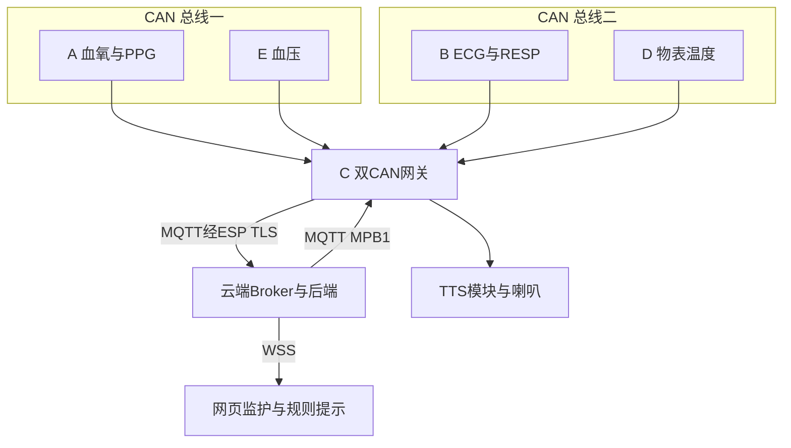

# 多参数监护系统样机

五块 STM32F407 开发板完成多源采集、双 CANopen 汇聚、MQTT/TLS 上云、网页监护和板载语音提示。当前统一入口为 `main`；完整历史与失败记录保留在 Git 和归档标签中。

## 结项入口

- [问题复盘、已修复问题与答辩/面试技术难点](docs/closeout/01-ISSUES-AND-ENGINEERING-REVIEW.md)
- [技术栈、五板结构与数据流程图](docs/closeout/02-ARCHITECTURE-AND-STACK.md)
- [清理前 41 个分支的提交与恢复标签](docs/closeout/BRANCH-INVENTORY.json)
- [本轮离线验证记录](docs/closeout/VALIDATION.json)

结项审查日期：**2026-11-12（America/Chicago）**。本次仓库合并与源码修正不等于重新烧录设备或重新部署服务器；现场基线和本轮修改的区别见两份报告。

## 当前五板分工

| 板卡 | 职责 | 数据与接口 |
| --- | --- | --- |
| A | 血氧、脉率、PPG | 血氧模块串口 → CANopen |
| B | ECG/HR、RESP/RR | ADS1292 采集、BIO_V2 算法 → CANopen |
| D | 物表温度 | GY641 红外温度 → CANopen |
| E | 无创血压 | NIBP 模块；由现场人员操作测量 → CANopen |
| C | 网关与喇叭 | 双 CAN 汇聚 → ESP8266 → 云端；接收 MPB1 播报并驱动 TTS |



## 正式实现与适用边界

固件采用 **C、裸机协作循环、CANopenNode、coreMQTT v2.3.1 / MQTT 3.1.1**。ESP8266 使用 115200 波特率 TLS 透传；正式 C 的时钟为 HSE 8 MHz、无 PLL。云端为 **Mosquitto、Python/FastAPI、云侧 Paho MQTT、Nginx/systemd**；网页为 **TypeScript、Vite、Canvas**，当前三个顶层页面为总览、趋势和问答。

当前 WP-AZ 镜像启用 TTS 下行，**未启用 FreeRTOS 和麦克风上行**。网页读数问答与自动播报采用确定性规则；早期 INMP441 → ASR → 模型 → TTS 台架成果单独保留，不能等同于五板正式功能。

样机传输与播报已有现场通过记录，但 SpO₂ 数值合理性仍未通过；GY641 输出为未经体温标定的物表温度；真人 ECG HR、同窗 HR/RR、2 h/24 h 长测及 CAN 物理裕量仍有未完成项。断网保留为有限 RAM 内的标量回放，波形尽力、掉电不保留。完整证据与状态见结项报告。

## 开发与验证

先读 [AGENTS.md](AGENTS.md)。普通本地主机测试不操作硬件，不访问正式端点。CI 使用 Python 3.12、Node.js 22；固件历史位级复现使用 Arm GNU 14.2.1，主机测试不等于 ARM 镜像或实板验收。

```bash
python -m pip install -r cloud/backend/requirements-dev.txt -c cloud/backend/requirements.lock
python -m pytest cloud/backend/tests -q
MPM_NODE_PROFILE=five python -m pytest cloud/backend/tests/test_five_node.py cloud/backend/tests/test_broadcast.py -q
python gateway/microphone/test_unified.py
cd cloud/web
npm ci --no-audit --no-fund
npm test
npm run build
```

正式问答服务的源码现支持显式 `P6_GATEWAY_IDS=GW-C-001`；默认仍为隔离网关 `GW-B5-001`。本轮仅完成代码与离线回归，正式配置、部署与线上验收应按架构文档另行执行。凭据、私有网络配置及真人原始记录不进入仓库。

## 目录导航

| 目录 | 内容 |
| --- | --- |
| `gateway/dual_can/`、`gateway/microphone/` | C 的实际构建入口、统一循环、透传、保留环与 TTS；目录名包含历史音频代码，不表示正式启用麦克风 |
| `gateway/canopen/`、`gateway/mqtt/`、`gateway/third_party/` | CANopen、MQTT、协议适配与固定第三方源 |
| `node-a/`、`node-b/`、`node-d/`、`node-e/` | 采集节点源码、单模块拆分构建和板级工具 |
| `cloud/backend/`、`cloud/web/`、`cloud/ai/` | 云端监护、V2 网页、问答与历史语音实现 |
| `node-b/docs/PI-REVIEW/` | Codex 执行回执与 Claude R1–R65 复核原件 |
| `docs/closeout/` | 本轮统一审查、架构与仓库治理记录 |
| `doc/`、其他 `*/docs/` 和 `*/evidence/` | 阶段合同、原始失败与历史验收，不按“旧”直接删除 |

旧文档中的阶段计划和已删除分支名称只用于追溯。恢复历史版本请按 `BRANCH-INVENTORY.json` 中的 `archive_tag` 或固定提交创建新分支；不要用旧镜像覆盖当前现场基线。
