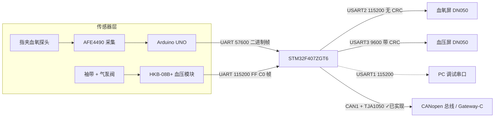
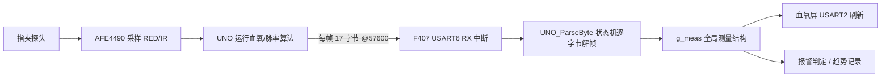
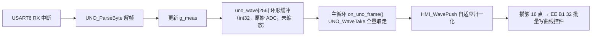
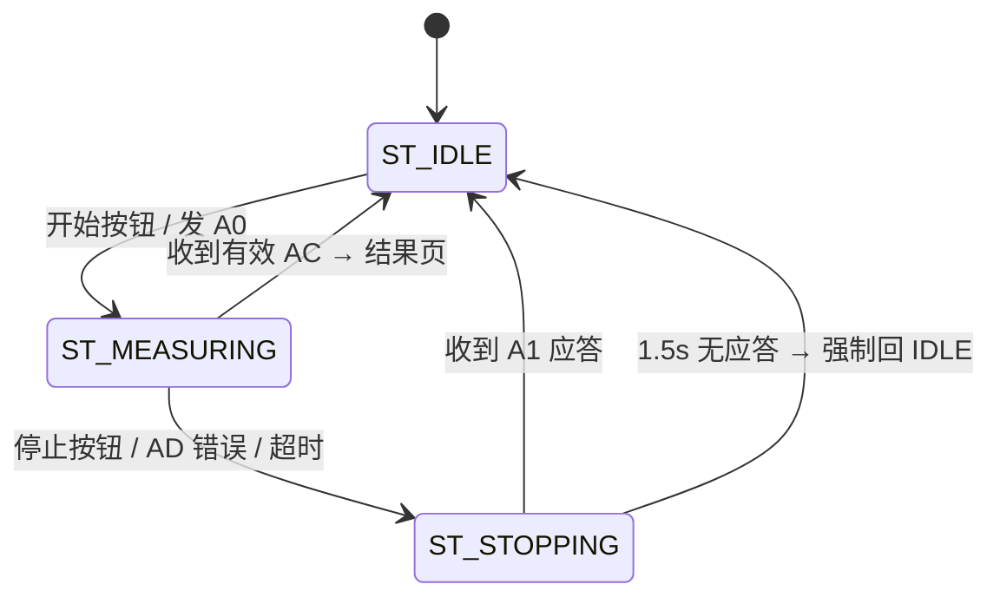

# NodeA 项目书（血压 + 血氧 · 实施版）

**项目名称**：多参数生理监护系统 Node-A —— 血氧（SpO2/PR）+ 无创血压（NIBP）
**文档版本**：v1.0（实施版）
**编制日期**：2026-10-12
**对应工程**：`F:\多参数心电监护仪系统-样机开发\代码资料\STM32F407_HOSPITAL`
**适用阶段**：样机开发 / 双屏双传感器并行联调 / Node-A 验收

> **本版与 v0.3 规划版的区别**：v0.3 是"待确认/候选方案"的规划稿（已归档为同目录 `NodeA项目书_v0.3_规划版.md`）；本版是**按已落地代码写实的实施版**——串口分配、屏驱动、CRC 开关、页面与控件 ID、状态机、已修复缺陷全部对齐当前工程实际，可直接作为交接与验收基线。v0.3 中"AFE4490 由 F407 经 SPI2 直连"的路线在本工程中**未采用**，当前血氧数据经 Arduino UNO 中转（详见 §4）。

---

## 1. 项目概述

### 1.1 项目目标

NodeA 使用一块 **STM32F407ZGT6** 开发板（标准外设库 SPL + Keil MDK V5.14 / ARM Compiler 5），同时完成两路独立监护：

| 通道 | 传感器 | 供电/接口 | 本地显示 |
|---|---|---|---|
| **血氧** | 指夹式血氧探头 + **AFE4490**（经 Arduino UNO 采集） | UNO → F407，UART @57600 | 一块大彩 DN 串口屏（USART2） |
| **血压** | **HKB-08B+** 无创血压模块 | TTL UART @115200 | 另一块大彩 DN 串口屏（USART3） |

核心能力：

- 血氧与血压**同时测量、两块屏幕同时刷新**，互不阻塞；
- 血氧输出 SpO2、脉率 PR、探头状态、有效位；PPG 波形实时上屏并支持趋势记录；
- 血压输出袖带实时压力、SYS/DIA/血压 PR、错误码，支持测量结果历史（100 条环形缓冲）；
- 软 RTC 时钟每秒同步到两块屏，支持时间设置页；
- CANopen（CAN1 + TJA1050）向 Gateway-C 上报**已实现**（单实例 CANopenNode v4 栈 + 私有 OD 0x2100/2110/2120/2130（0x2111 预留）+ 5 路 TPDO，含 PPG 波形 125Hz（走 TPDO1 0x181），编译 0E/0W；协议见 `其他资料/CANopen_协议扩展_NodeA.md`），仅余 Gateway-C 硬件联调；预留 ESP8266 冷备 UART（一期不强制）。

### 1.2 系统框图



关键分工：**F407 不解析 AFE 寄存器，也不运行血氧算法**——它接收 UNO 已经算好的 `spo2/hr` 与原始 RED/IR，负责显示、趋势、报警判定与 CAN 上报（已上线）。这一划分降低了 F407 的实时压力，代价是多了一个 MCU 中转环节。

---

## 2. 需求与验收目标

### 2.1 功能需求

| 编号 | 需求 | 证据 |
|---|---|---|
| F-01 | 上电初始化时钟（168 MHz）、GPIO、5 路 UART、两块屏、两路传感器 | 启动日志、心跳计数 |
| F-02 | 血氧：解析 UNO 17 字节二进制帧，得到 RED/IR/spo2/hr | `frames` 计数持续增长、数值随探头变化 |
| F-03 | 血氧：实时刷数值、状态、PPG 波形、监护时长；支持暂停/继续 | 屏显示与日志一致 |
| F-04 | 血压：唤醒/开始/停止/压力帧/完成帧/错误帧全流程 | 原始帧与解析结果逐条对应 |
| F-05 | 血压：输出压力、SYS、DIA、PR、分级提示与错误码 | 结果页/历史页记录 |
| F-06 | 双屏独立：任一块屏断开/重启不影响另一路，也不影响采样 | 断屏测试、双路抓包 |
| F-07 | 时钟：软 RTC 每秒同步到全部页面，切页/测量时不受影响 | 目视无跳变、各页时间一致 |
| F-08 | 血压结果历史 ≥100 条，结果页"历史"按钮显示最新一条 | 历史页翻页、结果页回填 |
| F-09 | 异常可诊断：坏帧、队列溢出、超时均有计数/状态 | 调试口计数、故障注入 |

### 2.2 非目标

- 不为两条业务线各建一个 CANopen 节点（NodeA 只有一个节点实例）；
- 不在血压屏测量中掉线时"继续等"——按保守策略请求停止；
- 不用屏幕内 Lua 脚本参与动态内容显示（见 §6.6，血氧屏 `main.lua` 已置空）；
- 不做无人值守自动循环测压。

---

## 3. 硬件设计

### 3.1 开发板基线

- **MCU**：STM32F407ZGT6，HSE 8 MHz → PLL → HCLK 168 MHz / APB1 42 MHz / APB2 84 MHz；
- **开发板**：郑州精畅"神舟号"STM32F4 系列（原理图 `F:\嵌入式\课件资料\1_开发资料\STM32F407_原理图.pdf`），板载 CH340、SP3232（双通道 RS232）、TJA1050（CAN1）、W25Q128、LAN8720A、TFT/CAN/摄像头/音频等多种复用排针；
- **开发环境**：Keil MDK **V5.14**，器件包 STM32F4xx_DFP 1.0.8（无 HAL，标准外设库）+ CMSIS 4.2.0；编译器为 **Arm Compiler 5.05（armcc）**。

> ⚠️ 板载外设复用严重：使用某组引脚前必须确认对应板载器件已断开或未初始化。本工程实际用到的 PA2/PA3（USART2）在板上经 P3 走 SP3232 通道 1，PB10/PB11（USART3）经 P5 走 SP3232 通道 2——**两路均走板载 RS232 收发器**，屏侧须是 RS232 或经原配线束转 TTL。

### 3.2 UART 资源分配（本工程权威表）

| 外设 | 引脚 | 用途 | 波特率 | 驱动 | 物理出口 |
|---|---|---|---|---|---|
| USART1 | PA9 / PA10 | 调试口 | 115200 | `debug.c` | 经板载 CH340（或 USB-TTL）到 PC 串口助手 |
| **USART2** | **PA2 / PA3** | **血氧屏** | **115200** | `dc_hmi.c` | **P3 → SP3232 通道 1 → COM_M** |
| **USART3** | **PB10 / PB11** | **血压屏** | **9600** | `hmi_dacai.c` | **P5 → SP3232 通道 2 → COM_G** |
| **UART5** | **PC12 / PD2** | **血压传感器 HKB-08B+** | **115200** | `bp_sensor.c` | P8 扩展口（TTL 直连） |
| USART6 | PC6 / PC7 | 血氧传感器（UNO） | 57600 | `uno.c` | PC7 = RX ← UNO TX(D1)；PC6 = TX 暂不用 |

**改造要点**：血压传感器原先挂在 USART3。本次把传感器移到 **UART5(PC12/PD2)**，**把 USART3 让给第二块血压屏**——这是"双屏并行"能成立的前提。

> 选 UART5 而非 UART4 的原因：UART4 的 PA0 与板上 `WK_UP` 冲突；UART5 的 PC12/PD2 在 P8 扩展口，且本工程不启用 SDIO（PC12 是 SDIO 复用脚），无争用。
> USART6 已被血氧传感器占用，因此不再作为屏口回退候选。

### 3.3 接线明细

**血压屏（第二块屏）**

```text
屏 J4-1/2  VCC  ← 独立 5V 支路（与血氧屏分开走线，共地）
屏 J4-3    NC   悬空
屏 J4-4    DOUT → 板载 SP3232 通道2 输出 → PB11 (USART3_RX)
屏 J4-5/6  DIN  ← 板载 SP3232 通道2 输入 ← PB10 (USART3_TX)
屏 J4-7/8  GND  ← 电源参考地
```

板载 P5 排针已把它接到 SP3232 通道 2，屏端为 RS232 电平，**不需要额外收发器**；若原配线束为 TTL 直连版本，须核对是否短接 J5 后接 TTL 侧。

**血压传感器**

```text
独立 5V 支路 → HKB VCC（泵阀电流较大，禁止从 3.3V/GPIO/USB-TTL 取电）
电源参考地   → HKB GND、F407 GND、两块屏 GND
PC12 (UART5_TX) → HKB RX
PD2  (UART5_RX) ← HKB TX
```

**血氧传感器**

```text
UNO TX (D1) → PC7 (USART6_RX)      /* 5V 电平，PC7 为 FT 脚可直连 */
UNO GND     → F407 GND
UNO 由 USB 独立供电（AFE4490 盾板功耗较大，勿从 F407 取电）
```

### 3.4 电源与共地

- 血氧屏 + 血压屏最亮带喇叭典型功耗合计约 4.2 W；按 5 V 折算约 0.84 A，再加 HKB 泵阀 0.35~0.50 A，合计约 1.2~1.35 A，**未含启动峰值**；
- 泵启停瞬间电流冲击最大，必须**按实测峰值加裕量**选电源和线径；
- 三块地（两屏、HKB、F407/UNO）在**电源参考点单点汇合**，避免泵电流经过信号地回路造成串口误码；
- 探头/AFE 走线与泵线束分开固定走线，避免充气抖动引入 PPG 干扰。

---

## 4. 血氧模块设计

### 4.1 数据链路现状



**为什么用 UNO 中转**：AFE4490 官方示例库（`AFE4490_library`）为 Arduino 平台编写，直接移植到 F407 需要重写 SPI 驱动、寄存器配置、DRDY 时序与算法时基（v0.3 已详述这些风险）。样机阶段先用 UNO 跑通"传感器 → 数值"链路，把不确定性隔离在 UNO 侧，F407 只做确定性很强的显示与业务逻辑。

> **路线定案**：本工程确定采用 **UNO 中转**，**SPI2 直连 AFE4490 路线明确不采用**（已归档于 v0.3 规划版）。`measurement_t` 接口刻意与数据来源解耦——若未来要去掉 UNO，只替换 `uno.c` 的数据来源，业务层代码基本不动。

### 4.2 UNO 二进制帧格式

源：`AFE4490_library` 的 Example-1 帧，兼容 `afe_bridge.py`。

| 偏移 | 字节 | 含义 |
|---|---|---|
| [0] | `0x0A` | 同步字 1 |
| [1] | `0xFA` | 同步字 2 |
| [2] | `0x0A` | 数据长度低（DATA_LEN = 10） |
| [3] | `0x00` | 数据长度高 |
| [4] | `0x02` | 类型 = DATA |
| [5..8] | IR_data | `int32` 小端（LED1VAL） |
| [9..12] | RED_data | `int32` 小端（LED2VAL） |
| [13] | spo2 | `uint8`，0~100；0 = 未算出/探头错误 |
| [14] | hr | `uint8`，bpm；0 = 无效 |
| [15] | `0x00` | 保留 |
| [16] | `0x0B` | 帧尾 |

**共 17 字节。**

解析器（`uno.c`）为 8 态状态机 `S0_SYNC1 → S7_FOOT2`：先匹配 5 字节固定头 `0A FA 0A 00 02`，再收 10 字节负载，最后用 `00 0B` **二次校验**帧尾。即使 IR/RED 数据体内出现 `0x0A/0xFA` 也不会误同步。每字节先计入 `g_uno_rx_bytes` 并写入 32 字节诊断环，**再做状态机判定**——这样即使波特率配错、同步不上，调试口也能看到"字节确实在进"以及进的是什么。

### 4.3 测量数据结构

```c
typedef struct {
    int32_t  red_raw;        /* RED 通道原始 ADC（AFE4490 LED2VAL） */
    int32_t  ir_raw;         /* IR  通道原始 ADC（AFE4490 LED1VAL） */
    int16_t  spo2;           /* 血氧 0~100；0 表示无效/探头错误 */
    int16_t  pulse_rate;     /* 脉率 PR，bpm */
    uint8_t  signal_quality; /* 灌注质量 0~100（F407 峰检 SQI，连续值，非占位） */
    uint8_t  probe_state;    /* 0 未接入/错误，1 接入 */
    uint8_t  result_valid;   /* 1 = 数值有效 */
    uint8_t  fault_code;
    uint32_t monitor_sec;    /* 监护时长（秒），由 main 累加 */
    uint32_t result_time_ms; /* 最近一次有效结果时间戳（F407 主循环维护，时效判定用） */
    uint32_t age_ms;         /* 当前值年龄 = now - result_time_ms */
} measurement_t;
```

有效性推导（`UNO_ParseByte` 内）：`spo2 == 0` → `result_valid = 0`、`probe_state = 0`、`quality = 0`；否则均为有效（`quality = 100`，再由 F407 峰检写入连续 0~100 SQI）。**`signal_quality` 现已由 F407 峰检推导提供连续 0~100 值（可用）**，非单纯二值占位——屏上"灌注质量 0/100"代表真实峰检质量而非仅"有值/无值"。

### 4.4 血氧算法说明与误差边界

算法运行在 **UNO 侧**（AFE4490 官方库的 HR/SpO2 例程）。主循环 `delay(8)` 帧率 ≈125Hz；SpO2 库内部每 `dec==5` 次采样取一点填缓冲（输入率回到 ~25Hz 设计值），血氧值约每 2s 刷新一次（方案A，2026-10-14 实施；激进方案B 可到 ~1s，见 §11）。因此：

- SpO2 数值稳定后可用；快速变化场景（运动、末梢循环差）误差偏大；
- 报告中的数值**仅作工程验证**，不作为临床结论；
- `hr` 与冻结的 `spo2` 更新不同步——**算法算完才更新，其余时间保持上次值**，因此短时间内的 `spo2/hr` 是"上一拍结果"；屏上**已做时效标注**：`measurement_t` 增 `result_time_ms`/`age_ms`，`SPO2_STALE_MS=4000` 判定陈旧，陈旧后数值转 `--`、状态显"数据陈旧"、释放报警、趋势停记。

### 4.5 血氧状态与显示规则

血氧屏（`SPO2_Hospital`）页面与关键控件（`hmi_ids.h`，来源 VisualTFT 导出的 `DefineID.h`）：

| 页面 | ID | 功能 |
|---|---|---|
| 主界面 | 0 (`SCR_MAIN`) | SpO2、PR、质量、PPG、探头/状态、监护时长 |
| 趋势 | 1 (`SCR_TREND`) | 1/5/30 分钟时段曲线 |
| 报警记录 | 2 (`SCR_ALARM`) | 4 行报警历史 + 条数 + 空态 |
| 设置 | 3 (`SCR_SETUP`) | SpO2 下限、PR 上限、声音开关、背光 |
| 暂停监护 | 4 (`SCR_PAUSE`) | 暂停确认弹窗 |
| 报警与探头状态 | 5 (`SCR_PROBE`) | 质量条、探头状态、建议 |
| 清空报警记录 | 6 (`SCR_CLEAR`) | 清空确认 |

主界面关键控件：

| ID | 控件 | 写入方 |
|---|---|---|
| 10 | SpO2 数值 | MCU |
| 11 | PR 脉率 | MCU |
| 12 | "测量有效"/"已暂停" | MCU |
| 13 / 15 | 报警限值文案 | MCU（随设置页联动） |
| 14 / 16 | "正常"/"血氧偏低"/"脉率偏快" | MCU |
| 17 | 灌注质量 0~100 | MCU |
| 19 | PPG 曲线（742px / 300 点 / 1 字节每点） | MCU |
| 20 | "脉搏波采集中"/"暂停中" | MCU |
| 21 | "监护时间 HH:MM:SS" | MCU，每秒刷新，暂停冻结 |
| 91 | "探头已接入/未接入" | MCU |
| 92 | RTC 时钟（`type="rtc"`） | **用 `EE 81` 指令设 RTC，写文本无效** |

趋势页曲线控件（`TRD_GRAPH_SPO2`=12 / `TRD_GRAPH_PR`=14）为 `historygraph`，**`sample_data_foramt=2`（UINT16，每点 2 字节）**，与 `HMI_HistorySampleU16()` 对齐；`sample_cycle = 2 s`，三个时段按钮为 1 分钟 / 5 分钟 / 30 分钟（30 / 150 / 900 点，均在 1024 点缓存内）。

### 4.6 PPG 波形显示（2026-10-12 重做）

血氧波形是本项目改动最集中的一块，两个问题都是**架构性**的，不是参数没调好。

#### 4.6.1 采样通路：中断入环 + 主循环全量取走



**为什么必须进环**：`main()` 是单线程事件循环，血压屏走 9600 且发送是"死等 TXE"的阻塞轮询。
旧代码用 `g_new_frame` 这**一个布尔标志**表示"有新帧"，主循环每轮只推 1 个波形点：
主循环一旦被别的任务占住（原先每秒有约 350 ms 的时钟广播，见 §6.4），这段期间到达的
多个 UNO 帧就被**合并成 1 个点**——波形先停住、然后猛跳一格，且横向采样比例随负载浮动，
脉冲间距忽宽忽窄。改为中断里逐点入环、主循环全量取走后，主循环偶有停顿也**一个点都不丢**。

- 环容量 256 点（2 的幂，1 KB RAM）；单生产者（中断）单消费者（主循环），两个指针各只有一个写者，16 位读写原子，**无需关中断**；
- 环满时丢弃并计入 `g_uno_wave_drop`（正常应恒为 0，可作诊断）；
- 暂停监护时 `UNO_WaveClear()` 丢弃积压，避免恢复瞬间把暂停期间攒的点一次冲出。

#### 4.6.2 纵向映射：自适应归一化（取代固定增益）

**旧实现（不直观的根因）**：固定增益 ×1.5625（`WAVE_FIXED_GAIN=400`）+ 基线 40 + 硬削幅，
且入环前先做 `ir_raw >> 8`。问题在于 AFE4490 的 IR 交流幅度同时受 LED 电流、TIA 增益、
指夹贴合度、末梢灌注影响，实测可差数十倍。固定增益必然二选一：

| 情形 | 现象 |
|---|---|
| 弱灌注（交流只有几个计数） | 乘完几乎不动 → 看起来"**一条平线 / 没波形**" |
| 强灌注（交流上千计数） | 乘完越过 0/255 被硬削幅 → 看起来"**方波、没有脉搏形状**" |

另外 `>>8` 让弱信号只剩个位数计数，量化台阶明显，波形呈**锯齿楼梯状**。

**新实现**：

1. **去掉 `>>8`**，环里存原始 ADC 全精度（弱信号不再被量化成楼梯）；
2. 慢 EMA 跟踪基线，只去掉大直流与缓慢漂移；
3. 对交流分量做**快起慢落**的上下包络：上升沿立即跟随（不漏收缩期峰值），回落按 `WAVE_ENV_SHIFT` 缓慢衰减（量程不会因某个极端值滑出而突然塌陷）；
4. 把 `[lo, hi]` 线性映射到 `[WAVE_BASE, WAVE_TOP]` = `[24, 248]` —— **每个脉搏都撑满量程**；
5. **增益封顶**：跨度相对 DC 太小时（弱灌注/无脉搏/只剩噪声）不无限放大，避免"一条乱抖的线"；
6. `valid = 0`（探头未接入/算法未出值）时推**平线贴底**并复位包络，探头取下就是一条干净的基线，而不是放大噪声。

自适应归一化后，灌注强弱只体现在包络的疏密上，"看不看得见"不再取决于灌注——这是与旧方案的本质区别。

#### 4.6.3 可调旋钮

| 宏 | 默认 | 作用 | 调法 |
|---|---|---|---|
| `WAVE_BASE` / `WAVE_TOP` | 24 / 248 | 基线与峰值在 0~255 的位置 | 屏上波形"从顶部向下跳"（控件 0/255 方向与假设相反）→ 改成 232 / 8 整条翻转；想抬高基线只调 `WAVE_BASE` |
| `WAVE_DC_SHIFT` | 5 | 基线 EMA 速度（125 Hz 下 ≈0.6 Hz 高通截止） | 越小抑制呼吸漂移越强，但太小会削掉脉搏本身（相位失真） |
| `WAVE_ENV_SHIFT` | 8 | 包络回落速度（≈2 s） | 越大越稳、越不易"呼吸"，但大幅扰动后恢复满幅也更慢 |
| `WAVE_MIN_SPAN_DIV` | 400 | 增益封顶阈值（跨度下限 = DC/400） | 波形抖成一团噪声 → 调大；弱灌注时波形偏小不显眼 → 调小 |
| `HMI_WAVE_CHUNK` | 16 | 一帧批量发多少点 | 调大省帧数，调小更实时 |

> 曲线控件本身（`MAIN_GRAPH_PPG`=19）配置为：宽 742 px、`sample_count=300`、值域 0~255、
> 单通道每点 1 字节。300 点对应多长时间取决于 UNO 的实际帧率，若发现脉冲在横向过密/过疏，
> 应调 **UNO 侧帧率**或控件 `sample_count`，而不是改归一化参数。

---

## 5. 血压模块设计

### 5.1 帧格式与校验

```text
FF C0 | LEN | CKSUM | CMD | DATA...
```

- `LEN` = 3 + N(DATA)，即包含 LEN 自身、CKSUM、CMD、DATA 的总字节数；整帧长度 = `LEN + 2`；
- `CKSUM = (LEN + CMD + ΣDATA) & 0xFF`，**含 LEN**，不含帧头与校验字节本身；
- 多字节数值**高字节在前**；
- 特例：复位指令 `FF 00`（无帧头，仅两字节，无应答）。

接收器（`bp_sensor.c`）必须能处理拆包、粘包、垃圾前缀、环形回卷、坏帧重同步、LEN 上限和半帧超时；**只有完整有效帧才刷新通信看门状态**。

### 5.2 命令与上行帧

| 动作 | 下行帧 | 期望应答 |
|---|---|---|
| 复位 | `FF 00` | 无应答（之后用唤醒确认通信） |
| 唤醒 | `FF C0 03 AD AA` | `AA` 应答帧 |
| 开始 | `FF C0 03 A3 A0` | 后续 `A0` 压力帧（**不把开始命令当结果**） |
| 停止 | `FF C0 03 A4 A1` | `A1` 应答（**不等同气路已释放**） |
| 休眠 | `FF C0 03 AB A8` | `A8` 应答 |

| CMD | 语义 | DATA |
|---|---|---|
| `A0` | 实时压力 + 脉搏标志（约 10 Hz） | `QYH, QYL` |
| `AC` | 测量完成：SYS / DIA / 血压 PR | `SSYH, SSYL, SZYH, SZYL, XL` |
| `AD` | 模块错误 | `X` = 错误码 |
| `AA`/`A1`/`A8` | 控制应答 | 无 |

字段解析（**注意剥离标志位**）：

```c
pulse_detected  = (QYH  & 0x10u) != 0u;          /* QYH.bit4 = 心跳标志 */
pressure_mmHg   = ((uint16_t)(QYH & 0xEFu) << 8) | QYL;
irregular_pulse = (SSYH & 0x80u) != 0u;          /* SSYH.bit7 = 心律不齐 */
sys_mmHg        = ((uint16_t)(SSYH & 0x7Fu) << 8) | SSYL;
dia_mmHg        = ((uint16_t)SZYH << 8) | SZYL;
nibp_pr_bpm     = XL;
```

> ⚠️ **`QYH.bit4` 必须先剥离再组合压力**。否则带心跳标志的 120 mmHg 会被算成 4000 多，写屏越界 → 屏渲染成 `？？`（本工程已实测踩过这个坑，见 §8.1）。
> `AC` 普通完成帧**没有 MAP 字段**，不自行估算并标作模块实测值。

### 5.3 校验回归向量（单元测试输入）

| 场景 | 测试帧 | 期望 |
|---|---|---|
| A0 压力 120 | `FF C0 05 1D A0 00 78` | `pressure=120`，无脉搏标志 |
| A0 压力 120 + 脉搏 | `FF C0 05 2D A0 10 78` | `pressure=120`，`pulse_detected=1` |
| AC 120/80/PR72 | `FF C0 08 C4 AC 00 78 00 50 48` | SYS=120，DIA=80，PR=72 |
| AC 心律不齐 | `FF C0 08 44 AC 80 78 00 50 48` | SYS=120，`irregular=1` |
| AD 错误 0（无脉搏） | `FF C0 04 B1 AD 00` | 结果无效，保留错误码 0 |
| AD 超压 3 | `FF C0 04 B4 AD 03` | 立即进入停止/锁定路径 |

测试时须**逐字节喂入、随机拆分、插入垃圾前缀并跨环形边界**，禁止只用完整数组测试。

### 5.4 错误码

| X | 含义 | 处置 |
|---|---|---|
| 0 | 无有效脉搏 | 本次结果无效，停止并提示检查 |
| 1 | 11 s 内未到 50 mmHg | 检查袖带、软管和漏气 |
| 2 | 测量值有误 | 停止，本次结果无效 |
| 3 | 超过 295 mmHg，超压保护 | 立即故障停止并锁定检查 |
| 4 | 干预过多 | 提示重新测量，停止后人工开始 |
| 其他 | 未定义 | 显示未知错误并保留原码 |

**X = 0 是真实错误，不能当作"无错误"。**

### 5.5 血压状态机



- 开始测量：发一次 `A0`，复位气压写屏节流计数，状态 → `ST_MEASURING`，测量计时归零；
- 测量中：处理 `A0` 压力帧（刷新压力/用时）、`AC` 完成帧（进结果页、写历史）、`AD` 错误帧（进提示页）；
- 停止：发 `A1`，状态 → `ST_STOPPING`；收到 `A1` 应答回 `ST_IDLE`；**若 1.5 s 内无应答，`app_loop` 强制回 `ST_IDLE`**（避免卡死在 stopping 页）；
- **每次成功/失败/取消都写入历史环形缓冲**（`HIST_CAP = 100`），失败记录 `valid = 0`。

> 实机安全提醒：`A1` 只证明模块**收到**停止命令，不代表气路已泄压。样机阶段必须保留人工泄压与独立断泵路径；断电、复位或 UART 断线都不等于已泄压。

### 5.6 气压写屏节流（关键设计）

血压屏走 **9600 8N1 ≈ 960 字节/秒**，而屏发送是**轮询阻塞**（`uart_send_byte` 等 TXE）。三条负载叠加会击穿串口：

| 负载 | 帧率 | 约占用 |
|---|---|---|
| 时钟广播（每秒写全部 0~9 页） | 10 帧/s | ≈ 320 B/s（33%） |
| 实时气压（`A0` 帧到达即写屏） | 10~50 帧/s | 每帧 ≈ 15 B → 150~750 B/s |
| 合计（未节流时） | — | **470~1070 B/s → 超物理上限** |

后果：屏 RX 溢出/时钟帧被丢弃 → **测量时屏幕时间"卡住几秒后猛地跳一下"**。

**修复**：`on_bp_frame()` 的 `BP_CMD_START` 分支加**纯时间闸门**——距上次写屏 ≥ 150 ms 才刷新一次（≈6.7 Hz）：

```c
static uint32_t s_press_send_tick = 0;

if (p.pressure > 600u) break;              /* 越界值丢弃，沿用上次显示 */
{
    uint32_t now = g_tick;
    if (now - s_press_send_tick >= 150u)   /* ★ 纯时间闸门，与压力变化率无关 */
    {
        char sp[12];
        uint8_t k = u32_dec(p.pressure, sp);
        sp[k] = '\0';
        if (s_state == ST_MEASURING)
            hmi_write_text(HMI_SCREEN_MEASURING, HMI_CTRL_MEAS_PRESSURE, sp);
        else if (s_state == ST_STOPPING)
            hmi_write_text(HMI_SCREEN_STOPPING, HMI_CTRL_STOP_PRESSURE, sp);
        s_press_send_tick = now;
    }
}
```

节流后负载恒定 ≈ 420 B/s（44%），**与传感器帧率、压力变化率无关**，时钟帧每 1 s 准时到达。

> **踩坑记录**：第一版用的是"时间闸门(≥150 ms) **或** 变化闸门(压力变化 ≥3 mmHg 立即刷新)"。结果**开始充气/停止泄气**时相邻帧压力差常 ≥3 mmHg（快速充放气时气压本来就急变），变化闸门几乎每帧放行 → 等效退回高频写屏 → 用户实测"点开始/停止还是跳"。**故最终删除变化闸门，只保留纯时间闸门。**
> 参数可调：链路质量差可放宽到 200 ms，需要更跟手的压力显示可收紧到 100 ms（均不改变时钟广播）。

---

## 6. 串口屏设计与协议

### 6.1 大彩帧格式

```text
0xEE | body... | [CRC16/MODBUS 高字节在前] | FF FC FF FF
```

常用指令：

| 功能 | 帧（无 CRC 版） |
|---|---|
| 握手 | `EE 04 FF FC FF FF` |
| 查询当前页 | `EE B1 01 FF FC FF FF` |
| 切换页面到 P02 | `EE B1 00 00 02 FF FC FF FF` |
| 向 P02 控件 111（`0x006F`）写 ASCII "120" | `EE B1 10 00 02 00 6F 31 32 30 FF FC FF FF` |
| 按钮事件（屏 → MCU） | `EE B1 11 SH SL CH CL 10 Subtype Status FF FC FF FF` |

- `B1 00` = 切页，`B1 01` = 查页，`B1 10` = 写文本，`B1 11` = 控件通知（**两个字节**，不是两位十六进制字符）；
- 页面 ID、控件 ID 均按 **16 位大端**；
- `Subtype=01` 为开关按钮，`Status=01/00` = 按下/弹起；`Subtype=00` 为切页按钮，`Status` 为保留字节，**不能套开关过滤**。

### 6.2 CRC 两端一致性铁律（本工程头号坑）

MCU 侧 `hmi_dacai.h` 的 `HMI_USE_CRC` 与屏工程 `DeviceEnableCRC` **必须同时开或同时关**，否则：

- MCU 发 CRC、屏不认 → 屏把 2 字节 CRC 当正文塞进控件 → 显示乱码（实测时钟末尾多出 `&`）；
- MCU 不发 CRC、屏要 CRC → 屏校验失败 → **整屏不显示**。

| 屏 | 工程 | 驱动 | MCU CRC | 屏 `DeviceEnableCRC` | 波特率 |
|---|---|---|---|---|---|
| 血氧屏 | `SPO2_Hospital.tftprj` | `dc_hmi.c` | **0（不发）** | **"0"** | 115200（`DeviceBaudRate=7`） |
| 血压屏 | `BP_Hospital.tftprj` | `hmi_dacai.c` | **1（发 CRC16/MODBUS）** | **"1"** | 9600（`DeviceBaudRate=3`） |

CRC-16/MODBUS **只对 body 计算，插在帧尾 `FF FC FF FF` 之前，高字节在前**。屏回传帧的 CRC 字节由 `hmi_rx_frame` 在解析前剥离（保持后续 offset 不变）。

> 改动任何一侧后，**必须在 VisualTFT 里重新编译并下载到屏**，否则屏固件里的开关不会变。

### 6.3 血压屏页面与控件

`BP_Hospital.tftprj`（无 boot 页，页号 0~9）：

| 页 | ID | 功能 | 关键控件 |
|---|---|---|---|
| idle | 0 | 就绪 / 上次结果 | `HMI_BTN_IDLE_START`(10) 开始、`HISTORY`(11)、`SETTINGS`(12)；`IDLE_LAST_RESULT`(110) |
| measuring | 1 | 测量中 | 停止按钮(10)；状态(110)、**压力(111)**、用时(112) |
| result | 2 | 结果 | 再测(10)、**历史(11)**、换患者(12)；SYS(110)、DIA(111)、PR(112) |
| notice | 3 | 错误提示 | 重试(10)、返回(11)；错误码(110)、标题(111)、说明(112/113)、有效性(114) |
| history | 4 | 历史记录 | 上页(10)、下页(11)、返回(12)；行数据 110~133（4 行 × 6 列）+ 页码 140 |
| settings | 5 | 设置 | 时间(12)、亮度减/加(10/11)；亮度(110)、时间(111) |
| maintenance | 6 | 维护（可隐藏） | — |
| stopping | 7 | 停止中 | 停止(10)；状态(110)、压力(111)、说明(112) |
| confirm | 8 | 换测量会话确认 | — |
| time | 9 | 时间设置 | 字段 0(10)、加(15)、减(16)、取消(17)、保存(18)；年(110)~分(114)、编辑框(120/121) |

公共控件：`CLOCK`(100)、`CONTEXT`(101)、`FOOTER`(102)、`TIP_TITLE`(103)、`TIP_DETAIL`(104)。

> **控件 ID 与页面绑定判断**：ID 10 在 idle 是"开始"、在 measuring 是"停止"、在 history 是"上页"——**必须连同页面 ID 一起判断，不能只按控件 ID 分发**。

### 6.4 时钟刷新：四轮迭代，最终改为屏内 RTC 控件（2026-10-12）

软 RTC 基于 `g_tick`（= `uwTick`，SysTick 1 ms 累加）。

> **本节结论先行（最终方案 = §6.4.5 第四轮）**：血压屏时钟的 `CLOCK`(id=100) 已由**文本控件**
> 改为 **`type="rtc"` 控件**，MCU 用 `EE 81` 每秒设置一次屏内 RTC，与血氧屏 `dc_hmi` 的
> `HMI_SetRTCTime()` **同指令同字段顺序**。时钟开销 **340 B/s → 15 B/s**，各页天然一致，
> 两屏完全同源。§6.4.1~§6.4.4 是走到这一步之前的**前两轮迭代与踩过的坑**，保留作追溯。

#### 6.4.1 早期结论（已被第四轮取代）：为什么当时认为必须刷全页

1. 一开始默认只写当前可见页 → **切页后时钟跳变、各页时间不一致**；
2. 加"页面变化回调 + 按钮按下回读页面" → 按按钮时仍会跳一次（非可见页停在旧值，切过去才被纠正）；
3. **当时结论：必须刷全页**：任意页恒为当前时间，切页/按键都不跳。页面变化回调保留作双保险。

> 第 3 条是"文本控件"时代的结论——文本控件每页是独立的一份数据，才需要逐页刷。
> 换成 RTC 控件后，**所有页显示的是同一个屏内 RTC**，这条前提整个消失了（见 §6.4.5）。

#### 6.4.2 但"每秒 10 帧背靠背"会阻塞主循环

血压屏挂 **USART3 @9600**，且发送路径 `hmi_send_cb → uart_send_byte` 是**死等 TXE 的阻塞轮询**（1 字节 ≈ 1.04 ms）。单帧构成：

```text
EE B1 10 | screen(2) | ctrl(2) | len(2) | "2026-10-12 19:51:33"(19) | CRC(2) | FF FC FF FF(4)  = 34 字节
```

10 帧 = **340 字节 ≈ 350 ms 连续占用主循环**。`main()` 是单线程事件循环，这 350 ms 里血氧 PPG
一个点都推不出去（详见 §4.6.1）→ 波形停住后猛跳。

#### 6.4.3 第二轮：每 100 ms 写 1 页、10 页轮转（修好了波形，但引入了 1 秒固定滞后）

```c
#define CLOCK_PACE_MS    100u
#define CLOCK_PAGE_CNT   (HMI_SCREEN_TIME + 1u)   /* 0 ~ 9 共 10 页 */
```

| | 旧：每秒广播 10 页 | 第二轮：每 100 ms 写 1 页 |
|---|---|---|
| 单次连续阻塞 | **~350 ms** | **~35 ms** |
| 每秒对主循环的占用形态 | 一次性尖峰 | 摊成 10 次 35 ms |

波形问题解决，但引出了**血压屏时钟固定慢 1 秒**（详见 §8.10）：

- 轮转周期 `10 × 100 ms = 1000 ms` **恰好等于**软 RTC 的 1 秒节拍 → **相位锁定**；
- 且 `app_loop()` 里"写屏"排在"推进软 RTC"**之前** → 每次整秒恰好被抓到的那一页（**0 号页 / 主界面**）写进去的永远是**上一秒** ⇒ 主界面恒定慢 1 秒。

#### 6.4.4 第三轮：整秒即时刷可见页 + 非可见页慢轮转（把"可见页延迟"打到 ≈0）

```c
/* ① 整秒：先推进软 RTC，再写屏（顺序不能反！） */
if (g_tick - sec_last >= 1000) {
    sec_last = g_tick;
    clock_tick_1s();                    /* 只推进软 RTC，不发串口 */
    clock_write_to(g_hmi_cur_screen);   /* 立刻只刷"当前可见页"，延迟 ≈ 一帧 35 ms ≈ 0 */
    if (s_state == ST_MEASURING) { /* 测量计时 */ }
}

/* ② 非可见页：慢速轮转补齐（跳过可见页，安全网） */
if (g_tick - s_clock_pace_tick >= CLOCK_PACE_MS) { s_clock_pace_tick = g_tick; clock_pace_step(); }

/* ③ 屏侧切页兜底：回读当前页 */
if (g_tick - s_screen_poll_tick >= 1000u) { s_screen_poll_tick = g_tick; hmi_get_screen(); }
```

```c
#define CLOCK_PACE_MS    300u    /* 原 100u；9 页 ≈ 2.7 s 一轮 */
static void clock_pace_step(void)        /* 一次只写 1 页，且跳过 g_hmi_cur_screen */
{
    uint8_t i;
    for (i = 0; i < CLOCK_PAGE_CNT; i++) {
        uint8_t pg = s_clock_pace_pg;
        s_clock_pace_pg = (uint8_t)((s_clock_pace_pg + 1u) % CLOCK_PAGE_CNT);
        if (pg != (uint8_t)g_hmi_cur_screen) { clock_write_to(pg); return; }
    }
}
```

| | 第二轮（100 ms 轮转全页） | 第三轮 |
|---|---|---|
| **可见页延迟** | **~1 s（固定）** | **≈ 0**（一帧 35 ms） |
| 非可见页最大陈旧度 | ~1 s | ~2.7 s（看不见，切页时立即补刷） |
| 时钟流量 | 10 帧/s ≈ 340 B/s（9600 上 ~35%） | ≈ 4.3 帧/s ≈ 147 B/s（~15%） |
| 与 1 秒节拍 | 锁相（1000 ms 周期） | 不锁相（300 ms × 9 页 = 2.7 s） |

**为什么慢速轮转不会退回"切页时钟跳变"**：非可见页虽然可能陈旧到 2.7 s，但**切页瞬间**
`clock_on_screen_changed`（`hmi_set_page_changed_cb` 注册）会立即把它补刷成当前时间；
即使屏侧按钮自行跳页（MCU 收不到通知）也有 1 秒的页面回读兜底。

> 第三轮已经把"能靠 MCU 侧调度修的都修完了"：可见页延迟 ≈0、无锁相、流量降 60%。
> **但残留的 0~1 s 是机制性的** —— 血压屏的时钟本质是"MCU 逐秒写文本"，
> 而血氧屏是"屏内硬件 RTC 自己走"，两条显示链路天生不同，靠调 MCU 参数无法归零。
> 于是有了第四轮（§6.4.5）。

#### 6.4.5 第四轮（最终）：血压屏也改用**屏内 RTC 控件**，两屏彻底同源

**做法**：把血压屏 10 个页面上的 `CLOCK`(id=100) 从 `type="text_display"` 改成
**`type="rtc"`**，MCU 不再逐秒写文本，改为用 **`EE 81`** 设置屏内 RTC，屏自己走。
这与血氧屏 `dc_hmi` 的 `HMI_SetRTCTime()` **同一条指令、同一字段顺序**。

**屏工程改动**（`F:\VisualTFT\BP_Hospital\`，10 个 `.tft` 各一处）：

```xml
<!-- 改前 -->
<item name="CLOCK" id="100" type="text_display" text="时间未校准" font="5" ...
      xOffset="548" yOffset="17" width="228" height="28" text_align="2" ... />

<!-- 改后（与血氧屏 主界面.tft 的 id=92 同配置：同型号屏、同 VisualTFT 版本） -->
<item name="CLOCK" id="100" type="rtc" lang="0" zone="0" format="1"
      format_string="%y-%n-%d %h:%m:%s" press="0" font="5"
      fore_color="173;189;206" input="0"
      xOffset="624" yOffset="23" width="152" height="16" timer="60" increase="0"/>
```

几何是按原控件算出来的，视觉位置完全不变：原文本框 (548,17,228,28) 是**右对齐**
（`text_align="2"`），而 `font=5` = 工程字体表里的 `GBK-16*16`（ASCII 8 px 宽、16 px 高），
`"2026-10-12 20:29:12"` 共 19 字符 = **152 × 16**，右对齐后落在 x 624~776、垂直居中 y 23~39。
RTC 控件是左上对齐，所以直接给 `xOffset=624, yOffset=23`。

**固件改动**：

```c
/* hmi_dacai.c：新增 */
void hmi_set_rtc(uint8_t year2, uint8_t month, uint8_t day,
                 uint8_t hour, uint8_t minute, uint8_t second, uint8_t week)
{
    uint8_t body[8];
    body[0] = 0x81;                 /* 0x81 = 设置 RTC */
    body[1] = bin2bcd(second);
    body[2] = bin2bcd(minute);
    body[3] = bin2bcd(hour);
    body[4] = bin2bcd(day);
    body[5] = bin2bcd(week);
    body[6] = bin2bcd(month);
    body[7] = bin2bcd(year2);
    hmi_send_frame(body, sizeof(body));      /* 自动补 CRC16/MODBUS + FF FC FF FF */
}

/* app_bp.c：整秒分支 —— 先算时间，再写屏 */
if (g_tick - sec_last >= 1000) {
    sec_last = g_tick;
    clock_tick_1s();          /* 只推进软 RTC */
    clock_sync_rtc();         /* EE 81 -> 血压屏 RTC（10 页同时生效） */
    if (s_state == ST_MEASURING) { /* 测量计时 */ }
}
```

**删掉的东西**（第四轮不再需要）：`clock_write_to()`（写文本）、`clock_broadcast()`（全页广播）、
`clock_pace_step()` / `CLOCK_PACE_MS` / `CLOCK_PAGE_CNT` / `s_clock_pace_*`（分页轮转）、
`clock_on_screen_changed()` 及其 `hmi_set_page_changed_cb()` 注册（RTC 全页共用，切页天然一致）。
页面回读周期也还原为 3 s（`g_hmi_cur_screen` 现在只作状态记录，不再服务时钟）。

| | 第一轮 | 第二轮 | 第三轮 | **第四轮（当前）** |
|---|---|---|---|---|
| 时钟载体 | 文本 ×10 页 | 文本 ×10 页 | 文本 ×10 页 | **屏内 RTC 控件** |
| 每秒帧数 | 10 帧 340 B | 10 帧 340 B | 4.3 帧 147 B | **1 帧 15 B** |
| 9600 链路占用 | ~35%（尖峰 350 ms） | ~35% | ~15% | **~1.6%（单次 15.6 ms）** |
| 可见页延迟 | ~1 s | ~1 s | ≈ 0 | **≈ 0** |
| 各页一致性 | 靠广播 | 靠轮转 | 靠轮转+补刷 | **天然一致（同一屏内 RTC）** |
| 与血氧屏同源 | ✗ | ✗ | ✗ | **✓ 同指令同字段顺序** |

**两屏同步节奏**：`app_bloodoxygen.c` 的 `SPO2_RTC_SYNC_MS` 从 5 分钟改为 **1000 ms**，
两块屏都变成"每秒被 MCU 用同一条指令对齐一次"。`main()` 里 `task_clock()`（血氧）与
`app_loop()`（血压）在同一个主循环迭代内执行，两屏收到的是**同一个时间值、相差不到一次循环**，
跳秒时刻因此锚定在同一节拍上。血氧侧仍保留 `SPO2_RTC_OFFSET_SEC` 作为最后的 ±1 s 微调旋钮
（两屏同源后一般不再需要）。

> **注意**：`EE 81` 在血氧屏上走 `dc_hmi`（该屏 `DeviceEnableCRC="0"`，帧长 13 B）；
> 在血压屏上走 `hmi_dacai`（该屏 `DeviceEnableCRC="1"`，帧长 15 B，中间多 2 字节 CRC）。
> **指令码与字段顺序完全相同**，只是传输层封装不同——这是两个屏工程各自的 CRC 开关决定的。

#### 6.4.6 两屏时钟一致性根因之二：软 RTC 基准必须共用同一个 tick

两个子系统各有一份软 RTC，**起算点必须一致**，否则两块屏显示的时间会永久差一个常数秒：

| | 血氧侧 | 血压侧 |
|---|---|---|
| 变量 | `app_bloodoxygen.c` 的 `s_year/s_mon/s_day/s_sec_of_day` | `app_bp.c` 的 `s_year/s_month/s_day/s_sec_of_day` |
| 基准 | `s_rtc_last_tick`（`millis()`） | `s_rtc_base_tick`（`g_tick`） |
| 初始化位置 | `app_hmi_init()`，`main()` 第 43 行 | `app_init()`，`main()` 第 51 行 |
| 显示方式 | 屏内 RTC 控件（`EE 81` 设置，屏自走） | 屏内 RTC 控件（`EE 81` 设置，屏自走）<br>（第四轮前是"文本控件 100，MCU 逐秒写字符串"） |

`app_hmi_init()` 要刷几十帧屏指令（报警记录清空 / 背光 / 趋势 / 各页探头状态 / 屏 RTC），
耗时数百毫秒~秒级；`app_init()` 的基准赋值在函数体后段。**两边各记各的基准 ⇒ 血压软 RTC 的
"0 秒"比血氧侧晚 Δ ⇒ 血压屏稳定慢 Δ 秒**（实测约 1 s，与 §6.4.3 的 1 s 叠加成目视 2 s）。

**处理**：`merge_cfg.h` 里放一个两屏共用的锚点，谁先初始化谁填，后者复用：

```c
/* merge_cfg.h */
extern uint32_t g_rtc_epoch_tick;

/* app_bloodoxygen.c : app_hmi_init() */
if (g_rtc_epoch_tick == 0u) g_rtc_epoch_tick = millis();
s_rtc_last_tick = g_rtc_epoch_tick;

/* app_bp.c : app_init() */
if (g_rtc_epoch_tick == 0u) g_rtc_epoch_tick = g_tick;   /* 兜底：血氧侧没先跑 */
s_rtc_base_tick = g_rtc_epoch_tick;
```

`millis()` 与 `g_tick` 是**同一个 `uwTick`**（见 `app_bp.h` 的 `#define g_tick uwTick`），
所以复用同一个 tick 后两侧 `floor((tick-base)/1000)` 完全相同，Δ 恒为 0。

配套：血压屏"时间设置"页保存时（`time_edit_commit`）额外调 `spo2_rtc_set(...)`，
把血氧侧软 RTC 一起对齐——否则用户在血压屏改一次时间，两块屏从此各走各的（能差几小时）。

#### 6.4.7 状态文案的广播策略

`status_set(ctx, foot, tip, det)` 把 `CONTEXT`(101) / `FOOTER`(102) / `TIP_TITLE`(103) / `TIP_DETAIL`(104)
同样广播到全部页面（**跳过设置页、维护页、确认页**），目的与时钟一致——任意页被切到时状态文案已是当前值。
它只在**状态变化时**触发（不是周期性的），因此不会形成周期性阻塞；但一次状态变化仍可能连发 ~7 页 × 若干控件，
属于"偶发数十毫秒级"，由 §4.6.1 的采样环兜住。

### 6.5 血氧屏侧：Lua 脚本必须置空

`SPO2_Hospital` 工程根目录的 `main.lua` 原本**会随工程下发并执行**，与 MCU **抢着写同一批控件**，导致：

- 监护时间永远显示 `00:00:01`（`on_init` 里 `start_timer(0,1000,0,1)` 的 `repeat=1` 只触发一次）；
- 暂停后按钮文案不变（Lua 用自己的 `paused=false` 把 12/20 两个控件覆盖回"测量有效 / 脉搏波采集中"）。

**处理**：`main.lua` 已替换为空壳（原版备份为 `main.lua.原版备份.txt`），**全部动态内容改由 MCU 独占写入**。对应地 `hmi_ids.h` 已逐控件标注 `[MCU]` / `[静态]` 归属。

### 6.6 按钮类型约定（血氧屏，权威）

| `button_type` | 枚举 | 行为 |
|---|---|---|
| 0 | 切换画面 | 屏按 `switch` 属性自己跳页；**实测不可靠上报按键事件** |
| 1 | 开关描述 | 只上报事件、不跳页（`switch` 必须留空）——**要 MCU 干活的按钮都用它** |
| 2/3/4 | 自定义按键/指令/弹出菜单 | 本工程未用 |

`button_style`：0 = 瞬变（点动）、1 = 开关（切换型）。`notify_disable = 0` 才上传按键事件。

本工程 `DeviceControlNotify="3"` = **按下和弹起都上报**，所以一次点击会收到**两帧**（`state=1` 按下 / `state=0` 弹起）。**凡翻转型动作必须只在 `state==1` 时执行**，否则一次点击翻转两次 = 看起来没反应。

### 6.7 结果页"历史"按钮行为

点击结果页"历史"按钮时，除刷新历史列表外，**结果页左侧数据区同时回填历史中最新一次的 SYS/DIA/PR**：

- 新增 `hist_show_latest_to_result()`：取历史环形缓冲最新一条（索引算法与 `hist_show_page()` 第 0 行一致）；
- 若 `valid` 为真 → 写 SYS/DIA/PR 到 `HMI_SCREEN_RESULT` 的 110/111/112；
- 若**最新一条不存在、被取消或为错误记录** → 三处一律写 `"--"`。

---

## 7. 软件架构

### 7.1 分层与文件清单

```text
USER/
  main.c              双屏双传感器主循环（唯一 main）
  stm32f4xx_it.c      仅保留一个 SysTick_Handler；USART2/3、UART5、USART6 中断分发
  merge_cfg.h         双屏并行架构说明（二选一宏已取消）
HARDWARE/
  SYS/sys.c(.h)       时钟、uwTick(1ms)、millis、delay_ms
  DEBUG/debug.c(.h)   USART1 调试输出
  USART/usart.c(.h)   USART2 血氧屏 / USART6 UNO 初始化与中断
  UNO/uno.c(.h)       UNO 17 字节帧解析状态机 + g_meas
  HMI/dc_hmi.c(.h)    血氧屏驱动（不发 CRC）
  HMI/app_bloodoxygen.c(.h)  血氧业务：数值/状态/PPG/趋势/报警/软 RTC
  HMI/hmi_ids.h       血氧屏页面与控件 ID（由 VisualTFT 导出，勿手改）
  hmi_dacai.c(.h)     血压屏驱动（发 CRC16/MODBUS）
  bp_sensor.c(.h)     HKB-08B+ 组帧/解帧（纯 C，无 SDK 依赖）
  app_bp.c(.h)        血压业务：状态机/结果/历史/设置/时间/亮度
```

### 7.2 主循环调度

```c
while (1)
{
    /* ---- 血氧子系统 ---- */
    HMI_Poll();              /* 血氧屏上行按键通知 */
    on_uno_frame();          /* 把 UNO 积压的 PPG 采样全部推给屏（无新采样时立即返回） */
    task_hmi_value();        /* 数值/状态刷新：每 400 ms（含报警判定） */
    task_hmi_trend();        /* 趋势：每 2 s 追加一点 */
    task_clock();            /* 软 RTC：每秒推进并同步到屏 */
    g_meas.monitor_sec = millis() / 1000;

    /* ---- 血压子系统 ---- */
    app_loop();              /* 传感器组帧 + 软 RTC + 时钟广播 + 血压屏刷新 */
}
```

`app_loop()` 内部三步：①把血压屏字节（`s_q2`）送 `hmi_rx_feed` 组帧，按钮事件在 `hmi_rx_frame` 分发；②把传感器字节（`s_q3`）送 `bp_sensor_feed` 解帧，整帧回调 `on_bp_frame`；③每 1 s 软 RTC 刷新时钟与测量计时。

### 7.3 中断与缓冲

- **统一 SysTick**：仅 `it.c` 一处 `SysTick_Handler` 累加 `uwTick`；血压模块的 `g_tick` 用 `#define g_tick uwTick` **别名**到同一个计数器，避免双 SysTick 计数错乱；
- **接收方式**：`RX_USE_DMA_IDLE = 0` → 全部走 **RXNE 逐字节中断**。理由是双屏并行后 BP 的屏口（9600，只有按键才回几字节）和传感器口（约 10 Hz × 几字节）数据量都很小，RXNE 完全够用，且不必申请 DMA 流、不与其它外设抢流；
- **环形缓冲**：`s_q2`（血压屏，256 B）、`s_q3`（血压传感器，256 B），中断只入队，业务在主循环出队；
  **`uno_wave[256]`（PPG 采样环，`int32` 共 1 KB）**，USART6 中断逐点入环、主循环 `UNO_WaveTake` 全量取走（单生产者单消费者，无需关中断，见 §4.6.1）；
- **中断向量**：`USART2_IRQHandler` → `HMI_RxByte`（血氧屏）；`USART3_IRQHandler` → `on_uart_rx(USART3)`（血压屏）；`UART5_IRQHandler` → `on_uart_rx(UART5)`（血压传感器）；`USART6_IRQHandler` 留在 `usart.c`（UNO）。**中断里只入队，不做解析、不写屏、不切页。**

### 7.4 并发约束

1. 每路 UART 独立端口、独立环形缓冲、独立错误计数；
2. 血压屏发送与血压传感器接收互不阻塞；
3. 屏发送是**轮询阻塞**的，因此所有写屏路径都必须限频（时钟 1 Hz/页、气压 6.7 Hz、数值 2.5 Hz）；
4. 两条业务线共用一份 `uwTick`，任何一方不得私自重配 SysTick；
5. 同一次启动内用无符号 `now - timestamp` 计算短时超时，避免回卷。

---

## 8. 已修复问题记录（排错手册）

### 8.1 血压屏袖带压力/时间偶发显示 `？？`（乱码）

**现象**：测量时压力控件偶尔显示 `？？`，后来时钟也开始偶发 `？？`。
**根因（两层）**：

1. **数据层**：`on_bp_frame()` 的 `A0` 分支未校验 DATA 长度，异常/截断帧读到 `static` 缓冲残留字节 → 伪数值（可达几千）→ 写屏越界；
2. **传输层（主因）**：`clock_broadcast()` 原本每秒把时钟帧**背靠背广播到全部 10 页**，大彩屏连续收大量写文本帧时偶发丢失帧尾 `FF FC FF FF` → 黏帧 → 乱码。这解释了为什么**数值和中文两类内容都中招**。

**修复**：①`A0` 帧 `len < 2` 直接丢弃；数值超 0~600 mmHg 跳过本次刷新；`AC` 帧加 `len < 5` 校验；②引入"当前可见页"跟踪，时钟改只写可见页（后因切页跳变又改回广播全页，见 §6.4）；③**根治手段是启用 CRC**：血压屏 `DeviceEnableCRC="1"` + MCU `HMI_USE_CRC=1`，屏按 CRC 丢弃坏帧，不再黏帧渲染乱码。

### 8.2 开启 CRC 后出现新乱码（时钟末尾多 `&`）

**现象**：MCU 侧开了 CRC 后，屏出现新乱码，如时钟末尾多出一个 `&`。
**根因**：MCU 已发带 CRC 帧，但屏工程 `DeviceEnableCRC` 仍是 `"0"`，屏按无 CRC 解析，把帧尾前 2 字节 CRC **当正文塞进控件**。
**修复**：把 `BP_Hospital.tftprj` 的 `DeviceEnableCRC` 改 `1` 并同步血氧屏工程为 `0`；`HMI_USE_CRC` 宏从 `.c` 移到 `.h` 全局可见；`hmi_rx_frame` 解析前剥离屏回传帧末尾 2 字节 CRC。

### 8.3 切页后时钟跳变、各页时间不同步

见 §6.4 的三轮迭代。结论：**必须广播全页**。

### 8.4 测量（开始/停止）时时钟卡住后跳变

见 §5.5 与 §5.6。结论：**气压写屏必须用纯时间闸门**，且**不能用"压力变化量"作为放行条件**（充放气时气压本来就急变，变化闸门形同虚设）。

### 8.5 编译报错 `function "hist_show_latest_to_result" declared implicitly`

**现象**：`app_bp.c` 编译报 `#223-D: function "hist_show_latest_to_result" declared implicitly` 和 `#159: declaration is incompatible`。
**根因**：函数定义在第 840 行，调用在第 337 行，**调用点之前没有声明**（C89/C99 下隐式声明返回 `int`，与 `void` 定义冲突）。
**修复**：在前向声明区（约第 203 行）补 `static void hist_show_latest_to_result(void);`。

### 8.6 armcc 命令行编译的两个坑

- 工程本身是 **C99**，用 armcc 编译 `for (uint16_t i = ...)` 这类写法必须加 `--c99`，否则报"类型名不允许"；
- 全量编译时必须**严格按 `.uvprojx` 的文件清单**收集源文件。多编 `stm32f4xx_fmc.c`（F42x 专属）会报 `FMC_Bank1 undefined`，`stm32f4xx_misc.c` 文件名特殊易漏。

### 8.7 血氧屏监护时间恒为 `00:00:01` / 暂停按钮文案不变

见 §6.5。根因是屏工程 `main.lua` 与 MCU 抢写控件。修复：`main.lua` 置空，动态内容全部由 MCU 独占写。

### 8.8 血氧 PPG 波形"一秒卡一次"

**现象**：血氧屏上 PPG 波形约每 1 秒停住一次，然后猛地往前跳一格；数值类显示正常。
**根因（跨模块，是本项目最隐蔽的一个）**：主循环单线程 + 血压屏阻塞发送 + 波形用单布尔标志门控，三者叠加。

1. `app_loop()` 每秒调用 `clock_broadcast()`，把时钟**背靠背**写到血压屏全部 10 页 = 340 字节；
2. 血压屏 USART3 @9600，`uart_send_byte` 是**死等 TXE 的阻塞轮询** → **约 350 ms 连续占用主循环**；
3. 血氧波形旧实现用 `g_new_frame` 单标志（主循环每轮只推 1 点），这 350 ms 内到达的多个 UNO 帧被合并成 1 点。

**为什么"数值正常、只有波形卡"**：数值是每 400 ms 刷一次的独立任务，350 ms 的停顿不足以让它丢拍；波形是按采样点连续的，一丢就是一整段。

**修复（两处同时改）**：
- `app_bp.c`：`clock_broadcast()` 退出周期路径，改为 `clock_pace_step()` 每 100 ms 写 1 页（§6.4.3），单次阻塞 350 ms → 35 ms；
- `uno.c` + `app_bloodoxygen.c`：波形改走 256 点采样环（§4.6.1），中断逐点入环、主循环全量取走，主循环偶有停顿也不丢点。

> 只做一边也能改善，但会留下尾巴：只做节流 → 仍有 35 ms × 多次的采样合并；只做采样环 → 波形不再"停"，但仍会以 350 ms 为周期成串冲出。两处都改才既平滑又不丢点。

### 8.9 血氧 PPG 波形"不直观"

**现象**：波形要么几乎是一条平线，要么被削成方波，看不出脉搏形状；且呈锯齿楼梯状。
**根因**：纵向映射用了**固定增益**（`×1.5625`）+ 硬削幅，而 AFE4490 的 IR 交流幅度受 LED 电流、
TIA 增益、指夹贴合、末梢灌注影响可差数十倍；另外入环前做 `ir_raw >> 8`，弱信号只剩个位数计数，
量化台阶明显。
**修复**：改为**自适应归一化**（慢 EMA 基线 + 快起慢落包络 + 映射到 [24,248] + 增益封顶），
并去掉 `>>8` 保留全精度。详见 §4.6.2，旋钮见 §4.6.3。

### 8.10 血压屏 RTC 比血氧屏稳定慢（1~2 秒）

**现象**：同时上电后，血压屏的时间显示比血氧屏**稳定**慢一段（用户实测约 2 秒），不随时间扩大。

**关键前提**：整个系统只有**一颗 MCU**（`main.c` 里 `USART2` 挂血氧屏、`USART3` 挂血压屏），
两块屏的时间都来自同一个 `uwTick`。所以**这不是"走时不准"，而是"显示链路延迟不同"**。

**误差预算（三项叠加，各自都是固定值，所以看起来"稳定"）**：

| 项 | 来源 | 量级 |
|---|---|---|
| **A. 血压屏显示机制滞后** | 每页轮转 1000 ms 恰好与软 RTC 的 1 s 节拍**锁相**，且 `app_loop()` 里"写屏"排在"推进软 RTC"**之前** ⇒ 每次整秒被抓到的 **0 号页（主界面）** 永远写上一秒 | **固定 1 s** |
| **B. 两套软 RTC 起算点不同** | 血氧侧基准取在 `app_hmi_init()`（`main()` 第 43 行）、血压侧取在 `app_init()` 后段（第 51 行），中间要刷几十帧屏指令 ⇒ 血压软 RTC 的"0 秒"晚 Δ | **Δ（数百 ms~秒级）** |
| **C. 两屏时钟机制根本不同** | 血氧屏是**屏内硬件 RTC**（屏自己走），血压屏是**MCU 逐秒写文本**（跟着 MCU 的显示链路走）。文本路径天生比"屏内 RTC 自走"多一层调度延迟 | 0 ~ 1 s（固定） |

**修复（分四轮，最终一轮从根上换掉机制）**：

1. `app_bp.c`：整秒分支改为**先推进软 RTC、再写屏**，且**立刻只刷 `g_hmi_cur_screen`**（可见页延迟 ≈ 35 ms ≈ 0）→ 干掉 **A**；
2. `merge_cfg.h` + `app_bp.c` + `app_bloodoxygen.c`：两套软 RTC **共用 `g_rtc_epoch_tick`** → Δ 恒为 0，干掉 **B**（详见 §6.4.6）；
3. **第四轮（最终）**：血压屏 `CLOCK`(id=100) 由**文本控件改为 RTC 控件**，MCU 改用 `EE 81`（`hmi_set_rtc()`）设置屏内 RTC，
   同时把血氧侧 `SPO2_RTC_SYNC_MS` 从 5 分钟缩到 **1000 ms**（两屏每秒被同一条指令对齐一次）
   → 干掉 **C**：两屏走完全相同的显示机制、同一时刻收到同一时间值（详见 §6.4.5）；
4. 兜底旋钮：`app_bloodoxygen.c` 的 `SPO2_RTC_OFFSET_SEC`（默认 0），仅在实测定标时需要 ±1 s 微调。

**5.（第五轮·残留相位补偿）同源改造后血压屏仍稳定慢 1 秒**
第四轮把两屏改成"同一时刻发同一条 `EE 81`"，值已经完全同源（A/B 已根除），
但实测血压屏仍**稳定**比血氧屏慢 **恰好 1 秒**。根因是 **C 类相位差**：
两块屏的屏内 RTC 各有独立晶振，`EE 81` 只设置"整秒值"、**不重新对齐屏内亚秒相位**，
于是每秒重发只是把整秒值对齐到 MCU，两屏"跳秒"的触发时刻仍由各自晶振相位决定，
稳定相差最多 1 秒（本机实测恰好差 1 秒）。这是屏硬件自走机制固有特性，MCU 侧
除非做相位补偿否则无法根除。补偿办法是新增**血压屏侧**旋钮
`app_bp.c` 的 `BP_RTC_OFFSET_SEC`（默认 **+1**，抵消实测的 1 秒滞后）：

- 屏比血氧屏 / MCU **慢** n 秒 → 填 **+n**（让血压屏多走 n 秒，追上）；
- 屏比血氧屏 / MCU **快** n 秒 → 填 **−n**；
- 两屏一致 → 填 **0**。

该宏只改写写进血压屏的秒值（含跨日借/进位），**不动** MCU 内部走时、监护时长、
报警时间，与 `SPO2_RTC_OFFSET_SEC` 完全对称。注意：**不要**用血氧侧的
`SPO2_RTC_OFFSET_SEC` 去补血压屏的差值，否则会把血氧屏也带偏。

**怎么验证 / 定位剩余偏差**：`main.c` 的心跳行会打印 MCU 自己的软 RTC：

```text
tick 123 | hmi_rx=... | uno_rx=... frames=... | spo2=98 pr=72 rtc=2026-01-01 00:02:03
```

把这行与两块屏上的时间**逐秒对照**：

- 三处一致 → 修好了；
- MCU 与血氧屏一致、血压屏差 n 秒 → 调 `app_bp.c` 的 `BP_RTC_OFFSET_SEC`（见第 5 条；
  先确认屏工程已重新编译下载、`DeviceEnableCRC` 仍为 `"1"`）；
- MCU 与血压屏一致、血氧屏快/慢 n 秒 → 调 `app_bloodoxygen.c` 的 `SPO2_RTC_OFFSET_SEC`。

> **⚠️ 前置条件（第四轮特有）**：血压屏**必须**在 VisualTFT 里重新编译 + 下载新固件，
> 否则 `EE 81` 会打到一个已经被改成 RTC 的控件上……反过来说，如果只烧 MCU 固件不动屏，
> 屏上仍是旧的文本控件，而 MCU 已不再写文本 ⇒ **血压屏时钟会永远停在"时间未校准"**。
> 屏工程原文件已备份到 `F:\VisualTFT\BP_Hospital\_bak_before_rtc\`（10 个 `.tft`）。

---

## 9. 配置基线与编译验证

### 9.1 必须两端一致的配置项

| 项 | 血氧屏 | 血压屏 |
|---|---|---|
| MCU 端口 | USART2 | USART3 |
| 波特率 | 115200 ←→ `DeviceBaudRate=7` | 9600 ←→ `DeviceBaudRate=3` |
| CRC | MCU `dc_hmi` 不发；屏 `"0"` | MCU `HMI_USE_CRC=1`；屏 `"1"` |
| 页面 ID | `hmi_ids.h`（`SCR_*`） | `app_bp.c` 顶部 `HMI_SCREEN_*` |
| 控件 ID | `hmi_ids.h`（由 `DefineID.h` 导出） | `app_bp.c` 顶部 `HMI_CTRL_*` / `HMI_BTN_*` |
| **时钟控件** | `96`(id=92) `type="rtc"`，`EE 81` 驱动，**每 1 s** 校准（`SPO2_RTC_SYNC_MS=1000`） | `100`(CLOCK) `type="rtc"`，`EE 81` 驱动，**每 1 s** 校准（`clock_sync_rtc()`） |
| UNO 波特率 | `main.c` 的 `UNO_BAUD` = 57600，须与 UNO sketch 的 `Serial.begin()` 一致 | — |

> ✅ 已修正（2026-10-12）：`usart.h` 中 USART6 的注释原写 "115200"，而 `main.c` 实传 **57600**（`UNO_BAUD`）——**实际生效的是 `main.c` 的值**，`usart.c` 的 `USART6_UNO_Init(uint32_t baud)` 波特率是参数传入、无硬编码。注释已同步为"由 `UNO_BAUD` 传入（当前 57600），须与 UNO sketch 的 `Serial.begin()` 一致"，同时把 USART2 注释明确为"血氧屏"以区分两块屏。

### 9.2 编译验证结论

用 Keil AC5 的 `armcc` + `armasm` + `armlink` 对 `.uvprojx` 清单内**全部源文件**
（含 CANopenNode v4 栈、bxCAN 驱动、适配层 `canopen_app.c` 等全部 `.c` + 1 个启动 `.s`）做完整编译 + 链接。
命令行为：`armcc -c --cpu Cortex-M4.fp -O0 --apcs=interwork --c99 --split_sections
-DSTM32F40_41xxx -DUSE_STDPERIPH_DRIVER -I…`。

```text
编译: 全部 .c（含 CANopenNode v4 栈 + bxCAN 驱动 + 适配层），0 error / 0 warning
链接: armlink exit 0，生成 fw.axf

Code   44316 B   RO-data   3012 B   RW-data   1480 B   ZI-data  15552 B
Total RO  (Code + RO Data)           47328   (46.22 kB)
Total RW  (RW Data + ZI Data)        17032   ( 16.63 kB)   ← 含 PPG 采样环 + CAN 专用环
Total ROM (Code + RO Data + RW Data) 48808   (47.66 kB)
最坏栈深（--info=stack）               —      ← CANopen 中断 + 主循环 CO_process 已纳入；栈容量 1 KB，以 --info=stack 实测为准
```

工程已通过 XML 校验；`HARDWARE` 组文件已随源码同步，IncludePath 为根目录 + 各子目录并集。仓库已排除 AI 日志与临时构建目录。

> 2026-10-15 追加 **CANopen 上报 Gateway-C**（CANopenNode v4 单实例栈 + bxCAN 驱动 + 私有 OD 0x2100/2110/2120/2130（0x2111 预留）+ 5 路 TPDO，含 PPG 波形 125Hz（走 TPDO1 0x181）），并完成 D1–D11 偏差闭环后重新全量编译：**0 error / 0 warning**，尺寸见上（Code 43.3 KB / ROM 47.7 KB / RW 16.6 KB）；仅余 Gateway-C 硬件联调（缺 CAN 收发器/分析仪）。
>
> 2026-10-12 本次改动（采样环 + 自适应归一化 + 时钟三轮改造 + 两屏软 RTC 基准统一
> + **血压屏时钟改 RTC 控件、两屏 EE 81 同源**，CANopen 前基线）后重新全量编译验证：
> **0 error / 0 warning**，链接通过，RAM 占用 5.98 KB、最坏栈深 436 B（栈 1 KB），均在安全范围内。
> 产物在临时目录（`/tmp/hosp_build`），交付编译走 Keil / EIDE 正常流程即可。
>
> ⚠️ **屏工程同样要重新编译下载**：`BP_Hospital` 的 10 个页面把 `CLOCK` 由文本控件改成了
> `type="rtc"`（见 §6.4.5）。**只烧 MCU 不更新屏 ⇒ 血压屏时钟会永远停在"时间未校准"。**

### 9.3 上电顺序建议

1. 两屏各自供电，确认屏自检与握手；
2. 接 UNO，调试口看 `uno_rx / frames` 是否增长；
3. 接 HKB（**先不接气路**），调试口看唤醒/握手帧；
4. 接气路，做第一次有人值守测量。

---

## 10. 联调与验收

### 10.1 分阶段联调

| 阶段 | 只接入内容 | 通过门槛 |
|---|---|---|
| A0 | 核对板卡/屏/传感器型号、线束、跳帽、波特率、CRC 开关 | 与 §9.1 配置表逐项一致 |
| A1 | F407 空跑、SWD、时钟、调试口心跳 | 168 MHz 稳定，心跳计数正常 |
| A2 | 血压屏单独联调（USART3） | 查询/切页/写文本/按钮事件可靠 |
| A3 | 血氧屏单独联调（USART2） | 同上；确认 `main.lua` 已置空 |
| A4 | 仅 HKB UART（UART5），不接气路 | 唤醒、校验、模拟帧解析通过 |
| A5 | 仅 UNO（USART6） | `frames` 持续增长；RED/IR 随遮挡变化；spo2 稳定后收敛 |
| A6 | 血氧单通道完整闭环 | 数值/PPG/趋势/暂停/报警全通 |
| A7 | 血压单通道完整闭环 | 至少 **10 次**台架测量，含失败分支 |
| **A8** | **双屏双传感器并行** | **两屏互不干扰；泵启动不复位 MCU；时钟不跳；无 `？？`** |
| A9 | 加 CAN1 回环 / 接 Gateway-C | CANopen 代码已实现（NMT/Heartbeat/PDO/EMCY 可编译通过），待 CAN 收发器/分析仪到位后做总线回环与 Gateway-C 联调 |
| A10 | 长时间稳定性 | 至少完成一次 24 h 综合运行 |

### 10.2 验收矩阵（实施版）

| ID | 场景 | 通过条件 |
|---|---|---|
| NA-01 | 配置核对 | 两屏波特率/CRC、UNO 波特率、UART 分配与 §9.1 一致 |
| NA-02 | 血氧数值 | 手指稳定放置 30 s 后 SpO2、PR 有值且不跳变；遮挡后 `--` 或"探头未接入" |
| NA-03 | 血氧无效语义 | `spo2 == 0` 时屏不显示旧值，明确标无效 |
| NA-04 | 血压流程 | 唤醒→开始→压力上升→完成 SYS/DIA/PR 全链路正确 |
| NA-05 | 血压失败分支 | 至少 10 个周期，覆盖无脉搏/超压/干预过多/取消 |
| NA-06 | 血压历史 | ≥100 条记录可翻页；结果页"历史"按钮回填最新一条；无有效记录显示 `--` |
| NA-07 | 时钟稳定性 | 切页、按按钮、测量中，时钟**每秒 +1 无跳变**；各页时间一致 |
| NA-08 | 双屏隔离 | 拔掉任一屏，另一屏与两路采样均正常 |
| NA-09 | 串口负载 | 血压屏 9600 占用 ≤50%；血氧屏 115200 占用 ≤50% |
| NA-10 | 复位/异常 | 坏帧、队列溢出、屏重连后状态可恢复，不产生伪数据 |
| NA-11 | 24 h | 记录复位、丢帧、队列峰值、重连，所有异常有结论 |
| NA-12 | **血氧 PPG 波形连续性**（修 §8.8） | 探头稳定后波形无"一秒一次"停顿；1 分钟录像里脉冲间距均匀、无成串冲出；调试口 `g_uno_wave_drop` 恒为 0 |
| NA-13 | **时钟分页节流等价性**（修 §6.4） | 切到任意页，时钟与真实时间差 ≤1 s，各页时间不互相矛盾；血压屏无 `？？`；测量中时钟不卡 |
| NA-14 | **PPG 波形观感**（修 §8.9） | 弱/强灌注下波形均撑满控件纵向 1/2 以上且不削顶；取下探头是一条干净平线，不是放大后的噪声；一眼能看出脉搏节律与重搏切迹 |
| NA-15 | **两屏时钟一致**（修 §8.10） | 血压屏**已下载新屏固件**后，把调试口每秒打印的 `rtc=YYYY-MM-DD HH:MM:SS` 与两块屏**逐秒对照**：三处秒数一致（差 ≤1 帧）；连续观察 5 分钟不漂移、不扩大 |
| NA-16 | **改时间后两屏同步**（修 §6.4.6） | 在血压屏"时间设置"页改一次时间并保存，血氧屏 RTC 应**同时**跳到新时间（差 ≤1 s），不是各走各的 |
| NA-17 | **时钟不再占用串口**（修 §6.4.5） | 血压屏 9600 链路时钟开销从 340 B/s 降到 **15 B/s（≈1.6%）**：测量中时钟不卡、PPG 波形无停顿、无 `？？`；切到任意页时间都一致 |
| NA-18 | **CANopen 标量/状态/时钟/有效性上报** | 单实例栈上电自主进入 OPERATIONAL；5 路 TPDO（COB-ID 0x181/0x281/0x381/0x481/0x681）：TPDO3–5（2120/2100/2130）为 1Hz，TPDO1（2110 波形）125Hz，TPDO2（0x2111 预留）禁用；与《未完成任务清单》NA-11/NA-12 对应；Gateway-C 侧按 `其他资料/CANopen_协议扩展_NodeA.md` §6 配 5 路 RPDO 后实测帧可达 |
| NA-19 | **PPG 波形上送**（TPDO1 0x181，125Hz） | USART6 中断同时喂屏环与 CAN 专用环；生产者写 0x2110（ir_wave + sample_tick）并请求发送；8ms 帧与 UNO 实测采样率对齐 |

### 10.3 验收证据最低字段

硬件/屏/模块完整型号与版本、固件提交号、工具链、供电与跳帽、时间基准、原始 UART 帧、样本/测量序号、单位、有效/陈旧/状态、错误源与错误码、队列峰值、复位原因、测试结论。

---

## 11. 已知限制与后续计划

| 项 | 现状 | 后续 |
|---|---|---|
| `signal_quality` | 已由 F407 峰检推导提供连续 0~100 SQI（可用，非单纯占位） | 可选深化：UNO 侧输出真实灌注指数 PI，或 F407 基于 AC/DC 估算更佳质量 |
| 血氧算法时基 | UNO 刷新已由 ~16.5s 提到 ~2s（方案A：`dec 20→5` + 窗口 `100→50`，只改 UNO 库、F407 零改动）；**SPI2 直采路线明确不采用**（UNO 中转为本工程定案） | 如需再快可选激进方案B（~1s，窗口25），与 24h 实测一并验证 SpO2 跳动/无效值 |
| `spo2/hr` 时效 | ✅ 已实现：`measurement_t` 增 `result_time_ms`/`age_ms`，`SPO2_STALE_MS=4000` 判定陈旧，陈旧后数值转 `--`、状态"数据陈旧"、释放报警、趋势停记 | —（已完成） |
| **PPG 波形参数** | 自适应归一化的 5 个宏（§4.6.3）按计算取值，屏侧尚未逐项上机观察验证；PPG 波形另已通过 CANopen TPDO6 上送 Gateway-C（125Hz） | 烧录后按 §4.6.3 的"调法"列逐项微调；重点看弱灌注时幅度与噪声抑制的平衡 |
| 波形横向比例 | ✅ UNO 实测采样率 **125 Hz**（帧率 `delay(8)`≈125Hz、`S_hr_algorithm freq=125`、`dec==5` 降采样填 SpO2 缓冲），波形横向比例已按 125Hz 定标；CAN TPDO6 `eventTimer=8ms` 对齐 | —（已完成） |
| 血压屏 9600 带宽 | 时钟开销已降到 **15 B/s（≈1.6%）**（原文本方案 340 B/s），测量中另加气压帧 | 余量充足；若日后还要提波特率，收益已在别处，优先级下降 |
| 两屏时钟 | **已彻底同源**：两屏都用 `type="rtc"` 控件 + `EE 81` 每秒校准，同一时刻下发同一值；软 RTC 基准也共用 `g_rtc_epoch_tick`。残留 `SPO2_RTC_OFFSET_SEC` 仅作 ±1 s 实测定标 | **前提**：血压屏必须重新下载屏固件（见 §6.4.5 / §8.10 的 ⚠️）；只烧 MCU 会让血压屏时钟停在"时间未校准" |
| 屏内 RTC 的绝对精度 | 两屏秒级显示已一致；屏内 RTC 晶振的长期漂移（±20 ppm，约 1.7 s/天）由 MCU 每秒重发校准覆盖 | 无需处理 |
| CANopen | ✅ **已实现**：单实例 CANopenNode v4 栈 + bxCAN 驱动 + 私有 OD 0x2100/2110/2120/2130（0x2111 预留）+ 5 路 TPDO（含 PPG 波形 125Hz，走 TPDO1 0x181），D1–D11 偏差已闭环，编译 0E/0W（尺寸见 §9.2） | 仅余 Gateway-C 硬件联调（缺 CAN 收发器/分析仪；协议见 `其他资料/CANopen_协议扩展_NodeA.md` §6） |
| 气路安全 | 依赖人工泄压 | 增加独立压力传感反馈与硬线断泵路径 |

---

## 12. 资料索引

1. `STM32F407_HOSPITAL\合并过程记录.md` —— 三工程合并与双屏改造记录（第 9 章为 UART 分配权威表）。
2. `STM32F407_HOSPITAL\屏显示问号排查与修复.md` —— `？？` 乱码、CRC、切页时钟、测量时钟卡顿四轮修复全过程（§7.3 为纯时间闸门）。
3. `F:\多参数心电监护仪系统-样机开发\代码资料\NodeA项目书_v0.3_规划版.md` —— **已归档的 v0.3 规划版**（AFE4490 SPI2 直连路线、完整待确认清单、DMA 资源矩阵）。本实施版发布后由该文件取代，保留仅作规划依据追溯。
4. `F:\多参数心电监护仪系统-样机开发\其他资料\多参数监护仪_总开发合同与系统方案_v0.7 (1).md` —— 总方案边界、协议选型、阶段与验收。
5. `F:\多参数心电监护仪系统-样机开发\文档资料\医疗检测仪资料\...\血压\HKB-08B+血压传感器V2.2.pdf` —— 血压命令、压力/完成/错误帧与校验依据。
6. `F:\嵌入式\课件资料\1_开发资料\STM32F407_原理图.pdf` —— 板载 P3/P5/P8 复用、SP3232 通道与供电。
7. `F:\多参数心电监护仪系统-样机开发\文档资料\医疗检测仪资料\...\M系列串口屏开发包V3.2\...\2. 大彩串口屏指令集V5.1 .pdf` —— 帧格式、页面/控件与 CRC 选项。
8. `F:\VisualTFT\SPO2_Hospital\SPO2_Hospital.tftprj`、`F:\VisualTFT\BP_Hospital\BP_Hospital.tftprj` —— 屏工程（CRC、波特率、页面与控件定义的最终来源）。
   - `SPO2_Hospital\font\fonts.xml` 与 `BP_Hospital\font\fonts.xml` **完全一致**（font id 5 = `GBK-16*16`，ASCII 8 px 宽 / 16 px 高）——换 RTC 控件时算几何就是靠它。
   - `BP_Hospital\_bak_before_rtc\` —— 把 `CLOCK` 从文本控件改成 RTC 控件**之前**的 10 个 `.tft` 备份（回滚用）。
9. `F:\多参数心电监护仪系统-样机开发\文档资料\医疗检测仪资料\...\血氧\AFE4490_library\` —— AFE4490 驱动与 HR/SpO2 参考算法（UNO 侧当前实现基础）。

---

**说明**：本实施版由代码与工程实测反推写成，§9.2 的编译结论（0 error / 0 warning）已在 Keil AC5 下验证；§10 的验收条件为后续执行标准，**尚未逐项实测**。凡标注 ⚠️ 的项（§4.4 算法误差边界、§5.5 气路安全）为当前已知缺口，不作为已通过结论。
