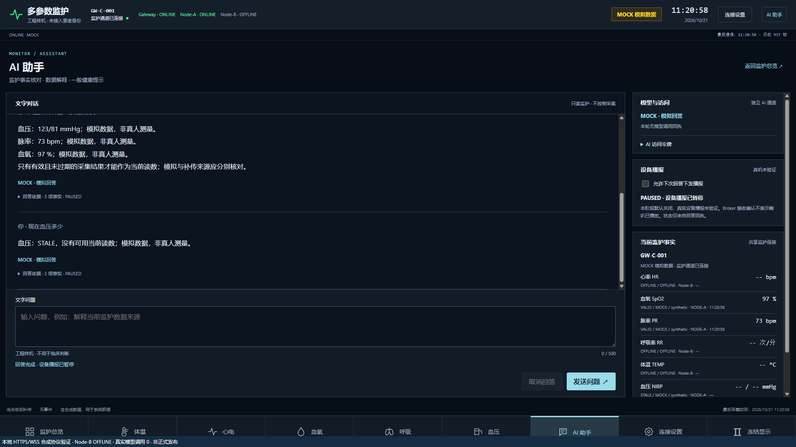
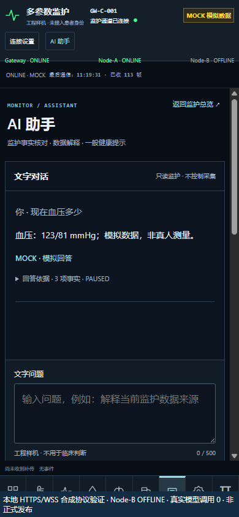

# H3 A→C 唯一权威交接（MPM-H3-004 R1.0）

**2026-10-21 最新裁定：新A已完成真实烧录/读回，负责人回报独立冷启动正常；`H3_AC_FINAL_PARTIAL / WAITING_AUTH_AC_C_READONLY`。** 本次AUTH-AC-A-FLASH已用完，真实CAN帧、合格采集源及云端阶段仍待准入。C/COM15未访问，云端未写入，没有实际发布或回滚。当前权威门禁矩阵为 `gateway/physical_can/evidence/h3-ac-final/closeout-status.json`；最新A实板结果及下一张只读卡见第10节。第9节保留前一准备窗口事实，AC-0/AC-1仍按原成绩继承。

下列第1–8节保留MPM-H3-003原轮事实及失败历史；其中“本轮”指该历史窗口。MPM-H3-004的新增事实从第9节开始。

执行日期：2026-10-21；执行者：**Codex**。负责人明确改派Codex接管，覆盖合同中DeepSeek主执行的角色标签。本文件是本轮唯一权威总结，R2及更早报告和失败原件全部保留。

**AC-0只读基线通过并保留残余风险；AC-1成对软件验证通过。整体仍为H3_AC_CLOSEOUT_PARTIAL。** 没有执行AC-2/AC-3真机采集、云端临时服务、正式发布或真实回滚。正式门保持`BLOCKED_SECURITY_REVIEW`，不能将本轮软件通过写成正式交付。

## 1. 执行人、worktree与Git身份

远端开始时重新查询，H3准确为`9a2c1db22e5c9ce11aa5cd3b65429185be98fb5c`，与合同一致；没有发现起点漂移。上一轮Codex就是本对话，已正常提交并停止。未发现引用旧H3目录的在执行命令行，但这不是对所有编辑器/其他会话的绝对证明；当前用户明确改派、独立worktree和外部单写入者登记共同限定本轮写入范围，没有声称获得不可用的跨对话工具回执。

- 新工作区：`E:/medical-monitor-h3-ac-closeout`，本地分支`codex/h3-ac-closeout`。
- 只正常推送既有远端`dev/h3-nodea-cloud-ai-integration`；不另推新远端分支，不强推、不建PR。
- 旧工作区`E:/medical-monitor-h3`仍停留`9a2c1db…`，未跟踪根`build/`保留；未切换其分支、移动原件或在其中运行构建。
- 新Web使用指向旧`node_modules`的本机junction复用既有安装，没有自动安装技能、升级依赖或改前端框架。构建/截图/临时证书只在新工作区/本轮受限目录。
- 本轮未打开COM15、未调用J-Link、未复位/上电/烧录设备。负责人提供的现状为C连接COM15，A未连接且未供电；BOOT实物状态本轮NOT_OBSERVED。

| 保护分支 | 开始时远端HEAD |
|---|---|
| A | `3fa14b00a0823d2855e9dd8bd1c6c8545abb8dc5` |
| B | `f8c99433561b2e110c04ba9fb33c30235910a3e9` |
| P6 | `77dd14d1ca761a488956f7a4ebf28cb3174835e4` |
| P4 | `67f5f57bd82c6e326e9e78ec9540481c80105e5f` |
| main | `50699048010c57ba10f8573461844c525b022a07` |

关键代码提交：

1. `8afb1e2903f18c3a562769b9e9352db7e1db438a`：Backend启动会话隔离、A/C边界/WSS负例、只读/验证入口、证据目录隔离；14项完整回归任务使用此提交。
2. `030d13d765991da8f41d6ad2f4769e3c581a80fc`：C断言宏文件名显式前缀映射，精确复现两个历史BIN。
3. `093f2d9a84874c6031d5d350a552f58452675c02`：补充HTTPS/TLS只读证据；初始成对manifest冻结于此。
4. **`926136bcd25118cb12a2f8b79fc91bc0165b2adc`**：本轮最终软件提交，仅补充实际进程二进制/完整部署源码与静态树的只读指纹。与初始成对manifest的所有固件和Backend/AI/Web文件SHA一致，源码连续性另有回执；与14项回归提交的运行时代码无新增差异。

包含本文的最终交付HEAD不预写：提交后用`git rev-parse HEAD`及远端回执取得并向负责人报告。`closeout-status.json`中的`h3_source_sha`是最终软件提交，配对manifest记录其初始冻结提交，连续性回执证明所验固件/应用字节没有变化；均不冒充包含自身的新文档提交。GitHub只读查询同时确认仓库仍为PRIVATE。

## 2. Gate与授权状态

| 阶段 | 裁定 | 实际边界 |
|---|---|---|
| AC-0 | AC0_READONLY_BASELINE_PASS_WITH_EXPLICIT_RISKS | 远端/单写入者/正式身份/历史备份可追踪；INPUT及云安全组风险保留 |
| AC-1 | AC1_PAIRED_SOFTWARE_PASS | A Host/Keil、C Host/双ARM、P5 42/46、255项及4子测试、Web/20项浏览器通过 |
| AC-2 | NOT_AUTHORIZED / NIBP_PHYSICAL_BLOCKED_SOURCE_MISSING | 没有新A烧录、合格新输入或真实完成事件证据 |
| AC-3 | NOT_AUTHORIZED / NOT_RUN | 没有本轮云临时服务、现场故障注入或新有源300秒 |
| AC-4 | PARTIAL_STATIC_REVIEW_ONLY | 本机七页/前缀已回归；没有全新正式不可变包/全套恢复备份/正式ACL证明 |
| AC-5 | BLOCKED_SECURITY_REVIEW / NOT_AUTHORIZED | 不执行正式prepare/activate/rollback |
| Node-B | OFFLINE_REQUIRED | 不修改B代码/分支，不接入实物B；H3夹具及页面检查B离线 |

未运行Security Gate、扫描器或sanitizer。P5入口明确记录`security_gate=NOT_AUTHORIZED/NOT_RUN`。

## 3. AC-0正式云只读核验与INPUT风险

原始回执位于`gateway/physical_can/evidence/h3-ac/`：`AC0-identity.json`、`AC0-cloud-readonly.json`、`AC0-risk-register.json`、`AC0-firewall-diff-review.md`、`AC0-runtime-readonly.json`及两份访问只读回执。SSH仅使用本机别名，在内存执行只读查询，没有写服务器脚本、配置、规则、临时目录或候选服务。

| 对象 | 本轮实际身份/结果 |
|---|---|
| 正式Backend | PID845095，`/opt/medical-monitor/releases/mqtt-v07-phase2-20260920-01/backend`，python3.12 |
| 正式MQTT单元 | PID851111包装器；实际mosquitto子进程PID851112、`/usr/sbin/mosquitto`，SHA `22cb8f9dbfda6032e26d230295c89d1a65bd8c675de89f6c29095715a83e25eb`；8883仍监听 |
| 正式AI | PID394625，`/opt/medical-monitor-p6`，python3.12；健康DOUBAO/MONITOR |
| Nginx | PID3631，`/usr/sbin/nginx`；原配置和Web index SHA与旧正式计划一致 |
| 原Backend健康 | status=ok、mqtt_connected=true；是既有进程的只读健康，不是新候选已订阅的证明 |
| HTTPS与8883 TLS | TLSv1.3及主机名/证书校验通过；叶证书SHA `a3c4d1284c8f59ccb434b8736f4a1862d1ff3b42e589a26f0108c2a2d854bacd` |
| 旧静态入口匿名HEAD | 200；未传令牌、未读测量内容，不能据此推断API/WSS或个人数据公开 |
| 新旧版本 | 旧AI源码AST仍有`range(1,6)`，正式片段无新AI前缀；没有切换为本轮H3 |
| 旧临时端口 | 8884/18775无监听；不能将当前C的8884配置当作正式8883联网 |

真实旧站URL从服务器已有`MONITOR_ALLOWED_ORIGINS`仅在内存使用；公开记录只保留受限引用，不落真实主机或令牌。实际部署目录不是Git worktree，版本以文件摘要/PID/路径核验，不给它伪造源码SHA。逐文件版本见`deployed_source_sha256`。正式publisher/subscriber ACL未独立证明，浏览器/WSS实际受众未作带令牌公网访问验证。

收尾同时冻结四个实际服务的unit与可执行文件SHA；已部署Backend应用7文件、AI应用6文件、Web dist36文件逐一散列。树SHA分别为`5eb24192d4d84b907ff5c31c5b5d5dd278ab36759556570dce6f9236d04f0d27`、`57c36360d9ad52f3f089089ac84115a3337bb6c9324a7ff0e4af37216799134b`、`c0780cbf36ddfe898dc4ea608f31abc7df7a4b9d05d7d500175e0a016de5e3d0`。这是只读版本快照，**不是已制作完整可恢复备份包**，AC-4/AC-5仍需补齐受限原件恢复包。

合同所称“INPUT总散列”历史实际来自`iptables -S`整个filter表，不仅是INPUT链。历史前/后SHA分别为`3c5a486467a9ea2ed4c7afeb3c8b45f1e9747cec67201f9b340a71d476f794b5`、`1fe2081c0f0cc04d56c8064144a11463bb03568c8c2b28524f755bacfeddbfd0`；本轮为**`05f3c5952feb6301c951704f9d93e7788531c28696a5d407c8bea4e9a629a983`**，395行。NAT当前SHA `96ba2354a7ee95379dbc8c4bc83f5c5d13ccc95d5367d69e3af1e6dec9ed3157`。当前filter/NAT链、规则顺序及逐条散列保留；地址只留范围类别/摘要，不输出原文。自有`MPH3R2C/MPH3R2N`引用均0。

UFW active、Fail2ban inactive；查询历史UTC11:18–11:27窗口未找到Ban/Unban线索。INPUT策略为ACCEPT、FORWARD为DROP、OUTPUT为ACCEPT，这不是完整有效访问路径裁定。缺少旧逐条文本，**不能归因于UFW、Fail2ban或其他执行者，也不能确定哪些链变更**。没有整表恢复或删除未知规则。

本机无`tccli`，未获得云安全组控制平面快照；旧“TCP8884全部IPv4保留”仍是历史负责人反馈，未冒充本次API核查。该未知项、INPUT残余风险、正式ACL/受众证明缺口继续阻断生产。AC-1离线不依赖这些生产门，已继续完成。

首份访问回执TLS字段已经通过，但broker的占位`state`未更新；保留原件，修正工具后新增时间戳回执明确`TLS_ONLY_OBSERVED_NO_MQTT_SESSION`。两次均为只读，未建立新MQTT业务会话或调用模型。

## 4. A/C NIBP软件审查与本轮修复

Node-A的`app_bp.c`成功结果才更新`valid_tick`并递增非零完成代次。CAN应用只读结果，停止/测量/过期锁存不可被旧代次解除；0x2111经0x281传完成tick和SYS/DIA镜像，0x681 bit9为扩展声明、bit3为有效位。原0x181/0x381/0x481/0x681和频率、双屏、看门狗/采集流程不重写。

C要求扩展、metadata/质量/TIME/PDO新鲜且值配对，用同一节点锚点复原完成UTC；90秒从完成算，不用2秒重发时间续期。89s/90s可有效，90.001s无当前值；uint32 tick回绕、旧A、缺0x281、身份错配、过期元数据、未来/错误时钟、重启均有定向负例。A本地完成代次没有额外写进PDO或JSON；详细线上身份边界见`AC1-protocol-validity-matrix.md`，后续真机不能虚报C直接收到未传输的本地代次。

**本轮发现并修复Backend跨启动续活缺口**：原Hub只检查90秒和流序号，新A/Gateway ONLINE可能使旧会话、未满90秒的血压重新作为当前值，真实WSS也会发送。修前新增6项中3失败/3通过，原日志保留。修复后记录网关接收代次、核对节点状态与遥测会话；旧会话高seq、REPLAY不能借新ONLINE复活，当前会话的同值新完成仍可有效。两个映射按已配置网关/current固定通道有界；未测运行RSS，不能编造Python内存变化。

本轮未修改Node-A或C的运行C源码、Router、CANopenNode、coreMQTT、AT/TLS/PUBACK期限或数据TTL。新增内容为Backend最小边界修复、负例和构建/审计/证据工具。Host不能证明HKB-08真实气路或生理准确性，原双屏实物本轮NOT_OBSERVED。

## 5. 冻结镜像、配置ABI与资源

详见`AC1-paired-manifest.json`，二进制及配置正文只在本机受限候选目录独占保存并磁盘回读，不进Git。

| 角色/候选 | 字节数 | SHA256 | 实际状态 |
|---|---:|---|---|
| A完成时间候选 | 50084 | `f59b76ef865c373c6df62aa09aea958597687f6d46b17c402ceb7126ca8f60d6` | Keil/FromELF重新生成，等于R2候选；未烧录 |
| C隔离8884 | 43172 | `59229f1b34660f053538737fc0fd17c814fde5502a0dfe33603e8e08b72ca8a5` | 精确复现历史已下载镜像；本轮未读板 |
| C正式8883 | 43184 | `9df43acd34732cacb8c1a90a6a15e420b96ad9675a004d65c3a088246268f977` | 精确复现旧候选；未烧录/连接正式链路 |
| C隔离配置generation2 | 336 | `3b1a8c344dfad1d1faa82bc962811e50a467eec9adbc1cec5b2a32979c6a2c25` | 本机私密原件CRC/ABI核验；当前板状态仅历史读回证明 |
| C正式配置 | — | — | NOT_PREPARED，正式publisher凭据/ACL/新记录SHA未冻结，不能申请不完整写入 |

C应用仅sector0–2，配置0x0800C000、sector3、16KiB擦除，24B头＋312B payload、版本1、CRC32、commit最后写；运行无Flash写入口。**端口不在记录内**，修改sector3不能把8884固件变成8883。隔离来源宏保留MOCK/synthetic，即使传输用实物CAN；正式来源仍须实际输入和授权，不凭正式端口假定LIVE。

初次在新worktree构建的两个C BIN分别为43208B/43220B，SHA `7ce421ca82c588c1725e60f2baf3658f73c84c763a2cb77b4154f126b3955ffb` / `5a1b455db9163d57bf5faf4484d46c33afb5677fcf8413fa90b376bde060da33`。差异来自三份coreMQTT断言的绝对`__FILE__`路径增长，不冒充相同二进制。首轮manifest和日志保留，中间BIN未单独归档、构建路径后来由复现目标更新。新增显式`--macro-source-root`冻结历史诊断前缀后，全字节复现上表两个BIN，并在仓库外归档最终候选；完整输入/命令/对照回执在`reproducible-C/`。没有访问旧目录写入或修改第三方库。

因此配对NIBP代码不额外要求重刷现有隔离C；后续实际核验若不匹配须停并另出C计划。**A仍是旧实机，不能用A候选编译成功推定已升级。**

资源未较R2候选变化：A Code46488/RO3108/RW1560/ZI15616；隔离C text43076/data88/bss123136，正式C text43088/data88/bss123136。bss含链接器堆/栈预留，未作真机栈水位测量；336B记录占独立16KiB擦除单元。Backend新增会话映射未实测RSS。

## 6. 实际测试、时间与退出码

所有命令在新worktree执行。14任务的UTC起止时间、精确argv、提交和退出码在`regression/*-exit.json`及`validation-result.json`；原日志不归一化CRLF、不删失败。没有联网至真实模型；DOUBAO测试使用HTTP边界替身，不消耗真实额度。

| 实际命令/任务 | 退出码 | 原件/结果 |
|---|---:|---|
| `python -m cloud.deploy.h3.ac_readonly` | 0 | AC0-cloud-readonly.json，SSH0、无服务器写 |
| `python -m cloud.deploy.h3.ac_access_readonly` | 0 / 0 | 两次访问回执，TLS/健康只读 |
| `python -m cloud.deploy.h3.ac_runtime_readonly` | 0 | 实际broker子进程、四服务binary/unit及部署树完整只读指纹 |
| 修前`pytest cloud/backend/tests/test_ac_nibp.py -q` | 1 | AC1-before-fix.log/json，3失败/3通过 |
| 修后Backend定向及旧回归 | 0 | AC1-session-fix.log/json，25通过 |
| C Adapter精确边界/负例 | 0 | AC1-adapter-boundaries.log/json，13通过 |
| Node-A Host，`--phase ac1-frozen` | 0 | regression/node-a-host.log、node-a/*，编译/运行均0 |
| C `--host --irq` | 0 | regression/gateway-host |
| C `--host --irq --rx-order` | 0 | regression/gateway-rx-order |
| C `--host --irq --peer-cycle` | 0 | regression/gateway-peer-cycle，含硬故障分支 |
| P5普通 / IRQ+fresh-SNTP | 0 / 0 | regression/p5-42 / p5-46，42/46项、完整编译和运行日志 |
| `pytest cloud/backend/tests cloud/ai/tests gateway/physical_can/tests -q` | 0 | regression/paired-python.log，**255通过、4子测试通过** |
| C两种ARM：`--irq --fresh-sntp --persistent-config`，隔离另加`--isolated` | 0 / 0 | regression/C-*保留首版路径差异镜像回执 |
| 同上加显式`--macro-source-root` | 0 / 0 | reproducible-C两份完整编译回执，复现两个历史SHA |
| Keil `UV4.exe -r …uvprojx -o …log` | 0 | regression/node-a-keil-build.log，0 Error/0 Warning；已核对用户构建钩子禁用，无下载参数 |
| FromELF `--bin --output …bin …axf` | 0 | regression/node-a-fromelf-exit.json，向量/范围及候选另冻结 |
| `npm --prefix cloud/web test` / `run build` | 0 / 0 | regression/web-tests.log、web-build.log，15项Web检查、TS/Vite |
| `python cloud/web/tests/run_r2_browser.py` | 0 | browser原日志/截图，**20项**，真实等待**90.109秒** |

Node-A补充89s及跨uint32回绕检查；C边界注入固定2000ms发布槽，90.001s不是按1Hz粗略近似。新增FastAPI WSS检查使用真实应用和Hub；Controller外部I/O仍是Host桩，不能称真实传感器结果。完整模式/身份/来源矩阵见对应Markdown。

## 7. 七页、豆包与数据范围

浏览器按agent-browser技能、独立会话执行，loopback18765/18766/18767、自签名短期证书仅用于本机；旧浏览器/正式TLS未修改。七页路由、独立AI/监护鉴权、来源标签、移动无横向溢出、90秒过期、停止测量不复活、B离线、刷新清令牌通过；自有进程均退出、证书已删除。复用R2测试入口的历史标题，不将它当正式网页。

本轮真实豆包调用**0、Token新增0**；未查询费用账户，历史10次/7496 Token账本只追溯。本地MOCK回答没有REAL_REQUEST_USED证据；新服务代码保留确定性读数NOT_CALLED、真实解释REAL_REQUEST_USED区分、持久账本/限流/并发/错误熔断和禁止自动无限重试。providers仅发送问题和标量有效性/来源元数据，不发送原始波形、患者身份或完整聊天历史。设备音频下发/扬声器仍未验收，页面显示PAUSED/未验证，不宣称播报成功。

R3的README/summary/timeline/RAW_SOURCE摘要仅在保护A分支读取，H3并无该实测目录；本轮用`git show`只读目录和散列，不复制历史真人数值/日志。没有新真人或非人体传感器采集，没有真实PPG/PUBACK/FOVR等新板端计数；全部标NOT_OBSERVED，不能继承路由器654条无探头窗口为本轮有源通过。

## 8. 私密原件与后续准确授权清单

初次只搜索两个私密根目录未找到A备份，原不完整目录回执保留；扩大到已知历史交接`h2-private`后找到两组（包含旧失败原件），至少一组双份1048576B一致并符合原始SHA `0fd4a4e8417b87a157fdf3e4f7c5a2a553c5aa9f69b4417fcac03c3a73d91516`。详见`AC0-A-backup-recheck.json`。没有读取UID正文或重新接板。

C路由器更新前generation1的64KiB双备份仍存在且符合`52a4c9d621375d63cd995c1a003d98473e9be3387d31cd857e702a27bee7e6f8`；它不是当前generation2快照。generation2历史写后完整读回SHA `102575dc940425d91b2db7c2a0f22ddf44c5cfab652b1b5ca0790f8924d3705b`只是旧窗口证明。本轮没有新增Flash双读或保护区实测，未来动写仍要新窗口实际双读/磁盘复核、保护7/11/options。

**可审阅的后续计划已在`AC2-authorization-plans.md`列全范围，不是另签合同：**

1. AUTH-AC-A-FLASH：A50084B候选、精确SHA、仅A sector0–3（应用0x08000000–0x0800C3A3），历史旧应用身份/备份与当前实际读回区别、维护/双屏/看门狗、失败只恢复本窗口原件和正常冷启动次序。未执行，不能复用旧下载器的49888B固定镜像门禁给新镜像放行。
2. 隔离C配对字节不变，本身无须重刷；正式C的AUTH-AC-C-FLASH尚NOT_READY，因为正式publisher配置SHA/权限未冻结。8884/8883应用不同，配置扇区单独授权。
3. AUTH-AC-SOURCE / HUMAN：缺合格新NIBP和血氧来源资料，保持NIBP_PHYSICAL_BLOCKED_SOURCE_MISSING。没有要求人体佩戴或无限重复袖带。
4. AUTH-AC-CLOUD-ISOLATION：新的不可变runtime必须含本轮Backend修复；需当次服务/端口/用户/client_id、现场/32、TTL/清理/故障粒度。没有写服务器staging或启动临时云服务。
5. AUTH-AC-PROD：先有正式ACL、来源/受众、INPUT/安全组风险裁定及完整恢复包，再冻结候选/配置/URL/窗口。当前新正式网址**未发布**；路径`/medical-monitor/#/ai`仅候选入口。实际正式回滚及回滚后公网复验均NOT_RUN。

本轮没有重构CANopen/coreMQTT、没有改P4/main/A/B/P6、没有操作Node-B、没有PR或强推。授权边界来自新合同第3节及AC-2至AC-5入口，既有现场/云窗口均已结束，不能作为本轮操作许可。软件范围已完成；后续依赖上述门，停在阶段复核，不将缺口改写为PASS。

## 9. MPM-H3-004 R1.0：F0–F6新增执行记录（2026-10-21）

### 9.1 F0：接管、现状与源条件

本轮完整阅读 `MPM-H3-004-AC-FINAL-DELIVERY-CODEX.md`。重新查询H3远端与本地，起点均为 `5a4cfd25753b5fe8f812d3acc6494aa898e1adb1`，工作区干净。上一轮外部租约明确关闭；按负责人“唯一工程执行者”指令归档旧租约并登记新租约。进程列表有其他Codex进程，不能由进程名称断言其编辑器状态；未发现未知工作区改动，旧H3工作区及原件未动。不使用不可用的跨对话交接工具伪造交接回执。

负责人本轮回报：A/C接J5，C同时接USB/COM15，A的J-Link未连接，BOOT均接GND；并说明“A与C均未开启”。这作为现场回报原文保留，不据USB枚举推断MCU的实际供电状态。未要求改接线、开关电源或移动跳帽。CAN既有三线、500kbps及双终端约60Ω为继承静态基线，本轮没有重新测量；板间不得互接电源，Node-B仍未接入、必须OFFLINE。

负责人确认模拟设备“能模拟血压并进行测量”，但型号/说明和非人体信号来源仍“不确定”。因此当前是 `OWNER_REPORTED_MEASUREMENT_CAPABLE / SOURCE_IDENTITY_UNCONFIRMED`，尚不构成合格HKB-08B+成功完成事件/PPG源证明，也不构成AUTH-AC-SOURCE或HUMAN。未要求人体佩戴或进行新测量，F2保持具名来源缺口。

`F0-input-continuity.json`重新逐文件计算AC1的固件及关键Backend/AI/Web输入摘要，差异均为0；这是身份连续性检查，未重跑或认领AC1的255项/Keil/ARM/浏览器成绩。新A镜像离线计划再次核对50084B及向量/扇区，未连接设备。历史A完整备份及C generation1原件仍不当作当次当前Flash。

### 9.2 F0/F3：实际服务器只读结果与风险差异

实际SSH只使用本机别名，在服务器内存执行只读查询；新证据位于 `gateway/physical_can/evidence/h3-ac-final/F0-*.json`、`cloud/evidence/h3-ac-final/F3-access-*.json`。无临时目录、staging、服务、规则、凭据或云安全组写入，真实AI调用0。

- 正式Backend/AI/Broker包装器/Nginx的PID分别仍为845095/394625/851111/3631，Broker实际子进程及完整源码/静态树指纹另在F0-runtime记录。8883监听，8884/18775无监听。旧AI的五槽限制仍在旧部署，不能说新账本已上线。
- 当前**整张filter表**为393行，SHA256 `e6f238e23dece4fe2763aae2c48a482f749a56f632aeac6d31aa1130d7abed1c`；与AC0的395行比较，有2条旧规则散列消失、无新增，脱敏顺序元数据保留于 `F0-filter-delta.json`。没有旧原文，不能将差异归因UFW/Fail2ban或某位执行者；未恢复整表。
- NAT为12行，SHA256 `96ba2354a7ee95379dbc8c4bc83f5c5d13ccc95d5367d69e3af1e6dec9ed3157`；filter/NAT自有H3引用均为0。不能因此宣称全部防火墙恢复。
- `nginx -T`退出0，真实引用只以别名/散列公开。最初更详细的只读原件移至私有目录留存，原摘要回执保留；新脱敏回执不含其他虚拟站点文件名。
- 只读定位了实际业务Broker配置及ACL：2个write角色、1个read角色，Topic散列和通配符性质已记录。这是现有配置观察，尚未绑定/验证本次独立正式publisher/subscriber权限，未建立新的业务MQTT连接。
- 正式Backend/AI沿用的用户及NoNewPrivileges/ProtectSystem已记录；云安全组控制平面8884未取得实测，生产受众尚未确认。残余风险仍须负责人裁定，`BLOCKED_SECURITY_REVIEW`不解除。

### 9.3 F1：新A工具与失败恢复的软件准备

新增 `gateway/physical_can/bench/final_a.py`，专用于本合同50084B候选，SHA256 `f59b76ef865c373c6df62aa09aea958597687f6d46b17c402ceb7126ca8f60d6`。默认plan仅离线；program必须有绑定工具SHA、执行HEAD、有效期、A单板现场条件及候选SHA的负责人专项卡。旧49888B下载器不复用。

程序在写前确认A身份、1024KiB、RDP0、选项字节；两次完整1MiB读取并磁盘复核；核对当前旧应用身份，未知即停止。只load/verify新A应用，检查64KiB以外、UID/容量/选项字节均不变。只临时冻结调试暂停期间IWDG，成功后恢复原调试寄存器；不长期关看门狗，不发送mass erase、PC/MSP/VTOR或go。原始UID/Flash/J-Link输出只进入私有新窗口目录。

restore是单独批准入口：只能取该窗口新双份原件前64KiB；先核验保护区和选项，再恢复A sector0–3并全片读回。损坏/身份变化即停，不自动用旧整片备份覆盖。当前只验证了合成存储模型；新A写入、屏幕/看门狗正常冷启动及真实Boot-up/Heartbeat均NOT_RUN。

### 9.4 F3：新不可变包、完整原件和受控发布准备

运行包源码冻结提交为 **`5da742f4e0e078d2d40453facdad1e65ff51fdda`**，包含 `8afb1e2` Backend会话隔离修复及 `f0a63e0c6d1af9e6f5fba375b70a46f0e0cbfe7e` 新维护/恢复工具。独立上传工具提交为 `8b4cb86b146f845495b3ebb8070208f9294cc2f9`；它不改变已冻结运行包内容。包含本次文档/证据的交付HEAD以提交后远端回执为准，不预写自身SHA。

| 冻结项 | 实际身份 |
|---|---|
| 新runtime包 | 3,878,350B；SHA256 `85f0e830991e79f8702ce01ae204c8326c66203ac6a2d2b21e55e6b7c6cd9c3f` |
| 全payload映射SHA | `b8fbb14b5c356090f8a35f211b9bc1f070be251b58436db7f1445283013ac87e` |
| Web完整dist映射SHA | `d081b7036e521208a433a7410f1a86c9f06208260434b4257f10eeddd1a174be` |
| 本机私有引用 | `ac-final/runtime-5da742f`及独立repeat目录；两次包SHA/字节完全一致 |
| 候选远端目录（未创建） | `/opt/medical-monitor-h3/releases/runtime-b8fbb14b5c35` |
| 完整内容 | 70个文件：Web dist、Backend、AI、发布工具、依赖清单、20个Linux/CPython3.12 wheel及来源manifest |
| 原始中间包 | `bf2b184f…`留在私有目录，因服务禁止写pyc等修正被新包取代，从未上传 |

依赖离线下载退出0，每个wheel进入manifest散列；Linux本机现有解释器为3.13，未安装3.12，**没有声称目标服务器venv安装或服务健康已通过**。新prepare要求独立版本venv并逐个核对锁定版本，后续安装仍需AUTH-AC-CLOUD-STAGE，不能借旧共享venv冒充新运行环境。

新增完整恢复组件覆盖整个Web/Backend/AI树、持久状态、unit/env、Nginx引用、Broker配置、执行文件和release链接，保存内容、mode/uid/gid/mtime、符号链接及POSIX xattrs/ACL。创建时源变化即失败；恢复先重建校验，同文件系统逐对象交换，中途失败按反序还原并保留被换下原件。**逐对象交换不宣称跨整站的一次文件系统原子事务**；正式入口以单个Nginx片段原子替换控制。真实服务恢复/重启/HTTPS仍须正式窗口验证。

正式prepare现在拒绝旧四文件计划或只有角色标签的假完整清单，按真实进程/环境/Nginx引用核对覆盖范围。activate/rollback要求完整恢复包可验证、候选服务SUBACK健康及DOUBAO/MONITOR健康；回退不再被损坏候选包封锁。旧服务保持原位，仅切换自有路由/候选服务。候选unit禁写pyc，NoNewPrivileges/ProtectSystem约束写入到既有STATE；避免重启污染不可变源码。Broker实际ACL、完整原件路径和服务端安装尚须现场审查/授权，当前不是F3_RELEASE_READY。

`tools/h3_stage_runtime.py`只接受冻结包，默认plan；upload须AUTH-AC-CLOUD-STAGE绑定准确包SHA/工具SHA/目录/有效期。源包是本机生成且无服务器直接下载源；批准后仅经E:/Server_file中转，远端尺寸/SHA、tar边界和全部文件摘要验证通过才清理本次中转件。不安装依赖、不启动服务；本轮只执行plan和tmp仿真，没有上传。

### 9.5 本轮新增验证及真实退出码

| 验证 | 退出码 | 本轮证据和限制 |
|---|---|---|
| 新A/恢复包/发布事务定向pytest | 0 | `cloud/evidence/h3-ac-final/software-20261021T072238226948Z/tool-regression.log`：30 PASS，1个Windows下POSIX项SKIP |
| Linux本地POSIX恢复 | 0 | 同目录posix-recovery：内容、额外文件、mode/uid/gid、xattr、链接共6项检查；补足对应平台覆盖，非服务器实际回滚 |
| 新A候选离线plan | 0 | 同目录new-A-offline-plan及node-a/evidence/h3-ac-final；无J-Link调用 |
| TS/Vite完整dist构建 | 0 | 同目录web-package-build；为新包构建，不重报旧浏览器20项成绩 |
| 上传器定向pytest | 0 | `cloud/evidence/h3-ac-final/stage-tool-tests.log`：3 PASS；含拒绝未授权网络、包变更、越界tar，全部tmp仿真 |
| 冻结包两次构建/解包逐文件核验 | 0 / 0 | `runtime-package.json`；SHA一致；无上传/模型调用 |
| F0/F3 SSH只读查询、nginx配置查询 | 0 | F0-cloud/runtime、F3-access脱敏回执；非新候选健康 |

新增合计33个pytest通过，另有1项Windows跳过及Linux独立6项检查。开发中每轮验证目录、旧较早中间包均保留，不以最终结果覆盖历史。尝试查询WSL pytest时发现未安装该模块，因此用stdlib独立POSIX检查；未将该查询当作通过的Linux pytest。AC1成绩单保持原归属。所有板端/实际发布退出码为null（未执行），不填0。

本轮无固件运行时代码变化，A/C资源统计继承AC1；运行包新增本机磁盘占用见上述大小，不声称实板水位或新服务RSS已测。没有更改第三方代码、CANopen/coreMQTT/Router/AT/TLS架构、ABI或TTL；没有PR、强推或Security Gate。

### 9.6 F0-window-request：当前只申请AUTH-AC-A-FLASH

**卡号 `AUTH-AC-A-FLASH / F0-A-1`，状态REQUESTED_NOT_APPROVED。** 这是一份合同内授权卡，不是新合同。批准后一次使用；批准时间起2小时内有效，超时重核现态。执行HEAD在收到批准后登记为当时准确交付HEAD，必须包含上述冻结提交，工具/候选字节不变。

| 项目 | 本卡准确范围 |
|---|---|
| 设备/工具 | 仅Node-A、原J-Link；工具 `final_a.py` SHA256 `4dd2c60b146e278bb917e45a577693e83c79256d1da6d57830e0692c85bbb27e`，J-Link/Keil/FromELF摘要另在F0-input-continuity |
| 现场动作 | 批准后才由现场使A/C及屏/传感器断电、隔离CAN三线，C保持断电；仅A接原J-Link及已核验独立供电，探头/袖带不接，BOOT正常GND |
| 新镜像 | 50084B，SHA256 `f59b76ef865c373c6df62aa09aea958597687f6d46b17c402ceb7126ca8f60d6` |
| 写入/保护 | A应用 `[0x08000000,0x0800C3A4)`；擦除影响仅A sector0–3/64KiB，`0x08010000`之后及options不变；不操作C Flash |
| 写前门禁 | A私有历史身份比对、容量/RDP/options、当前完整1MiB两次读/磁盘回读一致，当前49888B应用前缀必须匹配历史 `506423dc…`；未知即停，原始完整备份SHA不替代当次双读 |
| 下载/核验 | 有界load/verify，完整读回新镜像和保护区/选项；不mass erase、RDP或options写，不强设入口、不go |
| 冷启动 | 通过后由现场断电拔J-Link，原J5/双屏正常BOOT独立启动，报告屏幕/重启；C仍不操作。真实CAN Boot-up/HB留到下一次获准C观测，未取得前不宣称F1整体PASS |
| 失败与恢复 | 任一步异常即停、保留原件和真实退出码，不自动恢复。若需要恢复，另明确批准绑定本窗口新备份SHA，仅恢复A sector0–3；身份/保护区改变时不得恢复 |
| 明确不含 | C串口/读写/复位、采集/人体、云写入、8883生产、隔离故障、正式发布或回滚 |

此项必须等待明确批准，依据本合同第3/5/12节。批准前不要求现场执行表内断电/改接动作。后续C只读、AUTH-AC-SOURCE、隔离云/故障和staging将以已齐备身份分别出卡；**正式C和PROD卡目前NOT_READY，不对空配置SHA/未生成完整恢复包请求批准**。

### 9.7 F2–F6当前矩阵及后续准入

| Gate | 当前裁定 | 不可替代的下一项 |
|---|---|---|
| F0 | READONLY_COMPLETE_WITH_SOURCE_SECURITY_GAPS | 新鲜现场回报已得；合格来源、SG及历史差异仍保留 |
| F1 | SOFTWARE_PREPARED / WAITING_AUTH | 新A镜像实读/写/正常冷启动、双屏/看门狗/真实CAN证据 |
| F2 | BLOCKED_SOURCE_AND_AUTH | 模拟源身份与AUTH-SOURCE；新C实读配对；新runtime隔离云、真NIBP完成/90秒、PPG300秒和故障恢复 |
| F3 | LOCAL_PACKAGE_AND_RECOVERY_SOFTWARE_PREPARED | 服务端独立venv/完整原件、SG/有效ACL/受众/风险裁定；未达RELEASE_READY |
| F4 | NOT_READY | 正式publisher/subscriber角色、正式336B配置SHA、当次C64KiB双读及保护区；不复用隔离凭据 |
| F5 | NOT_AUTHORIZED / NOT_RUN | 精确正式发布卡、HTTPS七页/AI、真实rollback及获批再激活 |
| F6 | H3_AC_FINAL_PARTIAL | 等待专项门，不能冻结A→C为FINAL_PASS或推进Node-B |

正式权限设计为独立publisher仅write GW-C状态/节点状态/telemetry/replay/event、独立Backend仅read这些Topic，避免授予控制/downlink写权；client_id按角色/窗口隔离，TLS CA/SNI验证，具体账号/ACL文件差异必须在私有窗口核验后申请。正式C仍43184B/SHA `9df43acd…`、正式336B记录NOT_PREPARED；8883端口在编译镜像，不在sector3记录。

正式网址沿用受限 `MONITOR_ALLOWED_ORIGINS` 引用，未发布新HTTPS入口；`/medical-monitor/#/ai`仍只是候选操作入口。此次没有新增正式截图、真实豆包回执或Token；不把第7节本机截图当正式成果。设备扬声器/ASR/TTS仍NOT_VERIFIED。实际rollback及再次激活均NOT_RUN，旧正式服务保持原版本。

本轮阶段性软件与证据可正常提交/FF推送H3；受保护ref须在推送前后逐项核对。最终交付提交SHA和远端一致性由提交后的真实Git回执提供，报告中的软件/运行包SHA为以上真实冻结提交，不预造文档自身散列。

## 10. AUTH-AC-A-FLASH / F0-A-1 实际执行与下一准入卡

### 10.1 已批准窗口及实际下载

负责人明确回复“批准 AUTH-AC-A-FLASH / F0-A-1”，绑定交付 `d87295723160cd884033104ae683ac8713301fb2`。本次登记采用保守截止 `2026-10-21 17:29:03 +08:00`（UTC09:29:03）；没有借新代码提交延长窗口。现场随后回复“A单板已就绪，C断电，CAN三线分离”。工具/镜像/J-Link摘要与批准卡一致后才连接A；C/COM15没有打开。

实际执行区间：UTC `2026-10-21T07:31:38.715625+00:00` 至 `07:33:04.452238+00:00`，即北京时间15:31:38–15:33:04。`python -m gateway.physical_can.bench.final_a program` 实际退出码 **0**。完整命令、输出、UID/原件只在私有 `ac-final/A-F1-*` 窗口，目录移除继承授权，仅当前操作者、SYSTEM及Administrators可访问；Git仅留脱敏散列。

| 实际核验 | 结果 |
|---|---|
| 芯片/身份 | STM32F407、1024KiB、A历史私有身份一致、RDP0；无UID原值入Git |
| 当前原件双读 | 2×1,048,576B，磁盘回读一致；SHA256 `4c2730ebc9a8eab33b1e4d585db7deb47567261b6369165e47ecaf9630f35f3a` |
| 写前49888B应用 | SHA256 `506423dc295318a8de730d0d6b5100fc4ef199c349ee3acd2fbba350bf576f88`，符合批准的旧应用身份 |
| 新应用实际读回 | 50084B，SHA256 `f59b76ef865c373c6df62aa09aea958597687f6d46b17c402ceb7126ca8f60d6` |
| 实际边界 | 仅A sector0–3；应用 `[0x08000000,0x0800C3A4)`；64KiB外逐字节不变 |
| 64KiB外散列 | `8e6f77366baf8f9b9cddc873765484b539c202d890ef8291302eae35e63b37ce`，前后一致 |
| options | SHA256 `52d5979da03bd7be45e385920ec7d5901793bab3f6bc1daa0c1c1997f9e91687`，前后字节不变 |
| 写后完整1MiB | SHA256 `7c0f68fbd779c61fd7184d687a858d41d154361862af3b1c2a93b32ef67e49a6` |
| 命令审计 | 7个J-Link会话；21条savebin、1条loadbin、1条verifybin、2条调试暂停IWDG寄存器写；无erase/go/强设入口 |
| 恢复 | 未需要、未执行；旧历史整片备份未用于覆盖 |

工具完成后再次独立从私有文件核对双备份、实际镜像、应用外及身份/options，全部一致。证据：`node-a/evidence/h3-ac-final/F1-A-flash-20261021T073138715625Z.json`，含全部8份私有输出日志摘要（7个J-Link会话加CLI日志）。这是当次当前原件，不能与历史原始1MiB `0fd4a4e8…`互换。

### 10.2 正常独立冷启动与未观测部分

按已批准卡，请现场断A/双屏电源、拔J-Link、等约10秒后由原J5独立供电，BOOT正常GND、不按RESET、不接探头/袖带；C继续断电且CAN分离。对“两屏自行显示、时钟持续更新、约一分钟无反复重启/异常”的组合核对，负责人回复 **“正常”**。

记录为 **OWNER_REPORTED_NORMAL_COLD_BOOT_SMOKE**；这是实际现场反馈，没有精确切电时间或仪器级看门狗超时故障注入，手工观察退出码为null，不伪填0。没有连接J-Link强设PC/MSP/VTOR。证据：`F1-A-cold-boot-owner.json`；真实CAN Boot-up/Heartbeat/PDO和新NIBP完成事件仍 **NOT_OBSERVED**，不能据此把整个F1/F2标PASS。

本次A单板下载窗口已完成并标记CONSUMED，不再重复烧录；无真实采集、C操作、云写入或实际回滚。运行包、Backend/AI/Web、A/C固件源码和资源统计均未新增变化；新A现在已在实板，配对C仍须当次只读证明。

### 10.3 已备好的C只读工具和软件证据

新增 `tools/h3_c_readonly.py`，源码提交 `64bfd1274be9b3711e161812b8a34fc05ebb8ed7`，工具SHA256 `b0bada02b2e044d7c97f8879857b5f8535afc7abe6089f0f61279c0bc8a1cd70`。默认plan，无串口动作；read须下一张专项卡绑定工具/支持库/身份源摘要、实际执行HEAD、有效期及现场状态。

仅调用ROM识别/读取命令，核验当前43172B隔离镜像、generation2/336B配置、两次64KiB原件及sector7/11/options。原件先独占保存以保留失败证据；任何不一致即停止，无自动重刷、RAM注入、erase/write/go或自动RESET入口。只读计划见 `gateway/physical_can/evidence/h3-ac-final/F2-C-readonly-plan.json`。

3项本机合成内存检查退出 **0**（正常配对、双读不同保留原件并停止、总合同不能绕过读板专项门）；FakeBoot没有写入API。完整新日志及回执为 `cloud/evidence/h3-ac-final/C-readonly-tool-tests.*`。没有运行C实板检查，不能把这3项算为物理结果；既有33项不改归属。

### 10.4 下一张卡：AUTH-AC-C-READONLY / F2-C-1

**REQUESTED_NOT_APPROVED；单次窗口，批准后2小时有效。** 仅为了得到当前C配对原件，不是正式C烧录授权；不得据此进入8883或生产。当前A无需再刷、J-Link保持拔下，批准前现场不必移动任何接线。

| 对象 | 请求的准确范围 |
|---|---|
| 现场操作 | 批准后A/双屏保持断电、J-Link拔下、CAN三线仍分离；C先断电，BOOT0改3.3V、BOOT1保持GND，仅C通过USB/COM15进入手动ROM；无人体/探头/袖带 |
| 连接/读区 | 115200/Even，核验已冻结C身份/1024KiB/RDP0；`[0x08000000,0x08010000)`两次64KiB并私有磁盘复核；只读sector7 `[0x08060000,0x08080000)`、sector11 `[0x080E0000,0x08100000)`、16B options及ROM识别所需UID/容量映射 |
| 必须匹配的旧应用 | 43172B，SHA256 `59229f1b34660f053538737fc0fd17c814fde5502a0dfe33603e8e08b72ca8a5`，编译期8884 |
| 配置/完整原件 | generation2/336B SHA256 `3b1a8c344dfad1d1faa82bc962811e50a467eec9adbc1cec5b2a32979c6a2c25`；历史写后64KiB期望 `102575dc940425d91b2db7c2a0f22ddf44c5cfab652b1b5ca0790f8924d3705b`，此次实读前不称当前已确认 |
| 保护区期望 | sector7/11各 `b5a41c3758763bbec72769fab4a2533bf2db0b6312d93d25a695f9e4b9e02260`；options `52d5979da03bd7be45e385920ec7d5901793bab3f6bc1daa0c1c1997f9e91687` |
| ROM握手界限 | 最多初次同步、一次现场手按RESET后同步、一次USB断电重插后同步；各留独立失败原件，不自动无限重试；仍失败即停，不改镜像/身份门禁 |
| 结束状态 | 关闭COM15；现场断C电并把BOOT0恢复GND，BOOT1保持GND，C保持断电，不自动GO；A/C仍不联板采集 |
| 明确禁止 | 任何Flash/RAM/options写、擦除、C重刷、A再次写入、恢复、Wi-Fi凭据变更、云写入或实际测量；不删除错误计数/失败原件 |

专项等待依据合同第3/6/12节：本轮A许可明确不含C，当前C实读必须另获批准。此卡不要求新合同；批准后只安排上述已有精确范围。之后再按实际身份/来源条件推进隔离云和真实CAN/NIBP，避免在无源条件下重复300秒计时凑进度。
