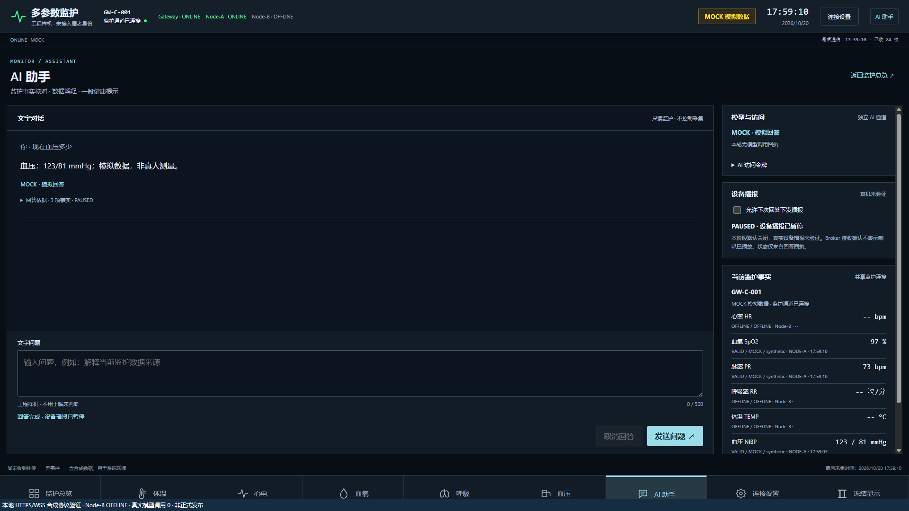
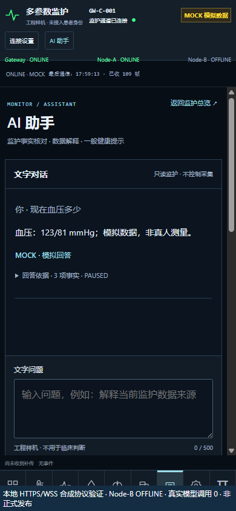
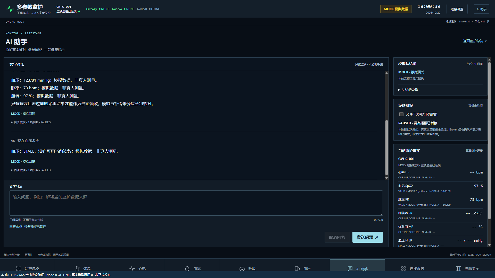

# H3-R2 工程收口与现场准入交接

本轮合同：MPM-H3-002 R1.0；执行者为 Codex。沿用合同指定的唯一文件名，不代表执行者变更为 DeepSeek。用户已排除第八节 ECG 采购和选型，本轮没有执行该支线。

**阶段结论：H3_PARTIAL_CONTINUE。软件回归通过，持久配置停在设计/现场授权门；NIBP_PENDING；FORMAL_RELEASE_NOT_AUTHORIZED；FORMAL_ROLLBACK_NOT_RUN。** 不宣告整体 H3_PASS、七页正式上线、持久化实板通过或生理准确性通过。

## 1. Git、镜像及现场身份

工作区 `E:/medical-monitor-h3`，仅使用 `dev/h3-nodea-cloud-ai-integration`。接管时本地/远端均为 `74d12a27425cdba6de18a833af86aa2087ee9c8a`。

**本轮代码、编译及测试证据提交：`b57f5464391174ca2bf45d0ed3453bd1cfe42093`。** 本交接及收尾只读证据另作正常提交；包含本文件的交付提交可用 `git log -1 --format=%H -- doc/H3/H3-DEEPSEEK-R2-FINAL-HANDOFF.md` 取得，最终完整 HEAD 和实际 push 结果在交付消息中列明。本文件不虚构包含自身的预知 SHA。

| 保护分支 | 重新查询到的远端 SHA |
|---|---|
| A | `3fa14b00a0823d2855e9dd8bd1c6c8545abb8dc5` |
| P6 | `77dd14d1ca761a488956f7a4ebf28cb3174835e4` |
| P4 | `67f5f57bd82c6e326e9e78ec9540481c80105e5f` |
| main | `50699048010c57ba10f8573461844c525b022a07` |

未创建 PR、合并、强推或执行正式 Security Gate。原有未跟踪根目录 `build/` 保留、不提交，因此不能声称整个工作区毫无未跟踪文件。已有疑似并行生成的未提交审计文件仅按用户指令移出工作区，原件在受限目录保留，SHA256 `011227e31e4e0d4358cda065adf51ef74c4b40b593a54826434ca3c0d9b3f6f1`；没有杀其他窗口或覆盖用户构建目录。

| 镜像身份 | 字节数 | SHA256 | 实际状态 |
|---|---:|---|---|
| C 既有实机镜像，源码 `ec044cc3e1887f7fd7812d6fd60b06a49d92f5ae` | 42728 | `c3bc10c6bb01831fb7c1f7a44dabb5fc0295fa667045a5428856bd6991250b6f` | 历史回执退出0；本轮未打开串口/重新读回 |
| C 新隔离持久配置候选 | 43172 | `59229f1b34660f053538737fc0fd17c814fde5502a0dfe33603e8e08b72ca8a5` | 仅构建；未下载 |
| C 新正常端口持久配置候选 | 43184 | `9df43acd34732cacb8c1a90a6a15e420b96ad9675a004d65c3a088246268f977` | 仅构建；未下载/连接正式Broker |
| A 新完成时间扩展候选 | 50084 | `f59b76ef865c373c6df62aa09aea958597687f6d46b17c402ceb7126ca8f60d6` | Keil/FromELF通过；未下载 |

候选镜像对应本轮代码提交；精确编译文件摘要、命令、向量、装载区间见 `gateway/physical_can/evidence/h3-r2/persistent-*/` 和 `node-a-arm-image.json`。最终文档提交不改变固件源码。

现场最新反馈：**A 断电、J-Link 拔下；C USB/COM15 正常供电，BOOT和CAN接线保持原状**。本轮未触发DTR/RTS、ROM复位、Flash读写、跳帽/电源/线缆操作；312B RAM配置当前存活状态未重新观察。C仍不能据此认定已具备正常独立BOOT。

## 2. Gate 裁定

| Gate | 结果 | 边界 |
|---|---|---|
| R2-0 | PARTIAL：代码/正式服务身份核对通过 | 现场为负责人反馈；无当前C读回；云安全组未用API独立验证 |
| R2-1 软件 | PASS / DESIGN_REVIEW_PENDING | 两种ARM、记录损坏/重载/闭锁Host通过；Flash物理保密性未具备 |
| R2-1 实板 | NOT_AUTHORIZED / NOT_RUN | 无新增sector3原件备份、持久配置写入、独立冷启动或300秒新窗口 |
| R2-2 软件 | PASS | 真实Node-A CANopen代码→Gateway→Backend→AI的合成协议字节及浏览器90秒过期通过 |
| R2-2 新信号源 | NIBP_PENDING | 没有新的合格血压源；未采集人体或上传新生理记录 |
| R2-3 新实板稳定/故障窗口 | NOT_AUTHORIZED / NOT_RUN | 不把历史无探头网络回归或本地MOCK当本轮有源300秒验收 |
| R2-4 本地七页/前缀 | PASS | HTTPS等效入口、WSS、桌面/移动截图20项；服务器内存候选nginx -t退出0 |
| R2-4 完整正式准备单 | PARTIAL / REPREPARE_REQUIRED | 新正式MQTT只读身份、完整受限备份及新的不可变候选目录未生成 |
| R2-5 | FORMAL_RELEASE_NOT_AUTHORIZED | activate、真实rollback及公网复验全部NOT_RUN |
| 第八节 | EXCLUDED | 用户已完成选型，不新增采购建议或B操作 |

## 3. 修改范围及持久配置方案

修改限于Node-A血压完成身份/对象字典、物理Gateway的NIBP采集时间还原、显式候选配置profile、功能夹具、只读核对与发布准备工具。没有迁移框架、改动第三方CANopenNode/coreMQTT、增加RTOS、麦克风或真实TTS路径。原Wi-Fi/ESP-AT/TLS及QoS1/PUBACK五秒预算保留，Node-B始终OFFLINE。

新配置profile默认关闭，通过 `--persistent-config --irq --fresh-sntp` 显式选择；隔离版本另加 `--isolated`。应用装载限sector0–2，不含配置段；链接断言禁止进入sector3。sector3提议保存336B记录（24B头+原312B结构）：版本、代次、CRC32、最后提交字；无效/缺失记录失败闭锁，不回退RAM或sector11。运行固件没有Flash写入口，不会在启动/重连时磨损Flash。**CRC不是加密、认证或物理读出保护。** ARK密钥不进入设备结构。

| 扇区 | 地址（右端不包含） | 擦除大小 | 本轮方案 |
|---|---|---:|---|
| 0 / 1 / 2 | `08000000–08004000` / `08004000–08008000` / `08008000–0800C000` | 各16KiB | C应用 |
| 3 | `0800C000–08010000` | 16KiB | 新配置，尚未授权写入 |
| 4 | `08010000–08020000` | 64KiB | 未使用且未确认擦除状态 |
| 5 / 6 | `08020000–08040000` / `08040000–08060000` | 各128KiB | 不动 |
| 7 | `08060000–08080000` | 128KiB | 严格保护 |
| 8 / 9 / 10 | `08080000–080A0000` / `080A0000–080C0000` / `080C0000–080E0000` | 各128KiB | 不动 |
| 11 | `080E0000–08100000` | 128KiB | 严格保护 |

按STM32F407ZGT6的1MiB设计，实际容量本轮未再读取。ST DS8626 Rev12 Table42列明指定温度条件下Flash最低10000次擦除寿命；这不是当前器件磨损实测。参考：<https://www.st.com/resource/en/datasheet/stm32f407vg.pdf>。

外部安全存储尚无已确认器件/驱动；sector3方案只适用于负责人接受**芯片可读的、可撤销且权限受限的台架Wi-Fi/MQTT凭据**。RAM方案仍可作为台架，不算持久交付。完整比较、记录结构、断电失败处理、擦除粒度和准入在 `H3-R2-1-CONFIG-PLAN.json`。没有生成真实持久配置，也没有绕用旧RAM下载工具写新profile。

回滚必须先备份实际C sector0–3的64KiB原件、至少两次一致SHA，再核对sector7/11/options；失败按同一授权窗口恢复原件。旧正常固件读sector11且此前为空，**不能承诺恢复旧固件后可独立联网**。旧隔离镜像+RAM恢复只代表显式台架会话。

资源：C隔离候选比既有42728B镜像增加444B；正常候选43184B。隔离text43076/data88/bss123136，正常text43088/data88/bss123136，RAM静态量不变。128KiB普通SRAM扣除data+bss约余7848B供栈等使用，未做真机栈水位测量。A Keil：Code46488/RO3108/RW1560/ZI15616；BIN50084B，比此前49888B增196B。A候选占sector0–3，和C新增配置sector3是不同板卡的范围，禁止混用下载计划。

## 4. NIBP 从完成时刻起算

发现旧Gateway把周期性TIME锚当成NIBP采集时间；旧值每两秒上报会看起来像新测量。Node-A虽已有90秒源端检查，仍需把完成时间传播到云端。

修复：Node-A成功结果增加非零generation，保留完成tick；利用原保留的TPDO2 `0x281` 发送新对象 `0x2111`（完成tick + SYS/DIA镜像），质量bit9标识扩展版本。原`0x181/0x381/0x481/0x681`及周期不降频。Gateway要求扩展新鲜、SYS/DIA镜像一致，并按TIME锚还原完成UTC。只有NIBP按90秒门限判龄，PPG/其他标量原门限不变。旧A无扩展时明确NIBP INVALID，不能倒退为当前时间。**新A/C需要成对部署后才可做本轮NIBP实板验收。**

源端加入中止/过期锁存，通信复位、返回IDLE、tick回绕不能复活旧结果；同值的新测量仍可凭新generation进入。保留已有屏幕、传感器采集流程；本轮仅离线编译，双屏实物没有新增观察。

协议夹具不是手工伪造最终JSON：实际Node-A CANopen发送字节进入实际Gateway栈/Adapter/Router格式化，再用Backend解码/Hub和AI事实层验证，明确MOCK。完成UTC不随重复上报刷新，90.001秒后STALE且AI无当前值；缺扩展、错配、未来时间、源质量和旧协议均覆盖。浏览器另等真实90.25秒验证相同结果。

R3的历史实测、旧人体来源记录仍仅追溯。本轮未填充新实测数值，不作精度结论；新物理NIBP保持PENDING。

## 5. 原始命令、退出码及失败

下表工作目录为 `E:/medical-monitor-h3`，Python使用UTF-8。完整参数、编译源摘要和原始输出在 `gateway/physical_can/evidence/h3-r2/`、`node-a/evidence/h3-r2-*`；未执行硬件。

| 命令/检查 | 退出码 | 结果 |
|---|---:|---|
| `python -m cloud.deploy.h3.r2_audit` | 0 | 只读身份冻结；首次审计前源码与历史实机编译输入一致 |
| `python gateway/physical_can/build.py --irq --isolated --fresh-sntp --persistent-config` | 0 | 新隔离ARM |
| `python gateway/physical_can/build.py --irq --fresh-sntp --persistent-config` | 0 | 新正常端口ARM，仅构建 |
| `python node-a/tests/run_host.py --phase h3-r2-final` | 0/0 | 编译/执行 |
| Keil `UV4.exe -r …uvprojx -o …node-a-keil-build.log` | 0 | 0错误0警告 |
| FromELF `--bin --output node-a/build/h3-r2-node-a.bin …axf` | 0 | 镜像身份单独冻结 |
| `python gateway/mqtt/tests/run_p5_host_tests.py` | 0 | 42项 |
| 同命令加 `--network-irq --fresh-sntp` | 0 | 46项 |
| `python gateway/physical_can/build.py --host --irq` | 0 | 协议、缺席B、过期、重启 |
| 同命令加 `--rx-order` | 0 | IRQ及100ms前台停顿 |
| 同命令加 `--peer-cycle` | 0 | ACK-only恢复、心跳门禁、硬故障锁存及掉电 |
| `python -m pytest cloud/backend/tests cloud/ai/tests gateway/physical_can/tests -q` | 0 | 最终180 passed、4 subtests；此前170/178项原件保留 |
| `npm --prefix cloud/web test` / `npm --prefix cloud/web run build` | 0 / 0 | 15项Web检查、TypeScript/Vite |
| `python cloud/web/tests/run_r2_browser.py` | 0 | 最后一次20项、实际90.25秒；自有进程和证书清理完成 |
| `python -m cloud.deploy.h3.r2_preflight` | 0 | 最新内存候选nginx -t、正式身份不变；没有prepare/activate |
| Python语法编译、Git源码空白检查 | 0 | 原始证据日志不归一化、不删末尾空行 |

失败没有被替换：NIBP修前pytest退出1、夹具7；两次Node-A对象字典初始化逗号编译1；独立wire夹具模块路径失败1；首轮浏览器MOCK标签断言失败1；只读预检缺全局json导入失败1；Nginx从不可seek的pipe解析失败1，改为内存memfd后退出0。详见 `failure-register.json`，含哪些首次输出仅留在工具会话、未另存完整原件。最早预检五槽窄正则false也未冒充无上限证明，后续AST查实 `range(1,6)`。

Git对原始Windows日志的CRCRLF/编译器末尾空格检查有提示，保留原始字节；源码（排除证据目录）空白检查通过，不把整库raw-log空白检查写成零告警。

## 6. 分层证据、浏览器和AI账本

| 层 | 本轮证据 | 未证明部分 |
|---|---|---|
| A CANopen→C Router | 实际代码Host字节、完成时间及过期；IRQ/掉电回归0 | 未烧录新A/C，无新实物CAN计数 |
| ESP/TLS/MQTT | P5原行为42/46项；两种联网ARM | 无本轮真实QoS0/QoS1、PUBACK、Broker/丢包增量 |
| Broker/Backend | 正式8883进程只读身份；本地真实Hub解码合成CAN JSON | 无本轮设备→隔离Broker有源300秒 |
| WSS/Web/AI | 本地真实Backend/AI应用，MOCK供数，HTTPS/WSS七页20项 | 无本轮正式HTTPS上线或真实模型调用 |

历史故障窗口仅历史：UART329.234s/PUBACK增加693；WSS320.052s A ONLINE/B OFFLINE；隔离单连接丢包6.002s、3包/783B，同次启动恢复。证据仍在旧 `mqtt-interruption-fix/`，不是新profile通过。MID1430/MID790因果差异不改；支持传输路径/无线延迟，未证明路由器硬件为唯一根因。本轮不继续无界网络诊断、不改5秒预算、不清零缺陷计数。

截图均标明本地测试，未使用人体读数：

七页overview/temp/ecg/spo2/resp/nibp/ai、独立浏览器AI令牌、AI鉴权失败不破坏监护、刷新清除令牌、移动无横向溢出均通过。端口仅loopback18765/18766/18767，自签名证书仅用于该入口，未修改系统信任、共享浏览器或正式TLS。

本轮真实豆包调用0、Token0，费用未新增且未查账户余额；历史10次/7496 Token原账保留，不能推定剩余免费额度。H3候选移除了五槽累计上限，仍有持久流水/并发/速率/预算授权/错误熔断及禁止自动重试。本轮DOUBAO真实服务没有切换。确定性读数标NOT_CALLED，MOCK一般解释不能标REAL_REQUEST_USED；不向模型发送原始波形、身份或完整聊天史。

## 7. 正式服务只读结果及发布审查包

| 正式运行对象 | PID | 实际工作目录/可执行文件 |
|---|---:|---|
| Backend `medical-monitor.service` | 845095 | `/opt/medical-monitor/releases/mqtt-v07-phase2-20260920-01/backend` / python3.12 |
| MQTT单元 `medical-monitor-mqtt.service` | 851111 | `/` / python3.12；实际8883 mosquitto子进程851112 |
| AI `p6-ai.service` | 394625 | `/opt/medical-monitor-p6` / python3.12 |
| Nginx | 3631 | `/` / nginx |

初审与收尾正式PID、CWD/executable、原配置散列和Web index均未变。业务Broker在`medical-monitor-mqtt.service`内；默认`mosquitto.service` inactive不代表正式Broker停机。8883监听存在，8884当前无监听；全IPv4安全组规则仍按负责人反馈保留，不代表主机监听或云规则已撤销。

旧正式AI `providers.py` SHA256 `40741521f34feaf3467d8d8bf7928342a36fbe2db463d99dc63b5715406140f6`，查实仍有五槽；未启动或调用该服务。此前三个runtime目录和旧 `20261020T034945Z/plan.json` 仅PREPARED_ONLY_NOT_PUBLISHED，不能作为R2部署完成。

发布代码修复：正式prepare必须显式输入外部0600正式只读角色MQTT8883配置，不能继承隔离8884；正式独立client_id；schema2拒绝旧准备单；健康要求Backend真正MQTT连接、AI DOUBAO/MONITOR；所有unit先校验再安装，部分复制失败也进入清理。purpose标识不是实际ACL已验证。11项本地发布失败保护测试通过，但activate重复执行目前是原路由hash不符后闭锁，并非幂等成功；不得无脑重跑。

候选路径：`/medical-monitor/#/ai`；AI `/medical-monitor/ai/*`完整保留给AI上游；API/WSS剥离项目前缀给Backend。本地等效HTTPS通过；新候选Nginx配置在服务器内存memfd执行`nginx -t`退出0，未reload、开监听或写正式配置。测试alias指向待重新prepare目录，不是已有可访问站点。

完整新正式prepare仍待：批准MQTT实际只读ACL/客户端、冻结新runtime源与静态散列、完整受限Web树/Backend/AI源码及所有unit/env/Nginx备份与权限、独立候选配置审查。旧prepare只备份四个配置文件和Web路径/index，不能把它当作全套原件备份。文件传输遵循E:/Server_file暂存→服务器SHA核验→仅删除自有暂存，本轮未上传。

新正式地址：**未发布**；原地址不变，仍由负责人本机受限生产配置管理。仓库不写真实主机或连接信息；原站点不能冒充新H3公网验收。正式activate/rollback、rollback后公网HTTPS复验均NOT_RUN；没有更改腾讯云、主机防火墙、ACL或正式站点。

## 8. 待负责人裁定的准确范围

合同第1节明确“任何…Flash擦写…写入持久密钥/配置或新增Flash扇区”须另行授权，第11节及最终签发裁定重复此门禁；第3.2标题“无需单独授权”与其冲突，本轮依授权矩阵和最终裁定停在现场门，不自行认定全硬件授权。

1. **先决定配置存储策略**：接受sector3明文可读、可撤销的受限台架凭据，或指定已验证外部安全存储。当前方案不能作为密钥物理保密方案。未接受则保持设计门，不烧录。
2. 若接受，批准单次C窗口：只读实际容量/镜像、备份实际sector0–3原件两次SHA；保护7/11/options；仅sector0–2写上述隔离候选，sector3另经批准写固定336B配置（擦除单位16KiB、commit最后）；按正常BOOT、独立供电并去除USB/宿主辅助验300秒。精确配置摘要和受限下载工具必须在真正写入前冻结；现有RAM工具不能绕过新布局门禁。
3. A候选若需配对验NIBP：另列A角色、50084B镜像和sector0–3写入范围，使用既有完整备份并核对当前原件，保持传感器/双屏功能。未给新的合格非人体源仍NIBP_PENDING；人体数据另需来源、最小上传及受众范围批准。
4. 同源码/镜像/配置下新有源300秒及单次隔离网络故障恢复，需要批准精确电源/BOOT/接线动作和隔离单连接故障窗口；分层统计FIFO、队列、Router、UART/Host、QoS0/QoS1、PUBACK、Broker、Backend及WSS，不能继承旧无探头结果。
5. TCP8884云规则准确待处理目标：仅负责人指认实例上“全部IPv4→TCP8884”规则；删除或换成现场出口/32均属公网范围调整，尚未执行。8883等原规则不在目标内。
6. 正式发布/真实回滚另待单次窗口，先补齐上节prepare缺口、确认受众/数据范围及原件。不能仅凭本次通用合同授权执行activate。

停止状态：板卡/生产环境保持接管时状态；本轮自有本地服务、浏览器会话和短期证书已清理；代码和证据可正常推送H3分支。等待负责人审阅存储策略与现场窗口，不需要再拆新合同。
