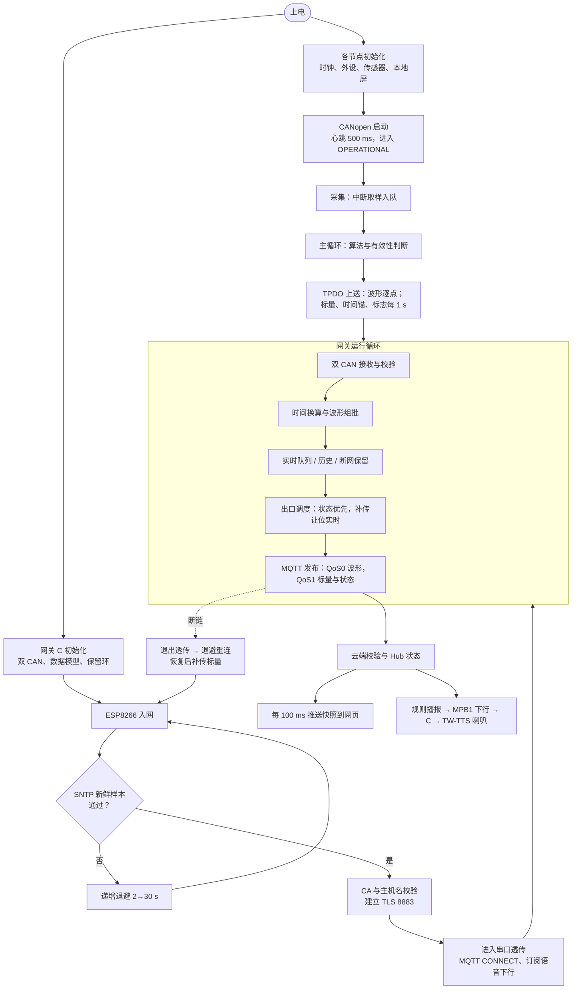
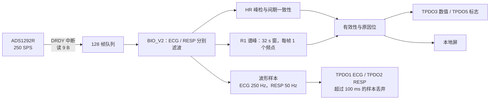
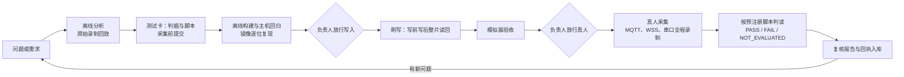
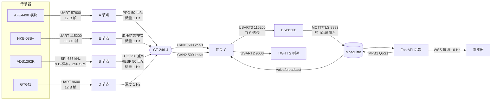
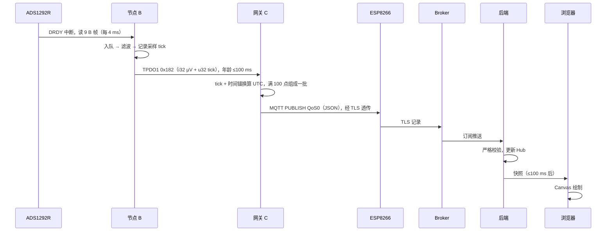

# 多参数生理监护系统样机 · 结项技术总览

| 项 | 内容 |
|---|---|
| 版本 | 1.0（2026-11-27） |
| 内容 | 一、技术栈；二、项目流程图；三、数据传输图；四、传输协议；五、成果展示与局限性 |
| 配套文档 | 项目书 `docs/acceptance/PROJECT-BOOK.md`（完整技术细节）；验收报告 `docs/acceptance/ACCEPTANCE-REPORT.md`（逐条结论与证据） |

系统由五块 STM32F407 主控板组成：
- **四个采集节点**：A 血氧/脉率/PPG，B 心电/心率/呼吸，D 物表温度，E 无创血压；
- **网关节点 C**：经双段 CANopen 汇聚四个节点的数据，再通过 ESP8266 以 MQTT over TLS 上云；
- **云端**：校验、时效管理、实时推送到浏览器，并通过规则引擎生成播报，经 MQTT 下行到 C 的喇叭。

---

## 一、技术栈

### 1.1 总览

| 层 | 技术 | 版本 / 规格 | 用途 |
|---|---|---|---|
| 主控 | STM32F407（Cortex-M4F） | 1 MiB Flash，192 KiB SRAM（含 64 KiB CCM） | 五块板 |
| 节点时钟 | HSE 8 MHz + PLL | 168 MHz，PCLK1 42 MHz | A、B、D、E |
| 网关时钟 | HSE 8 MHz，不启用 PLL | 8 MHz | C |
| 节点固件 | C99，Keil MDK ARMCC | 5.06 update 7 | A、B、D、E |
| 网关固件 | C，Arm GNU Toolchain | 14.2.Rel1（GCC 14.2.1，`-Os`） | C |
| 外设库 | STM32F4 标准外设库（SPL）+ CMSIS | v1.4.0 | 全部 |
| 调度 | 裸机协作式主循环 + 中断入队 | — | 全部（未使用 RTOS） |
| 心电 / 呼吸前端 | TI ADS1292R | 24 bit，250 SPS，内置呼吸阻抗调制 | B |
| 传感器模块 | AFE4490 血氧模块、GY641 红外温度、HKB-08B+ 血压 | 串口输出 | A、D、E |
| 本地显示 | DACAI 串口屏 | 115200 / 9600 | A、B、D、E |
| 板间总线 | CAN 2.0A + CANopen（CANopenNode） | 500 kbit/s；CANopenNode v4.0（`9b8beed`） | 五块板 |
| CAN 拓扑 | GCAN-GT-246-4 四通道网桥 | 四个约 60 Ω 子段 | 物理层 |
| 联网模块 | ESP8266 + ESP-AT | 固件 2.3.0.0；串口 115200 透传 | C |
| 设备 MQTT | coreMQTT | v2.3.1，MQTT 3.1.1 | C |
| 语音 | TW-TTS 模块 + 喇叭 | 串口 9600 | C |
| Broker | Mosquitto | 2.x，TLS 1.2，端口 8883 | 云端 |
| 后端 | Python + FastAPI + Uvicorn + Pydantic + paho-mqtt | 3.12 / 0.135.1 / 0.40.0 / 2.12.5 / 2.1.0 | 云端 |
| 网页 | TypeScript + Vite + Canvas 2D | 5.9.3 / 7.3.5 | 浏览器 |
| 部署 | Linux + Nginx + systemd + venv | — | 云端 |
| 测试 | C 主机测试（gcc）、pytest、Node 测试、Python 离线评估（numpy） | — | 开发与验收 |
| 诊断 | DWT 周期计数、CAN TEC/REC、UART 计数、J-Link/SWD 读回 | — | 板端 |
| CI | GitHub Actions | — | 普通构建与回归 |

### 1.2 关键算法

| 参数 | 算法 | 要点 |
|---|---|---|
| HR | BIO_V2 确定性峰检 | 0.5 Hz 去直流 → 50/100 Hz 陷波 → 5–25 Hz 带通；门限取 max(30, 2.5 × RMS)；不应期 273 ms；5 个间期一致才输出 |
| RR | R1 窗内谱峰 | 32 s 窗、2 s 步长；Goertzel 计算 0.10–0.70 Hz 的 246 个频点，每帧只算一个；六道质量门槛；3 窗一致才输出 |
| PR | IR 波形峰检（F407 端） | 高通、低通、陷波、平滑后检峰；重搏波防护；30–240 bpm |
| SpO₂ / NIBP / TEMP | 模块输出 | 节点只做协议解析、有效性与时效判断 |

---

## 二、项目流程图

### 2.1 系统运行流程



### 2.2 单个节点的数据处理流程（以 B 为例）



### 2.3 开发与验收流程



---

## 三、数据传输图

### 3.1 端到端链路与速率



### 3.2 各段数据形态

| 段 | 载体 | 单位数据 | 速率 |
|---|---|---|---|
| 传感器 → 节点 | UART / SPI | 模块帧 / ADC 原始帧 | ECG 250 Hz；PPG 约 121 Hz 原始，重采样为 50 Hz；温度、血压按模块输出 |
| 节点 → 网关 | CAN PDO（8 B） | 波形每帧 1 个样本（值 + 采样 tick）；标量 4 × u16；时间锚；标志 | 段二约 312 帧/s，总线负载约 8% |
| 网关内部 | `MpFrame` | 波形批：ECG 100 点（0.4 s），PPG、RESP 50 点（1 s）；标量单值 | 实时队列 24 帧，历史 56 帧，CCM 保留环 1,472 + 736 条 |
| 网关 → 云 | MQTT PUBLISH（JSON） | 一条消息 = 一个批次或一个标量 | 约 10.45 批/s，串口线速占用约 40% |
| 云 → 浏览器 | WebSocket 文本 | 快照：全部流的当前值与波形批 | 每 100 ms 一次 |
| 云 → 网关 | MQTT PUBLISH（二进制） | MPB1：19 B 头部 + ≤200 B UTF-8 文本 | 同一参数 300 s 内最多 1 条 |

### 3.3 一个心电样本的传输时序



---

## 四、传输协议

### 4.1 协议分层

| 链路 | 物理 / 链路层 | 应用协议 | 可靠性措施 |
|---|---|---|---|
| 血氧模块 → A | UART 57600 8N1 | 17 B 定长帧（无校验，核对帧头、帧尾） | 帧头帧尾同步；4 s 无数据判过期 |
| ADS1292R → B | SPI 模式 1 | 9 B 原始帧（状态 + 两个 24 bit 通道） | 状态字校验；128 帧队列；缺口与序号检测 |
| GY641 → D | UART 9600 | 12 B 帧，8 位累加校验 | 校验 + 2.5 s 时效 |
| HKB-08B+ ↔ E | UART 115200 | `FF C0 LEN CKSUM CMD DATA` | 校验和；停止命令 1.5 s 超时 |
| 节点 ↔ C | CAN 2.0A 500 kbit/s | CANopen（PDO / NMT / 心跳 / TIME / SDO / EMCY） | 自动重传；心跳超时 1.5 s；来源与角色校验；启动代次 |
| C ↔ ESP8266 | UART 115200 | ESP-AT 命令；建链后串口透传 | 预算化 AT 事务；`+++` 有界退出；硬复位兜底 |
| ESP8266 ↔ Broker | TCP/TLS 1.2 | MQTT 3.1.1（coreMQTT） | CA 与主机名校验；QoS1 + PUBACK；保活 15 s；遗嘱 |
| Broker ↔ 后端 | TLS | MQTT 3.1.1（paho） | 订阅 QoS1；有界队列 |
| 后端 ↔ 浏览器 | HTTPS / WSS（Nginx） | JSON 快照 | 首帧鉴权与 Origin 校验；有界订阅队列 |
| 后端 → C → TTS | MQTT → UART 9600 | MPB1 二进制帧 → TW-TTS 帧 | TTL 15 s；时间戳严格递增；3 槽队列 |

### 4.2 CANopen

**节点与总线**：A = 1、E = 5 在段一（C.CAN1）；B = 2、D = 4 在段二（C.CAN2）；C = 3。

**对象字典（厂商区）**：

| 索引 | 内容 |
|---|---|
| 0x2100 | 时间锚：epoch 秒 + 对应节点 tick |
| 0x2110 | 波形 A：值（i32）+ 采样 tick。PPG 为相对量 ×1e6；ECG 单位 µV |
| 0x2111 | 波形 B / 血压完成：RESP 相对量 ×1e6 + tick；或血压完成 tick + SYS \| DIA << 16 |
| 0x2120 | 标量 4 × u16：SpO₂/PR ×100；HR/RR ×100；TEMP ×100 + 帧龄；SYS/DIA ×10 |
| 0x2130 | 有效性标志（u32）+ 启动代次 |

**PDO 映射**（各节点 8 B，传输类型 0xFF）：

| PDO | COB-ID | 内容 | 节奏 |
|---|---|---|---|
| TPDO1 | 0x180 + ID | 0x2110 波形 | 每个新样本（A、B） |
| TPDO2 | 0x280 + ID | 0x2111 | B 每个 RESP 样本；E 每 1 s |
| TPDO3 | 0x380 + ID | 0x2120 标量 | 1 s |
| TPDO4 | 0x480 + ID | 0x2100 时间锚 | 1 s |
| TPDO5 | 0x680 + ID | 0x2130 标志 | 1 s，变化时立即发送 |

**网络服务**：
- **心跳**：500 ms 一次，C 按 1.5 s 超时消费。
- **TIME**：C 每 10 s 在两段上各广播一帧（COB-ID 0x100，6 B：当日毫秒 + 自 1984-01-01 起的天数）。
- **NMT**：通信复位时只重建协议栈，不复位 MCU。
- **EMCY**：转为 FAULT 事件上送。
- **SYNC**：不使用。

**网关校验**：
- 格式异常、来源段错误、角色与标志不符的帧，分别计数后丢弃；
- 单个 PDO 的新鲜期为 1.5 s；
- 标量有效须同时满足：数值、标志、时间锚三者都新鲜，且心跳在线。

### 4.3 网关 ↔ ESP8266

**建链顺序**：
1. `AT`、`ATE0`、`AT+SYSSTORE=0`、`AT+CWMODE=1`；
2. `AT+CWJAP` 入网；
3. SNTP 粗授时；
4. NTPv4 新鲜样本校验：RTT ≤1 s，originate 时间戳匹配，stratum 合法；
5. `AT+CIPSSLCCONF=2,0,0`，启用 CA 校验；`AT+CIPSSLCCN` 设主机名，`AT+CIPSSLCSNI` 设 SNI；
6. `AT+CIPSTART="SSL",<host>,8883`；
7. `AT+CIPMODE=1`、`AT+CIPSEND` 进入透传。

**退出透传**：静默 1 s → 发 `+++` → 静默 1 s → 发 `AT` 确认。最多两次，失败则硬复位 ESP。

**恢复**：
- 断链按 2 → 4 → 8 → 16 → 30 s 退避；稳定在线 300 s 后计数清零；
- 会话重入最多 3 次，之后做一次受控软件复位。

### 4.4 MQTT

**会话参数**：

| 项 | 值 |
|---|---|
| 协议 | MQTT 3.1.1；Clean Session = true；Keepalive 15 s |
| QoS | 实时波形 QoS0；标量、状态、故障、全部补传 QoS1（在途 4 槽，每个事务 5 s 超时） |
| Retain | 仅节点状态与网关状态 |
| 遗嘱 | `mpm/v1/GW-C-001/status`，QoS1，retain，内容为 OFFLINE |

**主题树**：

```text
mpm/v1/GW-C-001/status                         网关 ONLINE / OFFLINE（含遗嘱）
mpm/v1/GW-C-001/NODE-{A,B,D,E}/status          节点在线状态
mpm/v1/GW-C-001/NODE-x/telemetry/<stream>      实时数据
mpm/v1/GW-C-001/NODE-x/replay/<stream>         补传数据
mpm/v1/GW-C-001/NODE-x/event                   故障事件（EMCY-xxxx）
mpm/v1/GW-C-001/voice/broadcast                云 → C 的 MPB1 播报帧

stream：A = ppg | spo2 | pr；B = ecg | hr | resp | rr；D = temp；E = nibp
```

**载荷**（UTF-8 JSON，字段顺序固定）：

```json
{"timestamp": 1764000000000, "seq": 12, "session_id": "can-<epoch>-<boot>",
 "validity": "VALID", "source": "LIVE", "synthetic": false,
 "unit": "bpm", "value": 72.00}

{"timestamp": 1764000000400, "seq": 845, "session_id": "can-<epoch>-<boot>",
 "validity": "VALID", "source": "LIVE", "synthetic": false,
 "unit": "mV", "value": null, "sample_rate": 250, "samples": [0.012, 0.015, ...]}
```

| 字段 | 规则 |
|---|---|
| `timestamp` | 采集时刻（UTC 毫秒）；波形批取最后一个样本的时刻 |
| `seq` | 按节点和数据流分别递增 |
| `session_id` | `can-<连接时刻>-<节点启动代次>` |
| `validity` | VALID / INVALID；状态消息无效时为 OFFLINE |
| `source` | LIVE 实时 / REPLAY 补传 / MOCK 合成；补传不覆盖当前值，合成不得冒充实时 |
| `unit` | ECG `mV`，PPG/RESP `relative`，SpO₂ `%`，HR/PR `bpm`，RR `breaths/min`，TEMP `degC`，NIBP `mmHg`（值为 `[sys, dia]`） |

**后端校验**：
- Pydantic strict 模式：拒绝未知字段、类型不符、NaN/Inf；
- 以主题为准，载荷中的身份字段必须与主题一致；
- 时间戳不得超前 5 s；同一会话内 seq 必须递增；
- 新鲜度：标量、波形 5 s，NIBP 90 s。

### 4.5 WebSocket

| 项 | 规则 |
|---|---|
| 路径 | `/medical-monitor/ws/v1/monitor` |
| 握手 | 5 s 内发送首帧文本 JSON `{token, gateway_id}`，不超过 4 KiB；查看角色须提供白名单内的 Origin；公开只读模式免令牌 |
| 快照 | `{type:"snapshot", schema_version:1, gateway_state, nodes, streams[], replay, event, broadcast…}`，每 100 ms 一次；过期或离线的数据清空数值和样本 |
| 连接管理 | 最多 32 个订阅者；每个客户端的队列有界，跟不上时关闭（1013）；客户端按 1→10 s 退避重连 |

### 4.6 MPB1 语音下行与 TW-TTS

**MPB1 帧**（大端，头部 19 B）：

| 偏移 | 长度 | 字段 | 网关校验 |
|---|---|---|---|
| 0 | 4 | `"MPB1"` | 完全匹配 |
| 4 | 1 | 版本 | = 1 |
| 5 | 8 | issued_ms | 严格递增；未过期 |
| 13 | 4 | TTL | = 15000 ms |
| 17 | 2 | 文本长度 | = 总长 − 19 |
| 19 | ≤200 | UTF-8 文本 | 不含控制字符、零宽字符和方括号 |

**TW-TTS 串口**：
- 文本帧：`FD lenH lenL 01 04 <文本>`；
- 控制帧：`FD 00 01 cmd`，0x02 为停止，0x21 为状态查询；
- 模块应答：0x41 已接收、0x4E 播放中、0x4F 空闲。

---

## 五、成果展示与局限性

### 5.1 主要成果

| 方面 | 成果 | 数据 |
|---|---|---|
| 系统集成 | 五板分布式样机全链路贯通：采集 → CANopen → 网关 → TLS/MQTT → 云端 → 网页 → 播报下行 | 1 h 连续运行无意外重启（R128） |
| 出口吞吐 | 用 DWT 周期计数分解出口耗时，定位瓶颈在逐包 AT 交互，改为 TLS 透传 | 8.07 → **10.458 批/s**，送达率 ≥99.87%，零丢弃（R12） |
| 断网保留 | 标量、状态用 28 B 紧凑条目存入 CCM；补传为实时数据让路 | 断网约 203 s，标量 **1,030/1,030** 补传，无缺失、无重复（S3） |
| 自动恢复 | 断链后有界退出透传、退避重连；本地异常与网络异常分开处理 | 1 h 内一次断链，**13 s** 自动恢复（R128） |
| 心电 | 采集与算法解耦，ECG、RESP 分通道判有效 | 最终一轮真人 HR 有效 **99%**，与脉率 ±10% 以内 **97%**（R126） |
| 呼吸率 | R1 谱峰算法，计算分摊到每一帧；C 实现与 Python 参考实现逐窗一致 | 9,883 窗逐窗一致；模拟器 20、12 次/分全部正确；真人与实测一致（R126） |
| 实时显示 | 波形有效性与 HR/RR 解耦，波形持续显示；无效数值显示“--” | 1 h 内波形有效率 99.9–100%，ECG 丢失 1.4–2.6% |
| 血压链路 | 本地测量，屏、网关、云端、网页四处一致，按时失效 | 7/7 一致（R128） |
| 播报 | 云端确定性规则 → MPB1 → 网关 → 板载喇叭；浏览器同步朗读 | 现场确认发声（R65） |
| CAN 物理层 | 用网桥把约 40 Ω 的重负载拆为四个约 60 Ω 子段 | 双绞线接入验收通过（R73） |
| 工程方法 | 判据先于采集；镜像逐位复现；整片读回；原件 SHA 留档；失败记录不覆盖 | R1–R128 测试卡、回执与复核报告 |

**可演示内容**：
- 五板上电后自动上线；
- 网页实时显示心电、呼吸、PPG 波形，以及 HR、RR、SpO₂、PR、体温、血压；
- 拔下节点 CAN 时显示离线，插回后恢复；
- 断网时标量暂存，恢复后补传；
- 血压测量结果在屏和网页上同步出现，90 s 后转为过期；
- 规则播报经板载喇叭播放。

### 5.2 局限性

**已接受的未达项**：

| 项 | 现状 |
|---|---|
| SpO₂ 数值合理性 | 部分有效读数超出预设范围（14.8–22.7%）；没有参照仪器 |
| 网络恢复时间 | 短断网后 SNTP 零回复，恢复可达 551–582 s（目标 90 s） |
| 体温覆盖 | 1 h 内 87.1%（目标 99%），D 节点定时发送帧缺失约 20%，问题保留在分支 `claude/d-node-tpdo-loss` |
| 长测 | 只做 1 h；2 h 与 24 h 未做 |

**原因未明（UNKNOWN）**：
- MQTT 断链的源头：最近一次由 PUBACK 停滞触发，本地串口和 CAN 正常；
- D（以及程度较轻的 B）定时发送帧缺失的机制：已排除 CAN 速率和 B 波形挤占。

**设计边界**：
- 真人 HR 受个体胸壁噪声与 QRS 幅度影响大，此前多轮未达门槛；
- RR 刚上电或受干扰后，约需 40 s 才出值；
- 各测量量没有绝对标定；GY641 读的是物表温度；
- 断网保留以标量为主，波形尽力而为；保留期 240 s；
- 云端只保存当前状态，页面趋势只存在于当前会话，没有长期数据库；
- 网关未使用 RTOS，发送路径为逐字节轮询，约占 54% 的 CPU 周期；
- 状态帧仍标为 MOCK；Broker 的写权限未收窄。

**未做（NOT_RUN）**：
- CAN 差分波形与故障注入；
- 24 h 长测；
- 麦克风上行（正式镜像未启用）；
- 付费大模型问答；
- 录像证据。

### 5.3 后续方向

1. 定位并修复 D 的发送帧缺失，范围限于驱动的发送完成路径。
2. 网关出口改用 DMA；有语音上行需求时，再迁移到 FreeRTOS。
3. 与参照仪器做对比和标定；完成 24 h 长测和 CAN 故障注入。
4. 收窄 Broker ACL；统一状态帧的来源标签。
