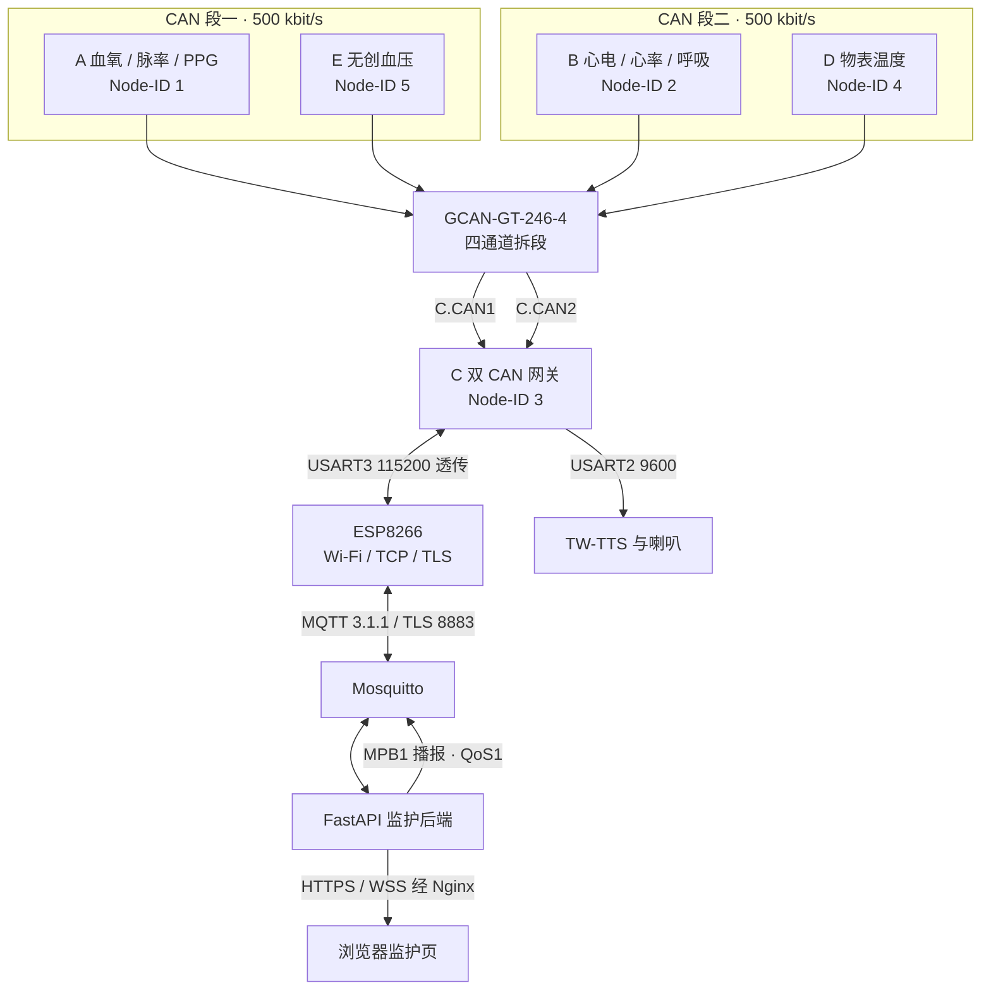

# 多参数生理监护系统样机 · 项目书

| 项 | 内容 |
|---|---|
| 文件版本 | 1.0 草稿（2026-11-24） |
| 状态截止 | 2026-11-27。已含 R125 结果（R126）和 1 h 长测结果（R128） |
| 源码基线 | 仓库 `Serendipity-min/medical-multi-parameter-monitor`，开发分支 `claude/r99-r98-offline-test` @ `22e44fd` |
| 适用范围 | 工程样机。不涉及医疗器械注册、临床准确度和量产 |

---

## 目录

1. 项目概述
2. 需求与设计约束
3. 系统总体架构
4. 硬件组成
5. 采集节点固件
6. 板间通信：CAN 与 CANopen
7. 网关节点 C
8. 上云协议：MQTT over TLS
9. 云端服务
10. 监护网页
11. 技术栈总表
12. 测试与验证
13. 关键技术问题与解决过程
14. 已知限制与后续方向
15. 仓库结构、构建与测试入口
附录 A 术语
附录 B 文档索引

---

## 1. 项目概述

### 1.1 项目目标

本项目实现一套分布式多参数生理监护工程样机，覆盖以下参数：

| 参数 | 缩写 | 来源 |
|---|---|---|
| 血氧饱和度 / 脉率 / 光电容积波形 | SpO₂ / PR / PPG | 节点 A |
| 心电 / 心率 | ECG / HR | 节点 B |
| 阻抗呼吸波形 / 呼吸率 | RESP / RR | 节点 B |
| 体表（物表）温度 | TEMP | 节点 D |
| 无创血压 | NIBP | 节点 E |

系统由五块 STM32F407 主控板组成：
- 四个采集节点（A、B、D、E）各自带本地显示屏，通过 CANopen 把数据汇聚到网关节点 C；
- C 经 ESP8266 以 MQTT over TLS 接入云端；
- 云端完成数据校验、时效管理和实时推送，浏览器显示波形、数值和趋势；
- 云端规则引擎生成播报文本，经 MQTT 下行到 C，由板载 TTS 模块和喇叭播放。

### 1.2 范围

**本阶段完成的内容：**
- 五类生理参数的采集、本地显示和上云；
- 双段 CANopen 汇聚；
- 网关的时间同步、分级队列和有限断网保留；
- TLS 上云和自动恢复；
- 云端严格校验和公开只读监护页面；
- 确定性规则播报，以及下行到板载喇叭。

**不在本阶段范围内：**
- 医疗器械注册与临床认证；
- 接入医院 HIS/EMR；
- 产品化 PCB 与单板集成；
- 远程控制血压充放气；
- 量产。

### 1.3 成果概览

| 方面 | 状态 |
|---|---|
| 五板架构与全链路 | 已实现。采集 → CANopen → 网关 → TLS/MQTT → 云端 → 网页 / 播报，全链路贯通 |
| 出口吞吐 | 源端约 10.45 批/s。改为 TLS 透传后，服务率由 8.07 批/s 提升到 10.458 批/s，五板实测送达率 99.87%，零丢弃 |
| 断网保留 | 断网约 203 s 的场景中，五路标量 1,030/1,030 全部补传，无重复，顺序正确 |
| CAN 物理层 | 经 GCAN-GT-246-4 拆成四个约 60 Ω 子段，双绞线接入验收通过；五板稳定运行 30 min |
| 心电 / 呼吸算法 | 模拟器多档验收通过。真人 HR 在多数轮次中受个体噪声与 QRS 幅度限制未达门槛；最终一轮（R125，志愿者丙）HR 有效率 99%，与脉率一致率 97%，RR 与实测呼吸一致（见 12.6） |
| 云端与网页 | 正式部署运行；公开只读查看；规则播报经板载喇叭播放，现场已确认 |
| 未完成 | 2 h 和 24 h 长测（本阶段只做 1 h）、各测量量的绝对标定、CAN 物理裕量与故障注入、麦克风上行（见第 14 章） |

---

## 2. 需求与设计约束

### 2.1 功能需求

1. 各测量模块独立工作，并在本地屏显示。
2. 采集节点通过统一的板间协议汇聚到网关；单个节点掉线不影响其他节点。
3. 网关独立联网，不依赖常开的个人电脑。
4. 云端接收、校验、转发数据；网页显示实时波形、数值、节点在线状态和趋势。
5. 网络中断时，网关有基本的缓存和恢复能力。
6. 每个测量值都带有效性标志；无效值或过期值不能当作当前值显示。

### 2.2 设计约束

| 约束 | 影响 |
|---|---|
| 主控统一为 STM32F407（192 KiB SRAM，其中 64 KiB 为 CCM；1 MiB Flash） | 网关的缓存与断网保留必须按字节精确预算 |
| 网关 C 的时钟为 HSE 8 MHz，不启用 PLL | 网关 CPU 预算按 8 MHz 计算；串口逐字节服务的开销显著 |
| 联网模块为 ESP8266（ESP-AT 固件），串口 115200 | 出口吞吐受串口线速和 AT 交互开销约束 |
| 传感器采用成品模块（血氧、血压、红外温度）与 ADS1292R 前端 | 数值的准确度部分取决于模块自身的算法 |
| 部分节点由电池供电，人体接触期间不接市电 | 现场测试流程须包含供电确认 |

### 2.3 数据语义原则

- **来源三分**：每条数据都标明来源，分为 `LIVE`（实时）、`REPLAY`（补传）、`MOCK`（合成）三类。补传数据不覆盖当前值，合成数据不能冒充实时数据。
- **采集时刻**：时间戳是采集时刻（UTC 毫秒），不是接收时刻。
- **有效性分层**：传输完整、算法有效、数值准确三者分别判定。`VALID` 只表示算法认为结果可用，不代表经过精度验证。

---

## 3. 系统总体架构

### 3.1 拓扑



### 3.2 节点职责

| 节点 | Node-ID / 所在段 | 职责 | 主要外设 |
|---|---|---|---|
| A | 1 / 段一（C.CAN1） | SpO₂、PR、PPG；本地血氧屏 | USART6 57600 接血氧模块；USART2 115200 接屏 |
| B | 2 / 段二（C.CAN2） | ECG、HR、RESP、RR；本地心电屏 | SPI1 接 ADS1292R；USART1 115200 接屏 |
| C | 3 / 两段 | 授时、双段汇聚、时效判定、队列与断网保留、MQTT/TLS 出口、播报下行 | CAN1、CAN2；USART3 接 ESP8266；USART2 接 TW-TTS |
| D | 4 / 段二（C.CAN2） | GY641 红外物表温度；本地温度屏 | UART4 9600 接温度模块；USART3 115200 接屏 |
| E | 5 / 段一（C.CAN1） | 无创血压测量（本地按键启动）；本地血压屏 | UART5 115200 接血压模块；USART3 9600 接屏 |

C 的两个 CAN 接口各运行一个 CANopenNode 实例，共用同一个网关身份和上行数据模型。C 汇聚的是业务数据，**不在两段之间转发 CAN 报文**。

### 3.3 端到端数据流

1. **采集**：传感器数据进入节点，节点在本地计算 HR、RR、PR 等标量，记录采集时刻（节点本地毫秒 tick）。
2. **板间**：节点通过 TPDO 上送：波形逐点发送；标量每 1 s 一帧；有效性标志每 1 s 一帧，变化时立即补发；时间锚每 1 s 一帧。
3. **网关**：C 用时间锚把节点 tick 换算成 UTC，把波形逐点重组为批次（ECG 每批 100 点，PPG 和 RESP 每批 50 点），把标量与有效性标志配对后生成统一帧 `MpFrame`，放入实时队列；需要时同时写入历史缓存和断网保留环。
4. **出口**：C 按“状态优先、标量与波形交替、补传让位实时”的规则调度，经 coreMQTT 编码，通过 ESP8266 透传发往 Broker。实时波形用 QoS0；标量、状态、故障和补传用 QoS1。
5. **云端**：后端订阅、严格校验，按网关、节点、数据流三元组维护当前值、时效和会话，每 100 ms 向浏览器推送一次快照。
6. **播报**：规则引擎从合格的实时标量生成播报文本：一路进入快照，由浏览器朗读；另一路编成 MPB1 帧经 MQTT 下行到 C，由 TW-TTS 播放。

### 3.4 时间体系

| 层 | 时间源 | 说明 |
|---|---|---|
| C | SNTP（ESP8266 粗授时，再加一次独立的 NTPv4 UDP 新鲜样本校验） | 每 10 s 重新同步。常规模式下，最后一次同步后 30 s 内 UTC 可用；启用断网保留时延长到 610 s。修正速率不超过每 100 ms 1 ms |
| 板间 | C 每 10 s 在两段上各发一帧 TIME 报文（COB-ID 0x100，6 B） | 节点按整秒建立锚点。30 s 没收到 TIME，节点的 epoch 置 0 |
| 节点 | 本地毫秒 tick | 每帧数据带采样 tick；时间锚对象 0x2100 给出“整秒 epoch 与对应 tick” |
| C 换算 | utc = epoch × 1000 + (tick − anchor) | 只接受偏差不超过 2000 ms、锚点年龄不超过 1500 ms、结果落在 [now − 5 s, now + 1 s] 内的样本 |

---

## 4. 硬件组成

### 4.1 主控与模块

| 组成 | 型号 / 规格 | 用途 |
|---|---|---|
| 主控板 ×5 | STM32F407（Cortex-M4F，1 MiB Flash，192 KiB SRAM 含 64 KiB CCM） | A、B、C、D、E |
| 血氧模块 | AFE4490 方案，由 UNO 侧固件输出串口帧 | A |
| 心电 / 呼吸前端 | TI ADS1292R（双通道 24 bit ΔΣ ADC，内置呼吸阻抗调制解调） | B |
| 红外温度模块 | GY641 | D |
| 血压模块 | HKB-08B+（示波法，带袖带与气泵） | E |
| 联网模块 | ESP8266，原厂 ESP-AT 固件 | C |
| 语音模块 | TW-TTS，外接喇叭 | C |
| 本地屏 | DACAI 串口屏（A、B、E），温度屏（D） | 各采集节点 |
| CAN 收发器 | 各板载收发器 | 全部节点 |
| CAN 网桥 | GCAN-GT-246-4（四通道） | 把两段总线拆成四个子段 |

### 4.2 CAN 物理拓扑

早期两段总线各连三块板，每块板都带 120 Ω 终端，并联后约 40–41 Ω，电气负载偏重。最终用 GCAN-GT-246-4 把两段拆成四个子段，每个子段只保留两只终端（约 60 Ω）：

| 子段 | GT 通道 / 终端拨码 | 两端 | 拓扑 | H–L 阻值 |
|---|---|---|---|---|
| S1 | CAN1 / R1 ON | GT CAN1 ↔ C.CAN1 | 点对点 | ≈60 Ω |
| S2 | CAN2 / R2 OFF | A.CAN1 ↔ E.CAN1，GT CAN2 从中间分出 | 一进两出 | ≈60 Ω |
| S3 | CAN3 / R3 ON | GT CAN3 ↔ C.CAN2 | 点对点 | ≈60 Ω |
| S4 | CAN4 / R4 OFF | B.CAN1 ↔ D.CAN1，GT CAN4 从中间分出 | 一进两出 | ≈60 Ω |

- 拆段降低的是电气负载，总线占用率不变。
- 双绞线接入后五板稳定运行 30 min，验收通过。
- 差分波形、长期老化和受控故障注入尚未做（见第 14 章）。

### 4.3 供电

- 有人体接触的测试中：采集节点和 C 用电池供电，网桥用移动电源，调试器拔除，不接市电。
- 模拟器测试和长测可以用常规电源，但须现场确认供电与散热条件。

---

## 5. 采集节点固件

### 5.1 共同基础

| 项 | A / E | B / D |
|---|---|---|
| 工程 | `node-a/STM32F407_HOSPITAL`。E 由同一工程裁剪而来：去掉血氧相关文件，加入 `node-e/` | `node-b/firmware/biov2/实验固件`。D 由同一工程裁剪而来：去掉 ECG/DSP/屏串口，加入 `node-d/` 和 `node-b/temperature` |
| 编译器 | Keil MDK，ARMCC V5.06 update 7（build 960），C99 | 同左 |
| 外设库 | STM32F4 标准外设库（SPL）+ CMSIS | 同左 |
| 时钟 | HSE 8 MHz，PLL M8/N336/P2 → 168 MHz；APB2 ÷2，APB1 ÷4（PCLK1 = 42 MHz）；Flash 5 等待周期 | 同左 |
| 时基 | SysTick 1 ms | B：TIM2 1 ms（算法）+ SysTick 10 ms（屏）+ DWT 微秒延时；D：只用 TIM2 1 ms |
| 看门狗 | IWDG，分频 128、重装 625，名义约 10 s，只在主循环中喂狗 | 不启用 |
| 调度 | 裸机协作式主循环，中断只做接收和入队 | 同左 |
| CANopen | CANopenNode（与网关同一上游版本），各自的 `CO_driver.c` 移植层 | 同左 |

五板构建由 `tools/build_five_node.py` 统一驱动：A 加 `MP_FIVE_NODE_A` 宏（去掉血压子系统）；B 的构建把原工程中的 CAN 实现替换为 CANopenNode 版本（`node-b/tools/build_b4_arm.py`）。

**镜像大小**（Keil 构建回执，2026-11-06）：

| 节点 | Code / RO / RW / ZI（B） | BIN |
|---|---|---|
| A | 30,052 / 2,896 / 1,512 / 15,584 | 33,444 B |
| B（C2 算法时期） | 36,420 / 3,144 / 1,480 / 18,088 | 40,040 B |
| B（R1 算法 + R125 修复，现装） | 40,548 / 3,176 / 1,492 / 44,292 | 44,200 B |
| D | 21,488 / 2,624 / 1,244 / 6,476 | 24,552 B |
| E | 26,284 / 2,680 / 1,356 / 7,796 | 29,424 B |

### 5.2 节点 A：血氧、脉率、PPG

**模块接口**：USART6（PC6/PC7），57600 8N1，RXNE 中断接收，优先级 2。

**帧格式**（17 B，`HARDWARE/UNO/uno.c`）：

| 偏移 | 长度 | 内容 |
|---|---|---|
| 0 | 5 | 帧头 `0A FA 0A 00 02` |
| 5 | 4 | IR 通道原始值（LED1VAL，int32 小端） |
| 9 | 4 | RED 通道原始值（LED2VAL，int32 小端） |
| 13 | 1 | SpO₂（%，由模块侧计算；0 表示无效） |
| 14 | 1 | 模块侧心率（只用于诊断） |
| 15 | 2 | 帧尾 `00 0B` |

帧内没有校验和，只核对固定帧头和帧尾。

**SpO₂**：直接取模块的计算结果。SpO₂ ≠ 0 视为探头在位且结果有效。

**PR（在 F407 上由 IR 波形计算）**：
1. 预处理：EMA 高通（α = 0.026，约 0.5 Hz）→ 一阶低通（α = 0.26，约 5 Hz）→ 50 Hz 陷波（Q = 30）→ 4 点滑动平均。代码中的采样率常数为 121 Hz（实测标注值）。
2. 峰检测：
   - 阈值为 0.5 × 衰减包络幅度；包络每个样本乘 0.9995，PR 无效时乘 0.99；
   - 在下降过零处确认一个峰，最小峰间隔 30 个样本（约 250 ms）；
   - 两峰之间必须出现低于 −0.1 × 幅度的谷，用来防止把重搏波误判为一次心跳。
3. 心率计算：单拍 PR 限定在 30–240 次/分；平滑估计 = 0.7 × 旧值 + 0.3 × 新值。3 s 内没有检测到峰则判无效。
4. 信号质量指数：取最近 8 个峰的显著度，计算 (1 − (max − min) / (2 × mean)) × 100；少于 4 拍时记为 0。

**PPG 上送**：
- 每个 IR 样本带时间戳进入 CAN 环。
- 在相邻两个真实样本之间做线性重采样，得到 20 ms 网格（即 50 Hz）上的点；不外推。输入间隔超过 100 ms 时网格重新起算。
- 年龄超过 250 ms 的点丢弃。

**本地屏**：USART2（PA2/PA3）115200，DACAI 协议（帧格式 `EE … FF FC FF FF`），共 7 页（主页、趋势、报警、设置、暂停、探头、清除）。数值每 400 ms 刷新，趋势每 2 s 刷新，屏自检每 3 s 一次。

**本地报警**：SpO₂ < 90%（可在 70–99 调节）、PR > 120（可在 60–200 调节）时报警，须持续 3 s 才触发；回落到 SpO₂ ≥ 92 或 PR ≤ 115 时解除。

### 5.3 节点 B：心电、心率、呼吸、呼吸率

#### 5.3.1 ADS1292R 配置

| 寄存器 | 值 | 含义 |
|---|---|---|
| ID | 0x73 | 器件识别 |
| CONFIG1 | 0x01 | 连续转换，250 SPS |
| CONFIG2 | 0xE0 | 内部参考等 |
| LOFF | 0xF0 | 导联脱落比较器 70% / 30%，6 nA，直流 |
| CH1SET | 0x40 | **通道 1 = RESP**，增益 4 |
| CH2SET | 0x40 | **通道 2 = ECG**，增益 4 |
| RLD_SENS | 0xEC | 右腿驱动 |
| LOFF_SENS | 0x00 | 默认关闭导联脱落电流（编译开关可改为 0x0C） |
| RESP1 | 0xEA | 呼吸调制和解调使能，相位 112.5°，内部时钟 |
| RESP2 | 0x03 | 调制频率 32 kHz，内部 RLDREF |
| GPIO | 0x0C | — |

- 每个寄存器写入后都回读核对；失败重试一次，仍失败则不启动采集。
- 引脚：PA0 PWDN，PG15 START，PA2 CS，PA3 DRDY。
- SPI1 工作在模式 1（CPOL 0，第二边沿采样），128 分频，约 656 kHz。

#### 5.3.2 采集链路

- **DRDY 中断**：EXTI3 下降沿，优先级 2。进入中断后延时 10 µs，再读 9 B 原始帧，每个字节有 50 µs 超时。
- **状态字校验**：(b0 & 0xF0) = 0xC0，(b1 & 0x1F) = 0，b2 = 0。
- **长间隔记录**：两次中断间隔超过 6 ms 时记一次长间隔。
- **帧队列**：128 帧的单生产者 / 单消费者队列，满时拒绝新帧并计数。每帧带中断序号和时间戳。
- **解码**：字节 [0..2] 为状态，[3..5] 为 RESP，[6..8] 为 ECG，各为 24 bit 大端补码，做符号扩展。
- **处理**：主循环逐帧调用 `BioV2_Process`。算法不在中断里运行，屏幕刷新等耗时操作也不会造成丢样。

#### 5.3.3 BIO_V2 心率算法

确定性信号处理，不含机器学习。

1. **滤波**：
   - 直流估计：EMA，α = 0.0124877（约 0.5 Hz）；
   - 工频：50 Hz 与 100 Hz RBJ 陷波，Q = 35；
   - 带通：5 Hz 高通 + 25 Hz 低通二阶节；
   - 另有自适应工频抵消器，编译开关，默认关闭。
2. **检测门限**：门限 = max(30, 2.5 × 带内 RMS)。
3. **峰判定**：
   - 信号低于 0.5 × 门限，或已过 200 ms，即结束一个候选峰；
   - 峰宽须在 12–160 ms 之间，峰值须不低于 1.05 × 门限；
   - 不应期 273 ms。
4. **心率输出**：
   - 需要 5 个 RR 间期，且都在中位数的 ±30% 以内；首次锁定时收紧到 ±20%；
   - HR = round(60000 / 间期中位数)；
   - 间期为中位数的 1.75–2.25 倍时，按漏检一拍处理并补齐；
   - 最大间期 2000 ms，超过 4000 ms 没有新峰则判失效。
5. **削顶判据**：输入幅度的绝对值 ≥ 8,304,721 码。
6. **无效原因位**（只在节点本地使用，不上送 CAN）：

| 位值 | 原因 | 触发条件 |
|---|---|---|
| 1 | WARMUP | 启动后预热：HR 5 s，RESP 10 s |
| 2 | NO_CYCLES | 尚未得到有效周期 |
| 4 | UNSTABLE | 间期离散超出容差 |
| 8 | EXPIRED | 超时或间期过长 |
| 16 | DISCONTINUITY | 采样缺口超过 100 ms 或序号跳变；此时开启新的数据段 |
| 32 | CLIPPED | 输入削顶 |
| 64 | MAINS | 工频功率超限 |
| 128 | BROADBAND_NOISE | 带内有效功率占比低于 5% |

ECG 与 RESP 各自维护滤波状态和有效性。一路失效（例如 RESP 削顶）不会清除另一路已经建立的有效性。

#### 5.3.4 呼吸信号处理

- **预处理**：直流去除用 EMA，α = 0.000666（时间常数约 6 s）；工频陷波与 ECG 通道相同；0.8 Hz 低通。
- **换算**：比例系数 0.11920928955（即 10⁶ / 2²³），得到相对量。
- **定标**：用模拟器 1.0 R 以上档位定标，约 300–330 r/R；0.5 R 时为 173 r/R，此时已不线性，是灵敏度下限。
- **上送**：每 5 个样本取 1 个，即 50 Hz，放大 1000 倍后上送 CAN。

#### 5.3.5 呼吸率算法 R1（现行，`BIO_V2_RR_R1 = 1`）

R1 是滑动窗谱峰估计：

| 步骤 | 参数 |
|---|---|
| 输入 | 50 Hz RESP 样本，量化方式与 CAN 上送值完全一致 |
| 窗口 | 32 s 窗，每 2 s 推进一次；环形缓冲 1800 点 |
| 重采样 | 线性插值到 10 Hz 网格（320 点），去线性趋势，加 Hann 窗 |
| 频谱 | 4096 点网格上的第 41–286 个频点（0.10–0.70 Hz），用 Goertzel 算法逐点计算功率 |
| 计算分摊 | 每处理一帧数据只算一个频点，约 1 s 完成一个窗口的全部频点，避免主循环出现长时间停顿 |

每个窗口依次经过六道门槛：

| 顺序 | 门槛 | 判失败条件 |
|---|---|---|
| 1 | 覆盖率 | 窗内少于 1440 点 |
| 2 | 缺口 | 存在大于 1000 ms 的缺口 |
| 3 | 瞬变 | 极差 > 3 × (p95 − p5) |
| 4 | 幅度 | (p95 − p5) / 2 < 60 |
| 5 | 频率边界 | 估计值不在 9.5–39 次/分之内 |
| 6 | 谱质量 | 峰值 ±12 个频点（约 ±0.03 Hz）内的功率不足总功率的 50% |

**输出规则**：连续 3 个窗口都通过，且三者的离散不超过 2 次/分，才输出这三个估计值的中位数（取整）。

**下限 9.5 次/分的来历**：10 次/分的谱峰正好落在 9.96 次/分那一格，下限取 10 会使规整的 10 次/分呼吸无法输出，所以取 9.5。这个下限是看过一次 ECG 模式下的低频误报（估计值 8.8–8.9）之后确定的，需要后续数据检验。

**旧路径 C2（时域谷—峰检测）**：
- 门限为 max(20, 0.6 × RMS)，谷到峰的差须超过 2 倍门限，峰须在谷之后至少 300 ms；
- 间期限定 1.5–10 s，12 s 无新周期判超时，需 3 个间期且离散在 20% 以内。
- R1 构建中 C2 仍在运行，但只输出诊断信息；关闭 R1 的构建与 C2 版本逐条一致。

#### 5.3.6 上送与本地显示

- **上送节奏**：算法逐帧（250 Hz）运行；HR/RR 数值帧每 1 s 发一次；有效性标志帧在变化时立即发送。
- **波形有效位**：上送的 ECG、RESP 波形有效位只看信号本身，即样本新鲜（≤100 ms）、有时间锚、本通道未削顶，与 HR/RR 能否算出无关。HR/RR 无效时，网页上波形照常走纸，数值显示“--”（R125 起；此前波形有效位等于 HR/RR 有效性，数值无效时波形一并隐藏）。
- **失效保持**：HR 或 RR 由有效转为无效后的 1.1 s 内，数值帧继续携带上一个有效值。数值和标志分两个 PDO 发送，这样网关不会把新的 0 值与旧的“有效”标志拼在一起（见 13.6）。
- **本地屏**：
  - DACAI DC80480DN050，USART1（PA9/PA10）115200；
  - 8 个页面：主页、趋势、日志、设置、暂停、探头、清除、时间；
  - 波形显示 ECG 62.5 Hz、RESP 31.25 Hz；趋势每 60 s 一点，保留 1440 点；
  - 5 s 没有新帧即显示离线；默认报警限 HR 50–120、RR 8–30。

### 5.4 节点 D：红外物表温度

- **模块接口**：UART4，只接收（PC11），9600 8N1，中断接收进 128 B 带时间戳的环形缓冲。
- **帧格式**（12 B）：

  | 偏移 | 内容 |
  |---|---|
  | 0–3 | 帧头 `A4 03 07 07` |
  | 4–5 | 发射率 |
  | 6–7 | 物体温度（大端，0.01 °C） |
  | 8–9 | 环境温度 |
  | 10 | 模块的体温字段（解析但不使用） |
  | 11 | 校验：字节 0–10 的 8 位累加和 |

- **采用值**：只采用物体温度字段。显示和上送的都是物表温度，未标定为体温。
- **有效判据**：
  - 帧年龄 ≤ 2500 ms；
  - 发射率在 1–100 之间；
  - 物体温度 ≤ 100.00 °C；
  - 出现串口错误或溢出时，解析器复位。
- **本地屏**：USART3（PB10，只发送）115200，每 1 s 刷新，显示“xx.x”，无效时显示“--.-”。

### 5.5 节点 E：无创血压

- **模块接口**：UART5（PC12/PD2）115200。
- **屏接口**：USART3（PB10/PB11）9600。
- 两路都是 RXNE 中断进 256 B 环形缓冲，在主循环中解析。

**帧格式**：`FF C0 LEN CKSUM CMD DATA…`，其中 LEN = 3 + N，CKSUM = (LEN + CMD + ΣDATA) & 0xFF。

| 命令 | 含义 |
|---|---|
| 0xAA | 唤醒 |
| 0xA0 | 开始测量（应答中约 10 Hz 携带实时袖带压） |
| 0xA1 | 停止（唯一的中止命令；模块停止后自行放气） |
| 0xAC | 结果：SYS = ((d0 & 0x7F) << 8) \| d1；DIA = d2:d3；PR = d4；d0 bit7 为心律不齐标志 |
| 0xAD | 错误码 0–4：无脉搏 / 11 s 内未充到 50 mmHg / 数值异常 / 超过 295 mmHg / 干扰过大 |

**测量状态机**：IDLE → MEASURING → STOPPING → IDLE。
- **启动**：先唤醒，20 ms 后发开始命令。
- **停止**：发 0xA1；1.5 s 内没有应答则强制回到 IDLE。
- **压力显示**：超过 600 的压力值丢弃；屏幕写入每 150 ms 最多一次。
- **结果**：进入结果页，并写入 100 条的历史环。
- **分级显示**：SYS 按 <90 / 90–139 / 140–159 / ≥160 分级，DIA 按 <60 / 60–89 / 90–99 / ≥100 分级。
- **对外报告**：结果只在空闲状态下、测量完成后 90 s 内作为有效值上送 CAN。

**屏幕看护**：
- DACAI 协议启用 CRC16-MODBUS 校验。
- 每 1 s 查询一次屏幕，150 ms 内无应答记一次缺失，连续 3 次缺失判屏离线，此时蜂鸣器提示。
- 屏恢复后重新下发时钟、状态栏、当前页和历史记录，但不会重新启动测量。
- 血压的启动、停止和泄压只在本地操作，云端不提供远程控制。

---

## 6. 板间通信：CAN 与 CANopen

### 6.1 物理层与协议栈

| 项 | 内容 |
|---|---|
| 物理层 | 经典 CAN，标准帧（11 bit ID），**两段都是 500 kbit/s** |
| A/B/D/E 位定时 | PCLK1 42 MHz，预分频 6，BS1 11 tq，BS2 2 tq，SJW 1 → 500 kbit/s，采样点 85.7% |
| C 位定时 | PCLK1 8 MHz，预分频 1，BS1 13 tq，BS2 2 tq → 500 kbit/s，采样点 87.5%；位定时与时钟不匹配时初始化中止 |
| 自动重传 | 使能（NART = DISABLE），用于应对仲裁失败 |
| 协议栈 | CANopenNode（上游提交 `9b8beed`，`CO_VERSION` 4.0，Apache-2.0）；各文件 SHA-256 记录在 `gateway/third_party/CANopenNode/upstream.json` |
| 对象字典 | 用 CANopenEditor v4.1 生成 `OD.c`/`OD.h`，再按项目需要手工调整 |
| 驱动移植层 | A/E：`node-a/.../HARDWARE/CANopen/CO_driver.c`；B/D：`node-b/canopen/CO_driver.c`；C：`gateway/dual_can/b4_bus.c`（128 帧软件发送队列）与 `b4_bxcan.c`（硬件层，96 帧接收环） |
| C 端口分配 | CAN1（PA11/PA12）接段一，A 占槽位 0、E 占槽位 1；CAN2（PB12/PB13）接段二，B 占槽位 0、D 占槽位 1。硬件过滤器放行全部标准帧，过滤由软件完成 |

### 6.2 对象字典（厂商自定义区）

| 索引 | 子索引 / 类型 | A（血氧） | E（血压） | B（心电呼吸） | D（温度） |
|---|---|---|---|---|---|
| 0x2100 时间锚 | 01 epoch 秒（u32）；02 该整秒对应的节点 tick（ms，u32） | ✓ | ✓ | ✓ | ✓ |
| 0x2110 波形 A | 01 值（i32）；02 采样 tick（u32） | PPG IR，相对量 ×1e6 | — | ECG，单位 µV | — |
| 0x2111 波形 B / 血压完成 | 01、02（u32） | — | 01 完成 tick；02 = SYS \| DIA << 16 | RESP，相对量 ×1e6；02 为采样 tick | — |
| 0x2120 标量 | 01–04（u16） | SpO₂ ×100 %，PR ×100 bpm | 03 SYS ×10，04 DIA ×10 mmHg | 01 HR ×100，02 RR ×100 | 03 TEMP ×100 °C，04 帧年龄 ms（无效时为 65535） |
| 0x2130 质量 | 01 标志位（u32）；02 启动代次（u32，协议栈每初始化一次加 1） | ✓ | ✓ | ✓ | ✓ |

网关 C 为每段的两个槽位各镜像一份上述对象：槽位 0 放在 0x31xx，槽位 1 放在 0x32xx。

**0x2130:01 标志位**：

| 位 | A / E | B / D |
|---|---|---|
| 0 | PPG 波形有效 | ECG 波形有效：信号新鲜、有时间锚、未削顶（R125 起与 HR 有效性无关） |
| 1 | SpO₂ 有效 | RESP 波形有效：同上（R125 起与 RR 有效性无关） |
| 2 | PR 有效 | HR 有效 |
| 3 | NIBP 有效（五板构建中 A 固定为 0） | RR 有效 |
| 4 | 探头在位 | TEMP 有效 |
| 5 / 6 | NIBP 测量中 / 停止中 | — |
| 8 | PPG 为 20 ms 网格线性重采样 | — |
| 9 | NIBP 完成时刻扩展 v1（恒置位） | — |
| 31 | 合成数据（真实固件从不置位） | 同左 |

B 的位 0–3 另有两个前提：时间锚有效；最近一个 ECG 样本的年龄不超过 100 ms。

### 6.3 PDO 映射

所有节点的 TPDO 都是 8 字节，传输类型 0xFF（事件驱动），禁止时间为 0：

| TPDO | COB-ID | 映射 | 事件定时 | A | B | D | E |
|---|---|---|---|---|---|---|---|
| 1 | 0x180 + ID | 0x2110:01、:02 | 0（有新样本才发） | 开 | 开（ECG） | 关 | 关 |
| 2 | 0x280 + ID | 0x2111:01、:02 | B 为 0；E 为 1000 ms | 关 | 开（RESP） | 关 | 开（血压完成） |
| 3 | 0x380 + ID | 0x2120:01–04 | 1000 ms | 开 | 开 | 开 | 开 |
| 4 | 0x480 + ID | 0x2100:01、:02 | 1000 ms | 开 | 开 | 开 | 开 |
| 5 | **0x680** + ID | 0x2130:01、:02 | 1000 ms，标志变化时立即发送 | 开 | 开 | 开 | 开 |

- 第五路 PDO 的基址 0x680 是本项目的约定，用来避开 SDO 的 COB-ID 区间，并非 CANopen 规范的预定义值。
- 各节点的 4 路 RPDO 全部禁用。
- C 不发 TPDO，配置 10 路 RPDO：每段每个槽位 5 路。初始化时先全部禁用，再按节点角色只启用该角色应发送的 PDO。

### 6.4 波形传输

- **逐点传输**：每个 PDO 携带一个样本，即 i32 值加 u32 采样 tick。总线上不传序号。
- **B 的发送队列**：
  - 每个 250 SPS 的 ECG 样本进入 128 槽发送队列；RESP 每 5 个样本取 1 个（50 Hz），与 ECG 共用同一时基。
  - 每次处理时，最多丢弃 8 个满足以下任一条件的样本，并计数：年龄超过 100 ms；带源端异常标志；尚未取得时间锚。
  - 发送缓冲满时保留队首样本，下一轮再发。
  - `CanOpen_Task` 每次调用最多执行 8 轮 `CO_process`。
- **A**：PPG 在 20 ms 网格上线性重采样后发送，年龄超过 250 ms 的点丢弃。
- **C 端重组**：
  - 段二槽位 0（B）的 TPDO1 按 250 Hz 处理，其余波形按 50 Hz 处理。
  - 相邻样本的步长和批内相位都必须落在 ±1 ms 内，否则结束当前批次，并计一次 `wave_gaps`。有效性或合成标志变化时也结束当前批次。
  - ECG 满 100 点、PPG 和 RESP 满 50 点组成一批。被提前截断的 ECG/RESP 残批丢弃并计数；PPG 残批照常发出，静默 100 ms 后也会冲出。
  - 批次的时间戳取最后一个样本的时刻。序号 `seq` 按节点和数据流各自在发出时递增。

### 6.5 NMT、心跳、TIME、SDO、EMCY、SYNC

| 服务 | 实现 |
|---|---|
| 心跳 | 所有节点和 C 都每 500 ms 发一次。C 对每个节点按 1500 ms 超时消费；只有心跳活跃且状态为 OPERATIONAL 才算在线。节点不消费心跳 |
| NMT | 节点上电后自行进入 OPERATIONAL；C 另外向节点 1、2、4、5 发进入运行命令。收到“通信复位”时，节点重新初始化协议栈，启动代次加 1。收到“应用复位”时，节点只关闭 CAN，不复位 MCU，也不重启测量模块 |
| TIME | C 不使用协议栈的 TIME 对象，而是直接在两段上每 10 s 发一帧 COB-ID 0x100、DLC 6 的报文：u32 当日毫秒数 + u16 自 1984-01-01 起的天数。节点只接受 2020–2100 年的时间，按整秒建立锚点；30 s 没收到 TIME，epoch 置 0 |
| SDO | 各节点有 SDO 服务器（0x600/0x580 + ID）。C 配置了 SDO 客户端，但业务代码没有使用 |
| EMCY | COB-ID 0x80 + ID；EMCY 只由协议栈自身产生。C 只接受 DLC 为 8 的 EMCY，转成 FAULT 事件（`EMCY-xxxx`）上送 |
| SYNC | 不使用 |

### 6.6 网关的接收校验与时效

**格式异常**（计入 malformed）：
- 总线号越界、DLC > 8、ID > 0x7FF、到达时刻在未来；
- 心跳 DLC ≠ 1，或状态不是 0/4/5/127；
- EMCY 或 PDO 的 DLC ≠ 8；
- 启动代次为 0 或倒退。

**来源错误**（计入 wrong_bus）：
- 收到属于另一段的节点 ID，或未知 ID；
- 节点发出了其角色不应发送的 PDO1/PDO2；
- 第五路 PDO 的标志位与节点角色不符，例如 A 置了位 3，B 置了位 4，D 置了位 0–3 中的任何一位，E 置了位 0–2 中的任何一位。

**状态重置**：心跳状态不是 OPERATIONAL 时，清除 C 中该节点的状态；收到启动心跳时，同时重置启动代次；第五路 PDO 出现新的代次时，也重置该节点状态。

**时效**：
- 单个 PDO 的新鲜期为 1500 ms。
- 标量要判为有效，须同时满足：数值 PDO 新鲜；标志 PDO 新鲜；时间锚新鲜；心跳在线。TEMP 另需帧年龄不超过 2500 ms。
- NIBP 要判为有效，须同时满足：PDO2 与 PDO5 新鲜；标志位 3 和位 9 置位；完成后年龄在 0–90 s 之间；打包值等于 SYS \| DIA << 16。每次测量只发出一次，时间戳为 utc − 年龄。

**标量与标志的配对**：收到数值 PDO（0x380 + ID）时，与最近一次收到的标志 PDO（0x680 + ID）配对，时间戳取时间锚整秒。用到的标志位：B 的 HR 为位 2、RR 为位 3；A 的 SpO₂ 为位 1、PR 为位 2；D 的 TEMP 为位 4。

**诊断计数**：
- 每个节点：接收数、心跳数、各 PDO 计数、EMCY 数、缺口数；
- 硬件：接收环溢出与高水位、发送成功、失败、忙、总线关闭（bus-off）。

---

## 7. 网关节点 C

### 7.1 运行环境

| 项 | 内容 |
|---|---|
| 时钟 | HSE 8 MHz，不启用 PLL，APB 不分频 |
| 工具链 | Arm GNU Toolchain 14.2.Rel1（GCC 14.2.1），`-Os`；STM32F4 SPL v1.4.0；独立链接脚本 |
| 调度 | 裸机协作式主循环。CAN、ESP UART、TTS UART 的中断只负责收发和入队；协议处理、超时、队列选择、连接恢复和播放状态机都在主循环中以有界的工作量推进 |
| MQTT 客户端 | coreMQTT v2.3.1（MQTT 3.1.1），运行在 STM32 上 |
| 正式构建 | `gateway/dual_can/build_arm.py`，开关包括 `--pass-lifecycle --esp-passthrough --link-resilience --outage-retention --formal-cloud --tts-broadcast` 等；正式构建禁用麦克风采集 |

**Flash 分区**：
- sector0：引导与中断向量；
- sector3：正式网络和身份配置，非易失，与应用分开维护；
- sector4：应用代码。

普通升级只写 sector0 和 sector4，sector3 不动。sector3 的配置写入时，先做预算判断，最后写入提交字，以此标记配置完整。

**资源占用**（正式镜像 WP-AZ）：

| 区域 | 占用 | 余量 |
|---|---:|---:|
| sector0 | 392 B | 15,992 B |
| sector4 | 61,228 B | 4,308 B |
| SRAM（含链接器预留的堆栈） | 116,048 B | 15,024 B |
| CCM | 61,824 B | 3,712 B |

### 7.2 数据模型与缓存

所有上行数据统一为 `MpFrame`，内容包括：网关、节点、数据流、时间戳、序号、会话、有效性、来源、单位、数值，以及波形样本（最多 100 点）。

| 结构 | 容量 | 用途 |
|---|---|---|
| 实时队列 | 24 帧 | 当前数据，期限 5 s |
| 历史队列 | 56 帧 | 普通历史波形，尽力而为 |
| CCM 标量保留环 | 1,472 条 × 28 B | 断网期间保存标量，保留 240 s |
| CCM 状态保留环 | 736 条 × 28 B | 节点和网关状态只在本地保留，不补传 |

**保留环满时的处理**：只有当新条目比最老的条目新 240 s 以上时，才淘汰最老的条目；否则新条目计入“压力”计数后丢弃。

**会话与来源**：
- 会话 ID 为 `can-<epoch>-<boot>`：epoch 取 MQTT 连接时 UTC 毫秒值的低 32 位；节点的 boot 为观察到的启动代次，网关的 boot 为连接计数。
- 年龄超过 5 s 的帧转为 REPLAY。状态帧超过 5 s 即丢弃；时间戳超前 1 s 以上的帧也丢弃。

### 7.3 出口调度

调度顺序：状态优先；之后标量与波形交替发送。

**QoS 分配**：
- 实时波形用 QoS0，发送完成即释放；
- 标量、状态、故障和补传用 QoS1，等收到匹配的 PUBACK 才释放。

**QoS1 在途窗口**：正式构建为 4 槽。最老的 QoS1 超过 1500 ms 未确认时，暂停实时波形，避免继续灌入。

**补传条件**（须全部满足）：
- 重连后已有实时帧得到确认；
- 实时队列少于 22 帧；
- 没有年龄达到 2.5 s 的实时帧；
- 轮到补传：实时队列为空，或者自上次补传以来已发出 8 个实时帧；
- 间隔已到：实时队列不空时为 2 s，为空时为 500 ms。

补传始终为实时数据保留一个 QoS1 槽。

### 7.4 ESP8266 联网流程

ESP8266 运行原厂 ESP-AT 固件，负责 Wi-Fi、TCP、TLS 和串口透传。C 通过 USART3（115200）控制它。代码保留了 230400 档的编译开关，但正式构建禁止使用。

**建链过程**：
1. **初始化**：`AT`、`ATE0`、`AT+SYSSTORE=0`（参数不写 Flash）、`AT+CWMODE=1`；用 `AT+CIPCLOSE` 清理残留连接并查询 CIPSTATUS；然后 `AT+CIPMODE=0`、`AT+GMR`。
2. **入网**：`AT+CWJAP`（超时 30 s）→ `AT+SLEEP=0` 并回读确认 → `AT+CIPMUX=0` → `AT+CIPRECVMODE=1`。
3. **粗授时**：用 `AT+CIPSNTPCFG` 配置最多 3 个 SNTP 服务器并轮换；随后以 2 s 为间隔最多查询 15 次 `AT+SYSTIMESTAMP?`（总预算 30 s），结果须不早于预设的最小时刻。
4. **新鲜时间门**：通过 `CIPSTART="UDP",…,123` 发送 48 B 的 NTPv4 请求，回复须满足：
   - 往返时间不超过 1000 ms；
   - originate 时间戳与请求一致；
   - mode 4，version 3–4，stratum 1–15，不是未同步状态（Kiss-o'-Death）；
   - 与粗授时结果一致；
   - 之后关闭 UDP 套接字。

   时间不合格就不联网，不会为了上线而忽略时间或关闭证书校验。
5. **TLS**：`AT+CIPSSLCCONF=2,0,0`（启用 CA 校验）、`AT+CIPSSLCCN`、`AT+CIPSSLCSNI`（主机名与 SNI）。
6. **进入透传**：`AT+CIPRECVMODE=0` → `AT+CIPRECONNINTV` → `AT+CIPSTART="SSL",<host>,8883`（超时 30 s）→ `AT+CIPMODE=1` → `AT+CIPSEND`。此后串口上传输的就是 TLS 连接中的 MQTT 字节流。

**退出透传**：静默 1001 ms → 发 `+++` → 再静默 1001 ms → 发 `AT`，500 ms 内应收到 `OK`。最多尝试两次；仍失败则硬复位 ESP，并在 3 s 内等待 `ready`。之后执行 `AT+CIPCLOSE` 和 `AT+CIPMODE=0`。

**为什么用透传**：普通 AT 模式下，每个包都要经过 `CIPSEND` 命令、`>` 提示符、写入数据、`SEND OK`，以及接收长度查询。实测这些交互开销使出口服务率只有约 8.07 批/s，低于源端产生的约 10.45 批/s。透传只在建链和退链时需要 AT 交互，每包只剩串口线上传输时间，服务率因此提升到 10.458 批/s（见 13.1）。

### 7.5 自动恢复

- **退避**：链路断开和建链失败都按 2 → 4 → 8 → 16 → 30 s 递增退避；稳定在线 300 s 后计数清零。
- **重入与复位**（正式镜像含链路韧性构建 `MP_LINK_RESILIENCE`）：只要 ESP 的 AT 仍同步，断链后按退避无限次重连；只有 AT 失去同步时，才执行一次带恢复标记的受控软件复位（`NVIC_SystemReset`，每次上电最多一次）；仍不能恢复则输出 `GW FAIL LINK` 并停止联网，需重新上电。“最多 3 次”只适用于未启用链路韧性的旧构建。
- **错误分类**：网络类的可恢复错误持续重试；本地不可恢复的异常停止相应的网络动作并保存诊断。
- **UART 错误基线**：在 ESP 静默后建立 UART 错误基线（冷启动时 ESP ROM 日志会产生约 222–225 个错误）。运行中新增错误超过基线即停止联网，这样正常启动不会被误判。
- **配置缺失**：进入 LOCAL_ONLY 模式，本地 CAN 服务照常运行。

### 7.6 语音下行与 TW-TTS

- **订阅**：C 订阅 `mpm/v1/GW-C-001/voice/broadcast`，SUBACK 须授予 QoS1。下行消息须为 QoS1、非保留，且 C 已有有效 UTC。
- **MPB1 帧**：格式见 8.5。C 依次核对魔数、版本、严格递增的 `issued_ms`、TTL（固定 15000 ms）和长度。
- **文本过滤**：文本须为合法 UTF-8，不能含控制字符、双向控制字符、零宽字符和方括号。
- **队列**：3 槽，满时拒绝新帧；从队列取出播放前再检查一次是否过期；两次提交之间至少间隔 5 s。
- **TW-TTS 接口**：USART2（PA2/PA3）9600，中断优先级 15。
  - 文本帧：`FD lenH lenL 01 04 <文本>`，其中 len = 文本长度 + 2；
  - 控制帧：`FD 00 01 cmd`，0x02 为停止，0x21 为状态查询；
  - 模块状态字节：0x41 已接收、0x4E 播放中、0x4F 空闲 / 完成；
  - 超时：发送 500 ms，播放 20 s，停止 1.5 s。
- 播报的串口服务每轮只推进有界的字节数，不会阻塞遥测上行。

---

## 8. 上云协议：MQTT over TLS

### 8.1 Broker

| 项 | 配置 |
|---|---|
| 软件 | Mosquitto 2.x |
| 监听 | 8883，TLS 1.2 |
| 认证 | 关闭匿名访问，用户名与口令 |
| ACL | `gateway-c` 只能写 `mpm/v1/GW-C-001/#`；`backend-reader` 只读已授权的网关前缀。语音下行主题的后端写权限在服务器上单独追加 |
| 其他 | 持久化开启；单条消息上限 32768 B；inflight 20；queued 256 |

### 8.2 客户端参数

| 项 | 设备端（C） | 云端后端 |
|---|---|---|
| 协议 / 库 | MQTT 3.1.1，coreMQTT v2.3.1 | MQTT 3.1.1，paho-mqtt 2.1.0（CallbackAPIVersion 2） |
| Client ID | 来自配置区；正式构建只接受编译时固定的网关标识 | 来自私有配置 |
| Keepalive | 15 s | 15 s |
| Clean Session | true；CONNACK 中 session_present 为 1 时拒绝 | true |
| 遗嘱（LWT） | `mpm/v1/GW-C-001/status`，QoS1，retain；内容为 OFFLINE 状态 JSON | — |
| QoS | 实时波形 QoS0；标量、状态、故障和全部补传 QoS1 | 订阅用 QoS1；发布语音下行用 QoS1 |
| Retain | 只有节点状态和网关状态保留 | 语音下行不保留 |
| 缓冲 | 接收 512 B；JSON 2048 B；主题 120 B；遗嘱 512 B；发送 2048 B | 载荷上限 32768 B；本地队列 256；inflight 16 |
| 超时 | 每个 QoS1 事务 5000 ms；PINGRESP 5000 ms；半包超过 5 s 即判会话失败 | 连接 8 s；重连间隔 1–15 s |

C 收到非预期主题的 PUBLISH 或未知报文时，立即关闭会话。

### 8.3 主题树

根为 `mpm/v1/<网关ID>/`，正式网关 ID 为 `GW-C-001`：

| 主题 | 方向 | 内容 |
|---|---|---|
| `…/status` | C → 云 | 网关 ONLINE / OFFLINE（含遗嘱） |
| `…/NODE-{A,B,D,E}/status` | C → 云 | 节点在线状态 |
| `…/NODE-x/telemetry/<流>` | C → 云 | 实时标量或波形批次 |
| `…/NODE-x/replay/<流>` | C → 云 | 补传数据（含历史故障） |
| `…/NODE-x/event` | C → 云 | 实时故障事件 |
| `…/voice/broadcast` | 云 → C | MPB1 二进制播报帧 |

各节点的数据流：A 为 `ppg`、`spo2`、`pr`；B 为 `ecg`、`hr`、`resp`、`rr`；D 为 `temp`；E 为 `nibp`。

后端订阅 `…/status`、`…/+/status`、`…/+/telemetry/+`、`…/+/replay/+` 和 `…/+/event`。

### 8.4 载荷格式

UTF-8 JSON，字段顺序固定：

```text
timestamp, seq, session_id, validity, source, synthetic, unit, value [, sample_rate, samples]
```

| 字段 | 类型 | 说明 |
|---|---|---|
| `timestamp` | 整数 | 采集时刻（UTC 毫秒）；波形批次取最后一个样本的时刻 |
| `seq` | 整数 | 按节点和数据流分别递增 |
| `session_id` | 字符串 | `can-<epoch>-<boot>` |
| `validity` | 字符串 | 设备端：有效为 `VALID`；无效的状态消息为 `OFFLINE`，其他无效消息为 `INVALID`。后端模型另外接受 `STALE` |
| `source` | 字符串 | `LIVE` / `REPLAY` / `MOCK` |
| `synthetic` | 布尔 | 合成标记；`MOCK` 必须为 true，`LIVE` 必须为 false |
| `unit` | 字符串 | ECG `mV`（3 位小数）；PPG、RESP `relative`（6 位小数）；SpO₂ `%`；HR、PR `bpm`；RR `breaths/min`；TEMP `degC`（以上 2 位小数）；NIBP `mmHg`；状态 `state`；事件 `code` |
| `value` | 数值 / 数组 / 字符串 / null | 标量值；NIBP 为 `[sys, dia]`；状态为 `"ONLINE"` / `"OFFLINE"`；事件为 `"EMCY-xxxx"`；无效标量和波形批次为 `null` |
| `sample_rate` | 整数 | 仅波形：ECG 250，PPG 和 RESP 50 |
| `samples` | 数组 | 仅波形：ECG 每批 100 点，PPG 和 RESP 每批 50 点 |

示例（数值为示意）：

```json
{"timestamp":1764000000000,"seq":12,"session_id":"can-1234567-3","validity":"VALID","source":"LIVE","synthetic":false,"unit":"bpm","value":72.00}
{"timestamp":1764000000400,"seq":845,"session_id":"can-1234567-3","validity":"VALID","source":"LIVE","synthetic":false,"unit":"mV","value":null,"sample_rate":250,"samples":[0.012,0.015,...]}
```

正式构建中，状态帧和故障帧仍标为 `MOCK`（`synthetic=true`），生理测量流标为 `LIVE`。这是已登记的标签限制（见第 14 章）。

### 8.5 MPB1 语音下行帧

二进制，大端，头部 19 B（Python `struct` 格式 `>4sBQIH`）：

| 偏移 | 长度 | 字段 | C 端校验 |
|---|---|---|---|
| 0 | 4 | 魔数 `"MPB1"` | 完全匹配 |
| 4 | 1 | 版本 | = 1 |
| 5 | 8 | `issued_ms`（UTC 毫秒） | 严格递增；未过期；不超前 15 s 以上 |
| 13 | 4 | TTL（ms） | = 15000 |
| 17 | 2 | 文本长度 | = 总长 − 19 |
| 19 | 1–200 | UTF-8 文本 | 过滤规则见 7.6 |

---

## 9. 云端服务

### 9.1 组成

| 服务 | 技术 | 职责 |
|---|---|---|
| Broker | Mosquitto 2.x | TLS 接入、认证、ACL、遗嘱、持久化 |
| 监护后端 | Python 3.12、FastAPI 0.135.1、Uvicorn 0.40.0（单 worker）、Pydantic 2.12.5、paho-mqtt 2.1.0 | 订阅、校验、状态维护、快照推送、规则播报、下行发布 |
| 网页问答 | FastAPI 独立服务 | 从只读快照取当前读数，用模板回答 |
| 反向代理 | Nginx | HTTPS/WSS 入口；把 `/medical-monitor/` 代理到本机后端，并处理 WebSocket 升级 |
| 进程托管 | systemd + 每个发布版本独立的 venv | 失败自动重启、环境隔离、按版本切换 |

### 9.2 后端处理流程


Paho 的回调只负责入队，不直接修改业务状态。asyncio 侧有界消费，这样网络突发或慢客户端都不会让内存无限增长。

### 9.3 校验规则

Pydantic 模型启用 strict 模式：禁止未知字段，禁止隐式类型转换，禁止 NaN 和 Inf。

**字段约束**：
- `timestamp` 须大于 0，且不超过 2⁵³ − 1；
- 单批波形不超过 500 点，采样率不超过 1000；
- 单位须与数据流匹配；
- NIBP 须为长度 2 的数组。

**一致性约束**：
- `MOCK` 必须为合成数据，`LIVE` 不得为合成数据；
- 状态消息不得为 `REPLAY`；
- **以主题为准**：载荷中重复出现的网关、节点、数据流必须与主题一致；replay 主题与 `source=REPLAY` 必须同时出现；telemetry 和 replay 主题不得携带状态消息或实时故障。

**Hub 层拒收**：
- 网关不在白名单中；
- 时间戳超前 5 s 以上；
- 时间戳倒退，或同一会话中序号不大于上一条。例外是当前会话的遗嘱，以及从 OFFLINE 恢复为 ONLINE。

### 9.4 状态与时效

- **状态键**：按（网关，节点，数据流）维护当前值。REPLAY 和 FAULT 分开维护，每个网关各保留最新一条，补传数据不覆盖当前值。
- **在线判定**：网关或节点判为 ONLINE，须同时满足：Broker 已连接；数据有效；最近 15 s 内收到过消息（以单调时钟计）；时间戳年龄不超过 15 s。
- **新鲜度**：标量和波形为 5 s；NIBP 须严格小于 90 s。数据过期后，快照中清空对应的数值和样本，页面不会把最后一个值当作当前值继续显示。

### 9.5 WebSocket 接口

- **路径**：`/ws/v1/monitor`（经 Nginx 后为 `/medical-monitor/ws/v1/monitor`）。
- **握手**：
  - 首帧须在 5 s 内发出，为文本 JSON `{token, gateway_id}`，不超过 4096 B，否则以 1008 关闭；
  - 查看角色须提供白名单内的 Origin；
  - 公开只读模式（`MONITOR_PUBLIC_VIEW=1`）免令牌，但仍检查 Origin、首帧格式和网关白名单。该模式只开放查看路径，不能用于设备发布。
- **连接管理**：最多 32 个订阅者，超出时以 1013 拒绝。每个客户端的队列普通模式只保留最新 1 个快照；波形批次模式保留 8 个，客户端跟不上时以 1013 关闭。发送超时 5 s。
- **快照格式**：

```text
{type:"snapshot", schema_version:1, node_profile, gateway_id, gateways, gateway_state,
 broker_connected, nodes, server_time, streams[], replay, event [, broadcast, broadcast_history]}
```

- **健康检查**：`/health`、`/api/health`，返回 ok / degraded、传输状态、MQTT 连接状态，以及接收 / 拒收 / 丢弃计数。

### 9.6 规则播报引擎

确定性规则，不调用大模型，也不作医学诊断：
- **适用范围**：只处理正式网关的数据，只接受当前会话中 `LIVE`、非合成、有效且未过期的标量。
- **参数**：NIBP、SpO₂、PR、TEMP；HR 由开关控制，正式环境关闭。
- **NIBP**：每个新的、年龄小于 90 s 的有效结果播报一次，按四档阈值区间选择文案。
- **TEMP**：连续有效 60 s 后播报一次。
- **SpO₂ / PR / HR**：取 60 s 窗口的中位数；中位数持续越界 120 s 后提示。
- **频率限制**：同一参数 300 s 内最多播报一次（NIBP 除外）；历史保留 10 条；最新一条在页面上显示 600 s。
- **输出**：文本进入快照的播报栏，由浏览器朗读；同时编成 MPB1 帧经 QoS1 下行到 C 播放。浏览器朗读须用户点击开启，板载喇叭不依赖浏览器。

### 9.7 网页问答

- **接口**：独立的 FastAPI 服务，`POST /medical-monitor/ai/api/v1/text`。使用 Bearer 令牌，与监护令牌相互独立。
- **限制**：请求体不超过 4096 B；每分钟 12 次；最多 4 个并发；超时 12 s。
- **取数**：从只读快照取当前读数。快照有效期 5 s（NIBP 为 90 s），且快照时间须在问答服务时钟的超前 1 s、滞后 5 s 范围内。
- **回答**：`facts.py` 把读数与节点、单位、会话、来源和时效绑定，再按模板生成答复。浏览器不能上传一个数字让后端当作测量事实。
- **模型**：仓库保留了大模型适配代码，但正式路径为确定性模板，没有接入付费模型。

### 9.8 部署布局

```text
/opt/medical-monitor/
├── current -> releases/<id>     当前发布
├── releases/<id>/.venv           每个发布版本独立的虚拟环境（离线 --no-index 安装）
├── backups/<id>                  回退点
├── broker/{passwords,acl,tls,data}
├── config/backend.env
└── logs/{broker,backend}
```

| systemd 单元 | 作用 |
|---|---|
| `medical-monitor.service` | Uvicorn，1 个 worker，监听 127.0.0.1，WebSocket 帧上限 64 KiB，队列 8 |
| `medical-monitor-mqtt.service` | Mosquitto（经日志白名单包装） |
| `medical-monitor-certificate.{service,timer}` | 每日同步证书副本 |

- 后端只监听本机地址，对外统一经 Nginx。Nginx 的访问日志关闭，不记录载荷。
- 运行日志只记录脱敏后的事件类别和计数，不保存完整的生理载荷。

---

## 10. 监护网页

| 项 | 内容 |
|---|---|
| 技术 | 原生 TypeScript 5.9.3 + Vite 7.3.5 + HTML/CSS + Canvas 2D；不使用前端框架或图表库 |
| 构建 | 先 `tsc --noEmit` 做类型检查，再由 Vite 输出静态文件，经 Nginx 发布 |
| 路由 | Hash 路由，三个顶层页面：`overview`（总览）、`trends`（趋势）、`ai`（问答） |
| 模块 | transport（连接）、state（状态与会话历史）、model（视图模型）、ui、waveform（Canvas 绘制）、demo（演示数据） |

**连接**：`MonitorSocket` 在首帧中携带令牌，令牌不出现在 URL 中。

| 情形 | 处理 |
|---|---|
| 连接断开 | 按 min(1 s × 2ⁿ, 10 s) 退避重连 |
| 收到 1008 关闭，或快照 schema 不匹配（客户端以 4002 关闭） | 停止重试 |
| 5 s 未收到快照 | 主动重连 |

**波形绘制**：
- 全页只用一个 `requestAnimationFrame` 循环驱动 Canvas，分辨率按设备像素比调整；
- 波形缓冲保留 16 s；
- 遇到序号缺口或回绕时断开连线，不把不连续的数据画成连续曲线。

**状态显示**：数值卡片按有效性与来源显示。数据过期、无效或节点离线时显示占位符，不保留旧值。波形批次只有在判为有效时才绘制；B 板自 R125 起按信号完整性判定波形有效，所以 HR/RR 无效时心电、呼吸波形仍照常显示。

**会话趋势**：
- 每个通道最多 3600 点、1 h，保存在当前页面实例的内存中，不混入 REPLAY 数据；
- 断线或会话切换时分段；
- 可导出 CSV（本地生成，带 BOM）。列为 `timestamp,channel,value,unit,validity,source,session,segment,seq`，单元格做了公式注入防护。

**演示模式**：须用户主动开启；检测到真实设备上线时自动退出。

**浏览器朗读**：使用 SpeechSynthesis，须用户点击开启，可选择中文音色，开关状态在软键上显示。

---

## 11. 技术栈总表

| 层 | 技术 / 版本 |
|---|---|
| MCU | STM32F407（Cortex-M4F） |
| 节点固件 | C99；Keil MDK ARMCC 5.06u7；STM32F4 SPL；裸机协作式主循环 |
| 网关固件 | C；Arm GNU Toolchain 14.2.Rel1（GCC 14.2.1，`-Os`）；STM32F4 SPL v1.4.0；裸机协作式主循环 |
| 板间协议 | CAN 2.0A 500 kbit/s；CANopenNode（v4.0，提交 `9b8beed`）；CANopenEditor 生成对象字典 |
| 模拟前端 | ADS1292R（SPI） |
| 传感器模块串口协议 | 血氧 17 B 帧（57600）；GY641 12 B 帧（9600）；HKB-08B+ `FF C0` 帧（115200）；DACAI 串口屏协议 |
| 联网 | ESP8266 + ESP-AT；TLS（CA 校验 + SNI）；SNTP + NTPv4 新鲜样本校验；串口透传 |
| 设备 MQTT | coreMQTT v2.3.1，MQTT 3.1.1 |
| Broker | Mosquitto 2.x，TLS 1.2，口令认证 + ACL |
| 后端 | Python 3.12；FastAPI 0.135.1；Uvicorn 0.40.0；Pydantic 2.12.5；paho-mqtt 2.1.0；websockets 17.4 |
| 前端 | TypeScript 5.9.3；Vite 7.3.5；Canvas 2D；Node.js 22（构建） |
| 部署 | Linux；Nginx；systemd；每个发布版本独立的 venv |
| 语音 | TW-TTS 模块（串口 9600）；浏览器 SpeechSynthesis |
| 测试 | C 主机测试（gcc）；pytest / unittest；Node 测试运行器；Python 离线评估脚本（numpy） |
| 板端诊断 | DWT 周期计数；CAN TEC/REC；UART 错误计数；队列高水位；J-Link/SWD 读回 |
| CI | GitHub Actions（普通构建与回归） |

---

## 12. 测试与验证

### 12.1 方法

1. **判据先于采集**：每个现场测试都先写测试卡，在卡中写明判定口径、门槛和判读脚本，并在采集前提交到仓库；采集后只填写现场时刻，不改判据。
2. **分层举证**：串口 `SEND OK`、MQTT PUBACK、Broker 收到、后端接收、WebSocket 推送、页面显示，各层分别计数和对账，不以下层的成功代替上层的成功。
3. **结果分级**：

   | 状态 | 含义 |
   |---|---|
   | PASS | 达到预设口径 |
   | FAIL / NOT_PASS | 未达到预设口径 |
   | NOT_PASS，已接受 | 未达标，但负责人决定接受这一限制，原始未达标事实照样保留 |
   | NOT_EVALUATED | 测试做了，但条件不符合判定要求 |
   | NOT_RUN | 未做 |
   | UNKNOWN | 证据不足 |

4. **场景隔离**：模拟器结果不代表人体；主机测试不代表实板；有限时长的窗口不代表长期运行。
5. **原件保全**：MQTT、WSS、串口录制等原件都记录 SHA-256 和行数；失败记录不删除、不覆盖。
6. **镜像可追溯**：每次刷写都记录写前整片读回、写后整片读回、应用 SHA-256 和写入扇区范围；构建要求能够逐位复现。

### 12.2 测试工具与环境

| 类别 | 内容 |
|---|---|
| 信号源 | 心电 / 呼吸模拟器（ECG 多档心率；RESP 多档基础阻抗和呼吸率）；血氧模拟器 |
| 现场录制 | 只读 MQTT 订阅录制器、独立的 WSS 观察器、C 串口诊断日志 |
| 主机测试 | B 算法主机用例 `node-b/firmware/biov2/tests/run_host.py`；网关协议与出口夹具 `gateway/b5/test_*.c`；后端 `cloud/backend/tests`；网页 `cloud/web` 测试 |
| 离线分析 | Python 参考实现（例如呼吸率 R1 的 `resp_r1.py`）；逐窗比对 C 实现与参考实现 |

### 12.3 对照合同验收条件

| 验收条件 | 结论 | 依据 |
|---|---|---|
| 血氧模块独立工作 | 链路 PASS；数值合理性 NOT_PASS，已接受（两批有效读数中分别有 22.7% 和 14.8% 超出 94–100% 的预设范围，没有参照仪器） | R43、R75 |
| 血压模块独立工作 | 真人测量 PASS（两次读数与本地屏一致；另有 106/64 和 97/66 两组读数，在屏、C、Broker、网页四处同时一致，并在 90 s 后按时转为过期）；精度未评估 | R75、五板 300 s 窗口 |
| 体温模块独立工作 | 链路 PASS；读数为物表温度，未标定为体温 | R43、R75 |
| ECG/HR 模块独立工作 | 模拟器 PASS；真人多数轮次未达门槛，最终一轮（丙）PASS：有效 99%（见 12.6） | R107–R126 |
| RESP_RAW 稳定获得 | PASS；定标 1.0 R 以上约 300–330 r/R | R109 |
| RR 算法初步验证 | 模拟器 PASS（20、12 次/分全部正确）；真人（丙）板上 RR 覆盖 100%，与实测约 12 次/分一致，负责人裁定 PASS | R124、R126 |
| 各节点本地显示 | 已在各轮现场使用 | 各轮现场记录 |
| 板间协议汇聚 | PASS：五板经双段 CANopen 汇聚；GT-246-4 双绞线接入，30 min 稳定 | R72/R73 |
| 稳定上云 | 有限窗口 PASS：约 10.45–10.50 批/s；正式镜像 30 min 稳态观察 | R12 W3、WP-AZ |
| 云端各服务与网页 | PASS：正式部署；公开只读访问 | R66/R67 |
| 网络中断恢复 | 功能 PASS；恢复时间 NOT_PASS，已接受（实测 551–582 s，目标 ≤90 s） | R36 |
| 网关离线缓存 | 限定场景 PASS：断网约 203 s，标量 1,030/1,030 | S3 |
| 长时间稳定性 | 合同要求 24 h；本阶段做 1 h（五板全开，ECG/RESP 模拟器，SpO₂/体温/血压真人测量）：七项判据中六项 PASS，体温覆盖 87.1% 未达 99%（NOT_PASS，已接受）；2 h 与 24 h 记为 NOT_RUN，已接受 | R128 |

### 12.4 出口与链路

| 指标 | 结果 |
|---|---|
| 源端产生量 | 约 10.44–10.47 批/s |
| 普通 AT 模式服务率 | 8.07–8.08 批/s（不足） |
| 115200 透传（五板，142 s 工作段） | Broker 实收 10.458 批/s，送达率 ≥99.87%，实时队列高水位 6/24，零丢弃、零顶替，UART 与 CAN 错误计数均为 0 |
| 发送开销 | 发送循环占 CPU 周期的 54.42%，每字节 941.69 周期；串口线速占用约 40% |
| QoS1 PUBACK | 台架透传 p50 约 206–241 ms；现场某一轮峰值 811 ms，超过 800 ms 的预设上限，NOT_PASS，已接受 |
| 断网保留 | 断网约 203 s，五路标量 1,030/1,030，零缺失、零重复、顺序正确；另一次 1,239 条积压用 676 s 排空，超过 390 s 的目标，NOT_PASS，已接受 |
| 稳态 | 正式镜像 30 min 指定窗口内链路无劣化；五板经网桥运行 30 min 无断线 |
| 1 h 长测（R127/R128） | 无意外重启；1 次网关断链 13 s，自动恢复；模拟器 HR/RR 全部正确；ECG 丢失 1.4–2.6%，无 2 s 周期；血压 7/7 在屏、MQTT 一致；SpO₂/PR 覆盖 100%，B 的 HR/RR 98%，体温 87.1%（未达 99%） |

### 12.5 心电与呼吸：模拟器

| 项目 | 结果 |
|---|---|
| ECG 60/90/120 bpm | 各两轮通过 |
| R1 上板后 ECG 60 bpm | 开始后 60 s 起，HR 有效 44/44，全部为 60 |
| RESP 定标（1.0 R 以上） | 约 300–330 r/R；0.5 R 为灵敏度下限 |
| R1：20 次/分 | 板上 RR 有效 167/167，全部为 20；上电后 39 s 首次出值 |
| R1：12 次/分 | 有效 138/138，全部为 12；换档后 27 s 跟上 |
| R1：断开 RA 电极 30 s | 期间 RR 全部判无效，没有输出错误数值；接回后约 67 s 恢复，原因是 RESP 滤波器对阶跃的恢复，与 R1 算法无关 |
| R1 的 C 实现与 Python 参考实现 | 18 份录制共 9,883 个窗口，判因、估计值和输出逐窗一致 |
| B 主机用例 | R1 版 61/61（1 项不适用）；关闭 R1 的版本 57/57，并与旧版本逐条一致 |

R1 首版上板后还发现三个问题：上传丢点增加、出现“有效的 0”、低频误报。修复版（R125）的模拟器验收结果如下：

| 项目 | 结果 |
|---|---|
| ECG 60 bpm | HR 有效 186/187，全部为 60 |
| RR 20 / 12 次/分 | 有效 133/133、98/98，全部正确；两次上电后均 39 s 首次出值 |
| 断开 RA | RR 有效 0/46，无错误数值 |
| 上传连续性 | 20 次/分档丢失 3.7%，2 s 周期 0%（主循环停顿已消除）；12 次/分档因网关两次掉线（34 s、21 s）丢失 33.7%，预注册判定 FAIL，剔除掉线后为 5.2% |
| “有效的 0” / ECG 模式 RR | 均为 0 帧 |
| 波形有效率 | ECG 段 99.6%，RESP 两档 100% |

因此，修复针对的问题全部有实证；唯一未通过的一项由网络掉线造成，原因未查明（见 14.1 L-07）。

### 12.6 心电与呼吸：真人

共 4 名成年志愿者（代号甲、乙、丙、丁），坐姿、胸前贴片，导联色标为绿 = RA、黄 = LA、红 = RL。判定门槛：HR 有效率 ≥80%，且与血氧脉率配对时，≥80% 的帧在 ±10% 以内。

| 志愿者 | HR 结果 | 主要原因 |
|---|---|---|
| 甲 | 贴片后前 3 min 约 90%，之后降到 15–20%（QRS 约由 600 µV 降到约 350 µV）；另一轮静坐 8 min 为 58% | 贴片后几分钟内信号变弱，被算法门限放大为有效率的大幅下降 |
| 乙 | 静坐 55%，重新静坐 46%；配对 ±10% 以内分别为 86% 和 94% | 单拍 SNR 约 1.8–3.0 |
| 丙 | 6% | 5–25 Hz 带内噪声约 198–287 µV，单拍 SNR 约 1.2 |
| 丁 | 未达门槛 | 噪声低，但 QRS 幅度小 |
| 丙（R125，最终一轮） | **99%**（154/156），与脉率 ±10% 以内 97% | 带内噪声 64 µV（上次约 198 µV），单拍 SNR 2.65；皮肤处理到位、电极提前贴好可能是原因，未做对照 |

**结论**：
- 前几轮真人 HR 未达到预设门槛，模拟器下 HR 正常；最终一轮（丙）HR 通过。
- 瓶颈在信号层，即个体的胸壁肌电噪声与 QRS 幅度，算法本身的计时没有问题。
- 有效输出的 HR 与脉率基本一致，有效时的数值是可信的。

**呼吸率（真人节拍呼吸）**：
- 离线 R1 在 12 次/分和 15 次/分的节拍段通过；
- 板上 R1 在丙的 15 次/分节拍段有效率 44%，数值为 13–15，与频谱主峰 14.1 一致；
- 该轮呼吸计数为抽样计数而非连续累计，不符合判定要求，判 NOT_EVALUATED；
- 失效窗口的判因中，“谱质量不足”占 47 个，“频率边界”占 17 个，“瞬变”为 0。真人 RR 长时间无效，主要原因是呼吸本身不够规整或存在低频漂移，并不是单次波动。离线比较过多种改法：缩短窗口不能提高覆盖率；降低质量门槛虽能提高覆盖率，但在没有呼吸的 ECG 模式下会误出 RR（13.0、13.5）。因此 R1 参数保持不变；
- 最终一轮（R125，丙）：板上 RR 在判定区间内有效 86/86，数值 10–14，集中在 11–12；直接数 RESP 波形峰为 11.3–12.0 次/分；丙前 3 分钟实际呼吸约 12 次/分，没有跟上 15 次/分的节拍器。真值取负责人报告的实测约 12 次/分，板上 RR 全部在 ±2 以内，负责人裁定 PASS。计数人未留下 30 s 累计数，这一点如实记录。

### 12.7 软件回归

| 范围 | 结果 |
|---|---|
| 后端默认档 | 108 passed / 6 skipped |
| 五板档后端与网页问答定向用例 | 67 passed |
| 网页 | 类型检查与生产构建通过；固定测试通过 |
| 网关主机夹具 | 协议、出口调度、透传、保留环、TTS 各组通过 |
| CI | GitHub Actions 普通回归通过 |

---

## 13. 关键技术问题与解决过程

### 13.1 出口吞吐不足

**现象**：源端持续产生约 10.45 批/s，出口只有约 8.07 批/s。积压最终表现为数据过期、转为补传或被丢弃。

**定位**：
- 用 DWT 周期计数器分解每笔发送的耗时，并用主机模型复现（SEND OK 档 22 ms，约 110 s 虚拟时间）：二进制写入 54.1 s（49%），SEND OK 等待 24.6 s，接收长度查询 15.8 s（其中空查询 7.2 s），AT 空闲只有 1.5 s。
- 结论：逐包的 AT 交互占用了大量出口时间，串口线速本身不是瓶颈。

**处理**：改为 SSL 透传，每包只剩串口线上传输时间；保留单一网络所有者，以及有界的服务循环。

**结果**：五板实测 10.458 批/s，队列高水位 6/24，零丢弃。

**后续**：发送循环仍占 54% 的 CPU 周期，原因是逐字节轮询等待（见 14.2）。

### 13.2 内存受限条件下的断网保留

**难点**：全波形、标量和状态的数据量相差很大，无法放进同一种大帧队列。普通 SRAM 还要留给运行对象和堆栈。

**处理**：
- 标量和状态压缩为 28 B 一条，放在 CCM 中（1,472 条标量、736 条状态），保留 240 s；
- 波形尽力保留；
- 补传由确认驱动释放，并为实时数据让路；
- 时间锚保持 610 s，使短时断网期间的采样仍能得到可信的时刻。

**结果**：断网约 203 s 时，标量全部到达，无重复，顺序正确。

**代价**：大量积压的排空时间超过目标；SNTP 恢复过慢时，断网时长加上恢复时间可能超过保留期。

### 13.3 采集与算法解耦、逐通道判有效

**现象一**：在主循环中读取 ADS1292R 时，屏幕刷新等任务会推迟读取，造成丢样。

**处理**：在 DRDY 中断中读完整的 9 B 帧，写入 128 帧 FIFO，帧内保留中断序号和时间戳；主循环再逐帧处理。

**现象二**：RESP 削顶时，ECG 一起失效。

**处理**：BIO_V2 对两个通道分别接收输入、分别判有效，并输出具体的无效原因位。

**结果**：限定窗口中捕获与交付的帧数一致；通道隔离用例 28/28 通过。

**其他修复**：
- START 引脚由 PA1 改为 PG15，消除了异常间隔；
- SPI 分频由 /64 改为 /128，并增加寄存器回读。

### 13.4 五板迁移中的 CAN 问题

| 问题 | 处理 |
|---|---|
| 仲裁失败后心跳丢失 | 启用自动重传；停止时有界地取消邮箱中的待发帧 |
| CAN 中断早于协议栈就绪 | 推迟中断使能，到协议栈进入正常模式后再开 |
| 同一 COB-ID 使用多个发送邮箱，导致顺序风险，待发的 PPG 被覆盖 | 按请求先后顺序发送；待发槽未释放时保留源端积压 |
| 新样本的年龄被无符号减法误判为约 49 天 | 改用有符号 tick 差，采样时刻统一 |
| 两段总线终端并联约 40 Ω | 用 GCAN-GT-246-4 拆为四个约 60 Ω 的子段 |
| 心电导联色标与厂家定义不一致 | 用模拟器验证，确认厂家定义为绿 = RA、黄 = LA、红 = RL，并据此修正接线 |

### 13.5 根因未明时的可恢复设计

**现象**：Broker 多次报告 MQTT 协议错误、收到畸形载荷，并随之断链；STM32 本地的短写、超时和重入计数均无异常。由于没有串口抓取设备，无法逐字节还原当时的报文。

**处理**：
- 保留故障证据，不臆断根因；
- 增加显式的退出透传与重入流程，采用 2 → 30 s 的长退避；
- ACK 停滞时限制波形灌入；
- 把网络类可恢复错误与本地不可恢复异常分开处理。原来连续失败 3 次即永久停传的策略，改为持续退避重试。

**状态**：影响已缓解，根因仍未关闭（见第 14 章）。

### 13.6 呼吸率 R1 上板后的三个问题

R1 首版上板后，模拟器验收通过，但对录制数据的分析发现了三个问题：

1. **主循环停顿**：R1 每 2 s 集中计算一次全部 246 个频点，使主循环停顿超过 100 ms，等待上传的 ECG 样本因超龄而被丢弃。
   - 表现：上传丢点从 2–6.5% 升到 14–20%；相邻缺口的间隔中，有 38–42% 恰为 2.00 s，而 C2 时期只有 0–1.4%。
   - 修复：改为每帧只算一个频点。主机计时显示，单次调用的工作量降为原来的约 1/250。
2. **有效的 0**：B 分两个 PDO 发送数值和有效标志，网关按最近一次收到的标志拼接两者。主循环停顿使两个 PDO 的到达顺序发生交错，于是在 RR 由有效转无效时，网关会生成一帧“RR = 0、有效”。
   - 表现：真人录制中 8 次 RR 有效 → 无效的转换，有 7 次出现这种帧。
   - 修复：失效后 1.1 s 内数值帧继续沿用上一个有效值，覆盖数值帧的一个发送周期。
3. **低频误报**：ECG 模式（没有呼吸信号）下，接夹后基线的缓慢漂移在略高于 8 次/分处形成谱峰，输出了一帧 RR = 9。
   - 修复：下限提高到 9.5 次/分（理由见 5.3.5）。

修复后：
- C 实现与 Python 参考实现逐窗一致；
- 用旧数据检验新增的三项门槛：C2 时期的录制三项全部通过，R1 首版的录制三项全部不通过，说明门槛能区分问题是否存在；
- 实板验收结果待 R125。

### 13.7 固件、配置与回退的分离

| 措施 | 说明 |
|---|---|
| 分区 | 引导、应用代码、正式配置分区存放；升级只写引导和应用分区，配置分区不动 |
| 配置写入 | 曾经把预算判断放在擦写之后，导致配置在提交前中断。改为写前判断预算，最后写入提交字；恢复时只需补写一个提交字 |
| 构建复现 | 固定工具链和库输入，构建做到逐位可复现。源码包改用未压缩的 tar，逐个成员与 Git blob 比对 |
| 安装核对 | 刷写前后各做整片读回，核对身份、选项字节和非目标扇区没有变化 |

---

## 14. 已知限制与后续方向

### 14.1 已知限制

| 编号 | 限制 | 现状 |
|---|---|---|
| L-01 | 真人 HR 有效率 | 多数轮次未达门槛，受个体噪声与 QRS 幅度限制；最终一轮（丙）通过，个体与贴片条件差异大 |
| L-02 | SpO₂ 数值合理性 | 部分有效读数超出预设范围；没有参照仪器，未做精度评估 |
| L-03 | 温度 | GY641 读的是物表温度，未标定为体温 |
| L-04 | 绝对标定 | ECG 幅值、阻抗、NIBP、SpO₂ 都没有对照参照设备的精度评估 |
| L-05 | 长期运行 | 本阶段做 1 h（R128，六项 PASS，体温覆盖 FAIL）；2 h、24 h 未做 |
| L-06 | 网络恢复时间 | 短时断网后，SNTP 多次零回复，恢复耗时可达 551–582 s；外部零回复的原因 UNKNOWN |
| L-07 | MQTT 协议错误与断链 | 有恢复机制。R125 模拟器段出现两次掉线（34 s、21 s），没有串口日志；R127 一小时内一次（13 s），串口显示触发点为 PUBACK 停滞（5 s 内无确认），本地 UART/CAN 计数正常，按设计退出透传并重连。PUBACK 停滞的源头 UNKNOWN |
| L-08 | CAN 物理层 | 没有差分波形测量、长期老化和受控故障注入 |
| L-09 | 状态标签 | 状态帧和故障帧仍标为 `MOCK`；播报只使用生理 `LIVE` 数据 |
| L-10 | Broker 权限 | 网关的写权限是通配前缀，尚未收窄到具体主题 |
| L-11 | TTS 供电检测 | 固件不能感知 TTS 模块是否断电 |
| L-12 | 数据存储 | 云端只保存进程内的当前状态；页面趋势只存在于当前会话；没有长期病历数据库 |
| L-13 | 麦克风上行 / 语音问答 | 有历史单板台架验证（INMP441 → ASR → 回复 → TTS），正式五板镜像未启用 |
| L-14 | 呼吸率下限 9.5 次/分 | 依据一次误报数据确定，需要后续数据检验 |
| L-15 | RR 模式下零星 HR 有效 | 偶见 0–6 个快照的 HR 有效值，来源未查明 |
| L-16 | RR 出值与恢复时间 | 上电或干扰后约 37–40 s 才出 RR（32 s 窗口加 3 窗一致）；接回电极后受 RESP 阶跃长尾影响约 60 s |
| L-17 | D（及 B）定时发送帧缺失 | 一小时内 C 收到的 D 标量帧（PDO3）只有标志帧（PDO5）的 80.7%，全程稳定，B 断电期间也不变；B 为 95.0%，A、E 为 98–99.9%。因此体温覆盖 87.1%（负责人接受），B 的 HR/RR 覆盖 93–98%。段二总线负载约 8%，不是 CAN 速率问题；机制 UNKNOWN，疑在节点侧发送处理 |

### 14.2 后续方向

1. **网关出口的 DMA 化**：发送循环占 54% 的 CPU 周期，主要是逐字节轮询等待，这段时间受线上传输时间限制，提高主频也省不下来。把 USART3 的发送改为 DMA（DMA1 Stream3/Ch4），接收改为 DMA 环形缓冲加 IDLE 中断，可在裸机条件下释放大部分 CPU 时间。
2. **FreeRTOS 迁移**：上线语音上行等多路有时限的任务时，再按分阶段路线迁移（裸机 coreMQTT → FreeRTOS + coreMQTT → 可选 MQTT 5）。方案要点：
   - CAN 接收、网络、音频分任务；
   - 单一网络所有者；
   - 全部静态分配；
   - 任务通知取代轮询。

   需要先核实 Flash 余量：sector4 剩约 4.3 KB，可能需要调整分区。
3. **心电前端**：从电极类型、皮肤处理和导联位置入手降低带内噪声；把有效率门限的陡坎平滑化，作为离线研究项。
4. **参照对比**：与参照血氧仪、血压计、温度计做工程对照，在此基础上开展标定。
5. **长测与故障注入**：24 h 运行；CAN 差分波形测量；断线和终端异常的受控注入。
6. **安全加固**：收窄 Broker ACL；统一状态帧的来源标签。

---

## 15. 仓库结构、构建与测试入口

### 15.1 目录

| 目录 | 内容 |
|---|---|
| `node-a/` | A（血氧）工程；E 复用其中的血压驱动；A 的 CANopen 移植层 |
| `node-b/firmware/biov2/` | B 工程：ADS1292R 采集、帧队列、BIO_V2 算法、本地屏；主机用例在 `tests/` |
| `node-b/canopen/` | B/D 共用的 CANopen 应用、对象字典与驱动移植层 |
| `node-b/temperature/` | GY641 解码与温度屏驱动（D 使用） |
| `node-d/`、`node-e/` | D、E 的入口与 CANopen 适配 |
| `gateway/dual_can/` | C 的正式构建入口（`build_arm.py`）、双段汇聚（`b4_gateway.c`）、bxCAN 驱动、HSE 时钟 |
| `gateway/b5/` | 网络生命周期、出口调度、恢复策略与对应的主机夹具 |
| `gateway/storage/` | 实时 / 历史队列与 CCM 保留环 |
| `gateway/mqtt/` | coreMQTT 适配、ESP-AT 传输、透传、SNTP |
| `gateway/voice/` | MPB1 校验、TTS 队列与 TW-TTS 协议 |
| `gateway/data_model/` | 统一帧模型、主题和 JSON 编码、角色映射 |
| `gateway/third_party/` | CANopenNode、coreMQTT 上游源码及来源清单 |
| `cloud/broker/` | Mosquitto 配置与 ACL 模板 |
| `cloud/backend/` | 监护后端：MQTT 适配、模型校验、Hub、播报、WebSocket |
| `cloud/web/` | 监护网页 |
| `cloud/ai/` | 网页问答 |
| `cloud/deploy/` | systemd、Nginx 模板与发布工具 |
| `tools/` | 五板统一构建等工具 |
| `doc/` | 总开发合同、硬件手册与阶段资料 |
| `docs/closeout/` | 结项审查、架构说明、分支清单 |
| `docs/acceptance/` | 验收计划、本项目书 |
| `node-b/docs/PI-REVIEW/` | 各轮测试卡、执行回执、复核报告、分析脚本与结果 |

### 15.2 构建

| 目标 | 方式 |
|---|---|
| A / B / D / E | Keil MDK 工程，由 `tools/build_five_node.py` 统一调度：按角色裁剪文件、注入宏，并输出 BIN 和资源回执 |
| C | `python gateway/dual_can/build_arm.py <开关>`，使用 Arm GNU 14.2.1；输出分段的 boot/code BIN、HEX、map |
| 网页 | `cd cloud/web && npm ci && npm test && npm run build` |

### 15.3 测试

```bash
# 后端
python -m pip install -r cloud/backend/requirements-dev.txt -c cloud/backend/requirements.lock
python -m pytest cloud/backend/tests -q
MPM_NODE_PROFILE=five python -m pytest cloud/backend/tests/test_five_node.py cloud/backend/tests/test_broadcast.py -q

# B 算法主机用例（需 gcc）
python node-b/firmware/biov2/tests/run_host.py --c1-cases --c2-cases
python node-b/firmware/biov2/tests/run_host.py --c1-cases --c2-cases --define BIO_V2_RR_R1=0

# 网关与 B 节点协议回归
python -X utf8 node-b/tools/run_b4.py

# 网页
cd cloud/web && npm ci && npm test && npm run build
```

### 15.4 配置与敏感信息

以下内容不进入版本库，单独存放在受限存储中：
- Wi-Fi 凭据、Broker 账号口令、TLS 私钥；
- 正式端点地址；
- 设备 UID；
- 完整的 Flash 原件；
- 真人原始录制。

C 的正式网络配置写在 Flash sector3，通过独立流程维护。

---

## 附录 A 术语

| 术语 | 含义 |
|---|---|
| 批 | 网关上行的一条 MQTT 消息：一个波形批次，或一条标量 / 状态 |
| PDO / SDO / NMT / EMCY | CANopen 的过程数据对象 / 服务数据对象 / 网络管理 / 紧急报文 |
| COB-ID | CAN 报文标识符 |
| 时间锚 | 节点报告的“整秒 UTC 及其对应的本地 tick”，用于换算采集时刻 |
| 启动代次 | 节点协议栈每初始化一次加 1 的计数，用于识别节点重启 |
| LIVE / REPLAY / MOCK | 实时 / 补传 / 合成数据 |
| 透传 | ESP8266 在 TLS 连接建立后，把串口字节原样转发到连接上，不再逐包使用 AT 命令 |
| MPB1 | 云端到网关的语音播报二进制帧格式 |
| R1 / C2 | 呼吸率的滑动窗谱峰算法 / 时域谷—峰算法 |
| r / R | RESP 通道的换算单位 / 模拟器的基础阻抗档位 |
| SNR | 信噪比；文中“单拍 SNR”指集合平均 QRS 幅度与带内噪声之比 |

## 附录 B 文档索引

| 文档 | 路径 |
|---|---|
| 总开发合同与系统方案 v0.7 | `doc/多参数监护仪_总开发合同与系统方案_v0.7 .md` |
| 结项审查（问题闭环与技术难点） | `docs/closeout/01-ISSUES-AND-ENGINEERING-REVIEW.md` |
| 技术栈与架构说明 | `docs/closeout/02-ARCHITECTURE-AND-STACK.md` |
| 验收阶段规划 | `docs/acceptance/ACCEPTANCE-PLAN-20261124.md` |
| 五板职责合同 | `node-b/docs/FIVE-NODE-MIGRATION/04-Five-Node-Contract.md` |
| CAN 接线与端接说明 | `node-b/docs/FIVE-NODE-MIGRATION/06-CAN-Wiring-and-M1-Contract.md` |
| 网关 MQTT 与 FreeRTOS 迁移路线 | `doc/P/90_维护/ADR_Gateway_MQTT客户端与FreeRTOS迁移路线_v0.1.md` |
| 出口透传验收 | `node-b/docs/PI-REVIEW/R12-W3-FIELD-RECEIPT-20261109.md` |
| GT-246-4 双绞线验收 | `node-b/docs/PI-REVIEW/R72-GT246-TWISTED-ACCEPT-CARD-20261117.md`、`R73-20261117.md` |
| RESP 定标与真人心电 | `node-b/docs/PI-REVIEW/R109-20261120.md` |
| R1 上板与三个问题 | `node-b/docs/PI-REVIEW/R124-20261124.md` |
| R1 修复卡 | `node-b/docs/PI-REVIEW/R125-B-R1-FIX-CARD-20261124.md` |
