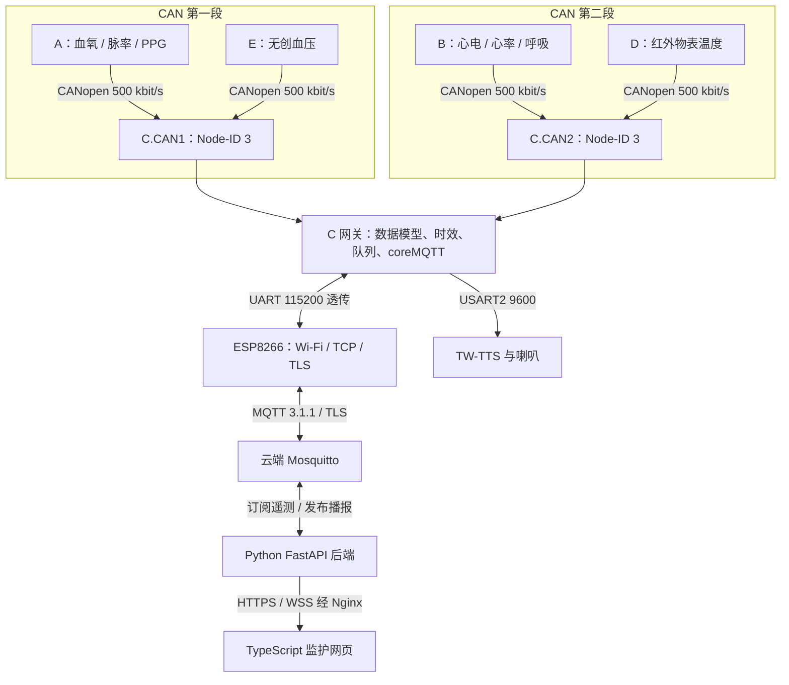
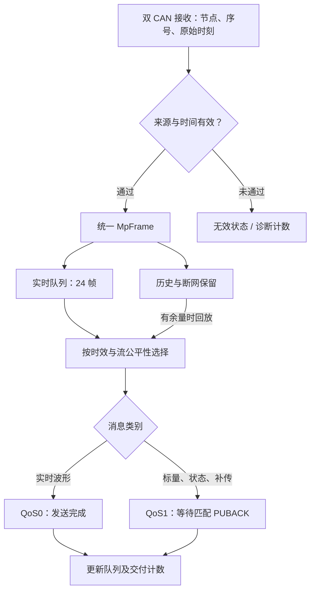
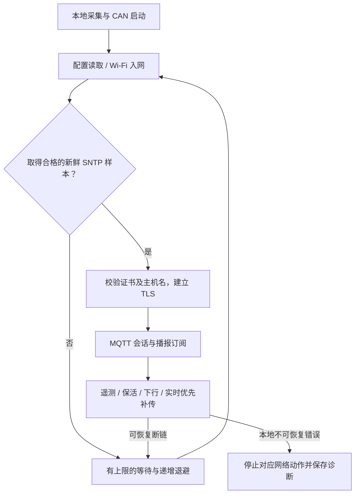
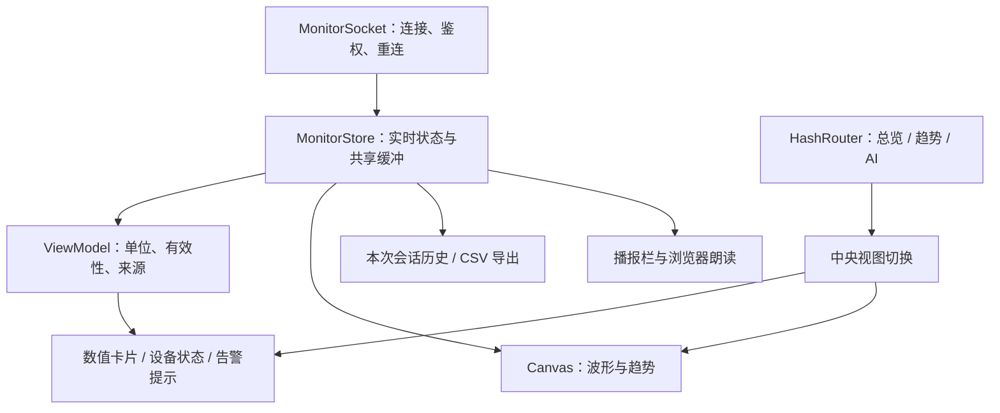
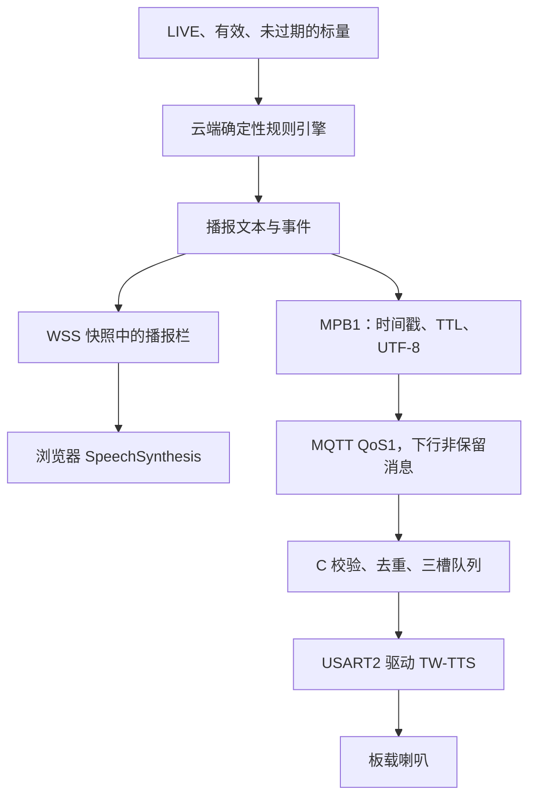

# 多参数监护样机技术栈与架构说明

**收尾审查版 · 2026-11-12（America/Chicago）**

本文描述当前五板样机实际使用的技术、数据流和运行边界，供项目交接、答辩和面试使用。代码核对基线为固件/后端 `7c94cc1`、网页 `1945c9c`、PI 复核 `01df885`；现场最终镜像的源码基点为 `2c97094`。本轮在此基础上补齐 WebAI 正式网关的显式配置入口及进程内回归；此项尚未部署，现场基线保持上述记录。固定提交链接集中列于文末，删除历史分支名称不会使这些链接失效。

## 1. 项目目前是什么

项目是一套由 **STM32F407 采集节点、双 CANopen 网关、ESP8266 网络出口、腾讯云服务和浏览器监护页面**组成的分布式多参数监护样机。四个采集节点分别承担血氧、心电/呼吸、温度和血压，C 节点统一完成授时、汇聚、缓存、MQTT 上送及语音下发。

当前正式链路已经包含自动联网、实时波形及标量显示、失效处理、有限断网补传、确定性规则播报和 C 板喇叭播放。**正式固件是裸机协作式主循环，MQTT 客户端是 coreMQTT；正式镜像没有启用麦克风采集，也没有引入 FreeRTOS。** 网页的“AI”读数问答使用确定性事实提取与模板，不能表述为已经在正式链路中完成付费大模型推理。[F1][P1][F2][F3]

这些结论是样机工程状态。SpO₂ 数值合理性、温度标定、真人 ECG HR 和长期稳定性等项目仍有未通过或未执行项，详见配套的[问题复盘文档](01-ISSUES-AND-ENGINEERING-REVIEW.md)。软件中出现某个模块、协议头或构建开关，并不自动代表它已进入最终现场镜像。

### 1.1 最终组成与版本依据

| 组成 | 收尾基线 | 依据与说明 |
| --- | --- | --- |
| C 正式固件 | WP-AZ，源码 `2c97094`；code 61,228 B | 支持正式云身份、115200 透传、断网保留和 TTS 下行；R64 安装回执、R65 复核 |
| C 内存/Flash 布局 | sector0 引导/向量，sector4 应用代码，sector3 正式配置 | 不能把分段 BIN 拼成连续镜像；配置不属于普通应用替换范围 |
| 云端监护后端 | 发布 `wp-az-2c97094` | `MONITOR_BROADCAST=1`、`MONITOR_BROADCAST_DEVICE=1`；HR 播报最终关闭 |
| 监护网页 | 发布 `web-20261112-03`，对应 UI 分支 `1945c9c` | 公开只读、设备上线自动显示、浏览器朗读需用户启用 |
| WebAI | 正式既有路由/读取器，加五板 `facts.py` | 本轮补齐仓库中的正式网关配置并做进程内回归；未更新现网、未验证整包替换，见第 9 节 |
| 回退点 | WP-AY0 | 去掉 TTS 下行功能的上一版正式 C 镜像；本轮未执行回退演练 |

版本表依据 [F1][F2][P1][F4]。这里的源码版本与软件包依赖锁定版本是两个层次：前者说明交付代码，后者说明重建环境；均不能代替现场设备读回与部署记录。

## 2. 总体结构

C 的两个 CAN 接口各运行一个 CANopenNode 实例，逻辑上共用同一个网关身份和上行数据模型。**它汇聚业务数据，不在两条总线之间透明转发全部 CAN 报文。** A/E 属于第一段，B/D 属于第二段；接错总线或使用错误节点身份应被拒绝并计数。[F5][F6]

这里的“五板”是 A/B/C/D/E 五块主控板，不是五个完全相同的采集节点。B 的一个 ADS1292R 模块仍提供 ECG 与阻抗呼吸两条通道，C 承担网关和语音，因此不宜把最终结构概括成“五块板每块只采集一个生理参数”。

## 3. 节点、传感器和外设技术

| 节点 | Node-ID / 总线 | 正式职责 | 关键接口与代码 | 应准确表述的边界 |
| --- | --- | --- | --- | --- |
| A | 1 / C.CAN1 | SpO₂、PR、PPG、本地血氧屏 | AFE4490/UNO 模块串口帧；USART6 57600 接收；本地屏 USART2；CANopenNode | F407 接收模块串口数据，不是本版本由 F407 直接用 SPI 驱动 AFE4490。SpO₂ 来自模块结果，PR 使用 F407 端波形峰检。 |
| B | 2 / C.CAN2 | ECG、HR、RESP、RR、本地显示 | ADS1292R、SPI、DRDY 中断、128 帧 FIFO、BIO_V2、CANopenNode | HR 与 RR 算法分别验收；不能把分窗通过写成同窗双有效已通过。 |
| C | 3 / 两段 | 时间锚、双 CAN 汇聚、分层队列、MQTT/TLS 出口、下行语音 | bxCAN、USART3 对 ESP8266、USART2 对 TW-TTS、coreMQTT | 当前构建使用外部 HSE 8 MHz，不启用 PLL；不能照搬 STM32F407 常见的 168 MHz 配置。 |
| D | 4 / C.CAN2 | GY641 物表温度、本地温度屏 | UART4 9600 接收，12 B 厂商帧与累加校验；屏复用 B 的 USART3 驱动 | 正式读取 `object_centi` 物体温度字段，不把模块另一个体温字段当已标定结果。 |
| E | 5 / C.CAN1 | HKB-08B+ 无创血压、手动测量和本地屏 | UART5 115200 接测量模块；USART3 9600 接血压屏；本地测量状态机 | 云端只显示结果与播报；血压启动、停止、泄压仍在本地处理。 |

依据 [F5]–[F10]、[F13]。各节点复用 STM32F4 标准外设库及 CMSIS，已有工程中存在 Keil 工程、厂商参考程序和历史双屏程序；当前角色通过构建目标与宏决定，不能仅根据目录名判断功能是否启用。

### 3.1 数据源到波形的处理

B 的采集路径先在 DRDY 中断中取完整的 9 B 原始帧，记录 IRQ 序号与时间，再进入单生产者/单消费者 FIFO。BIO_V2 在主循环中消费，避免复杂滤波长期占用中断。心电与呼吸各有独立滤波状态、削顶判据和恢复预热；一路信号故障不清空另一路已经建立的有效性。[F11][F12]

BIO_V2 使用有界 IIR 滤波、工频抑制、RMS 相关阈值、心电峰宽/不应期、完整呼吸峰谷周期，以及最近有效周期间隔的稳定性检查。结果带 `WARMUP`、`CLIPPED`、`EXPIRED`、`UNSTABLE`、`MAINS` 等原因位。**它是确定性信号处理算法，没有神经网络训练或深度学习推理。** 代码保留 ADC 原始码和诊断量；页面单位换算不等于已经完成绝对幅值与阻抗标定。[F12]

上行使用的名义波形速率为 ECG 250 Hz、PPG 50 Hz、RESP 50 Hz。C 中 ECG 每 100 点组成一批，即约 0.4 s 一批；PPG/RESP 每 50 点一批，约 1 s 一批。原始传感器串口帧率、总线波形发布率、MQTT 批率和浏览器刷新率是不同的量，答辩时应分别说明。[F5][F9]

## 4. 板间通信：CAN 与 CANopen 各承担什么

物理链路使用 STM32 bxCAN 和外部 CAN 收发器，两条总线各为 500 kbit/s。CANopenNode 在 CAN 帧之上提供对象字典和通信状态机；项目自定义的是参数对象、PDO 映射与业务时效，不是重新发明一套“类 CANopen”协议。[F5][F14]

| CANopen 组成 | 项目中的用途 | 对应实例 |
| --- | --- | --- |
| 对象字典 OD | 给测量值、质量、时间和身份分配固定结构 | `0x2100` 时间锚，`0x2110/0x2111` 波形或血压完成信息，`0x2120` 标量，`0x2130` 质量与启动代次 |
| TPDO / RPDO | 节点周期上送，C 按源及时消费 | 五种 PDO 基址为 `0x180/0x280/0x380/0x480/0x680`，加 Node-ID；按角色禁用无关 PDO |
| Heartbeat | 检测节点在线、启动和掉线 | C 为每段两个远端分别保留状态；消费者超时配置为 1500 ms |
| NMT | 管理通信状态及通信复位 | 应用复位与通信复位分开处理，不借通信复位重启测量模块 |
| TIME | 把 C 建立的 UTC 锚传给采集节点 | 时间锚与本地毫秒计时共同换算采集时间 |
| SDO | 对象访问和诊断通路 | 固定节点身份及请求/响应 COB-ID |
| EMCY | 报告设备/通信故障 | 错误进入事件语义，历史事件不会被当作当前告警 |

表中是项目实际用到的功能，不代表使用了 CANopenNode 包中所有协议扩展。第五路 PDO 使用 `0x680` 基址，是本项目冻结的映射选择；不要把它说成 CANopen 对所有项目强制规定的“第五 PDO 默认地址”。[F14]

五板实测 40–41 Ω 端接负载有短窗通信证据，但没有完成长期物理裕量、差分波形或受控故障注入验证。它属于当前样机限制，不应当作为推荐总线端接方案推广。[P2]

## 5. C 网关：在有限资源内调度多路数据

正式固件采用中断接收加主循环推进的协作式结构。CAN、ESP UART 和 TTS UART 接收处理尽量短；主循环负责协议处理、超时、队列选择、连接恢复和播放状态机。每轮工作量有界，以免某一路持续占用 CPU。[F1][F2][F15]

### 5.1 两种缓存目的

普通历史波形缓存与断网标量保留是两套不同结构。正式构建实时槽为 24、普通历史槽为 56；断网保留另使用 CCM 中的 1472 个标量条目和 736 个状态条目。缓存按帧/条目计量，不能简单把容量说成相同数量的秒。[F1][F16]

方案 A 优先保证有限断网场景下的标量保留、保序和恢复，波形尽力传输。状态在 C 本地保留；云端明确禁止旧节点/网关状态作为 REPLAY 补传续活。UTC 时间锚保持窗口增加到 610 s，是为了短断网期间仍能给采样分配可信时刻，**不是承诺任何 610 s 断网都无损**。[F5][F16][F17]

203 s 断网窗口中，统计到的 1030 条标量全部到达；另一次标量排空花费 676 s，未达到原先 ≤390 s 的目标，负责人接受了这一限制。资料中的“断网无损”必须带上数据类型、窗口和恢复条件，不能扩展成长期波形无损。[P2]

### 5.2 资源与时钟

| 正式 WP-AZ 资源 | 已记录占用 | 余量 |
| --- | ---: | ---: |
| sector0 | 392 B | 15,992 B |
| sector4 | 61,228 B | 4,308 B |
| 普通 SRAM，含链接器预留堆栈 | 116,048 B | 15,024 B |
| CCM | 61,824 B | 3,712 B |

资源数据来自 AZ-1 构建回执，不是本轮重新连接硬件所得。[F2] C 使用 HSE 8 MHz；硬件未就绪会影响初始化，不能凭 CPU 产品规格假定运行在 168 MHz。当前核心难点是有限 CPU/Flash/RAM 内的字节处理和协议调度。历史提出过 FreeRTOS 迁移，但最终瓶颈通过测量和透传路径处理，不能把“使用 coreMQTT”误写为“使用 FreeRTOS”。[F13][P2]

## 6. 设备上云：MQTT、TLS 与时间

MQTT 3.1.1 编解码和会话状态机运行在 STM32 上的 **coreMQTT v2.3.1**；ESP8266 原厂 ESP-AT 提供 Wi-Fi、TCP/TLS socket。正式性能路径使用 USART3 115200 透传，绕过普通 AT 每包 `CIPSEND`/长度查询等交互的持续开销。初始化、连接建立和退出透传时仍要管理 AT 状态，透传并不意味着删除了 ESP-AT。[F1][F18]

| 层次 | 实际职责 | 不能混淆的事 |
| --- | --- | --- |
| STM32 / coreMQTT | MQTT CONNECT、PUBLISH、SUBSCRIBE、packet ID、PUBACK、保活 | 不是 ESP 内部 MQTT AT 命令，也不是旧 Paho 嵌入式客户端 |
| ESP8266 / ESP-AT | Wi-Fi、SNTP 获取过程、SSL/TLS socket、串口透传 | TLS 运算在 ESP 一侧，不能写成 STM32 自己承载完整 TLS 栈 |
| Mosquitto | 主题路由、认证、ACL、遗嘱、持久化配置 | Broker ACK 不是后端入库/页面显示/喇叭发声的证明 |
| Python Paho MQTT | 云端订阅和设备播报发布 | 云端仍用 Paho，与设备迁移到 coreMQTT 并不矛盾 |

时间与连接管理的大致顺序如下：

正式上行入口为 TLS 8883。TLS 的 CA/名称校验和 SNTP 新鲜度门被保留；新鲜 SNTP 样本失败时不会通过忽略时间或关闭证书校验“强行联网”。可恢复网络错误采用 2/4/8/16/30 s 等递增退避，而非用次数耗尽永久停止整机。短断网后 SNTP 多次零回复仍可能使联网恢复耗时达到 551–582 s，这个限制尚未消除。[F18][P2]

### 6.1 MQTT 主题和数据语义

| 主题类别 | 结构示例 | 作用 |
| --- | --- | --- |
| 网关状态 | `mpm/v1/GW-C-001/status` | ONLINE / OFFLINE，含遗嘱语义 |
| 节点状态 | `mpm/v1/GW-C-001/NODE-D/status` | 单节点在线与失效 |
| 实时遥测 | `mpm/v1/GW-C-001/NODE-D/telemetry/TEMP` | 当前标量或波形批次 |
| 历史补传 | `mpm/v1/GW-C-001/NODE-D/replay/TEMP` | 历史采样，不能覆盖当前值 |
| 故障事件 | `mpm/v1/GW-C-001/NODE-B/event` | 事件信息 |
| 正式语音下行 | `mpm/v1/GW-C-001/voice/broadcast` | MPB1 二进制播报帧 |

MQTT Topic 是路由身份来源；载荷如果重复给出网关、节点或流名称，必须与主题一致。数据携带毫秒时间戳、序号、会话、单位、有效性和来源；来源区分 `LIVE`、`REPLAY`、`MOCK`，合成数据不能伪装成 LIVE。[F17][F19]

正式构建已经把生理测量流设为真实来源，但状态和 FAULT 仍沿用 synthetic/MOCK 标记。后端按状态、会话与时效维护在线性；播报只接受符合条件的生理 LIVE 数据。因此不能宣称最终每一种消息都已统一为 LIVE，此处是已登记的标签限制。[F5][P2]

## 7. 云端技术栈与状态管理

| 技术 | 仓库锁定版本或形式 | 用途 |
| --- | --- | --- |
| Python | 部署/CI 文档使用 CPython 3.12 | 后端、工具与自动化脚本 |
| FastAPI | 0.135.1 | HTTP 健康接口和监护 WebSocket |
| Uvicorn | 0.40.0，单 worker | ASGI 服务运行 |
| Pydantic | 2.12.5 | 严格载荷模型：拒绝未知字段、隐式错误类型、非有限数值 |
| paho-mqtt | 2.1.0 | 云端 MQTT 网络线程与回调 |
| websockets | 16.0 | 只读快照客户端与工具 |
| Mosquitto | 部署文档为 2.x，仓库未给出最终运行包完整版本 | TLS Broker、用户认证、主题 ACL |
| Nginx | 未在收尾记录中锁定完整包版本 | HTTPS/WSS 入口、静态页面/应用反向代理 |
| systemd / venv | 项目独立服务和 Python 环境 | 进程托管、失败重启、环境配置、发布切换 |

版本数字是依赖文件中的锁定值；本次仓库审查没有进入生产服务器核对 `pip freeze` 或系统包版本，不能把它们声称为重新实测的在线环境。[F20][F21]

### 7.1 为什么有 Paho 线程和 asyncio 两层

Paho 回调不直接修改全部业务状态，而是把主题与载荷放入容量 256 的线程安全队列。asyncio 侧每轮最多消费 64 条，进行解码和严格验证，再更新 Hub。这样网络突发与慢客户端不会无限增长内存或长期阻塞事件循环。[F22]

Hub 按“网关、节点、数据流”保留当前值，以 session 和 seq 去重，并区分采集时间与接收时间。当前值、REPLAY 和 FAULT 分开维护。快照默认每 100 ms 发布；只有在显式开启波形批次推送时，波形消息也会触发快照。监护服务使用单 worker，是因为这些状态在单进程内；直接增加 Uvicorn worker 数不会自动得到共享状态。[F23][F24]

每个浏览器订阅队列有界。普通模式只保留最新快照；波形批次模式不能静默覆盖有效批次，因此消费者赶不上时会明确关闭该连接。断线、发送超时与任务取消均有资源回收路径。[F23][F24]

### 7.2 有效性与公开只读

标量及波形的常用新鲜度为 5 s，NIBP 为严格小于 90 s；节点和网关状态还有独立心跳/接收龄判据。变成 INVALID、STALE 或 OFFLINE 后，快照清空当前数值或样本，页面不能继续把最后一条数据画成新的正常数据。[F19][F23]

公开页面通过 `MONITOR_PUBLIC_VIEW=1` 允许无查看令牌读取，但仍检查 Origin、首帧大小与格式、网关白名单。该开关开放的是查看路径，不能用于设备发布或泵控制。当前 `gateway-c` 上行 ACL 仍有通配授权，收窄列为待完成加固项；不能在答辩中宣称所有主题权限已经最小化到位。[F24][F1][P1]

## 8. 浏览器前端技术栈

前端是 **原生 TypeScript + Vite + HTML/CSS + Canvas 2D**，没有使用 React、Vue、ECharts 或 WebGL。仓库 `package.json` 锁定 TypeScript 5.9.3、Vite 7.3.5；构建先执行 `tsc --noEmit`，再由 Vite 输出静态文件。[W1]

V2 页面只有 `overview`、`trends`、`ai` 三个顶层路由。旧资料中的“七子页/六页面”属于早期 UI 组织，不能继续描述当前路由结构。路由切换只装卸中央视图，共享连接、状态和绘制循环由应用根部持有。[W2][W3]

波形由单个 `requestAnimationFrame` 循环驱动 Canvas 绘制，按设备像素比调整分辨率，在序列缺口或回绕处断线，避免把不连续数据画成连续测量。实时帧与演示数据有分离机制；演示需用户主动开启，检测到真实设备上线后自动退出。[W2][W4]

趋势记录保存在浏览器当前页面的内存实例中，每通道最多 3600 点、最多 1 h；断线或会话切换会分段，REPLAY 不混入实时趋势，可导出 CSV。**它不是后台病历数据库，也不是跨浏览器/跨重启的长期历史查询。**[W5]

## 9. 规则播报、网页问答与语音：三条能力要分清

### 9.1 正式规则播报

后端 `BroadcastEngine` 从符合条件的 LIVE 标量生成固定文案；它是确定性规则引擎，没有调用付费大模型。TEMP 使用连续有效数据和等待窗口，SpO₂/PR/HR 使用滚动中位数及持续时间条件，常规参数限制重复播报频率。具体阈值只是当前样机代码中的演示规则，本文件不将它们转换为医学诊断建议。[F3]

浏览器朗读与板载喇叭是两个独立输出。浏览器朗读需要用户手势开启，并选择中文语音；C 板 TTS 不依赖浏览器启用声音。网页有一条播报事件只能证明规则生成和显示，实物喇叭播放要由设备或现场证据另行证明。[W6][F2][P1]

MPB1 使用 19 B 大端头部，包含魔数、版本、`issued_ms`、固定 15 s TTL 和文本长度，文本上限 200 B。C 核对完整主题、QoS1、非保留、时间锚、严格递增时间戳及有效期；三槽满时拒绝新帧，播放前再次检查时效。TTS 状态机以有界工作量推进串口发送与 ACK/播放状态，避免语音阻塞遥测。[F2][F15]

最终 HR 播报环境开关已经关闭；HR 正向规则及喇叭的现场验证使用模拟器，R65 §6 有负责人补充确认。该历史验证与“最终正式环境默认启用 HR 告警”是不同结论。TTS 电源/协议使能布尔值目前由固件直接设为真，没有硬件电源检测能力。[P1][F15]

### 9.2 网页问答

网页问答是独立 FastAPI 服务：从监护端只读快照取数，由 `facts.py` 绑定节点、单位、会话、来源和有效期，再由模板回答当前读数。浏览器不能自行上传一个数字要求后端把它当作测量事实；通用建议、多个参数或无有效结果走固定回复。[F25][F26]

仓库保留了 Doubao 适配器、HTTPX 请求与预算记录代码，但当前文字问答路由没有据此证明真实模型被调用。R58 的正式网页问答明确记录为确定性路径，付费模型 NOT_RUN。[P3]

**本轮补齐了 WebAI 正式网关的代码配置入口，完整重新部署仍未验证。** 审查基线中的 `cloud/ai/app.py` 只接受隔离网关 `GW-B5-001`，而正式页面与监护服务使用 `GW-C-001`。R48-S2 因而只把五板 `facts.py` 加到既有正式 WebAI 路由/读取器中，未整包替换。[F4][F25]

本轮代码修改允许请求模型识别 `GW-C-001`，并通过 `P6_GATEWAY_IDS` 显式配置允许的网关；未设置该变量时默认仍仅允许 `GW-B5-001`。正式五板服务需设置 `P6_GATEWAY_IDS=GW-C-001`，同时配套 `MPM_NODE_PROFILE=five`、`P6_SNAPSHOT_MODE=MONITOR` 及正式只读快照地址、Origin 和查看凭据。新增进程内回归覆盖了正式网关下 D 温度/E 血压的来源映射和确定性问答，以及未配置或未列入名单时的拒绝行为。合成输入只用于离线回归，不作为真人或在线设备测量证据。

上述修复已经解决代码硬编码隔离身份的问题，**没有修改线上服务或证明当前目录可直接替代线上整套 WebAI**。后续重新部署仍需使用正式环境配置，核对依赖、路由和只读快照，完成受影响的部署验证；现网状态继续以 R48-S2 的文件级组合及后续现场回执为准。

### 9.3 历史麦克风台架

INMP441、I²S/DMA、16 kHz PCM、音频分块、ASR、模型回复和 TW-TTS 回包在历史 C 单板台架中有代码和验证记录。PCM 64,000 B / 125 块的链路曾经跑通，但当前 WP-AZ 使用 `--no-audio`，没有麦克风采集和音频 DMA；只单独恢复了 TTS 播报下行。**“历史语音问答台架通过”与“最终五板固件支持完整语音问答”不能合并为同一项成绩。**[F2][P2]

| 能力 | 收尾状态 |
| --- | --- |
| 监护数据 → 规则 → 页面 | 正式启用并有现场记录 |
| 规则 → 浏览器朗读 | 已验证；用户主动开启 |
| 规则 → MQTT → C → TW-TTS | WP-AZ 正式启用；样机级通过 |
| 网页读数问答 | 确定性事实路径；正式部署是文件级组合 |
| 付费大模型解释 | 代码/历史方案保留，最终正式路径未完成验证 |
| INMP441 → ASR → 模型 → TTS 整机 | 历史单板台架证据；最终五板镜像未启用 |

## 10. 数据保存、部署和验证工具

### 10.1 数据在哪里

| 位置 | 保存什么 | 持续性 |
| --- | --- | --- |
| 采集节点 RAM | 原始帧 FIFO、当前读数、算法状态 | 断电丢失 |
| C SRAM / CCM | 实时、历史波形、标量与状态保留环 | 有界；断电丢失 |
| C Flash sector3 | 正式网络/身份配置 | 非易失；需独立配置维护 |
| Mosquitto 数据目录 | Broker 自身持久化状态 | `persistence true`；不等于患者历史数据库 |
| 云端 Hub / 播报引擎 | 当前快照、有限播报历史和间隔状态 | 进程内；重启会清空并重新计时 |
| 浏览器页面实例 | 本次会话趋势、波形缓冲 | 刷新/关闭页面后丢失 |
| 运行日志 | 脱敏事件、错误类别和计数 | 轮转 JSONL / journald，不保存完整患者载荷 |

依据 [F16][F21]–[F24][W5]。当前不应宣称项目已经实现数据库级病历管理、长期波形归档或云端高可用集群。

### 10.2 开发与验证技术

| 类别 | 实际工具/方法 | 证明范围 |
| --- | --- | --- |
| C 固件构建 | Arm GNU Toolchain 14.2.Rel1 / GCC 14.2.1、STM32F4 SPL v1.4.0、链接脚本、map、ELF/HEX/BIN | 编译、链接、资源占用、向量/分区检查 |
| A/B/D/E 工程 | Keil μVision/ARMCC 既有工程、Python 构建适配 | 各板独立目标，D/E 复用 A/B 驱动与协议 |
| 主机测试 | C Host 测试、pytest / unittest、固定回放与字节替身 | 协议、状态机、异常路径、源数据一致性 |
| 网页测试 | TypeScript 固定测试、Node runner、`tsc`、Vite build | 模型、状态、去重、路由与构建 |
| 板端诊断 | DWT 周期计数、CAN TEC/REC、UART 计数、队列高水位 | 瓶颈、丢包和恢复过程定位 |
| 设备连接/归档 | J-Link/SWD、串口工具、Python 取证、读回与版本记录 | 特定现场窗口与写入范围 |
| 云端取证 | Broker 日志、后端计数、独立 WSS 观察器 | 分层交付对账，不能互相替代 |
| CI | GitHub Actions 普通构建/回归；Security Gate 为人工入口 | 仓库有流程不等于当前提交已经通过全部流程 |

本项目有 Semgrep、Gitleaks、Trivy、clang 等历史安全治理工具，不属于样机运行时依赖；保留相关代码也不表示本轮已重新执行 Security Gate。本次仓库整理不自动重新部署云端或烧写硬件。[F2][F27]

## 11. 仓库目录导航

| 目录 | 内容 | 阅读优先级 |
| --- | --- | --- |
| `node-a/` | 血氧/旧双屏基础、A CANopen、被 E 复用的血压驱动 | 看正式 A/E 构建角色，避免照搬旧双功能叙述 |
| `node-b/firmware/biov2/` | ADS1292R 采集、FIFO、BIO_V2、原本地显示 | 信号采集与算法核心 |
| `node-b/canopen/`、`node-b/temperature/` | B 的 CANopen 与被 D 复用的 GY641/屏驱动 | 结合 `node-d/` 和五板配置阅读 |
| `node-d/`、`node-e/` | 温度、血压独立角色入口与 CANopen 适配 | 五板职责的直接证据 |
| `gateway/dual_can/` | 双总线汇聚、正式构建入口、HSE 时钟 | C 正式架构入口 |
| `gateway/b5/`、`gateway/storage/` | 网络生命周期、出口调度、保留队列 | 稳定性与容量重点 |
| `gateway/mqtt/` | coreMQTT 适配、ESP-AT、透传、时间 | 读取当前源文件与构建开关，旧 README 有阶段性内容 |
| `gateway/voice/` | TW-TTS 协议、队列与 MPB1 下行 | 正式播报核心 |
| `gateway/microphone/`、`cloud/microphone/` | 历史麦克风与语音问答实现 | 单列历史/实验能力 |
| `cloud/backend/` | MQTT 订阅、严格模型、Hub、规则播报、WSS | 云端实时核心 |
| `cloud/web/` | V2 原生 TypeScript 页面、Canvas、状态、朗读 | 当前网页 |
| `cloud/ai/` | 事实问答和模型适配 | 关注正式部署组合差异 |
| `cloud/broker/`、`cloud/deploy/` | Mosquitto、ACL、systemd/Nginx 模板与发布工具 | 区分模板和最终部署回执 |
| `node-b/docs/PI-REVIEW/` | R1–R65 审查、候选、现场回执与收尾记录 | 以最新补充覆盖旧阶段结论，但不改写原始失败 |
| `doc/P/`、`review/`、`tools/` | 阶段资料、算法参考、开发及治理工具 | 历史脉络与复现辅助 |

## 12. 答辩与简历中的准确表达

可以这样概括：

> 基于 STM32F407 构建分布式多参数监护样机，以双路 CANopen 汇聚血氧、心电/呼吸、红外物表温度和无创血压；网关采用裸机协作式调度及 coreMQTT，经 ESP8266 TLS 透传连接云端。后端使用 FastAPI、Pydantic 与 Mosquitto 完成严格数据验证、会话/时效管理和确定性播报，前端使用 TypeScript、Vite 与 Canvas 展示实时波形和会话趋势，并通过 MQTT 下行驱动板载 TTS。完成了相应样机窗口验证，保留传感器准确度、特定恢复时延和长期测试方面的限制。

| 容易说错 | 建议表述 |
| --- | --- |
| “FreeRTOS + coreMQTT 已全面落地” | “当前使用裸机主循环与 coreMQTT；FreeRTOS 未进入最终正式镜像。” |
| “React/Vue + 图表库” | “原生 TypeScript/Vite，Canvas 2D 自绘波形。” |
| “STM32 168 MHz 运行整套网关” | “正式 C 构建使用 HSE 8 MHz；按实际时钟测量和调度。” |
| “所有节点直接经 Wi-Fi 上云” | “四个节点走 CANopen，由 C 统一经 ESP8266 上云。” |
| “全部上行使用 QoS1，因此端到端零丢包” | “实时波形 QoS0，标量/状态/补传 QoS1；另外用分层计数核对到达。” |
| “多分钟断网时所有数据都无损” | “特定约三分钟断网窗口标量完整，波形尽力传输，恢复时延有已接受限制。” |
| “智能大模型诊断并播报” | “正式播报和当前读数问答使用确定性规则/模板，付费模型未验证。” |
| “五板正式固件支持完整麦克风对话” | “麦克风对话有历史单板台架证据；最终正式固件启用的是云端下行 TTS。” |
| “完成临床体温与血氧准确度验证” | “GY641 读取物表温度；SpO₂ 数值合理性仍有 NOT_PASS，不作临床准确度承诺。” |
| “已有完整患者历史数据库” | “当前以 RAM/进程/页面会话状态为主，趋势可导出，未实现长期病历数据库。” |

## 13. 固定提交证据索引

以下链接对应本次审查时的内容快照。后续分支合并或删除不会改变这些提交中的文件内容。

- [F1：正式 C 构建与特性开关](https://github.com/Serendipity-min/medical-multi-parameter-monitor/blob/7c94cc1ceb83b1f00097272563e30f6b17a9b616/gateway/dual_can/build_arm.py)
- [F2：AZ-1 构建命令、MPB1、资源与无麦克风范围](https://github.com/Serendipity-min/medical-multi-parameter-monitor/blob/7c94cc1ceb83b1f00097272563e30f6b17a9b616/node-b/docs/PI-REVIEW/R62-WP-AZ-AZ0-AZ1-RECEIPT-20261112.md)
- [F3：确定性播报引擎](https://github.com/Serendipity-min/medical-multi-parameter-monitor/blob/7c94cc1ceb83b1f00097272563e30f6b17a9b616/cloud/backend/app/broadcast.py)
- [F4：正式 WebAI 文件级部署及身份差异](https://github.com/Serendipity-min/medical-multi-parameter-monitor/blob/7c94cc1ceb83b1f00097272563e30f6b17a9b616/node-b/docs/PI-REVIEW/R48-WP-AY0-B-PREWRITE-S2-RECEIPT-20261112.md)
- [F5：双 CAN 汇聚、节点/总线映射、波形组批](https://github.com/Serendipity-min/medical-multi-parameter-monitor/blob/7c94cc1ceb83b1f00097272563e30f6b17a9b616/gateway/dual_can/b4_gateway.c)
- [F6：五板流与节点职责映射](https://github.com/Serendipity-min/medical-multi-parameter-monitor/blob/7c94cc1ceb83b1f00097272563e30f6b17a9b616/gateway/data_model/roles.h)
- [F7：D 温度节点](https://github.com/Serendipity-min/medical-multi-parameter-monitor/blob/7c94cc1ceb83b1f00097272563e30f6b17a9b616/node-d/main.c)
- [F8：E 血压节点](https://github.com/Serendipity-min/medical-multi-parameter-monitor/blob/7c94cc1ceb83b1f00097272563e30f6b17a9b616/node-e/e_canopen.c)
- [F9：AFE4490/UNO 串口协议与波形环](https://github.com/Serendipity-min/medical-multi-parameter-monitor/blob/7c94cc1ceb83b1f00097272563e30f6b17a9b616/node-a/STM32F407_HOSPITAL/HARDWARE/UNO/uno.c)
- [F10：GY641 解码与物表字段](https://github.com/Serendipity-min/medical-multi-parameter-monitor/blob/7c94cc1ceb83b1f00097272563e30f6b17a9b616/node-b/temperature/gy641.c)
- [F11：B 采集 FIFO](https://github.com/Serendipity-min/medical-multi-parameter-monitor/blob/7c94cc1ceb83b1f00097272563e30f6b17a9b616/node-b/firmware/biov2/实验固件/HARDWARE/ecg_frame_queue.h)
- [F12：BIO_V2 算法](https://github.com/Serendipity-min/medical-multi-parameter-monitor/blob/7c94cc1ceb83b1f00097272563e30f6b17a9b616/node-b/firmware/biov2/实验固件/HARDWARE/bio_v2.c)
- [F13：正式 C 的 HSE 8 MHz 时钟](https://github.com/Serendipity-min/medical-multi-parameter-monitor/blob/7c94cc1ceb83b1f00097272563e30f6b17a9b616/gateway/dual_can/system_hse.c)
- [F14：对象字典与 PDO 映射](https://github.com/Serendipity-min/medical-multi-parameter-monitor/blob/7c94cc1ceb83b1f00097272563e30f6b17a9b616/gateway/canopen/src/mp_od.c)
- [F15：TTS 下行时效、去重与队列](https://github.com/Serendipity-min/medical-multi-parameter-monitor/blob/7c94cc1ceb83b1f00097272563e30f6b17a9b616/gateway/voice/tts_broadcast.c)
- [F16：实时/历史/CCM 保留结构](https://github.com/Serendipity-min/medical-multi-parameter-monitor/blob/7c94cc1ceb83b1f00097272563e30f6b17a9b616/gateway/storage/router.h)
- [F17：MQTT 主题与载荷验证](https://github.com/Serendipity-min/medical-multi-parameter-monitor/blob/7c94cc1ceb83b1f00097272563e30f6b17a9b616/cloud/backend/app/adapters.py)
- [F18：coreMQTT、QoS、SNTP 与透传生命周期](https://github.com/Serendipity-min/medical-multi-parameter-monitor/blob/7c94cc1ceb83b1f00097272563e30f6b17a9b616/gateway/mqtt/src/gateway_transport.c)
- [F19：Telemetry 模型及 five 档映射](https://github.com/Serendipity-min/medical-multi-parameter-monitor/blob/7c94cc1ceb83b1f00097272563e30f6b17a9b616/cloud/backend/app/models.py)
- [F20：Python 依赖锁定](https://github.com/Serendipity-min/medical-multi-parameter-monitor/blob/7c94cc1ceb83b1f00097272563e30f6b17a9b616/cloud/backend/requirements.lock)
- [F21：Broker 配置](https://github.com/Serendipity-min/medical-multi-parameter-monitor/blob/7c94cc1ceb83b1f00097272563e30f6b17a9b616/cloud/broker/mosquitto.conf)
- [F22：Paho 网络线程与有界队列](https://github.com/Serendipity-min/medical-multi-parameter-monitor/blob/7c94cc1ceb83b1f00097272563e30f6b17a9b616/cloud/backend/app/mqtt_adapter.py)
- [F23：Hub 会话、时效、回放与快照](https://github.com/Serendipity-min/medical-multi-parameter-monitor/blob/7c94cc1ceb83b1f00097272563e30f6b17a9b616/cloud/backend/app/hub.py)
- [F24：FastAPI 公开只读及连接生命周期](https://github.com/Serendipity-min/medical-multi-parameter-monitor/blob/7c94cc1ceb83b1f00097272563e30f6b17a9b616/cloud/backend/app/main.py)
- [F25：网页问答路由](https://github.com/Serendipity-min/medical-multi-parameter-monitor/blob/7c94cc1ceb83b1f00097272563e30f6b17a9b616/cloud/ai/app.py)
- [F26：事实提取与模板答复](https://github.com/Serendipity-min/medical-multi-parameter-monitor/blob/7c94cc1ceb83b1f00097272563e30f6b17a9b616/cloud/ai/facts.py)
- [F27：GitHub Actions 普通回归](https://github.com/Serendipity-min/medical-multi-parameter-monitor/blob/7c94cc1ceb83b1f00097272563e30f6b17a9b616/.github/workflows/phase1.yml)
- [W1：网页依赖与构建](https://github.com/Serendipity-min/medical-multi-parameter-monitor/blob/1945c9cc7273e352a5f3d219c8d7a3fdc99d5e19/cloud/web/package.json)
- [W2：V2 应用、演示与连接生命周期](https://github.com/Serendipity-min/medical-multi-parameter-monitor/blob/1945c9cc7273e352a5f3d219c8d7a3fdc99d5e19/cloud/web/src/app.ts)
- [W3：当前三个路由](https://github.com/Serendipity-min/medical-multi-parameter-monitor/blob/1945c9cc7273e352a5f3d219c8d7a3fdc99d5e19/cloud/web/src/router/hashRouter.ts)
- [W4：Canvas 波形和趋势绘制](https://github.com/Serendipity-min/medical-multi-parameter-monitor/blob/1945c9cc7273e352a5f3d219c8d7a3fdc99d5e19/cloud/web/src/waveform/renderer.ts)
- [W5：会话历史、保留时限和 CSV](https://github.com/Serendipity-min/medical-multi-parameter-monitor/blob/1945c9cc7273e352a5f3d219c8d7a3fdc99d5e19/cloud/web/src/state/sessionHistory.ts)
- [W6：浏览器播报及中文语音](https://github.com/Serendipity-min/medical-multi-parameter-monitor/blob/1945c9cc7273e352a5f3d219c8d7a3fdc99d5e19/cloud/web/src/model/broadcast.ts)
- [P1：R65 最终样机状态及负责人补充](https://github.com/Serendipity-min/medical-multi-parameter-monitor/blob/01df885ebdb3ee1ac874a562a60ac301a4eb3b04/node-b/docs/PI-REVIEW/R65-20261112.md)
- [P2：PI 结项问题总结](https://github.com/Serendipity-min/medical-multi-parameter-monitor/blob/01df885ebdb3ee1ac874a562a60ac301a4eb3b04/node-b/docs/PI-REVIEW/ISSUES-SUMMARY-20261112.md)
- [P3：R58 网页确定性问答与模型未运行结论](https://github.com/Serendipity-min/medical-multi-parameter-monitor/blob/01df885ebdb3ee1ac874a562a60ac301a4eb3b04/node-b/docs/PI-REVIEW/R58-20261112.md)

<!-- 正文简写引用 -->
[F1]: https://github.com/Serendipity-min/medical-multi-parameter-monitor/blob/7c94cc1ceb83b1f00097272563e30f6b17a9b616/gateway/dual_can/build_arm.py "正式 C 构建与特性开关"
[F2]: https://github.com/Serendipity-min/medical-multi-parameter-monitor/blob/7c94cc1ceb83b1f00097272563e30f6b17a9b616/node-b/docs/PI-REVIEW/R62-WP-AZ-AZ0-AZ1-RECEIPT-20261112.md "AZ-1 构建命令、MPB1、资源与无麦克风范围"
[F3]: https://github.com/Serendipity-min/medical-multi-parameter-monitor/blob/7c94cc1ceb83b1f00097272563e30f6b17a9b616/cloud/backend/app/broadcast.py "确定性播报引擎"
[F4]: https://github.com/Serendipity-min/medical-multi-parameter-monitor/blob/7c94cc1ceb83b1f00097272563e30f6b17a9b616/node-b/docs/PI-REVIEW/R48-WP-AY0-B-PREWRITE-S2-RECEIPT-20261112.md "正式 WebAI 文件级部署及身份差异"
[F5]: https://github.com/Serendipity-min/medical-multi-parameter-monitor/blob/7c94cc1ceb83b1f00097272563e30f6b17a9b616/gateway/dual_can/b4_gateway.c "双 CAN 汇聚、节点/总线映射、波形组批"
[F6]: https://github.com/Serendipity-min/medical-multi-parameter-monitor/blob/7c94cc1ceb83b1f00097272563e30f6b17a9b616/gateway/data_model/roles.h "五板流与节点职责映射"
[F7]: https://github.com/Serendipity-min/medical-multi-parameter-monitor/blob/7c94cc1ceb83b1f00097272563e30f6b17a9b616/node-d/main.c "D 温度节点"
[F8]: https://github.com/Serendipity-min/medical-multi-parameter-monitor/blob/7c94cc1ceb83b1f00097272563e30f6b17a9b616/node-e/e_canopen.c "E 血压节点"
[F9]: https://github.com/Serendipity-min/medical-multi-parameter-monitor/blob/7c94cc1ceb83b1f00097272563e30f6b17a9b616/node-a/STM32F407_HOSPITAL/HARDWARE/UNO/uno.c "AFE4490/UNO 串口协议与波形环"
[F10]: https://github.com/Serendipity-min/medical-multi-parameter-monitor/blob/7c94cc1ceb83b1f00097272563e30f6b17a9b616/node-b/temperature/gy641.c "GY641 解码与物表字段"
[F11]: https://github.com/Serendipity-min/medical-multi-parameter-monitor/blob/7c94cc1ceb83b1f00097272563e30f6b17a9b616/node-b/firmware/biov2/实验固件/HARDWARE/ecg_frame_queue.h "B 采集 FIFO"
[F12]: https://github.com/Serendipity-min/medical-multi-parameter-monitor/blob/7c94cc1ceb83b1f00097272563e30f6b17a9b616/node-b/firmware/biov2/实验固件/HARDWARE/bio_v2.c "BIO_V2 算法"
[F13]: https://github.com/Serendipity-min/medical-multi-parameter-monitor/blob/7c94cc1ceb83b1f00097272563e30f6b17a9b616/gateway/dual_can/system_hse.c "正式 C 的 HSE 8 MHz 时钟"
[F14]: https://github.com/Serendipity-min/medical-multi-parameter-monitor/blob/7c94cc1ceb83b1f00097272563e30f6b17a9b616/gateway/canopen/src/mp_od.c "对象字典与 PDO 映射"
[F15]: https://github.com/Serendipity-min/medical-multi-parameter-monitor/blob/7c94cc1ceb83b1f00097272563e30f6b17a9b616/gateway/voice/tts_broadcast.c "TTS 下行时效、去重与队列"
[F16]: https://github.com/Serendipity-min/medical-multi-parameter-monitor/blob/7c94cc1ceb83b1f00097272563e30f6b17a9b616/gateway/storage/router.h "实时/历史/CCM 保留结构"
[F17]: https://github.com/Serendipity-min/medical-multi-parameter-monitor/blob/7c94cc1ceb83b1f00097272563e30f6b17a9b616/cloud/backend/app/adapters.py "MQTT 主题与载荷验证"
[F18]: https://github.com/Serendipity-min/medical-multi-parameter-monitor/blob/7c94cc1ceb83b1f00097272563e30f6b17a9b616/gateway/mqtt/src/gateway_transport.c "coreMQTT、QoS、SNTP 与透传生命周期"
[F19]: https://github.com/Serendipity-min/medical-multi-parameter-monitor/blob/7c94cc1ceb83b1f00097272563e30f6b17a9b616/cloud/backend/app/models.py "Telemetry 模型及 five 档映射"
[F20]: https://github.com/Serendipity-min/medical-multi-parameter-monitor/blob/7c94cc1ceb83b1f00097272563e30f6b17a9b616/cloud/backend/requirements.lock "Python 依赖锁定"
[F21]: https://github.com/Serendipity-min/medical-multi-parameter-monitor/blob/7c94cc1ceb83b1f00097272563e30f6b17a9b616/cloud/broker/mosquitto.conf "Broker 配置"
[F22]: https://github.com/Serendipity-min/medical-multi-parameter-monitor/blob/7c94cc1ceb83b1f00097272563e30f6b17a9b616/cloud/backend/app/mqtt_adapter.py "Paho 网络线程与有界队列"
[F23]: https://github.com/Serendipity-min/medical-multi-parameter-monitor/blob/7c94cc1ceb83b1f00097272563e30f6b17a9b616/cloud/backend/app/hub.py "Hub 会话、时效、回放与快照"
[F24]: https://github.com/Serendipity-min/medical-multi-parameter-monitor/blob/7c94cc1ceb83b1f00097272563e30f6b17a9b616/cloud/backend/app/main.py "FastAPI 公开只读及连接生命周期"
[F25]: https://github.com/Serendipity-min/medical-multi-parameter-monitor/blob/7c94cc1ceb83b1f00097272563e30f6b17a9b616/cloud/ai/app.py "网页问答路由"
[F26]: https://github.com/Serendipity-min/medical-multi-parameter-monitor/blob/7c94cc1ceb83b1f00097272563e30f6b17a9b616/cloud/ai/facts.py "事实提取与模板答复"
[F27]: https://github.com/Serendipity-min/medical-multi-parameter-monitor/blob/7c94cc1ceb83b1f00097272563e30f6b17a9b616/.github/workflows/phase1.yml "GitHub Actions 普通回归"
[W1]: https://github.com/Serendipity-min/medical-multi-parameter-monitor/blob/1945c9cc7273e352a5f3d219c8d7a3fdc99d5e19/cloud/web/package.json "网页依赖与构建"
[W2]: https://github.com/Serendipity-min/medical-multi-parameter-monitor/blob/1945c9cc7273e352a5f3d219c8d7a3fdc99d5e19/cloud/web/src/app.ts "V2 应用、演示与连接生命周期"
[W3]: https://github.com/Serendipity-min/medical-multi-parameter-monitor/blob/1945c9cc7273e352a5f3d219c8d7a3fdc99d5e19/cloud/web/src/router/hashRouter.ts "当前三个路由"
[W4]: https://github.com/Serendipity-min/medical-multi-parameter-monitor/blob/1945c9cc7273e352a5f3d219c8d7a3fdc99d5e19/cloud/web/src/waveform/renderer.ts "Canvas 波形和趋势绘制"
[W5]: https://github.com/Serendipity-min/medical-multi-parameter-monitor/blob/1945c9cc7273e352a5f3d219c8d7a3fdc99d5e19/cloud/web/src/state/sessionHistory.ts "会话历史、保留时限和 CSV"
[W6]: https://github.com/Serendipity-min/medical-multi-parameter-monitor/blob/1945c9cc7273e352a5f3d219c8d7a3fdc99d5e19/cloud/web/src/model/broadcast.ts "浏览器播报及中文语音"
[P1]: https://github.com/Serendipity-min/medical-multi-parameter-monitor/blob/01df885ebdb3ee1ac874a562a60ac301a4eb3b04/node-b/docs/PI-REVIEW/R65-20261112.md "R65 最终样机状态及负责人补充"
[P2]: https://github.com/Serendipity-min/medical-multi-parameter-monitor/blob/01df885ebdb3ee1ac874a562a60ac301a4eb3b04/node-b/docs/PI-REVIEW/ISSUES-SUMMARY-20261112.md "PI 结项问题总结"
[P3]: https://github.com/Serendipity-min/medical-multi-parameter-monitor/blob/01df885ebdb3ee1ac874a562a60ac301a4eb3b04/node-b/docs/PI-REVIEW/R58-20261112.md "R58 网页确定性问答与模型未运行结论"

本轮新增配置与CI修正的当前源码入口：[WebAI配置](../../cloud/ai/app.py)、[相关回归](../../cloud/ai/tests/test_five_appliance.py)、[普通CI](../../.github/workflows/phase1.yml)、[验证记录](VALIDATION.json)。这些相对链接随本报告所在提交一起版本化；上面的固定历史提交用于说明原始实现和现场基线。
