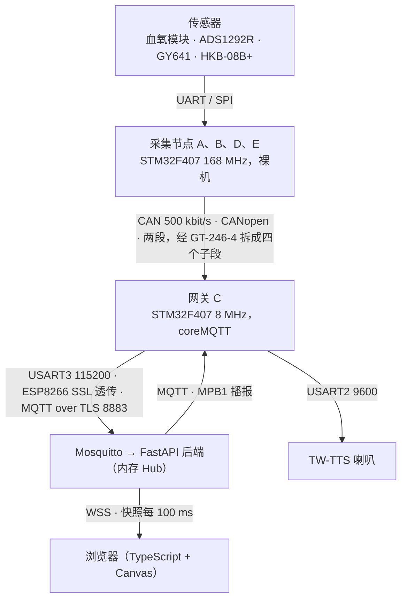

# 00 · 索引与阅读路线

> 维护手册的入口。先看“我现在要做什么”，再按路线读。

## 1. 项目一页纸

| 节点 | 号 | 测什么 | 一句话 |
|---|---|---|---|
| A | 1 | SpO₂、PR、PPG | 17 B 串口帧取 SpO₂；PR 由 F407 峰检；PPG 重采样到 50 Hz |
| B | 2 | ECG、HR、RESP、RR | ADS1292R 250 SPS；HR 时域峰检；RR 用 32 s 窗谱峰（R1） |
| C | 3 | 网关 | 双 CAN 汇聚、打 UTC、组批、MQTT、断网保留、语音下行 |
| D | 4 | 物表温度 | GY641，只收不发，帧龄 ≤2.5 s 有效 |
| E | 5 | 血压 | 屏上按钮触发，结果有效 90 s，带代次 |

**现状**：算法自 R125 起冻结。一小时长测七项中六项 PASS，体温覆盖未达标（已接受，D 定时帧缺失待查）。

## 2. 篇目

| 编号 | 文档 | 什么时候读 |
|---|---|---|
| 00 | 本篇 | 入口 |
| 01 | [硬件与接线](01-HARDWARE-AND-WIRING.md) | 接线、换板、查引脚、上电前 |
| 02 | [节点 A、D、E 固件](02-NODES-A-D-E.md) | 改 A/D/E，查血氧、温度、血压问题 |
| 03 | [节点 B：采集与算法](03-NODE-B-ACQUISITION-AND-ALGORITHMS.md) | 心电、呼吸、HR/RR 任何问题；面试核心 |
| 04 | [CANopen 细节](04-CANOPEN-DETAILS.md) | PDO、标志位、时间戳、网关判有效的规则 |
| 05 | [网关 C](05-GATEWAY-C.md) | 上云、掉线、断网、语音；**读串口日志** |
| 06 | [云端与网页](06-CLOUD-AND-WEB.md) | 后端校验、快照、播报规则、WebAI、部署 |
| 07 | [构建、烧录与回滚](07-BUILD-FLASH-ROLLBACK.md) | 出镜像、刷板、回退之前 |
| 08 | [测试与验收方法](08-TESTING-AND-ACCEPTANCE.md) | 改代码后跑什么；写新的测试卡 |
| 09 | [问题档案与排障速查](09-ISSUE-ARCHIVE.md) | 现场出问题时**先看这里的速查表** |
| 10 | [设计决策记录](10-DESIGN-DECISIONS.md) | “为什么这样做” |
| 12 | [数字速查与时间线](12-NUMBERS-AND-TIMELINE.md) | 查数字、回忆时间顺序 |

编号 11 为另行保管的材料，不在仓库中。

## 3. 按任务的阅读路线

| 我要…… | 路线 |
|---|---|
| 半年后重新上手 | 00 → 12 时间线 → 10 → 09 速查表 |
| 准备面试或答辩 | 10 → 03 → 09（P-06、P-07、P-08、P-09、P-20、P-21、P-22）→ 12 数字 |
| 现场掉线了 | 09 速查表 → 05 §7 读日志 → 05 §4.3 恢复流程 |
| 网页数值总是“--” | 09 速查表 → 04 §6.3 判有效条件 → 03 §2.3 原因位 → 06 §2.2 新鲜度 |
| 要改 B 的算法 | 03 → 08 §2.1、§7 → 07 §2.1 构建矩阵 → 08 §5 写卡 |
| 要改网关 | 05 → 04 → 08 §2.3 → 07 §3.2（C 只写 sector0 + sector4） |
| 要重刷某块板 | 07 全篇 → 01 §6（接线与安全）→ 准备放行原话 |
| 继续查 D 丢帧 | 09 P-20 → 04 §9 → 分支 `claude/d-node-tpdo-loss` |
| 交接给别人维护 | 先解决 07 §8 的“B 镜像不能仅凭仓库复现” |

## 4. 规则提要（来自 `AGENTS.md`）

- 刷写、sector3、选项字节、ESP 固件和每次回滚，都要负责人单独放行。
- 真人测试要当次放行；只用代号；累计接触 ≤30 分钟；电池供电；拔掉 J-Link。
- 遇到 HALT、停在 ROM、身份或 Flash 漂移：停止，保存证据，不自动复位或重刷。
- 凭据、UID、真实端点、IP、SSID、私有固件、志愿者原始数据只放受限存储。
- 不擅自合并、建 PR、删分支或标签，不擅自触发安全扫描。
- 结论分清 PASS / FAIL / NOT_PASS（已接受）/ NOT_EVALUATED / NOT_RUN / UNKNOWN；模拟器 ≠ 人体；PUBACK ≠ 端到端收到。

## 5. 仍开放的事项

| 事项 | 状态 | 在哪 |
|---|---|---|
| D 定时帧缺失约 20% | OPEN | 09 P-20、04 §9 |
| B 镜像不能仅凭仓库复现 | OPEN（维护风险） | 03 §7、07 §8 |
| E 整片 SHA 缺失 | 待单独放行读取 | 07 §8 |
| PUBACK 停滞源头 | UNKNOWN | 09 P-22 |
| 断网后 SNTP 慢 | UNKNOWN，已接受 | 09 P-23 |
| 工作区 `gateway/` 显示为已删除 | 待负责人确认 | 08 开头、07 §8 |
| 验收报告签认 | 待负责人签署 | `docs/acceptance/ACCEPTANCE-REPORT.md` §9 |
