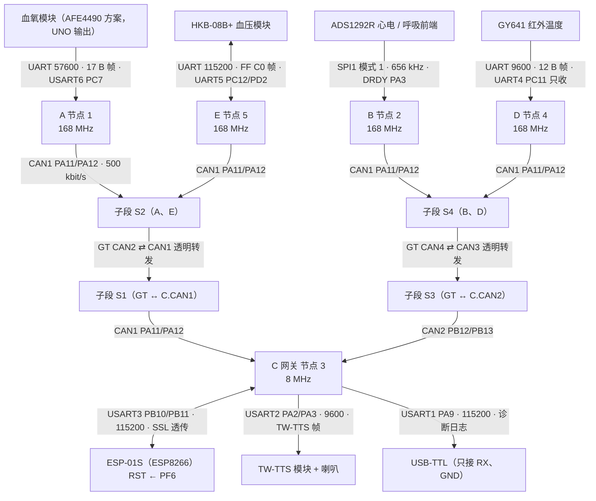
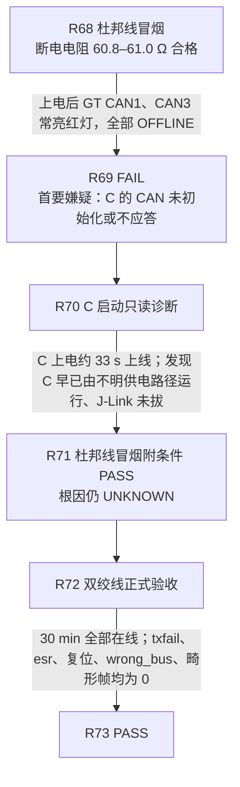

# 01 · 硬件与接线

> 本篇记录每块板用了哪些外设和引脚、传感器怎么接、CAN 物理层怎么组网，以及现场调试和人体接触时的接线规则。
> 引脚以源码为准，出处写在表里。缩写：PB = `docs/acceptance/PROJECT-BOOK.md`；Rnn = `node-b/docs/PI-REVIEW/` 下的记录；`06-CAN` = `node-b/docs/FIVE-NODE-MIGRATION/06-CAN-Wiring-and-M1-Contract.md`。

## 0. 一句话版

五块相同的 STM32F407ZGT6 开发板（“神舟号”，原理图 V2.0）：
- 四块采集板跑 168 MHz，网关 C 跑 8 MHz；
- 每块板用板载 TJA1050 接 CAN，500 kbit/s；
- GCAN-GT-246-4 网桥把两段总线拆成四个约 60 Ω 的子段；
- 传感器都是串口模块，只有心电前端 ADS1292R 走 SPI。

---

## 1. 总体连线

---

## 2. 各板外设与引脚

### 2.1 共同部分

| 项 | 值 | 出处 |
|---|---|---|
| 芯片 | STM32F407ZGT6，1 MiB Flash，192 KiB SRAM（含 64 KiB CCM） | PB §4.1 |
| 开发板 | “STM32F4 神舟号”，原理图 V2.0。板子的 PCB 版本是否与图纸一致，未在实物上逐块核对 | R16-HARDWARE §5 |
| CAN 收发器 | 板载两颗 TJA1050：U3 接 CAN1 插座，U2 接 CAN2 插座 | 06-CAN §一 |
| 板载终端 | 每个 CAN 插座固定焊 120 Ω（CAN1 为 R7，CAN2 为 R1），**没有开关** | 06-CAN §一、R68 §1 |
| 插座脚位 | 2 脚 CANH，1 脚 CANL | R72 §1 |

### 2.2 时钟与 CAN 位时序

| 板 | 时钟 | APB1 | CAN 分频 / BS1 / BS2 | 采样点 |
|---|---|---|---|---|
| A、B、D、E | HSE 8 MHz → PLL（M8 / N336 / P2）→ 168 MHz | 42 MHz | 6 / 11 / 2（14 TQ） | 约 85.7% |
| C | HSE 8 MHz 直接作系统时钟，**不启用 PLL** | 8 MHz | 1 / 13 / 2（16 TQ） | 87.5% |

出处：`node-b/canopen/CO_driver.c:105–140`；`gateway/dual_can/hse_clock.h:5–15`；`gateway/dual_can/b4_bxcan.c:94–95`。

两侧采样点不同（85.7% 和 87.5%），在 500 kbit/s 的短线上可以工作；网桥的采样点设置未知（R69 §4）。

### 2.3 A：血氧、脉率、PPG（节点 1）

| 外设 | 引脚 | 参数 | 用途 |
|---|---|---|---|
| USART6 | PC7 RX（PC6 TX 不用） | 57600 8N1 | 血氧模块 |
| USART2 | PA2 / PA3 | 115200 | DACAI 屏 |
| USART1 | PA9 / PA10 | 115200 | 调试串口 |
| CAN1 | PA11 RX / PA12 TX（AF9） | 500 kbit/s | 子段 S2 |
| IWDG | — | 分频 128，重装 625 | 看门狗（只有 A、E 开） |

出处：`node-a/STM32F407_HOSPITAL/HARDWARE/USART/usart.c:9–83`、`USER/main.c:19–22`、`HARDWARE/DEBUG/debug.c:4–15`、`HARDWARE/CANopen/CO_driver.c:113–141`。

### 2.4 B：心电、呼吸（节点 2）

| 外设 | 引脚 | 参数 | 用途 |
|---|---|---|---|
| SPI1 | PA5 SCLK / PA6 MISO / PA7 MOSI，PA2 软件 CS | 模式 1，/128 ≈ 656 kHz | ADS1292R |
| GPIO | PA0 PWDN，**PG15 START**，PA3 DRDY（EXTI3） | — | ADS1292R 控制 |
| USART1 | PA9 / PA10 | 115200 | DACAI 屏 |
| CAN1 | PA11 / PA12 | 500 kbit/s | 子段 S4 |
| TIM13 | PF8 | PWM | 蜂鸣器 |

- **START 为什么不用 PA1**：PA1 与板上以太网 PHY LAN8720A 的 REFCLKO 网络相连（`node-b/docs/02_模块资料与接线.md` §3）。用 PA1 时出现过异常帧间隔，改到 PG15 后消失。
- **ADS1292R 模块**：由板上 5 V 供电，模块内用 SY8120 开关降压（R106 §3）。J3 选择时钟，默认断开即内部时钟；未经核对不要短接。
- **串口跳线**：B 板 COM1 的 R/T 到 PA9/PA10 的跳线据报已拆，历史照片不能证明现状（`02_模块资料与接线.md` §2）。

### 2.5 C：网关（节点 3）

| 外设 | 引脚 | 参数 | 用途 |
|---|---|---|---|
| CAN1 | PA11 / PA12（AF9） | 500 kbit/s | 段一：A、E（经 S1） |
| CAN2 | PB12 / PB13（AF9） | 500 kbit/s | 段二：B、D（经 S3） |
| USART3 | PB10 / PB11 | 115200 | ESP8266 透传 |
| USART2 | PA2 / PA3 | 9600 | TW-TTS |
| USART1 | PA9 TX / PA10 | 115200 8N1 | 诊断日志（只输出） |
| PF6 | 芯片第 18 脚 | GPIO | ESP 硬复位（经 GBC_KEY 网络到 ESP 的 RST） |

出处：`gateway/dual_can/b4_bxcan.c:73–76`、`gateway/mqtt/src/platform.c:1318–1328`、`gateway/voice/tts_uart_port.c:58–64`、R16-HARDWARE §5。

- C 在两段上的节点号都是 3。**禁止在两段之间转发**，否则同一个节点号会在一条总线上出现两次（R68 §1）。
- 麦克风台架用过 PF9，正式五板镜像未启用（L-13）。

### 2.6 D：物表温度（节点 4）

| 外设 | 引脚 | 参数 | 用途 |
|---|---|---|---|
| UART4 | **只接 PC11 RX**；PC10 保持输入，不开发送 | 9600 8N1 | GY641 |
| USART3 | PB10，只发 | 115200 | 温度屏（沿用旧的独立温度屏驱动） |
| CAN1 | PA11 / PA12 | 500 kbit/s | 子段 S4 |

出处：`node-b/temperature/b_temperature.c:1–23`、`b_temp_screen.c:1–26`。

**只收不发**：固件从不给 GY641 写配置或保存命令，避免误改模块参数。

### 2.7 E：无创血压（节点 5）

| 外设 | 引脚 | 参数 | 用途 |
|---|---|---|---|
| UART5 | PC12 TX / PD2 RX | 115200 8N1 | HKB-08B+ 血压模块 |
| USART3 | PB10 TX / PB11 RX | **9600** 8N1 | DACAI 屏（带 CRC16-MODBUS） |
| USART1 | PA9 / PA10 | 115200 | 调试串口 |
| CAN1 | PA11 / PA12 | 500 kbit/s | 子段 S2 |
| IWDG | — | 同 A | 看门狗 |

出处：`node-a/STM32F407_HOSPITAL/HARDWARE/app_bp.c:992–1038`。

**注意**：E 屏是 9600，A、B 屏是 115200。换屏或改屏工程时不要弄混。

---

## 3. 传感器模块

| 模块 | 板 | 接口 | 帧格式 | 校验 | 备注 |
|---|---|---|---|---|---|
| 血氧（AFE4490 方案，UNO 输出） | A | UART 57600 | 17 B：`0A FA 0A 00 02` + IR(i32 LE) + RED(i32 LE) + SpO₂(u8) + 模块 HR(u8) + `00 0B` | **无**，只靠帧头帧尾 | PR 不用模块的，由 F407 从 IR 波形计算 |
| ADS1292R | B | SPI | 9 B：3 B 状态 + 3 B RESP + 3 B ECG（24 bit 大端补码） | 状态字固定位 | 见 `03` |
| GY641（V3 协议） | D | UART 9600 | 12 B：`A4 03 07 07` + 发射率 + 物温(u16 BE, 0.01 °C) + 环境温 + 体温字段 + 累加和 | 8 位累加和 | 只用物温，**不是体温**（L-03） |
| HKB-08B+ | E | UART 115200 | `FF C0` LEN CKSUM CMD DATA… | (LEN+CMD+ΣDATA) & 0xFF | 命令 0xAA 唤醒、0xA0 开始、0xA1 停止、0xAC 结果、0xAD 错误 |
| TW-TTS | C | UART 9600 | 文本 `FD lenH lenL 01 04 <文本>`；控制 `FD 00 01 cmd` | — | 应答 0x41 收到、0x4E 播放中、0x4F 空闲 |
| ESP-01S（ESP8266） | C | UART 115200 | ESP-AT 2.3.0.0，透传 | — | 见 `05` |

A、D、E 模块的供电电压在仓库中没有记录；记录了的是 ADS1292R 5 V、TW-TTS 5 V（板上 5 V 输出）、ESP-01S 3.3 V（板上插座）。

---

## 4. CAN 物理层

### 4.1 40 Ω 问题的由来

- 早期每段挂 3 块板，每块板插座上都焊死了 120 Ω，3 个并联约 40 Ω（实测 41 / 40.9 Ω）。标准是两端各一个，即 60 Ω。
- 再加一个 120 Ω 只会更低（约 30.6 Ω）；板上电阻没有开关，拆焊又会改动开发板。
- 有限窗口内 TEC/REC 等计数没有异常，但电气上偏离标准，裕量未知。
- 06-CAN 对“哪三块板组成那次 41 Ω 测量”有两种说法（C/B/E 与负责人更正的 C/B/D），以负责人更正为准，记为未完全确认。

### 4.2 GT-246-4 拆段

| 子段 | GT 通道 / 终端拨码 | 挂接 | 断电时 H–L 电阻 |
|---|---|---|---|
| S1 | CAN1，R1 = ON | GT ↔ C.CAN1，点对点 | 约 60 Ω |
| S2 | CAN2，R2 = OFF | A.CAN1、E.CAN1，GT 从中间分支 | 约 60 Ω |
| S3 | CAN3，R3 = ON | GT ↔ C.CAN2，点对点 | 约 60 Ω |
| S4 | CAN4，R4 = OFF | B.CAN1、D.CAN1，GT 从中间分支 | 约 60 Ω |

- **为什么这样拆**：每个子段只剩两个 120 Ω（两块板，或者一块板加 GT 内部终端），所以是 60 Ω。
- **转发规则**：GT 只做 CAN1⇄CAN2、CAN3⇄CAN4 的双向透明转发，无 ID 过滤，500 kbit/s 经典 CAN。
- **拆段只降低电气负载，不改变总线占用率**（R68 §1、R73 §1）。段二负载仍约 8%。
- **GT 供电**：24 V（端子 PE | 0V | 24V）。人体接触测试时用移动电源。
- **端子顺序陷阱**：CAN2–CAN4（上排）是 CANH | CANL | GND；**CAN1（下排）反过来**，是 GND | CANL | CANH（R68 §2、R72 §1）。
- 每个子段的 GT CANx_GND 接该子段板子的地，GT 各通道之间是隔离的。

### 4.3 验收经过

- R73 断电测量：异名线 60.5–60.8 Ω，同名线 0.2–0.3 Ω，参考地 0.2–0.3 Ω，对地和跨段开路。
- C 启动时出现过 352/369 次 RX 溢出，推断是 C 尚未应答时 GT 积压，只出现在启动阶段，未证实。
- **教训**：C 必须只有一条供电路径；上电前拔掉 J-Link，并确认调试串口（COM15）不存在。

### 4.4 未验证的部分

- 没有差分波形测量、长期老化和受控故障注入（L-08）。
- 各板终端只做过断电电阻测量。
- GT 的采样点和错误帧隔离选项未知（R69 §4）。

---

## 5. 心电电极与导联色标

**最终色标（R107，模拟器功能验证）**：

| 线色 | 电极 | ADS 输入 |
|---|---|---|
| **绿** | RA（ERA） | IN2N |
| **黄** | LA（ELA） | IN2P |
| **红** | RL（右腿驱动） | RLD |

- 记录的 ECG = 滤波后的 (ELA − ERA)，信号链中没有反相。
- **项目早期用的是“红=RA、绿=RL”，是错的**（P-06）。照旧色标贴的 P2 胸前贴法（红在右锁骨下、黄在左下胸、绿在右下腹），实际测量轴是右下腹 → 左下胸，几乎与心电轴垂直，QRS 小、三相、对位置敏感。
- **正确贴法**：绿贴 RA 位（右锁骨下或右腕），黄贴 LA/LL 位（左下胸或左踝），红贴 RL 位（右下腹或右踝）。
- **呼吸**：CH1 测 ERA–ELA 之间的阻抗（两电极法）。模拟器 RESP 按手册接 RA–LL：绿→RA，黄→LL，红→RL，LA 不接。
- **验证方式的局限**：这是功能证据（极性、幅度、取下单个夹子的效果），没有断电用万用表测通断。
- **待更正的旧文档**：`02_模块资料与接线`（部分已改）、`B-ALG-002-CONNECTOR-REVIEW-R2.md` 仍带旧色标（R107 §3）。

---

## 6. 现场接线与安全规则

### 6.1 C 的诊断串口

- USB-TTL 的 **RXD 接 C 的 PA9**（USART1_TX），**GND 接 GND**。**TXD、VCC 都不接**。
- 3.3 V 电平，115200 8N1，无流控，DTR/RTS 为假。
- **不用 C 板载的 USB 口**：板载 USB 转串口要等 C 上电后才枚举，会漏掉约 9 s 的启动输出（R71）；还可能形成第二条供电路径。
- 插上后确认 C 的电源灯不亮，即适配器没有反向给 C 供电。
- 开测前先连续接收 5 分钟无中断，再开始计时（R127 §2）。

### 6.2 上电顺序

**GT → A、B、D、E → C**。C 最后上电，这样 C 启动时各节点已在线。R127 实际是 C 先上电，已记为偏离，未造成问题。

### 6.3 人体接触时（PB §4.3、R127 §1）

- 电脑拔掉充电器，只用电池；不接市电。
- 各板用电池；GT 用移动电源。
- **拔掉 J-Link**。
- USB-TTL 的地经 C 和 CAN 与所有板相通，而志愿者会接触 A 的指夹和 E 的袖带，所以全链路都不能接市电地。
- 有不适、袖带不放气、发热或异味，立即停止并断电，报时刻。
- 每次真人接触都要负责人当次放行；累计接触 ≤30 分钟（除非负责人另行说明）。
- ADS1292R 厂家要求人体心电用电池或线性稳压；项目用电池，但模块的 5 V 经 SY8120 开关降压，R93 估计板噪约 7 µV。

### 6.4 J-Link / SWD

- 只用于读回诊断和经放行的刷写。
- 遇到 HALT、停在 ROM、身份或 Flash 不一致时，停止写入和复位，保存证据（`AGENTS.md`）。

---

## 7. 速查：哪个口接什么

| 板 | USART1 | USART2 | USART3 | UART4 | UART5 | USART6 | SPI1 | CAN1 | CAN2 |
|---|---|---|---|---|---|---|---|---|---|
| A | 调试 115200 | 屏 115200 | — | — | — | 血氧 57600 | — | 节点 1 | — |
| B | 屏 115200 | — | — | — | — | — | ADS1292R | 节点 2 | — |
| C | 日志 115200 | TTS 9600 | ESP 115200 | — | — | — | — | 段一 | 段二 |
| D | — | — | 屏 115200（只发） | GY641 9600（只收） | — | — | — | 节点 4 | — |
| E | 调试 115200 | — | 屏 9600 | — | 血压 115200 | — | — | 节点 5 | — |
