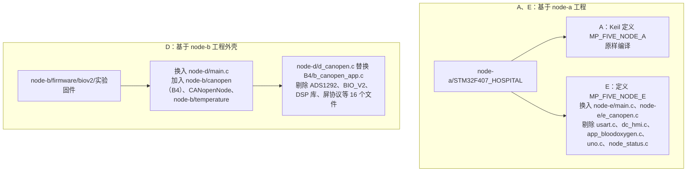
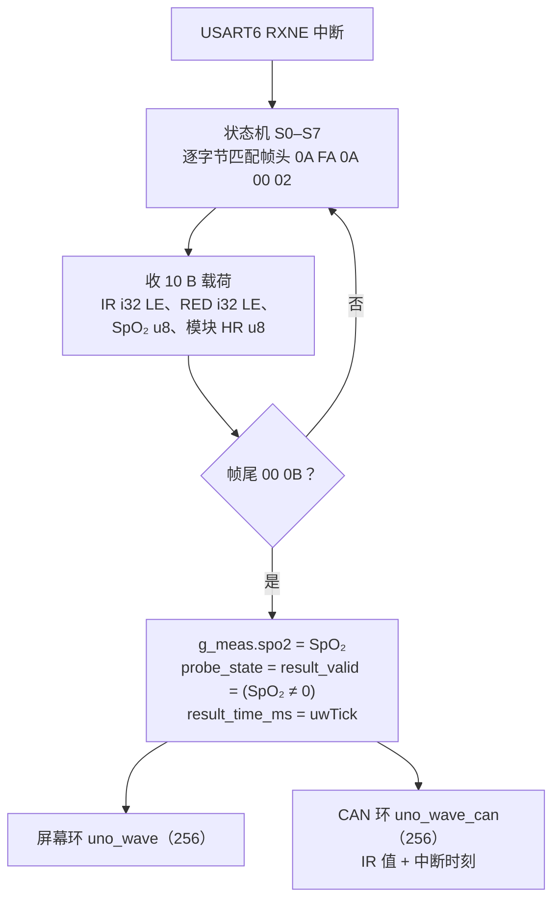
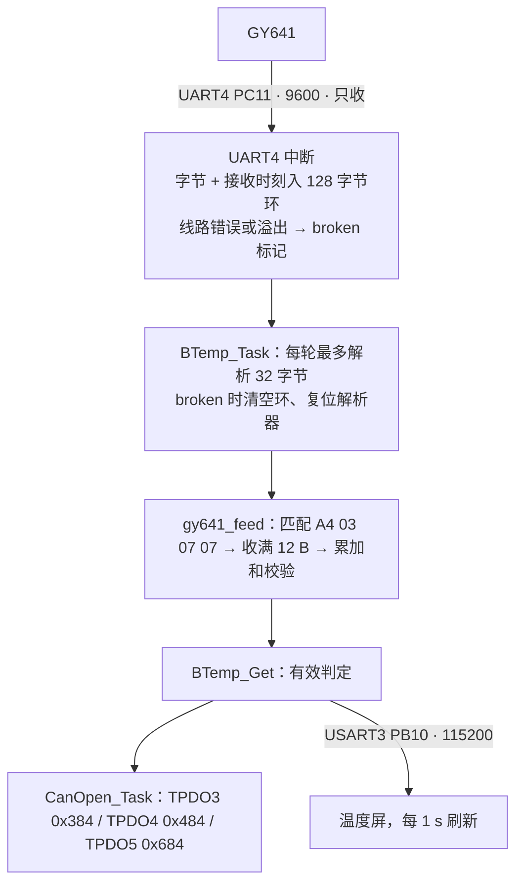
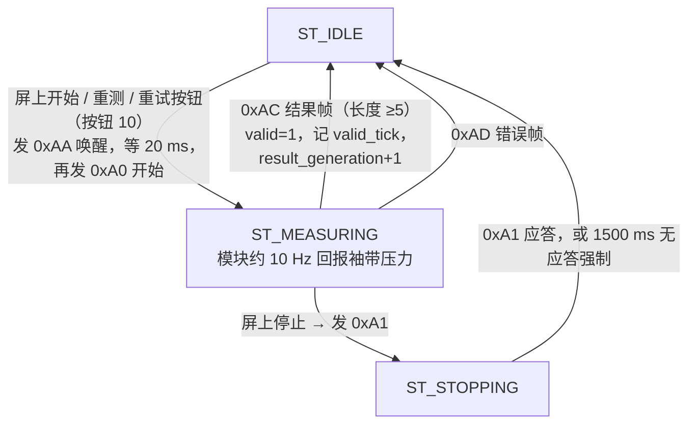

# 02 · 节点 A、D、E 固件

> A（血氧、脉率、PPG，节点 1）、D（红外物表温度，节点 4）、E（无创血压，节点 5）。
> 行号以当前仓库 HEAD 为准。路径缩写：`A/` = `node-a/STM32F407_HOSPITAL/`，`A/H/` = `A/HARDWARE/`。

## 0. 一句话版

三块板都是“串口模块 → 解析 → 有效性判断 → CANopen PDO”。
- **A**：17 B 帧取 SpO₂；PR 由 F407 从 IR 波形峰检得到；PPG 按接收时刻线性重采样到 20 ms 网格（50 Hz）上 CAN。
- **D**：只收不发，12 B 帧取物温；帧龄 ≤2.5 s 才有效。
- **E**：屏上按钮触发测量，结果有效 90 s，每个结果带“代次”，同一次结果不会被当成新测量。

三块板的镜像都不是某个目录原样编译出来的，而是由 `tools/build_five_node.py` 拼装（§1）。

---

## 1. 镜像是怎样拼出来的

出处：`tools/build_five_node.py:31–66`。

**维护含义**：
- E 和 A 共用 `app_bp.c`、`bp_sensor.c`、`CO_driver.c`、`OD.c` 等文件，改 A 的公共文件会同时影响 E。
- D 和 B 共用 `node-b/canopen/` 下的 `CO_driver.c`、`OD.c`，改 B 的驱动会同时影响 D。D 在运行时把 COB-ID 改成 0x384 等（`node-d/d_canopen.c:35–43`）。
- A 工程里虽然编进了血压代码（`app_bp.c`），但 A 不调用 `app_init()`，并且在 CAN 上强制 `bp_ok=0`（`A/H/CANopen/canopen_app.c:89–91`）。

---

## 2. 节点 A：血氧、脉率、PPG

### 2.1 时基、初始化和主循环

- **时基**：SysTick 1 ms，`uwTick++`（`A/H/SYS/sys.c:25`、`A/USER/stm32f4xx_it.c:90–93`）。
- **初始化顺序**（`A/USER/main.c:73–128`）：SysTick → 调试串口 → 屏（USART2 115200）→ 血氧串口（USART6 57600）→ CANopen → 看门狗 → 屏幕看护 → 节点状态。
- **主循环**（`main.c:130–233`）：喂狗 → 屏幕看护 → 1 s 调试心跳 → 屏输入 → 处理血氧帧 → 刷新数值（400 ms）→ 刷新趋势（2 s）→ 时钟 → `canopen_app_process()`（最后）。
- **看门狗**：IWDG 分频 128、重装 625，只在主循环里喂。
  - **陷阱**：`sys_wdt.h:15–20` 注释写“LSI/512，典型 10 s”。按 SPL 语义，128 分频的典型超时约 626×128/32 kHz ≈ 2.5 s（LSI 偏差下约 1.7–4.7 s）。这是按库语义推算的，未在硬件上实测。主循环里任何超过约 1.7 s 的阻塞都可能触发复位。
- **未确认**：A 没有调用 `NVIC_PriorityGroupConfig`（唯一的调用在 A 不执行的 `app_init` 里），各中断优先级依赖复位后的默认分组。

### 2.2 血氧帧解析（`A/H/UNO/uno.c:94–209`）

- **没有校验和**，只靠帧头帧尾。载荷里的位错误只要没落在帧尾，就会被接受。
- **没有单独的“手指脱落”检测**：`probe_state` 就是“SpO₂ ≠ 0”。模块不输出 SpO₂，A 就认为探头不在位。
- **模块给的 HR 只做诊断**（`g_uno_hr`），对外的 PR 由 F407 计算。

### 2.3 脉率（屏幕路径，`A/H/HMI/dc_hmi.c:540–640`、`app_bloodoxygen.c:604–644`）

1. **滤波**：高通 → 5 Hz 低通 → 50 Hz 陷波 → 4 点滑动平均。
2. **峰检**：动态门限为近期幅度的 0.5 倍；最小峰距 30 个点（约 250 ms）；用谷值门槛排除重搏波。
3. **出值**：只接受 30–240 bpm，EMA 平滑（0.7 / 0.3）；漏峰后保持 3 s 再清除；≥220 视为假峰丢弃。
4. **信号质量**：`HMI_WaveGetSQI` 看峰峰值的一致性，不足 4 拍时为 0。

**采样率未确认**：代码按约 121 Hz 处理（`dc_hmi.c:400、413`，注释写“用户实测约 121 Hz”）；另有注释写约 90/s（`app_bloodoxygen.c:577`）和 125 Hz（`dc_hmi.c:374`）；`node-a/README_RELIABILITY.md:9` 记为待查。样本时刻是串口中断的接收时刻，不是模块的 ADC 时刻。

### 2.4 上 CAN（`A/H/CANopen/canopen_app.c:70–135`）

**新鲜判定**：`未暂停 && probe_state && result_valid && 帧龄 ≤ 4000 ms`。

| 量 | 有效条件 | CAN 值 |
|---|---|---|
| SpO₂ | 新鲜，且 0 < SpO₂ ≤ 100 | ×100 |
| PR | 新鲜，且 0 < PR ≤ 350 | ×100 |
| PPG | 新鲜，且最近 100 ms 内发过波形点 | IR × 10⁶ / 2²² |

**PPG 重采样**（`node-b/canopen/node_policy.h` 的 `NodeResampler`）：
- 输出点落在 20 ms 网格上，值由两侧两个真实点线性插值得到，**不外推**。
- 输入间隔 >100 ms 或时刻重复，就重新起网格。
- 每轮只提交一个输出点；发送缓冲未空时保留积压，不覆盖未发出的点；超过 250 ms 的点丢弃并计数。

**有效标志 0x2130**（A 的定义）：

| 位 | 含义 | 条件 |
|---|---|---|
| 0 | PPG 实时 | 已授时、新鲜、最近 100 ms 内发过点 |
| 1 | SpO₂ 有效 | 已授时 |
| 2 | PR 有效 | 已授时 |
| 3 | NIBP 有效 | A 上恒为 0 |
| 4 | 探头在位 | 不要求授时 |
| 5、6 | 血压测量中 / 停止中 | A 上恒为 0 |
| 7 | 波形有效 | 同 bit0 |
| 8 | 波形为线性重采样（非原生采样） | 同 bit0 |
| 9 | 完成时间扩展版本 1，恒为 1 | 不是有效位 |
| 31 | 合成数据（synthetic），真实数据恒为 0 | — |

**注意**：各节点的位定义不同（B 的 bit0–3 是 ECG 波形、RESP 波形、HR、RR）。网关按节点角色解释标志位，见 `04`。

**暂停键**：屏上按暂停会使所有 CAN 数值无效（`app_bloodoxygen.c:1020–1023`）。

### 2.5 PDO 与 CANopen 服务（`A/H/CANopen/OD.c`）

| PDO | COB-ID | 事件定时 | 内容 |
|---|---|---|---|
| TPDO1 | 0x181 | 0（请求才发） | 0x2110 PPG + 采样 tick |
| TPDO2 | 0x281 | — | A 上禁用（`0x80000281`，`canopen_app.c:59–61`） |
| TPDO3 | 0x381 | 1000 ms | 0x2120：SpO₂、PR、SYS、DIA（各 u16） |
| TPDO4 | 0x481 | 1000 ms | 0x2100 时间锚 |
| TPDO5 | 0x681 | 1000 ms | 0x2130 标志 + 启动代次；变化即发 |

- 心跳 500 ms；EMCY COB 0x81。
- `canopen_app_emcy()` 定义了但**没有调用方**，只有协议栈内部错误（CAN 错误、超时）会发 EMCY。
- NMT 复位通信只重建协议栈，启动代次 +1。
- **过时注释**：`canopen_app.c:96` 说 0x281 每秒发送完成时刻镜像，但 A 已禁用 0x281。

### 2.6 本地屏

- DACAI 屏，USART2 115200。上行帧以 `EE B1` 开头、`FF FC FF FF` 结尾；发送是阻塞轮询。
- **屏幕看护**（`A/H/SYS/screen_watch.c`）：每 1 s 问一次屏，150 ms 内无应答记一次缺失，连续 3 次判离线，蜂鸣 1 s 并每 3 s 重响；恢复后重新同步页面。

---

## 3. 节点 D：物表温度

### 3.1 结构（`node-d/main.c`、`node-d/d_canopen.c`、`node-b/temperature/`）

- 主循环（`node-d/main.c:12–19`）：一直调用 `CanOpen_Task(now)`，每 1 s 刷一次屏。没有看门狗。
- **有效条件**（`gy641.c:27–31`、`b_temperature.c:82–84`）：
  - 串口没有处于 broken 状态；
  - 收到过合法帧，且帧龄 ≤2500 ms；
  - 发射率为 1–100；
  - 物温 ≤100.00 °C（只开放 0–100 °C 的工程域，不解释负温编码）。
- **上 CAN**：
  - TEMP = 物温 ×100；保留字 = 帧龄（ms），无效时为 65535；
  - HR、RR 恒为 0；
  - 标志只有 bit4（TEMP 有效）；
  - TPDO1、TPDO2 禁用（`0x80000184`、`0x80000284`）。
- **测的是物表温度**：开测前测到的是室温，测量时点对着皮肤，读数在室温和皮肤表面温度之间切换。不是体温，也没有标定（L-03）。

### 3.2 定时帧缺失（OPEN，见 `09` P-20）

D 每秒有 TPDO3、TPDO4、TPDO5 三个 1 s 定时 PDO 同时到期，加上 500 ms 心跳，形成 3–4 帧的突发。一小时内 C 只收到 PDO3 的 80.7%、PDO4 的 87.4%，PDO5 则一帧不缺。

**用 A 作对照**：A 也有三个 1 s 定时 PDO 加心跳，另有 50 Hz 的 PPG，而且驱动几乎相同，三处差异如下：
- TXFP 在 A 上要靠 `MP_FIVE_NODE_A` 打开，B/D 上始终打开；
- 缓冲占用时，B/D 版 `CO_CANsend` 立即返回；
- B/D 版接收时丢弃扩展帧和远程帧。

可 A 的 PDO3/PDO5 是 0.98。所以“驱动每次中断只补发一帧”不足以单独解释 D 的缺失：排队的帧会随每次发送完成逐个补发，毫秒级就能发完。差异要从 D 与 A 的不同之处找，例如：
- D 的主循环节奏；
- B/D 版 `CO_CANsend` 的提前返回；
- 网桥 S4 → S3 方向的转发。

---

## 4. 节点 E：无创血压

### 4.1 主循环（`node-e/main.c`）

SysTick → 调试串口 → `app_init()`（血压应用）→ 屏幕看护 → `canopen_app_init()` → 看门狗 → 循环：喂狗 → 屏幕看护 → `app_loop()` → `canopen_app_process()`。

**陷阱**：如果 CAN 初始化失败，E 会在开看门狗之前死等（`for(;;){}`），不会自己恢复。

### 4.2 测量状态机（`A/H/app_bp.c`、`A/H/bp_sensor.c`）

- **只有屏上按钮能发起测量**；屏重连（`bp_resync`）不会重新开始测量。
- 帧解析在主循环里做，中断只把字节入队。`bp_sensor.c:6–7、35` 的注释说在中断里解析，已过时。
- 结果解析时，SSYH 的 bit7 是心律不齐标志，取数值前要先屏蔽掉。
- **陷阱**：`ST_MEASURING` 没有超时。模块测量中途失联，状态会一直停在“测量中”，直到有人按停止键。

### 4.3 上 CAN（`node-e/e_canopen.c:47–65`）

**有效条件**：
- 已授时；
- 有结果，且结果代次不为 0；
- 未被阻断（`bp_blocked=0`）；
- 状态为空闲；
- 结果年龄 ≤90 s；
- 0 < SYS ≤ 400，0 < DIA ≤ 400。

**代次与阻断**：
- 开机或通信复位时，记下当前代次，并置阻断，所以复位前的旧结果不会重新出现。
- 只有出现新代次才解除阻断；进入非空闲状态或超过 90 s 就重新阻断。

**PDO**：

| PDO | COB-ID | 内容 |
|---|---|---|
| TPDO1 | 禁用（`0x80000185`） | — |
| TPDO2 | 0x285，1 s | 0x2111：完成时刻 tick + (SYS×10 \| DIA×10 << 16) |
| TPDO3 | 0x385，1 s | 0x2120：SpO₂=0、PR=0、SYS×10、DIA×10 |
| TPDO4 | 0x485，1 s | 时间锚 |
| TPDO5 | 0x685，1 s + 变化即发 | 标志：bit3 NIBP 有效，bit5 测量中，bit6 停止中，bit9 恒为 1 |

- **为什么另发完成时刻（TPDO2）**：网关和后端用“完成时刻 + 数值”识别同一次测量。90 s 内每秒重复发送的是同一个结果，不会被当成多次测量（项目书 §5.5）。
- **NMT 复位**：复位通信时重建协议栈；其他复位类型会关掉 CAN 且不再恢复（看门狗照常喂），只有重新上电才能恢复。

### 4.4 本地屏

- DACAI 屏，**USART3 9600**，CRC16-MODBUS（`hmi_dacai.h:26–27`），阻塞发送。
- 压力显示每 150 ms 最多刷新一次；压力合理上限 600。
- **调试回显会拖慢主循环**：每个模块字节和屏字节都以阻塞方式回显到调试串口（`RX3:`、`RX2:`，`app_bp.c:1141–1155`）。

---

## 5. 三块板对照

| 项 | A | D | E |
|---|---|---|---|
| 工程来源 | node-a | node-b 外壳 | node-a |
| 时基 | SysTick `uwTick` | TIM2 `TimeBase_GetMs` | SysTick `uwTick` |
| 看门狗 | IWDG | 无 | IWDG |
| CAN 驱动 | node-a 版 | node-b 版（与 B 共用） | node-a 版（TXFP 关） |
| 模块帧校验 | 无 | 8 位累加和 | 8 位累加和 |
| 数值有效期 | 帧龄 4 s | 帧龄 2.5 s | 结果 90 s |
| 屏 | USART2 115200 | USART3 115200（只发） | USART3 9600 + CRC |
| 主要陷阱 | 无校验和；看门狗注释与实际不符 | 定时帧缺失 OPEN | 测量中无超时；CAN 初始化失败会死等 |

## 6. 面试追问链

**Q：PPG 为什么要重采样？为什么不外推？**
- 模块输出约 121 Hz，而且时刻是串口接收时刻，有抖动。网关和网页要的是固定 50 Hz 的序列。
- 线性插值只在两个真实点之间取值，外推会凭空制造数据。间隔超过 100 ms 就重新起网格，不跨缺口插值。
- 标志 bit8 明确告诉下游“这是重采样数据”，不冒充原生采样。

**Q：血压结果为什么要“代次”？**
- 同一个结果在 90 s 内每秒都会发一次。如果不带身份，下游会把它当成 90 次测量，或者在复位后把旧结果当成新结果。
- 代次每次出结果加 1；节点复位后只认新的代次。网关用“完成时刻 + 数值”去重。

**Q：D 为什么只收不发？**
- GY641 有配置和保存指令，误发可能改掉模块参数，而且掉电后保持。只读最安全，工程上也不需要配置。
