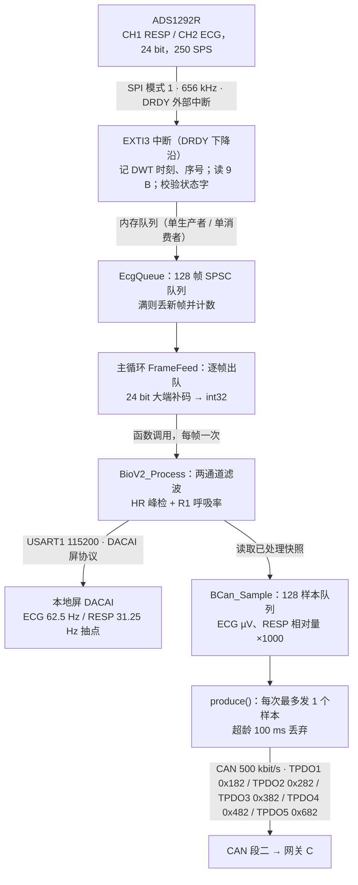
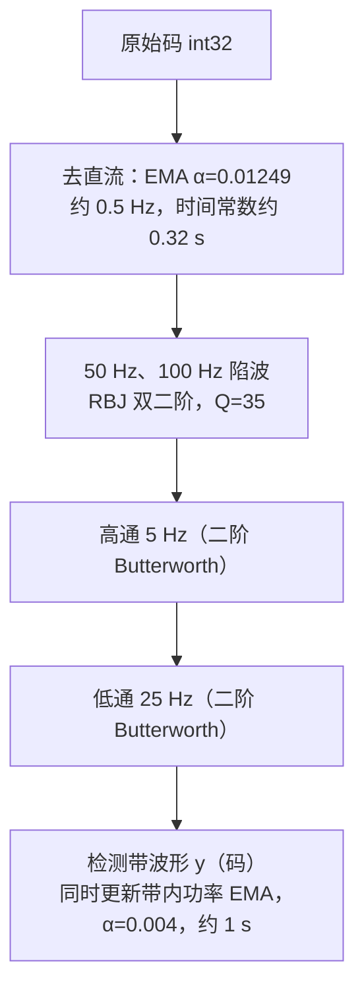
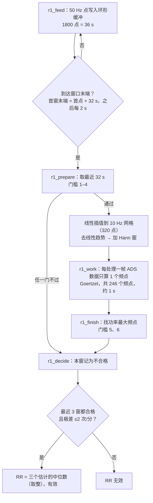
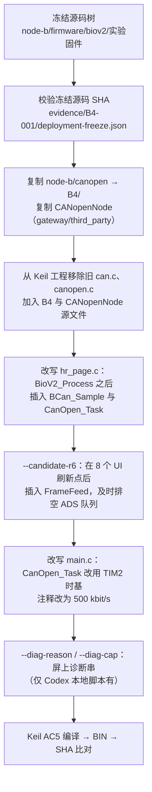

# 03 · 节点 B：采集链路与心率、呼吸率算法

> 本篇对应冻结镜像 **R125 K5**（应用 SHA `9619761b…`），源码钉在提交 `65803a1`。文中的“文件:行号”都以这个提交为准；以后若改代码，行号会漂移，以函数名为准。

## 0. 一句话版

B 用 ADS1292R 以 250 SPS 同时采心电（CH2）和阻抗呼吸（CH1）。DRDY 中断里只读帧、入队；主循环逐帧跑 BIO_V2 算法：
- **心率**：时域峰检，需要 5 个稳定间期才出值；
- **呼吸率**：R1 算法，32 s 窗谱峰，用 Goertzel 逐频点计算，三窗一致才出值。

结果分三类 PDO 上 CAN：波形每样本一帧，数值每 1 s 一帧，标志变化即发。
- 波形有效只看信号本身，与数值能否算出无关（R125 起）。
- RR 从上电到出值约 39 s，这是窗长决定的，不是故障。

---

## 1. 硬件与采集链路

### 1.1 ADS1292R 关键配置（`HARDWARE/ads1292.c` 的 `k_regs[]`）

| 寄存器 | 值 | 为什么是这个值 |
|---|---|---|
| CONFIG1 | 0x01 | 250 SPS。改采样率要同步改算法里所有按 250 Hz 推导的系数（滤波、EMA、R1 抽取） |
| CH1SET（RESP） | 0x40，增益 4 | 原来是增益 12（0x60）。解调输出里有一个与基础阻抗成正比的直流分量（约 30 mV），×12 后约 360 mV，超过 ±202 mV 满量程，会削顶成方波。增益 4 时满量程 ±605 mV，直流只占约 20%（2026-09-24 改） |
| CH2SET（ECG） | 0x40，增益 4 | ±605 mV 满量程，1 码约 72 nV（2.42 V / 4 / 2²³） |
| RLD_SENS | 0xEC | 开 RLD 缓冲，只从 CH2 感测共模（TI 官方配置）。原来是 0xCB（关缓冲），人体共模没有被压住，环境干扰会经电极失配转成差模 |
| LOFF_SENS | 0x00 | 关导联脱落电流。电极经模块上 56 kΩ 接入，6 µA 电流压降 336 mV，会把通道顶轨。编译开关 `ADS_LOFF_DC=1` 可改为 0x0C（6 nA 档，只给 CH2） |
| RESP1 | 0xEA | 解调相位 112.5°。**陷阱**：手册 8.3 的示例代码写 0xD5 并注释为 112.5°，但 0101 在 32 kHz 表里是 56.25°，示例前后矛盾，不能照抄 |
| RESP2 | 0x03 | 调制频率 32 kHz，RLDREF 取内部 |

- 每个寄存器写后都回读核对；失败重试一次，仍失败则不启动采集。
- 引脚：PA0 PWDN、**PG15 START**（原来用 PA1 时出现异常间隔，改到 PG15 后消失）、PA2 CS、PA3 DRDY、PA5/6/7 SPI1。
- SPI1：模式 1（CPOL=0、CPHA=第 2 边沿），128 分频。APB2 为 84 MHz，所以 SCLK 约 656 kHz。原来是 64 分频，改为 128 并加回读后，8,412 帧完整。
- 9 B 帧在 656 kHz 下约 110 µs，远小于 4 ms 帧周期。

### 1.2 三个时基互不混用（`USER/main.c` 头注释）

| 时基 | 周期 | 用途 |
|---|---|---|
| SysTick | 10 ms | 屏幕层（`timer_tick_count`） |
| TIM2 | 1 ms | 算法和 CAN（`TimeBase_GetMs()`） |
| DWT CYCCNT | CPU 周期 | ADS 命令时序延时；DRDY 间隔测量 |

**陷阱**：仓库里 `main.c` 把 `timer_tick_count*10` 传给了 `CanOpen_Task`，注释写的还是“CAN1 1M、NodeID=3”。这两处在构建时被脚本改写（见 §7），板上实际是 `CanOpen_Task(TimeBase_GetMs())`、500 kbit/s、节点号 2。

### 1.3 数据流



**DRDY 中断里做什么**（`ads1292.c:177–226`）：
1. 记录 DWT 时刻、`TimeBase_GetMs()` 和自增序号。
2. 与上一次中断的间隔超过 6 ms（正常 4 ms），给本帧打 `flags=1`。**算法收到 flags≠0 会开新数据段，HR、RR 全部重来**（§2）。
3. 延时 10 µs，拉低 CS，读 9 B。每字节有超时；读完等 BSY 清零，再拉高 CS。
4. 状态字校验：`(b0&0xF0)==0xC0`、`(b1&0x1F)==0`、`b2==0`。不符则计 `bad_status` 并丢弃。
5. 入队；队满时丢新帧并计 `queue_overflow`，保持旧帧顺序。

**为什么算法不放在中断里**：中断只做固定、短时的工作。算法和屏幕刷新都在主循环里，耗时波动不会推迟下一次 DRDY，也就不会丢样。代价是主循环要及时消费：队列 128 帧等于 512 ms，主循环停顿超过 0.5 s 就会溢出。

---

## 2. BIO_V2 公共框架（`HARDWARE/bio_v2.c`）

### 2.1 数据段与断段

`BioV2_Process()`（`:454`）满足以下任一条件就调用 `new_segment()`，清空两路滤波、周期历史和 R1 窗口：
- 帧带 `flags`（中断间隔 >6 ms）；
- 与上一样本的时间差 > `BIO_V2_GAP_MS` = 100 ms；
- 序号不连续（队列溢出、SPI 错误、状态字错都会造成跳号）。

**维护含义**：只要采集链路出一次问题，HR 要从头积累，约 12 s；RR 要从头积累，约 37 s。看到 RR 在“没动电极”的情况下长时间无效，先查 `discontinuities` 计数，再怀疑算法。

### 2.2 逐通道削顶

- **判据**：`|raw| ≥ 8,304,721`，即满量程 2²³ 的 99%（`:92`）。
- **处理**：只重置削顶的那一路，另一路照常。首次削顶清空本路滤波和周期历史；之后的削顶帧不喂入滤波。恢复后从第一个未削顶样本重新预热。
- **R1 特有**：RESP 任何一帧削顶，R1 窗口整体作废（`r1_reset()`，`:487`）。
- **由来**：早期 RESP 削顶会把 ECG 一起判无效。改为逐通道判断后，隔离用例 28/28 通过。

### 2.3 无效原因位（`bio_v2.h`）

| 位 | 名称 | 何时置位 |
|---|---|---|
| 1 | WARMUP | 本路有效起点后 HR 不足 5 s、RESP 不足 10 s |
| 2 | NO_CYCLES | 还没有稳定周期，或 R1 未满三窗、有窗不合格 |
| 4 | UNSTABLE | 间期离散超容差；R1 三窗极差 >2 次/分 |
| 8 | EXPIRED | 超时无新周期，或间期过长 |
| 16 | DISCONTINUITY | 断段，或 `BioV2_Tick` 发现超过 100 ms 无样本 |
| 32 | CLIPPED | 本路削顶 |
| 64 | MAINS | 工频功率 `line_power > 9.6e11` 码²（注释：约 100 mV 峰值） |
| 128 | BROADBAND_NOISE | 仅 RESP：带内功率不到陷波后总功率的 5%（低通后的白噪声看起来像慢起伏，不能拿来判周期） |

原因位只在节点本地使用，可在 B 屏的诊断串上看到，不上 CAN。CAN 上只有 4 个有效位（§6）。

---

## 3. 心率算法

### 3.1 滤波链（`filter_channel`，`:194`）



- 系数是按 250 Hz 用 RBJ / 双线性公式离线生成的常数（`configure`，`:73`），不移植旧 FIR 数组。
- 用转置直接 II 型，每节只有 2 个状态，每帧计算量固定。
- 5–25 Hz 带通保留 QRS 主能量，压掉基线漂移、呼吸和肌电高频。
- 首个样本用来初始化直流估计（`seeded`）。否则大的直流偏置从零初态起步，会产生一个假峰。

### 3.2 峰检（`heartbeat`，`:213`）

1. **门限**：`max(30, 2.5 × 带内 RMS)`。30 码约 2.2 µV，用作噪声底。
2. **进峰**：`|y|` ≥ 门限时开始一个候选峰，并锁定这一刻的门限 `gate`。
3. **出峰**：`|y|` < 0.5×gate，或进峰已超过 200 ms。
4. **候选成立**需同时满足：
   - 峰宽 12–160 ms；
   - 峰值 ≥ 1.05×gate；
   - 距本路有效起点 ≥ 5 s（预热）。
5. **峰时刻**：取峰内 `|y|` 的最大点。

### 3.3 周期判稳（`accept_cycle`，`:141`）

| 参数 | HR | RESP（C2 旧路径） |
|---|---|---|
| 最短间期（不应期） | 273 ms（约 220 bpm） | 1.5 s |
| 最长间期 | 2000 ms（30 bpm） | 10 s |
| 无新周期超时 | 4 s | 12 s |
| 需要的间期数 | 5 | 3 |
| 首次锁定容差 | ±20% | ±20% |
| 已锁定后维持容差 | ±30%（`HEART_TOLERANCE`） | ±20% |
| 漏检一拍桥接 | 有 | 无 |

- **输出**：最近 5 个间期取中位数，HR = round(60000 / 中位数)。
- **滞回**：未锁定时用 20%，噪声难以偶然成锁；已锁定后放宽到 30%，正常心率变异不会频繁掉锁。
- **漏检桥接**：已有 ≥3 个间期时，若新间期是中位数的 1.75–2.25 倍，视为漏检一拍。此时只把锚点前移，这个间期不入窗、不改输出，并且不能连续桥接。所以心率真的减半时，下一个间期照常入窗，会被判为 UNSTABLE。
- **非法候选不续命**：候选时刻和“最后一个合法周期”的时刻分开记。非法候选不能延长有效期。

### 3.4 出值和恢复时间（60 bpm 时）

| 场景 | 计算 | 约 |
|---|---|---|
| 上电到第一个 HR | 启动约 2 s + 预热 5 s + 第一个峰作锚 ≤1 s + 5 个间期 5 s | **12–13 s** |
| 削顶恢复 | 预热 5 s + 锚 + 5 个间期 | 11 s |
| 失效 | 最后一个合法周期后 4 s 无新周期 | 4 s |
| CAN 数值保持 | 失效后 1.1 s 内仍发上一个有效值（§6.2） | — |

### 3.5 真人 HR 为什么常常不达标

这是本项目最难的问题，详见 `09-ISSUE-ARCHIVE.md` 的 P-07。结论如下：
- **硬件链路正常**：模拟器 60 bpm 下 HR 100% 有效，带内 RMS 27.6 µV。
- **真人的单拍信噪比**（QRS 峰值 / 带内 RMS）只有 0.5–3.3。同一个人两次贴片，QRS 幅度能相差 7 倍。
- 工频残留时大时小，来自两个电极接触阻抗不平衡造成的共模转差模（R103）。早先猜测是 250 SPS 下谐波折叠形成的拍频，R103 实测否定了这一点：频偏与幅度无关。
- 2026-11-28 的分窗统计（`node-b/docs/PI-REVIEW/VENDOR-CODE-AND-SIGNAL-BOTTLENECK-20261128.md` §6）：HR 有效率随 SNR 单调上升，没有“信号好却判无效”的窗。HR 无效窗的 QRS 反而更大，差别在带内噪声（197 µV 对 68 µV）和工频残留（54 µV 对 23 µV）。
- 多种算法改法（梳状滤波、Pan–Tompkins、包络自相关）都没有过预先写定的门槛。最终保留现算法。最好的真人结果是志愿者丙在 R125：98.7%（154/156）。

---

## 4. 呼吸信号预处理

- **去直流**：EMA α=0.000666，时间常数约 6 s。
- **陷波**：与 ECG 相同。
- **低通**：0.8 Hz，二阶 Butterworth。
- **换算**：乘以 0.11920928955（即 10⁶/2²³）得到“r 单位”，是相对量，不是欧姆。
- **定标**：模拟器 1.0R 以上约 300–330 r/R；0.5R 时为 173 r/R，已不线性，是灵敏度下限。
- **旧路径 C2**（时域谷—峰，`respiration`，`:232`）：
  - 门限 `max(20, 0.6×RMS)`；
  - 谷到峰须超过 2 倍门限，峰须在谷之后 ≥300 ms，并且距有效起点 ≥10 s。
  - R1 构建里 C2 仍在跑，只输出诊断计数；编译 `BIO_V2_RR_R1=0` 即回到 C2，镜像与 C2 逐位相同（R123 K1 验证）。

---

## 5. 呼吸率算法 R1

### 5.1 为什么换成谱峰法

C2 在模拟器上表现很好，在真人上有两个问题：
- 自然呼吸不规整，3 个间期 ±20% 的判稳条件很少满足；
- 不规整的伪迹也能凑出“周期”。

R1 改为看 32 s 内的主频是否集中：呼吸越规律，谱峰越尖。窗内谱峰稳定就出值，不稳定就不出。

R1 的门槛在离线研究（R102）开跑之前就写定了：
- **阳性**：模拟器各档覆盖 ≥80%，误差 ±1 次/分；
- **阴性**：ECG 模式（无呼吸）、导联断开、大瞬变时输出 0%；合成噪声输出 ≤1%。

### 5.2 输入：与上传完全相同的点

```c
if(sequence%5u==0u) r1_feed(now,(float)(int32_t)(r*.11920928955f)/.11920928955f);   // :489
```

- 每 5 个样本取 1 个，即 50 Hz，与 CAN 上传的 RESP 是同一批点。
- 先按上传的量化取整，再换回原尺度。

**这样做的价值**：云端录下的 MQTT RESP 可以在 Python 里逐窗重放，结果与板上一致。R123 的对照为 9,067 窗，持续输出 100% 一致；R125 为 9,883 窗，全部一致。所以 R1 的问题都能离线复现和回归，不必上板。

### 5.3 一个窗口的计算



**六道门槛**（顺序与 Python 参考实现 `resp_r1.py` 相同）：

| 序 | 门 | 失败条件 | 防什么 |
|---|---|---|---|
| 1 | 覆盖 | 窗内点数 < 1440（32 s×50 Hz 的 90%） | 数据缺失 |
| 2 | 缺口 | 任一缺口 > 1000 ms（含窗两端） | 断续数据插值出假周期 |
| 3 | 瞬变 | 极差 > 3×(p95 − p5) | 动作伪迹、接夹拉线 |
| 4 | 幅度 | (p95 − p5)/2 < 60 r | 没有呼吸（约 0.2 个模拟器 R） |
| 5 | 贴边 | 估计值不在 (9.5, 39) 次/分 | 低频漂移、高频泄漏 |
| 6 | 谱质量 | 峰值 ±12 个频点内的功率 < 带内总功率的 50% | 无主频的宽带起伏 |

### 5.4 频点、分辨率和 Goertzel

- **频率网格**：10 Hz 网格补零到 4096 点。第 k 个频点为 k×10/4096 Hz，对应 **k×600/4096 = 0.1465k 次/分**。
- 只算 k=41..286（0.10–0.70 Hz，即 6.0–41.9 次/分），共 246 个频点。

| 呼吸频率 | 最近频点 k | 该频点对应 |
|---|---|---|
| 10 次/分 | 68 | 9.96 |
| 12 次/分 | 82 | 12.01 |
| 20 次/分 | 137 | 20.07 |

- **补零不提高分辨率**：32 s 窗的固有分辨率是 1/32 Hz ≈ 1.9 次/分。补零只是把峰位插值得更细，两个相距不到约 2 次/分的频率仍分不开。三窗极差 ≤2 次/分这条门槛，和这个分辨率是同一量级。
- **为什么用 Goertzel，不用 FFT**：
  - 只需要 4096 点谱中的 246 个点。Goertzel 每个频点只需对 320 点网格做一遍二阶递推，状态只有两个浮点数。
  - 可以“一次只算一个频点”，把计算摊到 246 帧里（`r1_work`，`:389`）。
  - 4096 点浮点 FFT 光工作区就要 32 KB，还只能一次算完。
- **Goertzel 递推**：`s0 = x + c·s1 − s2`，其中 c = 2cos(2πk/4096)；功率 = s1² + s2² − c·s1·s2。结果等于补零 rfft 的 |X|²。
- **RAM**：环形缓冲（时刻 + 值）2×7.2 KB，排序副本 7.2 KB，网格与 Hann 窗 2.5 KB，系数与功率 2 KB，合计约 26 KB（R123 GCC 估算 +26 KB）。

### 5.5 计算分摊（R125 修复的由来）

- **问题**：R1 首版每 2 s 集中算完全部频点，主循环停顿超过 100 ms。等待上传的 ECG 样本超过 100 ms 龄被丢弃，上传丢点从 2–6.5% 升到 14–20%；相邻缺口间隔里有 38–42% 恰为 2.00 s（R124 §3.1）。
- **修复**：每调用一次 `r1_work` 只算一个频点。主机 -O0 计时：取窗准备约占一次完整计算的 9%，单个频点约 0.4%。
- **输入跳步时**：如果输入一次跨过多个窗口末端，先把上一窗补算完，保持逐窗顺序（`:406`）。

### 5.6 出值、失效与恢复时间

| 场景 | 计算 | 约 |
|---|---|---|
| 上电到第一个 RR | 启动到首个样本约 2 s + 首窗 32 s + 再等两窗 4 s + 谱计算约 1 s | **39 s** |
| 削顶、断段之后 | 窗口作废，从下一个样本重新计 32 + 4 + 1 s | 37 s |
| 某一时刻出现一次瞬变 | 包含这一刻的窗口（32 s 内）都不合格。第一个不含它的窗口在 +32 s，三窗满足在 +36 s，再加计算 1 s | **37 s** |
| 由有效转无效 | 下一窗不合格即失效：≤2 s 步长 + 约 1 s 计算 | ≤3 s |
| 呼吸停止 | 主机用例：21.0 s 判无效（幅度门要等窗内大部分点变平） | 21 s |

**规律是失效快、恢复慢**：任何一次波动都会让 RR 消失约 37 s。在 3 分钟的测试里，中途波动一两次，可见 RR 的时间就会大幅减少。

**R125 研究过缩短窗口，结论是不改**（`results/r125_rr_variants.txt`）：
- 24 s、20 s 窗不提高覆盖（真值段 69% → 66%、47%），而且 20 s 窗在 ECG 模式下误出 RR 13.8。
- 真人失效窗的判因：谱质量 47、贴边 17、瞬变 0。真人 RR 长时间无效的主因是呼吸不规整和低频漂移，不是单次波动。
- 只有把谱质量门槛降到 0.40 才明显提高覆盖（真值段 78%，丙 45%），但 ECG 模式下开始误出 RR 13.0、13.5。误报比不出值更糟，所以参数不变。

### 5.7 下限 9.5 次/分的由来

- 原下限是 8 次/分。R123 模拟器 ECG 模式（无呼吸）下，接夹后基线慢漂在 8.8–8.9 次/分处形成谱峰，输出了一帧 RR=9。
- 下限提高到 10 不行：规整的 10 次/分落在 9.96 那一格，会被挡掉。所以取 9.5。
- **这个数是看过误报数据之后才定的**，需要以后的数据检验（项目书 L-14）。

---

## 6. 上 CAN（`node-b/canopen/b_canopen_app.c`）

### 6.1 PDO 一览（`canopen/OD.c` 的 0x1800–0x1804）

| PDO | COB-ID | 内容 | 发送时机 |
|---|---|---|---|
| TPDO1 | 0x182 | 0x2110：ECG µV（i32）+ 采样 tick | 每个样本，250 Hz |
| TPDO2 | 0x282 | 0x2111：RESP 相对量 ×1000（i32）+ tick | 每 5 个样本，50 Hz |
| TPDO3 | 0x382 | 0x2120：HR×100、RR×100、TEMP、保留 | 事件定时器 1 s |
| TPDO4 | 0x482 | 0x2100：epoch 秒 + 对应 tick | 1 s |
| TPDO5 | 0x682 | 0x2130：有效标志 + 启动代次 | 1 s，变化时立即发 |

- 心跳 500 ms（OD 0x1017 = 0x01F4）。B 不消费其他节点的心跳（0x1016 全 0），心跳超时由网关 C 判断（1.5 s）。
- 代码注释里写的“TPDO2 数值帧、TPDO4 标志帧”用的是从 0 开始的数组下标（`co->TPDO[2]`、`co->TPDO[4]`），对应上表的 TPDO3、TPDO5。

### 6.2 `produce()` 每轮做什么（`:83`）

1. **取时间锚**：在临界区里拷贝 `clock_anchor`，再算出当前 epoch 和整秒 tick。30 s 没收到 TIME 帧时 epoch=0，视为未授时（`node_policy.h`）。
2. **取 HR、RR**：`BioV2_GetHeart/Resp` 内部先调用 `BioV2_Tick` 做超时检查。
3. **数值保持 1.1 s**（`:98–101`）：
   - 有效时记下数值和时刻；
   - 失效后 1.1 s 内，TPDO3 仍发上一个有效值。
   - **原因**：网关在数值帧到达时，配用最近收到的标志帧。若失效那一刻数值帧（已是 0）先到、新标志帧后到，就会拼出“有效的 0”。保持 1.1 s，正好覆盖一个 1 s 定时周期（R124 §3.2）。
4. **有效标志**（`:113–126`）：

   | 位 | 含义 | 条件 |
   |---|---|---|
   | bit0 | ECG 波形有效 | 已授时 + 最近样本 ≤100 ms + ECG 原始码未削顶 |
   | bit1 | RESP 波形有效 | 同上，RESP 原始码未削顶 |
   | bit2 | HR 有效 | 同上前两项，且算法 HR 有效 |
   | bit3 | RR 有效 | 同上前两项，且 R1 有效 |

   - R125 之前，bit0/1 等于 HR/RR 的有效性，数值无效时网页波形一起消失。改为只看信号本身之后，网页波形一直走纸，数值显示“--”。
   - 主机用例 `node-b/tests/b4_node_protocol.c` 断言了两种语义：3 s 时标志为 3（波形有效、数值未出）；ECG 削顶时为 2。
   - 标志一变就立即发 TPDO5，不等 1 s 定时。

5. **发一个样本**：
   - 队首样本超过 100 ms 龄、带 flags 或未授时，直接丢弃，每轮最多丢 8 个。
   - TPDO1/TPDO2 的发送缓冲还占着时，保留队首、本轮不发，以免覆盖还在邮箱里等待的旧点。
   - 每轮最多发 1 个样本。

### 6.3 `CanOpen_Task()` 的小技巧（`:149`）

CANopenNode 的 `CO_process_TPDO` 只要 PDO 有效就会发送。B 的波形 PDO 需要“有样本才发”。所以每轮先把本轮没有请求的 TPDO1/2 临时标成无效，调用完再恢复。每轮最多循环 8 次，把积压的样本尽快发出。

NMT 远程复位只重建通信栈（`stack_init`），不复位 MCU，屏幕、ADC 和算法不受影响。

---

## 7. 板上镜像是怎样拼出来的（维护必读）

**板上的 B 镜像不等于 `node-b/firmware/biov2/实验固件` 原样编译。** 构建脚本 `node-b/tools/build_b4_arm.py` 先复制冻结源码树，再做以下改写：



- **CMSIS-DSP 库**：脚本从固定的 Windows 路径取一个冻结库，并校验 SHA（`evidence/external-build-dependencies.json`）。
- **未闭环的风险**：`--diag-reason`、`--diag-cap` 只存在于 Codex 本地构建脚本（R89 `f0ca6a42…`、R104 私有副本 `4e084d07…`），仓库版没有（R105 §3）。**仅凭仓库目前不能独立复现 R125 K5**；要复现，需要把本地脚本去掉私有路径后入库。
- **回退点**：R123 K3 `cbbafe29…`（R1 首版）；R89 C2 `f81063c9…`（时域 RR）。K1（`BIO_V2_RR_R1=0`）编出来与 C2 逐位相同，这一点已验证。

---

## 8. 代码位置索引（@`65803a1`）

| 主题 | 位置 |
|---|---|
| 寄存器表 | `node-b/firmware/biov2/实验固件/HARDWARE/ads1292.c:36` 起 |
| DRDY 中断 | 同上 `:177–226` |
| 帧队列 | `HARDWARE/ecg_frame_queue.c/.h` |
| 逐帧消费 | `HARDWARE/hr_page.c:286`（`FrameFeed`） |
| 通道配置与系数 | `HARDWARE/bio_v2.c:73`（`configure`） |
| 削顶 | `bio_v2.c:90`（`accept_input`） |
| 断段 | `bio_v2.c:105`（`new_segment`）、`:461` |
| 周期判稳 | `bio_v2.c:141`（`accept_cycle`） |
| 滤波 | `bio_v2.c:194` |
| 心搏峰检 | `bio_v2.c:213` |
| R1 参数 | `bio_v2.c:252–259` |
| R1 取窗与门 1–4 | `bio_v2.c:310`（`r1_prepare`） |
| R1 三窗判定 | `bio_v2.c:351`（`r1_decide`） |
| R1 门 5–6 | `bio_v2.c:377`（`r1_finish`） |
| Goertzel 单频点 | `bio_v2.c:389`（`r1_work`） |
| 原因位汇总 | `bio_v2.c:431`（`publish`） |
| 上 CAN | `node-b/canopen/b_canopen_app.c:64`（入队）、`:83`（`produce`）、`:149`（任务） |
| PDO 参数 | `node-b/canopen/OD.c:117–198` |
| CAN 驱动 | `node-b/canopen/CO_driver.c:239`（发送）、`:413` 起（发送完成中断） |
| 主机用例 | `node-b/firmware/biov2/tests/run_host.py`（61/61）、`node-b/tests/b4_node_protocol.c` |
| Python 参考 | `node-b/docs/PI-REVIEW/analysis-r83-r96/scripts/r98/resp_r1.py` |

---

## 9. 面试追问链

**Q1：为什么 ADS 读在中断里、算法在主循环？**
- 中断只做固定、短时的工作：读 9 B，打时间戳和序号，入队。
- 算法耗时会波动（R1 每帧多算一个频点），屏幕串口刷新也会阻塞。放在主循环里，不会推迟下一次 DRDY。
- 追问“队列多大、满了怎么办”：128 帧，约 512 ms。满了丢新帧并计数，算法靠序号发现跳号后断段，不会把断开的数据当成连续的拼起来。

**Q2：RR 为什么要 39 s？能不能快一点？**
- 32 s 窗才能容纳 5 个以上的 10 次/分呼吸周期，频率分辨率约 1.9 次/分。再加三窗一致 4 s 和计算 1 s。
- 缩短窗口试过：覆盖不升反降，20 s 窗在无呼吸时会误报。
- 追问“那临床设备怎么做”：多数用时域加较短窗口，同时用更好的电极（四电极阻抗）和更高的信噪比。本项目是两电极，信号先天弱，只能用长窗换可靠性。

**Q3：Goertzel 和 FFT 怎么选？**
- 只需 246 个频点，而且要把计算拆到每帧，Goertzel 每个频点独立，正好可以拆。
- 补零到 4096 不提高分辨率，只让峰位插值更细。

**Q4：“有效的 0”是怎么回事？**
- 数值和标志分在两个 PDO，网关按到达顺序拼接。主循环停顿使两个 PDO 到达交错，失效那一刻拼出了“RR=0、有效”。
- 修法是节点侧失效后保持数值 1.1 s。没有合并 PDO，是因为合并要同时改 OD 和已冻结的网关。

**Q5：怎么证明板上算法和离线分析是一回事？**
- R1 的输入与 CAN 上传同点、同量化，云端录制可以逐窗重放。
- C 与 Python 对照：R123 9,067 窗、R125 9,883 窗，持续输出全部一致。
- 关掉 R1 的编译开关，编出的镜像与旧版 C2 逐位相同。

**Q6：真人 HR 不达标，为什么不继续改算法？**
- 先证明硬件没问题（模拟器 100%），再量化真人信噪比（0.5–3.3），然后预先写定门槛做离线研究（R95/R96）。三种候选都没有过门槛，有的提高了有效率，却牺牲了与 PPG 脉率的一致性。
- 结论：瓶颈在信号源（贴片、个体、两电极、工频耦合），不在算法。继续调算法只会以误报为代价换有效率。
