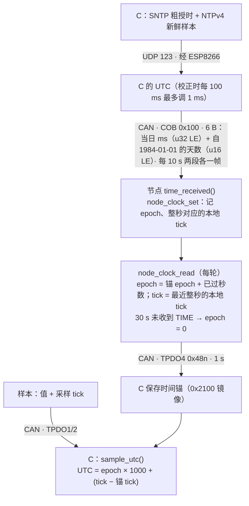
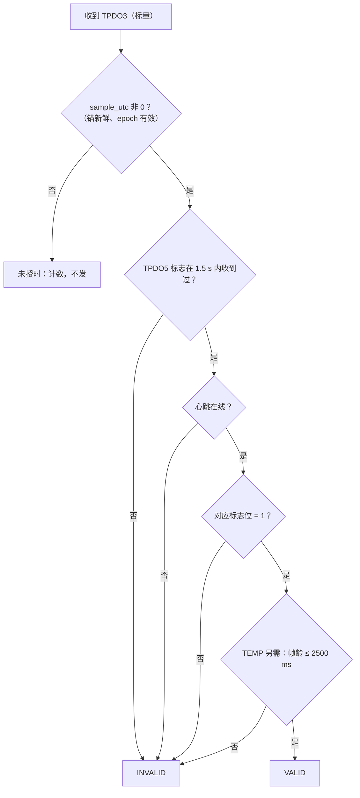

# 04 · CANopen 细节

> 本篇讲节点之间“说什么、怎么说、网关怎么判断真假”。
> 节点侧代码：`node-b/canopen/`（B、D 共用）、`node-a/STM32F407_HOSPITAL/HARDWARE/CANopen/`（A、E 共用）。网关侧：`gateway/dual_can/b4_gateway.c`、`gateway/canopen/src/mp_od.c`、`gateway/dual_can/b4_bxcan.c`。
> 注意：当前工作区里 `gateway/` 显示为已删除（未暂存），文中网关行号以提交 HEAD 为准，可用 `git show HEAD:gateway/...` 查看。

## 0. 一句话版

- 每个节点用 5 个 TPDO 发数据：波形、第二路数据、标量、时间锚、有效标志。
- 网关 C 收到标量后，只有在**时间锚、标志都在 1.5 s 内收到过、心跳在线、对应标志位为 1** 时才判为 VALID。
- 时间戳由节点时间锚换算：`UTC = 锚 epoch × 1000 + (样本 tick − 锚 tick)`。
- 时间同步靠 C 每 10 s 广播一帧 TIME。节点 30 s 收不到 TIME 就不再声称有可信时间。

---

## 1. 网络与节点

| 节点 | 号 | 段 | 协议栈 | 驱动 |
|---|---|---|---|---|
| A | 1 | 段一（C.CAN1） | CANopenNode v4.0 | node-a 版 `CO_driver.c` |
| B | 2 | 段二（C.CAN2） | 同上 | node-b 版 |
| C | 3 | 两段都是 3 | 同上（每段一个实例） | `gateway/dual_can/b4_bxcan.c` |
| D | 4 | 段二 | 同上 | node-b 版（与 B 共用） |
| E | 5 | 段一 | 同上 | node-a 版 |

- 500 kbit/s，CAN 2.0A 标准帧。
- C 在两段上都是 3，所以**不能在段间转发**。
- 节点上电后直接进入 OPERATIONAL（`CO_NMT_STARTUP_TO_OPERATIONAL`）；C 启动时也会给 1、2、4、5 号节点发 NMT start（`gateway/b5/network_main.c:860–868`）。
- **不用** SYNC；**不用** SDO 做业务（SDO 服务端在，但没有业务读写）。

---

## 2. 对象字典厂商区（0x2100–0x2130）

| 索引 | 子索引 | 类型 | 内容 |
|---|---|---|---|
| 0x2100 | 1 epoch，2 tick | u32, u32 | 时间锚：UTC 整秒，以及该整秒对应的本地 ms tick |
| 0x2110 | 1 值，2 采样 tick | i32, u32 | 波形 A 路：A 为 PPG（IR × 10⁶/2²²）；B 为 ECG µV |
| 0x2111 | 1、2 | i32/u32 | 第二路：B 为 RESP（`BioV2_RespWave()` × 1000）+ tick；E 为血压完成 tick + (SYS×10 \| DIA×10 << 16) |
| 0x2120 | 1–4 | 4 × u16 | 标量：A 为 SpO₂×100、PR×100、SYS×10、DIA×10；B、D 为 HR×100、RR×100、TEMP×100、保留（TEMP 有效时为帧龄 ms） |
| 0x2130 | 1 标志，2 启动代次 | u32, u32 | 有效标志（bit31 = synthetic）；启动代次，每次初始化或通信复位 +1 |

**设计要点**：
- 标量和标志分在两个 PDO 里。好处是标志一变就能立刻单独发；代价是到达顺序问题，见 `03` §6.2 的“有效的 0”。
- 标量和波形都不带 UTC，只带本地 tick。UTC 由“时间锚 PDO”统一给出，8 B 的 PDO 才放得下“值 + tick”。

---

## 3. PDO 总表

COB-ID = 基址 + 节点号。所有 TPDO 的传输类型都是 0xFF（事件驱动 / 定时）。

| PDO | 基址 | 映射 | A（1） | B（2） | D（4） | E（5） |
|---|---|---|---|---|---|---|
| TPDO1 | 0x180 | 0x2110:1 + :2 | 0x181 PPG 50 Hz，请求才发 | 0x182 ECG 250 Hz | 禁用 | 禁用 |
| TPDO2 | 0x280 | 0x2111:1 + :2 | 禁用 | 0x282 RESP 50 Hz | 禁用 | 0x285 完成时刻，1 s |
| TPDO3 | 0x380 | 0x2120:1–4 | 0x381，1 s | 0x382，1 s | 0x384，1 s | 0x385，1 s |
| TPDO4 | 0x480 | 0x2100:1 + :2 | 0x481，1 s | 0x482，1 s | 0x484，1 s | 0x485，1 s |
| TPDO5 | 0x680 | 0x2130:1 + :2 | 0x681，1 s + 变化即发 | 同 | 同 | 同 |

- 心跳 0x700 + 号，500 ms（OD 0x1017 = 0x01F4）；EMCY 0x80 + 号；TIME 0x100。
- TPDO5 用 0x680 而不是 CiA 301 的预定义号，因为预定义只到 TPDO4。
- D、E 复用 B、A 的 OD，在运行时改写 COB-ID（`node-d/d_canopen.c:35–43`、`node-e/e_canopen.c:36–45`）。禁用某个 PDO 是把 COB-ID 的 bit31 置 1（如 `0x80000184`）。
- **波形 PDO 的“有样本才发”**：CANopenNode 会自动发送有效的 TPDO。B 和 A 在每轮处理前，把本轮没有新样本的波形 TPDO 临时标为无效，处理完再恢复（`node-b/canopen/b_canopen_app.c:166–170`）。

### 3.1 段二每秒的帧（用于负载估算）

| 来源 | 帧/s |
|---|---|
| B ECG | 250 |
| B RESP | 50 |
| B 标量、时间锚、标志 | 3 |
| B 心跳 | 2 |
| D 标量、时间锚、标志、心跳 | 约 5 |
| C 的 TIME、NMT 等 | <1 |
| **合计** | 约 312 帧/s，约 41 kbit/s，约占 500 kbit/s 的 8% |

按每帧 8 B 数据、计入位填充最多约 130 bit 估算（R128 §3.2）。

---

## 4. 有效标志位：各节点含义不同

| 位 | A | B | D | E |
|---|---|---|---|---|
| 0 | PPG 实时 | ECG 波形有效 | — | — |
| 1 | SpO₂ | RESP 波形有效 | — | — |
| 2 | PR | HR | — | — |
| 3 | NIBP（A 上恒 0） | RR | — | NIBP |
| 4 | 探头在位 | TEMP（B 未启用温度时恒 0） | TEMP | — |
| 5 | — | — | — | 测量中 |
| 6 | — | — | — | 停止中 |
| 7 | 波形有效 | — | — | — |
| 8 | 波形为重采样 | — | — | — |
| 9 | 完成时间扩展 v1（恒 1） | — | — | 完成时间扩展 v1（恒 1） |
| 31 | synthetic（真实数据恒 0） | 同 | 同 | 同 |

**网关怎么读**（`gateway/dual_can/b4_gateway.c`）：
- **波形**：看 `bit[pdo]`，ECG/PPG 看 bit0，RESP 看 bit1（`:196`）。
- **标量**：SpO₂ 看 bit1，PR 看 bit2；HR 看 bit2，RR 看 bit3；TEMP 看 bit4（`:241–244`）。
- **NIBP**：bit3 和 bit9 都要为 1（`:256`）。

改任何一个节点的标志定义，都必须同步改网关的这几行。

---

## 5. 时间：TIME 帧、节点锚和样本时间戳

**节点侧**（`node-b/canopen/node_policy.h:6–16`）：
- 收到 TIME 时，算出 epoch = 441763200 + 天数 × 86400 + 当日 ms / 1000。其中 441763200 是 1984-01-01 的 Unix 秒。epoch 必须在 2020–2100 年之间，否则视为无效。
- 锚 tick = 收到时刻 − (当日 ms mod 1000)，即对齐到 UTC 整秒的本地时刻。
- 读取时用无符号差处理 32 位 tick 回绕；距上次收到 TIME 超过 30 s，就返回 epoch = 0。
- **节点不读屏幕 RTC**：屏的软 RTC 不可信，UTC 只能来自网关。

**网关侧**（`b4_gateway.c:142–161` 的 `sample_utc`），出现以下任一情况，样本记为“未授时”（时间戳 0）：
- C 自己的 UTC 无效；
- 该节点的时间锚 PDO 超过 1.5 s 没收到；
- 锚里 epoch = 0；
- |样本 tick − 锚 tick| > 2000 ms；
- 算出的 UTC 不在 C 当前时刻的 [−5 s, +1 s] 之内。

**未授时的帧不发**（`emit`，`:162–181`）。注意，seq 先加 1 再丢弃，所以丢一帧会在 seq 上留下一个空号。这也是 G3 不能用 seq 统计覆盖率的原因（`09` P-30）。

**标量的时间戳**：标量 PDO 的 tick 直接取锚 tick，所以标量时间戳都是锚的整秒。D 的锚帧缺失时，C 沿用旧锚，就会出现时间戳重复的 TEMP 帧（R127 中有 342 对）。

**断网保留构建**（`MP_OUTAGE_RETENTION`）：C 的 UTC 在断网后保持 610 s；每个节点、每路数据的时间戳强制不倒退（`:177`）。

---

## 6. 网关如何判定“在线”和“有效”

### 6.1 在线

- 心跳消费者超时 1500 ms（`b4_gateway.c:55`）。
- 在线 = 心跳消费者处于 ACTIVE，且节点 NMT 状态为 OPERATIONAL（5）（`:119–127`）。
- 心跳字节只接受 0、4、5、127，其余记畸形。字节不是 5 时，清空该节点所有“已收到”标记；字节为 0（启动）时，代次也清零（`:280–285`）。

### 6.2 启动代次

- TPDO5 带启动代次。代次为 0 或比上次小，记畸形；代次变大，视为节点重启，作废该节点的旧状态。
- MQTT 的 `session_id = can-<网关会话>-<节点观测启动号>`，后端据此区分不同的启动会话。

### 6.3 标量 VALID 的条件（`:236–249`）

**NIBP 另有规则**（`:252–268`）：
- 需要 TPDO2（完成时刻）和 TPDO5 都新鲜，bit3、bit9 都为 1；
- 年龄 = 锚 tick − 完成 tick，须在 0–90 s 之间；
- 完成时刻里打包的 SYS/DIA 必须与标量 PDO 里的一致；
- 同一个完成时刻、同一个代次只发一次。
- 时间戳 = 锚 UTC − 年龄，即测量完成的时刻，而不是发送时刻。

### 6.4 波形（`:193–235`）

- 有效 = TPDO5 新鲜、在线、`bit[pdo]` = 1、能授时。
- **批**：ECG 每 100 点（0.4 s），PPG、RESP 每 50 点（1 s）。
- **断批**：
  - 相邻样本 tick 差偏离 1000/rate 超过 ±1 ms，或整批相位偏差超过 ±1 ms，就清批，计 `wave_gaps`。ADS 的 4 ms 周期在整数毫秒域里会量化成 3/4/5 ms，所以允许 ±1 ms。
  - 批内有效性或 synthetic 变化，就切批，计 `quality_resets`。
  - A 的 PPG 静默 100 ms 后，把不满一批的部分发出。

---

## 7. EMCY 与 NMT

- **EMCY**：0x80 + 号，DLC 8，错误码 = data[0] | data[1] << 8。C 把它转成 FAULT 帧（QoS1，主题 `.../NODE-x/event`，值 `EMCY-xxxx`）。
- 节点应用层**没有主动发 EMCY**（A、E 的 `canopen_app_emcy()` 没有调用方），只有协议栈内部错误会发。
- **NMT 复位通信**：节点只重建协议栈，启动代次 +1，不复位 MCU，屏幕、采集和算法不受影响。
- **NMT 复位应用**：
  - B、D：拒绝并关闭 CAN，计 `app_reset_rejected`；
  - E：关闭 CAN，不再恢复；
  - A：锁定 CAN，清时间和标志后本地重建。
  - 远端命令不能把节点整机复位，这是有意的设计。

---

## 8. 驱动层要点（问题最多的一层）

| 项 | node-b 版（B、D） | node-a 版（A、E） | C（`b4_bxcan.c`） |
|---|---|---|---|
| 位时序 | 42 MHz / 6，11 + 2 TQ | 同 | 8 MHz / 1，13 + 2 TQ |
| 自动重传 | 开（NART = DISABLE） | 开 | 开 |
| TXFP（按请求顺序发） | 开 | A 开，E 关 | 开 |
| 缓冲占用时再请求发送 | 立即返回 `TX_OVERFLOW` | 记错误后继续 | — |
| 收扩展帧、远程帧 | 丢弃 | 不过滤 | 软件按 ID 过滤 |
| 发送完成中断 | 清全部 RQCP，每次中断最多补发 1 帧 | 同 | 发送队列 128 帧，每次轮询发 16 帧 |
| 接收 | 每次中断 1 帧 | 同 | 每次中断最多 3 帧进 96 帧环，主循环每次取 16 帧 |
| 中断优先级 | — | 3/0（最低） | 抢占 3 |

出处：`node-b/canopen/CO_driver.c`、`node-a/.../CO_driver.c`（两者 `diff` 只差上表三处）、`gateway/dual_can/b4_bxcan.c:39–123`、`b4_bus.c:41`。

**历史问题**（详见 `09`）：
- P-15 仲裁失败不重传 → 打开自动重传；
- P-16 中断早于协议栈就绪；
- P-17 同 COB-ID 多邮箱乱序 → TXFP；
- P-18 无符号年龄回绕；
- P-20 D 定时帧缺失（OPEN）。

---

## 9. D 定时帧缺失：已知事实与对照

| 对照 | PDO3/PDO5 | 驱动 | 每秒定时 PDO | 其他流量 |
|---|---|---|---|---|
| A | 0.980 | node-a 版 | 3 个 + 心跳 | PPG 50 Hz |
| E | 0.999 | node-a 版（TXFP 关） | 4 个 + 心跳 | 无 |
| B | 0.950 | node-b 版 | 3 个 + 心跳 | ECG 250 Hz + RESP 50 Hz |
| **D** | **0.807** | node-b 版 | 3 个 + 心跳 | 无 |

**可以推出**：
- 不是总线负载问题：段二只有 8%，B 断电时 D 仍缺。
- “每次中断只补发 1 帧”本身不会长期丢帧：排队的帧会随每次发送完成逐个补出，几毫秒内就能发完，1 s 后同一个 PDO 再发时缓冲早已空出。A、E 用几乎相同的逻辑，基本不缺。
- 两块用 node-b 版驱动的板（B、D）缺得最多。node-b 版与 node-a 版的一个差异是：缓冲占用时 `CO_CANsend` 立即返回。

**还要查的**（按成本从低到高）：
1. 离线：在主机上建两版驱动的模型，喂 D 的发送时序（三个 1 s 定时器同时到期 + 500 ms 心跳），比较丢帧数。
2. 只读：J-Link 读 D 的 `CANerrorStatus`（`CO_CAN_ERRTX_OVERFLOW`）和 `CANtxCount`。
3. 挂 CAN 分析仪在 S4 子段上，看 0x384 是否真的上了总线，区分节点侧和网桥/网关侧。

修复会打破冻结，并且 B、D 都要重刷。登记见分支 `claude/d-node-tpdo-loss` 的 `docs/issues/D-NODE-TPDO-LOSS.md`。

---

## 10. 面试追问链

**Q：为什么值和时间分开发？**
- 8 B 的 PDO 只放得下“i32 值 + u32 tick”。把 64 位 UTC 放进每个样本，ECG 就要两帧一个样本，负载翻倍。
- 改为每秒一帧时间锚，网关换算即可，误差就是节点晶振在 1 s 内的漂移。

**Q：节点时钟漂了怎么办？**
- 每 10 s 用 TIME 重新对齐一次锚；30 s 收不到 TIME 就撤销可信时间。
- 网关还会检查算出的时间是否落在自己时钟的 [−5 s, +1 s] 内，超出就不发。

**Q：怎么知道节点重启过？**
- 三层判据：心跳字节 0（boot-up）、启动代次变化、心跳超时。任一出现，网关就作废该节点的旧状态，后端看到新的 `session_id`。

**Q：为什么标志变化要立即发，不等 1 s？**
- 失效要尽快让下游知道，否则网页会在最长 1 s 内显示已经不可信的数值。
- 反过来，数值帧失效后保持 1.1 s（B），是为了防止“新的 0 + 旧的有效标志”。这两条规则配合使用。
