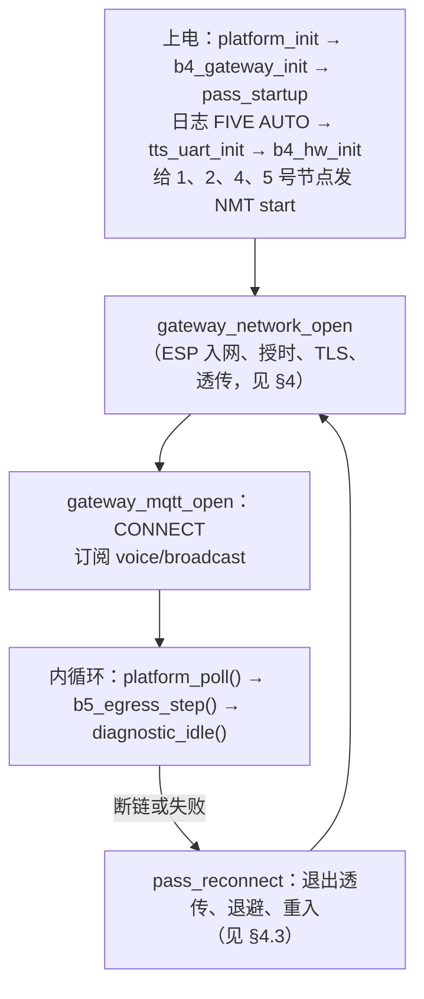
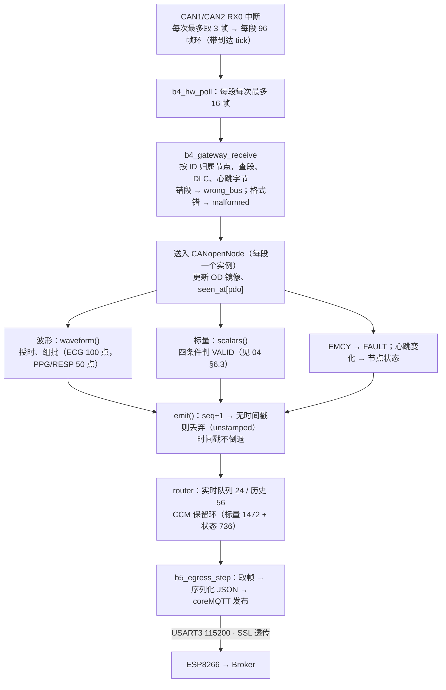
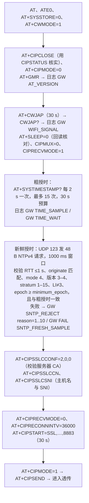
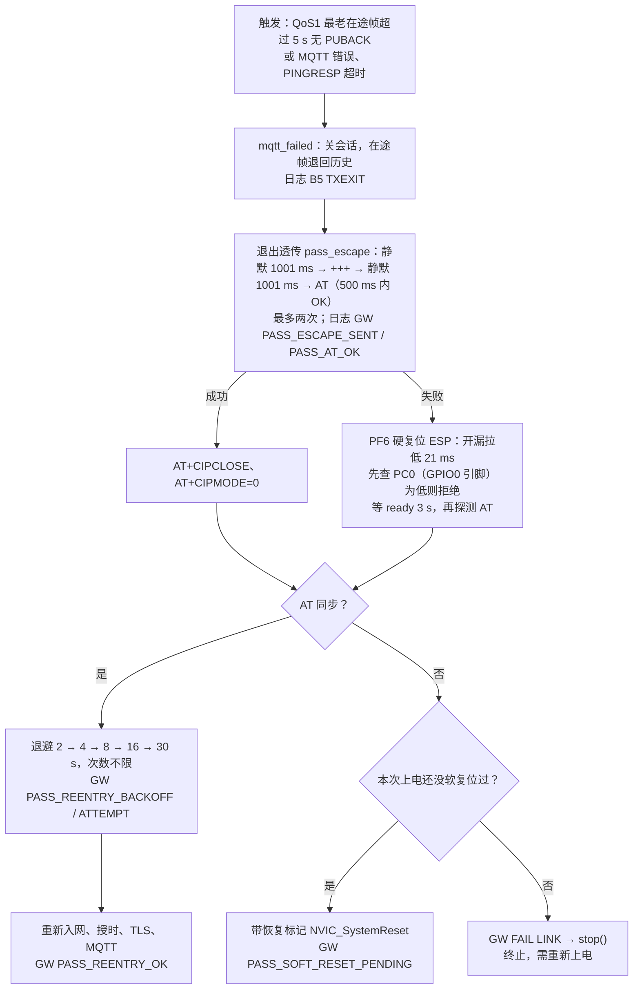
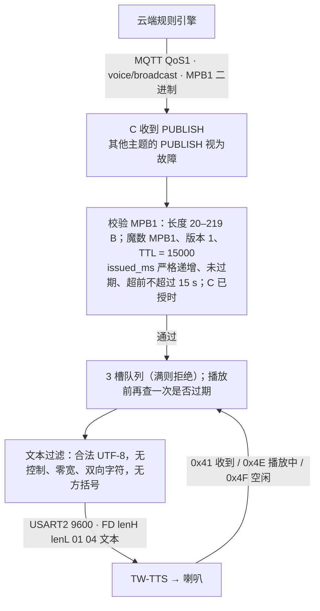

# 05 · 网关 C

> 正式镜像 **WP-AZ**：boot `ef85ab63…`，code `9d190246…`，源码提交 `2c97094`。HEAD 与 `2c97094` 在 `gateway/` 下只差 `gateway/mqtt/README.md` 的一行历史说明，所以下文行号按 HEAD 计，与镜像源码一致。
> 当前工作区里 `gateway/` 显示为已删除（未暂存），查看源码请用 `git show HEAD:gateway/<路径>`。

## 0. 一句话版

C 是一块 8 MHz、无 RTOS 的 STM32F407：
- 两路 bxCAN 收四个节点的 PDO，按时间锚打 UTC，组批成 JSON；
- 经 ESP8266 的 SSL 透传，以 MQTT 3.1.1（coreMQTT）发到 Broker；
- 波形 QoS0，标量 QoS1（在途 4 槽，每个事务 5 s 超时）；
- 断网时把标量和状态保留在 CCM 里，约 240 s；
- 订阅一个语音主题，把云端播报转成 TW-TTS 串口帧。

所有诊断信息从 USART1（PA9）以 115200 输出，现场排障就靠这份日志。

---

## 1. 镜像组成

- **入口**：`gateway/b5/network_main.c`，加 `gateway/mqtt/src/` 下的 `gateway_transport.c`、`platform.c`、`mqtt_transport_adapter.c`、`heap.c`，以及 coreMQTT v2.3.1。
  - **不是** `gateway/mqtt/src/main.c`，也**不是** `gateway/dual_can/network_main.c`，那两个是早期目标。
- **构建**：`gateway/dual_can/build_arm.py`，Arm GNU 14.2.1，`-Os -flto`。WP-AZ 的开关（R62 回执 :52）：

  ```text
  --b5 --egress-final --tri --unified --split-flash --five-node --five-appliance --no-audio
  --esp-passthrough --pass-lifecycle --production-diag --outage-retention --tx-integrity-diag
  --link-resilience --formal-cloud --tts-broadcast
  ```

- **主要宏**：`MP_FRAME_MAX_SAMPLES=100`、`HSE_VALUE=8000000`、`GATEWAY_TELEMETRY_SLOTS=4u`、`MP_LIVE_CAPACITY=24`、`MP_CACHE_CAPACITY=56`、`MP_FORMAL_CLOUD`、`MP_TTS_BROADCAST`。
- **构建自检**（`build_arm.py:~285–298`）：
  - 向量表必须绑定 CAN1_RX0、CAN2_RX0、USART3、USART2，并且只有这四个强定义中断；
  - 镜像里不能出现麦克风主题 `mpm/mic/v1/`；
  - 不能有 Flash 写入路径。
- **Flash 布局**：

  | 区 | 地址 | 大小 | 内容 |
  |---|---|---|---|
  | BOOT | 0x08000000（sector0） | 16 KB | 引导，392 B |
  | sector3 | 0x0800C000 | 16 KB | 正式配置记录（见下） |
  | CODE | 0x08010000（sector4） | 64 KB | 应用，61,228 B |

- **sector3 配置**：记录头 `H3ConfigRecord`（magic、payload_bytes、generation、crc32、committed），载荷 `GatewayConfig` 312 B（magic、minimum_epoch、ssid、wifi_password、host、username、password、client_id）。
  - 只写字段名，值只存在受限存储里，**不入库**。
  - 写入流程：先判断预算，最后写提交字（`09` P-25）。固件本身不写 Flash。
- **身份校验**：client_id 和 username 必须等于编译期常量（`b5_policy.h:7–9`）。网关 ID 是编译期字符串 `GW-C-001`。
- **时钟**：HSE 8 MHz 直接作系统时钟，不开 PLL（`gateway/dual_can/system_hse.c:10–14`）；起振失败时日志输出 `GW FAIL HSE_CLOCK` 并停机。SysTick 1 kHz。

**过时的注释和文档**（读代码时别被误导）：
- `gateway_config.h:5–6`、`gateway_transport.c:~196` 写的是 sector7/11，实际是 sector3。
- `gateway/b5/flash.ld` 头注释写“应用只限 sector0..2”，实际是 sector0 + sector4。
- `gateway_transport.c` 注释写 3 个遥测槽，正式构建是 4 个。
- `gateway/voice/tts_uart_port.c:65` 写 CAN 优先级为 1，实际是 3。
- `b5_policy.h:4` 的 420 s 窗口只用于早期限时测试，正式镜像不生效。
- `gateway/dual_can/README.md` 是 B4/H3 时期的文档。

---

## 2. 主循环与调度



**`service()` 是核心回调**（`network_main.c:644`）。每次 `platform_poll()` 都会调用它，包括 AT 等待、逐字节发送等待和接收等待期间。因此 CAN 接收在网络阻塞时也不会停：
- 每次都执行 `tts_broadcast_poll`；
- 每 5 ms（`B5_SERVICE_MS`）一次：
  - `b4_gateway_tick`：两段的 `CO_process`、每 5 s 发节点状态、每 10 s 发 TIME；
  - `b4_hw_poll`：每段最多取 16 帧。
- 每 10 s 重新 SNTP 授时；每 5 s 排一帧网关状态。

**CPU 去哪了**：USART3 发送是逐字节轮询 TXE（`platform.c:240` 的 `send_bytes`），每个字节都调用一次 `platform_poll()`，没有 DMA，也没有发送中断。R14 在 FIELD01 测量档里测得发送循环占 54.4% 的周期（230400 时为 27%）。WP-AZ 镜像没有编入测量计数器（`MP_TRANSPORT_PROFILE`），所以没有直接的 54% 数据。这段时间由线上传输时间决定，提主频省不下来。改进方向是 USART3 DMA（项目书 14.2）。

---

## 3. 从 CAN 帧到 MQTT 消息



### 3.1 帧结构 `MpFrame`（`gateway/data_model/model.h:29–42`）

时间戳（u64 ms）、seq、epoch、boot、`values[100]`（i32）、count、rate、node、stream、valid、synthetic、replay。

### 3.2 出口前处理（`gateway/b5/b5_policy.c:6–18`）

- 时间戳为 0，或比现在超前 1 s 以上：丢弃。
- 比现在落后 5 s 以上：标为 REPLAY（补传）。状态帧落后 5 s 直接丢弃，旧状态没有意义。
- **正式构建的 synthetic 标签**：`synthetic = stream ≥ 节点状态`。所有传感器帧都标为 `synthetic:false`、`source:LIVE`；状态帧和 FAULT 帧标为 MOCK。
  - **含义**：LIVE 只表示“数据来自真实的采集链路”，不表示输入是真人。模拟器接在 B 上时，ECG 同样是 LIVE。区分真人和模拟器靠现场记录，不靠这个标签（`AGENTS.md`：模拟器 ≠ 人体）。

### 3.3 路由与断网保留（`gateway/storage/router.c/.h`）

| 结构 | 容量 | 内容 |
|---|---|---|
| 实时队列 | 24 帧 | 最新数据；满了把最老的挪进历史 |
| 历史缓存 | 56 帧 | 包括波形；尽力补传 |
| CCM 保留环 | 标量 1,472 条 + 状态 736 条，各 28 B，共 61,824 B | 只存标量和事件（rate = 0），保留 240 s |

**补传规则**：
- 重连后，要先有一帧实时数据被确认，才开始补传。
- **实时优先**：实时队列不超过 22 帧、没有超过 2.5 s 的实时帧、没有 QoS1 在途时，才发历史帧；标量补传至少给实时留一个 QoS1 槽。
- 帧只在收到对应 PUBACK 后才释放；失败就退回历史，路由转为离线。
- 状态历史不补传；标量从最老的开始补。
- 保留环满了：新帧比最老帧新 240 s 以上，才挤掉最老的；否则丢新帧并计 `pressure`。

**UTC 保持**：断网后 UTC 继续保持 610 s，期间采到的数据仍能打上可信时间。

---

## 4. ESP8266 与网络

### 4.1 建链顺序（`gateway_transport.c:~1175–1340`）



### 4.2 串口与冷启动

- USART3 115200，接收用中断写入 8192 B 环，发送逐字节轮询。
- **错误基线**：`pass_boot_settle` 等 ESP 静默或输出 `ready`（最多 3 s），把此时的 UART 错误总数记为基线。冷启动基线约 222–225，R127 为 223。之后**只要错误数超过基线，就停止联网**。
- **出站数据不得含 `+++`**：任何出站包里出现连续三个 `+`，都会被拒发（`platform.c:918–922`），以免意外触发 ESP 退出透传。
- **透传下只接受**五类报文：CONNACK、PUBACK、PINGRESP、SUBACK、QoS1 PUBLISH。剩余长度须在 5–509 之间，其余一律视为故障（`platform.c:947–1003`）。

### 4.3 断链与恢复



- **稳定在线 300 s** 后清零退避计数（`GW PASS_REENTRY_STABLE_RESET`）。
- **PUBACK 停滞保护**：最老的 QoS1 超过 1.5 s 未确认，且 1.5 s 内没收到任何 PUBACK 时，暂停 QoS0 波形，先让确认回来（`LINK_PUBACK_STALL_MS`）。
- **停止是终态**：UART 错误超基线、`GW FAIL LINK` 等都会锁定 `stopped` 并取消 CAN 发送，日志 `B5 STOPPED NO_AUTOREARM`，只能重新上电。
- **R127 实例**（15:14:52）：最后一个 PUBACK 延迟 1,599 ms → `q1_puback` 停止增长 → 5 s 超时 → `TXEXIT` → 退出透传 → Wi-Fi（RSSI −50）→ 新鲜 SNTP（RTT 121 ms）→ TLS → `MQTT_CONNECTED` → `PASS_REENTRY_OK`，共约 13 s。期间 UART 错误停在 223，CAN 发送失败 0。

---

## 5. MQTT

| 项 | 值 | 出处 |
|---|---|---|
| 库 | coreMQTT v2.3.1，接收缓冲 512 B | `core_mqtt_config.h` |
| CONNECT | Keepalive 15 s，Clean Session；CONNACK 带 session_present 视为失败；5 s 预算 | `gateway_transport.c:~410–450` |
| 遗嘱 | `mpm/v1/GW-C-001/status`，QoS1，retain，内容 OFFLINE | 同上 |
| QoS0 | 实时波形（rate ≠ 0 且非补传） | `:~540` |
| QoS1 | 标量、状态、FAULT、全部补传；在途 4 槽，按 PUBACK 包 ID 释放 | `:~330–350` |
| Retain | 只有节点状态和网关状态 | `:~540` |
| 超时 | 最老在途 QoS1 达 5 s → 发送预算为 0 → 会话失败 → 重连 | `b5/egress.h:50–53` |

**主题**（`gateway/data_model/model.c:147–164`）：

```text
mpm/v1/GW-C-001/status
mpm/v1/GW-C-001/NODE-{A,B,D,E}/status | event
mpm/v1/GW-C-001/NODE-x/telemetry/<stream>     实时
mpm/v1/GW-C-001/NODE-x/replay/<stream>        补传
stream：ppg spo2 pr nibp ecg hr resp rr temp status fault
```

**JSON 字段顺序**（`model.c:85–96`）：`timestamp`、`seq`、`session_id`、`validity`、`source`、`synthetic`、`unit`、`value`；波形另有 `sample_rate`、`samples`。
- ECG 的样本除以 1000，单位 mV；PPG、RESP 除以 10⁶，单位 relative。
- `session_id = can-<网关会话>-<节点观测启动号>`。网关会话是授时那一刻 UTC 毫秒数的低 32 位（不是秒）。

---

## 6. 语音下行



- 订阅时 SUBACK 必须授予 QoS1，否则语音消息会被静默忽略。
- 两次提交至少间隔 5 s；发送超时 500 ms；从收到到播放的超时 20 s。
- **停止流程**：发 `FD 00 01 02` → 等 0x41 → 发查询 `FD 00 01 21` → 等 0x4F，总预算 1500 ms。
- **固件不知道 TTS 是否供电**：`tts_enable(true, true)` 是写死的（L-11）。

---

## 7. 读串口日志（现场排障）

接线见 `01` §6.1。日志只在 AT 同步时输出周期行。每 5 s 输出 `B5 DIAG` 和生产诊断，之后每次调用轮流输出一行，共 27 种（WAVE、IO、9 行 LAT、7 行 FLOW、TEMP_ENTRY、RAM、SCHED、FIVE STATE、4 行 FIVE RX）（`network_main.c:587–626`）。

### 7.1 行前缀

| 前缀 | 内容 |
|---|---|
| `GW OK <步骤>` / `GW FAIL <步骤>` | 建链各步骤结果 |
| `GW MQTT_ERROR stage=n` | 1 意外报文，2 坏 ACK，3 半包超过 5 s，4 ProcessLoop 错，5 序列化错，6 发布或 ACK 失败 |
| `GW PASS_*` | 透传生命周期：BOOT_ESCAPE、ESCAPE_SENT、AT_OK、ACQUIRE_BACKOFF、REENTRY_BACKOFF / ATTEMPT / OK / STABLE_RESET、HARD_RESET、SOFT_RESET_PENDING / RESUMED / BLOCKED、LOCAL_FAULT |
| `B5 DIAG` | 每 5 s 的总览（见下） |
| `B5 TXCHK` / `TXEXIT` / `TXPKT` / `TXACK` | 发送完整性 |
| `B5 QUEUE` / `WAVE` / `LAT` / `FLOW` / `RAM` / `SCHED` / `RETENTION` / `LINKRES` | 队列、波形、延迟、流量、内存、调度、保留、链路韧性 |
| `UNI UART` / `UNI CAN` / `UNI IRQ` | 启动时的串口基线、CAN、中断 |
| `ABC A_CAN` / `ABC E_STATE` | 段一（CAN1）计数；E 的血压状态 |
| `FIVE AUTO` / `FIVE STATE` / `FIVE RX` | 五板模式标志、节点状态、按节点的接收计数 |

### 7.2 关键计数

| 计数 | 含义 | 正常值 |
|---|---|---|
| `B5 DIAG rx / txack / txfail / overflow / esr` | **仅段二（CAN2）**；段一看 `ABC A_CAN` | txfail、overflow 为 0 |
| `uart_err` | ESP 串口错误累计 | 等于冷启动基线（约 223），一增加就停网 |
| `live` / `cache` / `dropped` | 实时队列、历史占用、被挤掉的历史条数 | — |
| `q0_transport` | QoS0 已写入透传（**不是** Broker 已收到） | 持续增长 |
| `q1_puback` | 收到的 PUBACK 数 | 持续增长；停住即 PUBACK 停滞 |
| `B5 QUEUE overflow / expired / replaced` | 实时队列满、超 5 s 过期、同一路被替换 | 低 |
| `B5 WAVE gaps / quality_resets / unstamped` | 波形断批、质量切批、未授时丢弃 | 低 |
| `B5 TXCHK short / txe_to / gap_ms` | 短写、TXE 超时、最大字节间隔 | short、txe_to 为 0 |

**`FIVE RX`**（`network_main.c:497`），按节点 1、5、2、4 轮流输出：
- `rx`：接受的帧数；`hb`、`hb_age`：心跳计数、距上次心跳 ms；
- `nmt`：最后的心跳字节（5 运行，127 预运行，4 停止，0 启动）；
- `boot`、`gen`：观测启动号、代次；
- **`p0`–`p4`**：TPDO1–5 的接收计数，即波形、第二路、标量、时间锚、标志；
- `emcy`、`code`：EMCY 次数和最后一个错误码；`gap0`、`gap1`：两路波形的断批数。

**D 丢帧就是从这里看出来的**：窗口首末的 `p2/p4` 相减，D 的 PDO3/PDO5 = 0.807。

### 7.3 一次掉线的排查顺序

1. 找掉线时刻前后的 `q1_puback`：停住 → PUBACK 停滞（远端没确认）。
2. 看 `uart_err` 是否超过基线、`TXCHK short / txe_to` 是否增加：增加 → 本地串口问题。
3. 看 `B5 DIAG txfail / overflow` 和 `ABC A_CAN`：增加 → CAN 侧问题。
4. 看 `GW PASS_*` 序列，确认恢复走到了哪一步，以及每步耗时（授时最容易慢，见 `09` P-23）。

---

## 8. 面试追问链

**Q：网关 8 MHz 够用吗？**
- CAN 接收、组批、JSON 序列化都按 8 MHz 实测排过预算，够用。主要瓶颈是串口逐字节轮询，那是线速决定的。下一步是 USART3 DMA，而不是提主频。

**Q：网络阻塞时 CAN 会不会丢？**
- 所有等待（AT 应答、逐字节发送）都在调用 `platform_poll() → service()`，CAN 接收每 5 ms 照常处理；中断还会先把帧收进 96 帧的环。

**Q：怎么保证补传不打乱实时？**
- 实时优先：只有实时队列不忙、没有 QoS1 在途时才发历史，标量补传还要给实时留一个 QoS1 槽。补传帧发到 `replay/` 主题，后端不用它覆盖当前值。

**Q：为什么 QoS1 超时就断开重连，而不是重发？**
- 在透传模式下，PUBACK 5 s 不回，说明链路的某一段已经不可信（ESP、无线、公网或 Broker）。重发同一会话可能堆积；断开重连会重新经过授时和 TLS 校验，在途帧退回历史后补传，不会丢失。
- 代价是一次约 13 s 的中断。
