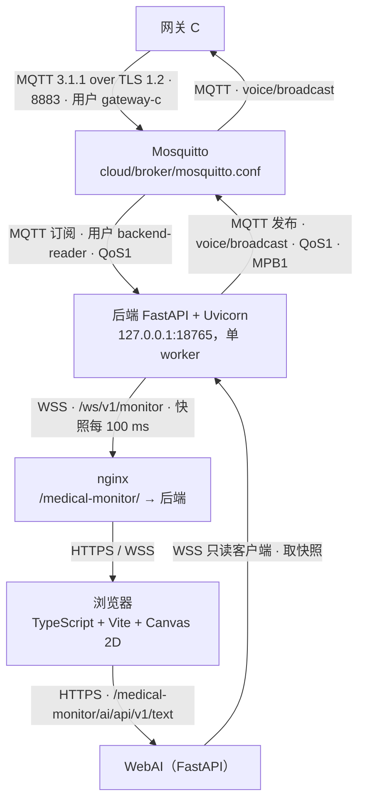
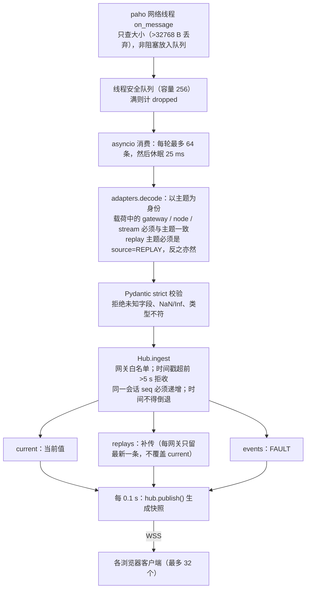
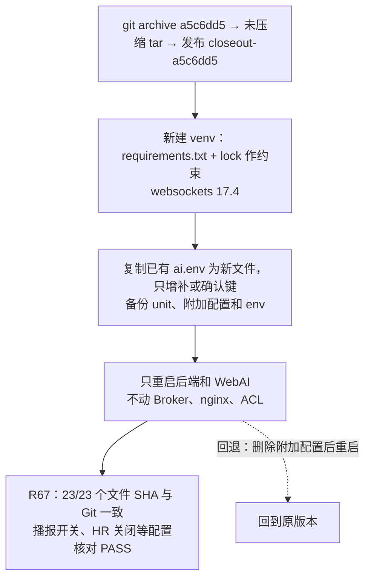

# 06 · 云端与网页

> 本篇讲数据进云之后的路径：Broker → 后端 → WebSocket → 浏览器，以及播报规则和网页问答（WebAI）。路径以 `cloud/` 为准。
> 不写任何主机名、IP、令牌或口令；只写配置项的名字和存放位置。

## 0. 一句话版

- Mosquitto 在 8883 端口收网关的 TLS 连接。
- 单进程 FastAPI 后端用 paho 订阅，严格校验后放进内存里的 Hub，每 100 ms 生成一份快照，经 WSS 推给浏览器。
- 浏览器用原生 TypeScript + Canvas 画波形，数值无效时显示“--”。
- 规则引擎从 Hub 取数据，生成中文播报，编成 MPB1 下发给网关的喇叭。
- WebAI 只按快照里的事实用模板回答，**不调用付费大模型**。

所有状态都在进程内存里，重启即清空，没有长期数据库（L-12）。

---

## 1. 组件与连接



| 组件 | 版本 / 启动方式 | 出处 |
|---|---|---|
| Mosquitto | 2.x；监听 8883；`allow_anonymous false`；`tls_version tlsv1.2`；包上限 32768 B；在途 20、排队 256 | `cloud/broker/mosquitto.conf` |
| 后端 | Python 3.12；fastapi 0.135.1、uvicorn 0.40.0、websockets 17.4、pydantic 2.12.5、paho-mqtt 2.1.0 | `cloud/backend/requirements.txt`、`requirements.lock` |
| 启动 | `uvicorn app.main:app --host 127.0.0.1 --port 18765 --workers 1 --ws-max-size 65536 --ws-max-queue 8 --no-access-log` | `cloud/deploy/medical-monitor.service:11` |
| 网页 | TypeScript 5.9.3、Vite 7.3.5、Node 22；`base='/medical-monitor/'` | `cloud/web/package.json`、`vite.config.ts` |
| nginx | 片段 `cloud/deploy/nginx/medical-monitor.conf`：`/medical-monitor/` 反代到 18765，去前缀，带 Upgrade 头，关缓冲，超时 60 s | — |

**为什么只能单 worker**：状态在内存里。多个 worker 各自持有一份 Hub，快照会互相矛盾（`medical-monitor.service:10` 的注释）。

### 1.1 Broker 账号与 ACL（`cloud/broker/acl`）

| 用户 | 权限 |
|---|---|
| `gateway-c` | 写 `mpm/v1/GW-C-001/#`（**通配前缀，偏宽**，L-10） |
| `backend-reader` | 读两个网关前缀 |
| `mock-publisher` | 写 `mpm/v1/GW-DEV-001/#`（服务端合成数据） |

- **仓库里的 ACL 与生产不完全一致**：生产另有语音下行的写权限，R64 记录了 ACL 的 SHA（`bee2be2f…`）和备份。以生产记录为准。
- 口令文件、TLS 私钥、证书都在服务器的 `/opt/medical-monitor/broker/` 下，不入库。
- `five-appliance-acl.example` 只是隔离测试用的示例，不是正式 ACL。

---

## 2. 后端：从 MQTT 消息到快照



### 2.1 校验规则（`cloud/backend/app/models.py:197–254`）

- `extra='forbid'`、`allow_inf_nan=False`、`strict=True`。
- `timestamp`、`seq` ≤ 2⁵³−1；`samples` ≤ 500 个；`sample_rate` ≤ 1000。
- **来源组合**：MOCK 必须 `synthetic=true`；synthetic 不得标为 LIVE；状态消息不得是 REPLAY，值只能是 ONLINE / OFFLINE。
- **数据形状**：VALID 波形必须带样本；标量不得带样本；VALID 的 NIBP 必须是两元素列表 `[sys, dia]`；FAULT 文本 ≤160 字。
- **节点档位**：`MPM_NODE_PROFILE=three`（默认）或 `five`。五板档下 NODE-D 是 TEMP，NODE-E 是 NIBP。**生产必须设为 five**。

### 2.2 有效性与新鲜度（`cloud/backend/app/hub.py:113–181`）

| 判断 | 规则 |
|---|---|
| 网关 / 节点 ONLINE | Broker 已连接 + 状态为 VALID + 接收年龄 ≤15 s + 时间戳年龄 ≤15 s |
| 数据流新鲜期 | NIBP 90 s，其余 5 s；接收时刻和采集时刻**两个年龄都要满足** |
| 节点不在线 | 该节点的数据流强制为 OFFLINE 或 STALE |
| 会话不是当前会话 | STALE（网关状态出现新会话时 `gateway_generation` 加 1，旧会话数据全部过期） |
| 非 VALID | `value=None`、`samples=[]`。所以 R125 之前 B 的波形标志一无效，网页就画不出波形 |

**快照字段**：`type`、`schema_version=1`、`node_profile`、`gateway_id`、`gateways`、`gateway_state`、`broker_connected`、`nodes`、`server_time`、`streams`、`replay`、`event`；开启播报时另有 `broadcast`、`broadcast_history`。

### 2.3 WSS 接入（`cloud/backend/app/main.py`）

1. 路径 `/ws/v1/monitor`，浏览器经 nginx 访问 `/medical-monitor/ws/v1/monitor`。
2. Origin 必须在 `MONITOR_ALLOWED_ORIGINS` 白名单内，否则以 1008 关闭。
3. **首帧**须在 5 s 内到达，为文本，≤4096 字符，内容是 JSON `{token, gateway_id}`。令牌用 `secrets.compare_digest` 比较，至少 32 个 ASCII 字符。
4. `MONITOR_PUBLIC_VIEW=1` 时免令牌，但 Origin、首帧和网关检查照旧。
5. 最多 32 个订阅者，超出以 1013 关闭。每个客户端的队列为 1，只保留最新快照；发送超时 5 s。
6. `/health`、`/api/health` 返回 ok / degraded 以及 accepted、rejected、dropped 计数。OpenAPI 文档页关闭。

**环境变量**（只列名字）：`MONITOR_VIEW_TOKEN`、`MONITOR_MQTT_CONFIG`、`MONITOR_ALLOWED_ORIGINS`、`MONITOR_GATEWAY_IDS`、`MONITOR_PUBLIC_VIEW`、`MONITOR_WAVE_BATCH_DELIVERY`、`MONITOR_BROADCAST`、`MONITOR_BROADCAST_HR`、`MONITOR_BROADCAST_DEVICE`、`MONITOR_LOG_DIR`、`MONITOR_WEB_DIR`、`MPM_NODE_PROFILE`。不设 `MONITOR_MQTT_CONFIG` 时拒绝启动（测试模式除外）。

**日志**（`app/diagnostics.py`）：只记事件类别和计数，不记载荷；单文件 5 MiB，保留 7 个备份。

---

## 3. 播报规则与语音下行（`cloud/backend/app/broadcast.py`）

**启用条件**：`MONITOR_BROADCAST=1` 才建规则引擎，`MONITOR_BROADCAST_DEVICE=1` 才下发到喇叭。生产两者都开，HR 播报关闭（R65、R67）。

**输入**：只取 LIVE、非合成、当前会话、并且晚于网关上线时刻的数据。

| 参数 | 触发 | 内容 |
|---|---|---|
| NIBP | 每个新的有效结果（<90 s）播一次，按（会话，时间戳）去重；不受 300 s 限制 | 分档：SYS<90 或 DIA<60 偏低；SYS≥140 或 DIA≥90 偏高；SYS≥120 或 DIA≥80 正常高值；其余在一般参考范围内。建议静坐 5 分钟后复测 |
| TEMP | 连续有效 60 s 后 | “当前体表温度约 X °C”，并说明体表温度低于体温，**不作判断** |
| SpO₂、PR（HR 需另开） | 60 s 中位数超出范围（SpO₂<90，脉率不在 60–100），并持续 120 s | 提示检查指夹或静坐后复测 |

- **重复抑制**：同一参数 300 s 内最多播一次；历史保留 10 条；最新一条在网页上显示 600 s。
- **MPB1 编码**：`>4sBQIH`，19 B 头（魔数、版本 1、issued_ms、TTL 15000、文本长度）+ 1–200 B UTF-8 文本。`issued_ms` 在进程内强制严格递增。发布到 `mpm/v1/GW-C-001/voice/broadcast`，QoS1，不保留。
- **重启的影响**：窗口、历史和抑制计时都在内存里。后端重启后 300 s 抑制失效；如果此时有一个不到 90 s 的血压结果，可能再播一次（据代码推断，未测试）。网关换会话、离线或 Broker 断开时，这些状态也会清空。
- **网页另有本地报警**（`cloud/web/src/model/alarms.ts:22–28`）：HR 50–120、SpO₂ 下限 90、PR 50–120、RR 8–30、SYS 90–160、DIA 50–90，延迟 10 s。这只是界面提示，阈值与语音规则不同（例如脉率 50–120 与 60–100）。

---

## 4. WebAI（`cloud/ai/`）

- **作用**：网页上的问答。用户问“现在心率多少”，返回快照里的事实。
- **回答方式**：确定性规则（`facts.py:25–34`）。
  - 按关键词匹配 HR、SpO₂、PR、RR、TEMP、NIBP，事实只取服务端快照（5 s 新鲜期，WSS 读取超时 3 s）；
  - 问“建议、正常吗、怎么办”时，给固定的建议文本；
  - 一次问多项时，提示“请一次询问一项读数”。
- **大模型**：代码里有豆包（火山方舟）适配器，但 `/text` 接口不会调用它。响应里标明 `real_model='NOT_CALLED'`。正式链路没有付费模型（R67 §3、项目书 9.7）。
- **鉴权与限流**：
  - `Authorization: Bearer <P6_AI_TOKEN>`，与监护页令牌相互独立；
  - 请求体 ≤4096 B，问题 1–500 字；
  - 每分钟 12 次，并发 4，每个会话同时只允许 1 个请求；
  - 会话空闲 1800 s 过期，最多 128 个会话，保留 4 轮历史；
  - 总超时 12 s（504），其他错误统一返回 503。
- **必须设置**：
  - `MPM_NODE_PROFILE=five`（否则拒绝启动）；
  - `P6_GATEWAY_IDS=GW-C-001`（默认是 GW-B5-001）；
  - `P6_SNAPSHOT_MODE=MONITOR`（**仓库默认是 MOCK**，生产必须显式设置，R66 §2）。
- **缺陷**：WebAI 没有自己的依赖清单（`httpx` 不在后端依赖里），整包重建时要注意（R67 §3）。
- **另有隔离候选**：`voice/reply` 下行（P6V1 帧）、麦克风上行（MC01，16 kHz）、Whisper 识别。均未进入正式链路（L-13）。

---

## 5. 网页（`cloud/web/`）

| 项 | 实现 |
|---|---|
| 技术 | 原生 TypeScript + Vite + Canvas 2D，无框架、无图表库 |
| 页面 | `#/overview` 总览、`#/trends` 趋势、`#/ai` 问答 |
| 波形 | 单个 `requestAnimationFrame` 循环；从左到右扫描，留 2.5% 擦除带；默认 8 s 窗；每批样本按 `t = start + i × 1000 / sample_rate` 映射到本地单调时钟，漂移超过 5 s 重新对锚；缓冲最多 16 s / 16000 点；缺口超过 100 ms 就断线 |
| 采样率 | 取自每条数据流的 `sample_rate`，页面不写死 |
| 有效性显示 | 只有 VALID 且非 REPLAY 才画波形、显示数值，否则显示“--”；补传波形显示为 STALE；有任一 MOCK 数据流时顶部显示“MOCK 模拟数据” |
| 重连 | 退避 min(1000 × 2ⁿ, 10000) ms；连着但 5 s 没收到快照，强制重连；收到 1008 或快照格式不符（4002）就停止重试，清掉令牌 |
| 公开查看 | 先用空令牌连接；服务器回 1008 时提示输入只读令牌 |
| 浏览器朗读 | 默认关闭；必须由用户点击开启（顺便朗读一句确认语，以解锁音频）；选 zh-CN 音色；每条播报只读一次，开启之前的不补读；用 `id:时间戳` 去重，因为后端重启后 id 会从 1 开始 |
| 会话趋势 | 只在页面内存里：每通道最多 3600 点、1 小时；可导出 CSV |

**构建与测试**：

```bash
cd cloud/web
npm ci --no-audit --no-fund
npm test            # node tests/run.mjs：esbuild 打包后用 node --test 运行
npm run build       # tsc --noEmit && vite build
```

线上版本标签 `web-20261112-03` 是发布名，不在源码里（R60、R64、R65、验收报告 §5）。

---

## 6. 部署

**服务器目录**（项目书 9.8）：

```text
/opt/medical-monitor/
  current -> releases/<id>      每个发布有自己的 .venv，离线安装（--no-index）
  backups/
  broker/{passwords, acl, tls, data}
  config/backend.env
  logs/{broker, backend}
```

- **配置与机密**（只写名字）：`backend.env`、`mqtt-config/backend.json`（Broker 凭据）、Broker 口令文件、TLS 私钥和证书链、`P6_AI_TOKEN`、`P6_MONITOR_VIEW_TOKEN`、`ARK_API_KEY`。都不在仓库里。
- **证书**：`medical-monitor-certificate.timer` 每天把已有证书同步一份给 Broker，**它不负责续签**。
- **生产服务名与仓库不同**：生产是 `medical-monitor-h3-webbackend`、`medical-monitor-h3-webai`，位于 `/opt/medical-monitor-h3`，带 `90-closeout.conf` 附加配置（R66 §4）。仓库里的 `medical-monitor*.service` 是模板。

**最近一次重部署**（R66 执行，R67 复核，2026-11-13）：



---

## 7. 测试

| 套件 | 命令 |
|---|---|
| 后端 | `MONITOR_TESTING=1 python -m pytest cloud/backend/tests -q`；五板用例 `MPM_NODE_PROFILE=five python -m pytest cloud/backend/tests/test_five_node.py cloud/backend/tests/test_broadcast.py -q` |
| WebAI | `MPM_NODE_PROFILE=five python -m pytest cloud/ai/tests -q`（18 项） |
| 网页 | 见 §5 |

- 依赖装进项目 venv，按锁文件安装，不用 sudo pip。
- **已知偶发问题**：WSS 测试的 `CancelledError` 是测试夹具没等服务端关闭帧造成的，后端（`d30f7e7`）和 AI 测试都已修复（`09` P-27）。

---

## 8. 过时文档与不一致

| 位置 | 问题 |
|---|---|
| `cloud/README.md` | 已标为历史文档；引用的旧分支和 `../doc/P/...` 路径已不存在；默认网关列表含 GW-DEV-001 |
| `cloud/deploy/README.md` | `current` 指向旧发布 `mqtt-v07-review1-20260920-01`；生产现为 `closeout-a5c6dd5` |
| 仓库 unit 名 | 与生产服务名不同（见 §6） |
| 仓库 ACL | 缺生产上的语音下行写权限 |
| WebAI 快照模式 | 仓库默认 MOCK，生产必须设 MONITOR |

---

## 9. 面试追问链

**Q：为什么后端不用数据库？**
- 样机阶段只需要“当前状态”和页面内的会话趋势，内存 Hub 最简单，也没有持久化的隐私负担。
- 代价是重启清空、只能单 worker。要做病历存储，需要加时序数据库和访问控制（L-12）。

**Q：怎么防止伪造或错乱的数据进入页面？**
- **身份**：以 MQTT 主题为准，载荷里的身份字段必须与主题一致；Broker ACL 限制谁能写哪个前缀。
- **格式**：Pydantic strict，未知字段、NaN、类型不符一律拒收。
- **时间**：超前 5 s 拒收；同一会话 seq 必须递增；新会话使旧数据全部过期。
- **来源**：MOCK 必须标 synthetic；补传不覆盖当前值。

**Q：快照为什么用 100 ms 一次的整体推送，而不是逐条转发？**
- 浏览器只需要最新状态。整体快照让每个客户端的队列只存一份（最新的覆盖旧的），慢客户端不会拖垮服务端，也不会无限积压。
