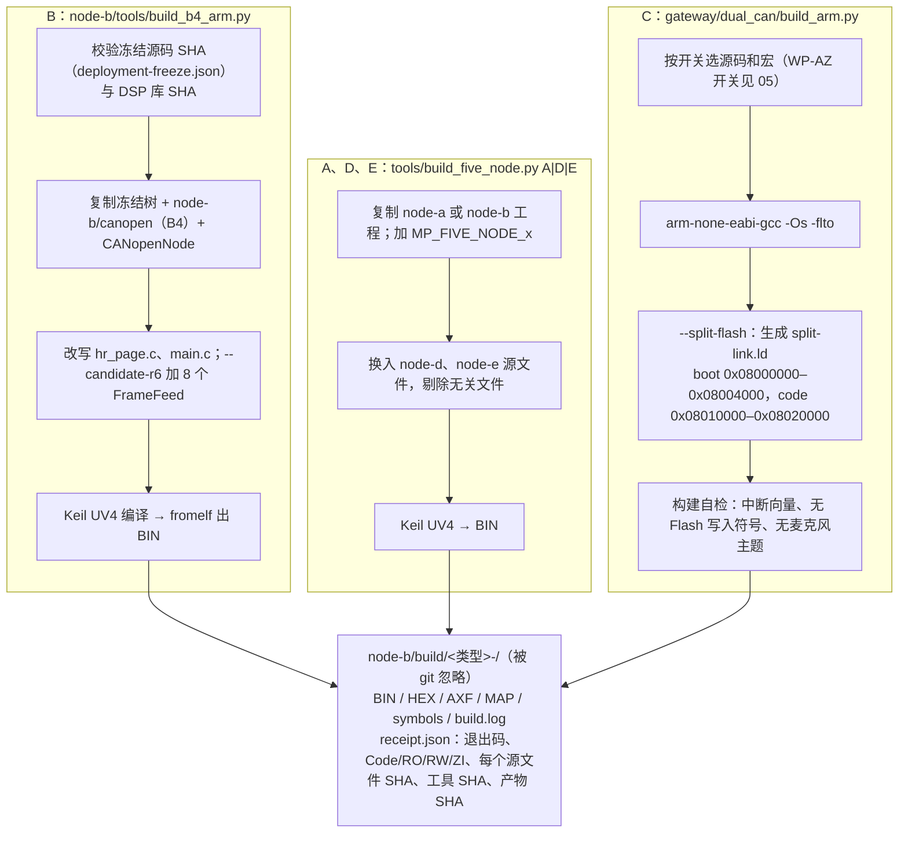
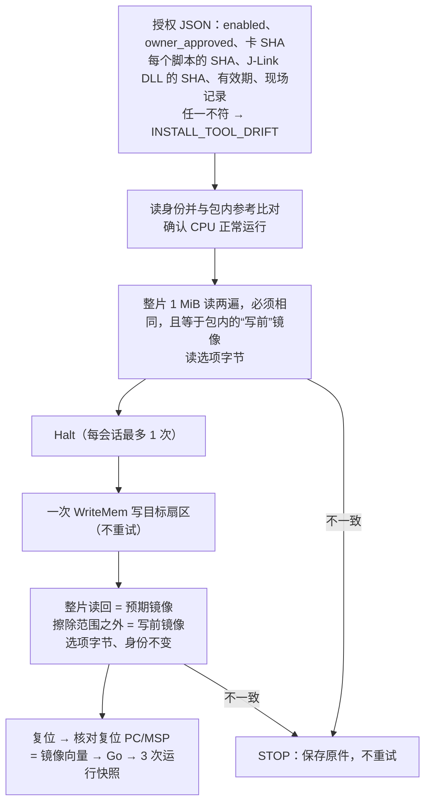
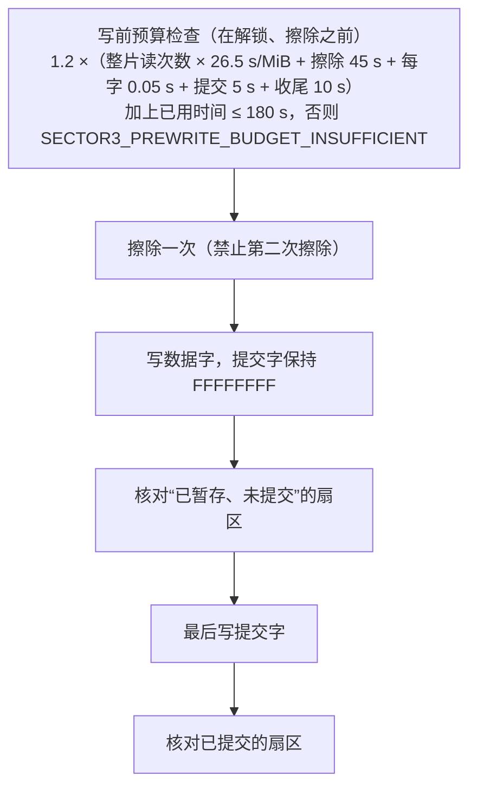

# 07 · 构建、烧录与回滚

> 本篇讲镜像怎么编出来、怎么证明编对了、怎么写进板子、出问题怎么退回去。
> **刷写、sector3、选项字节、ESP 固件、解除保护和每一次回滚，都是需要负责人单独放行的操作**（`AGENTS.md`）。本篇只描述流程，不构成授权。

## 0. 一句话版

- A、B、D、E 用 Keil ARMCC 5.06u7 在 Windows 上编译；C 用 Arm GNU 14.2.1 编译，可以在 VPS 上逐位复现。
- 每次构建都输出源码清单和 SHA；刷写卡用 K0/K1/K3/K5 构建矩阵，先证明“环境没变”，再出新镜像。
- 刷写走 J-Link，单次会话、不重试；写前读两遍整片，写后整片读回，核对身份、选项字节和非目标扇区。
- 出问题先停，保存证据，不自动复位、不自动重刷。

---

## 1. 工具链

| 对象 | 工具链 | 固定方式 | 能否在 VPS 上编 |
|---|---|---|---|
| A、B、D、E | Keil MDK，ARM Compiler 5.06 update 7（build 960） | `artifacts/ecg-source/toolchain-identity.json` 记录 armcc、fromelf、UV4 的 SHA | **不能**，只能在 Windows 上编 |
| B 的 DSP 库 | CMSIS-DSP `arm_cortexM4lf_math.lib`（冻结版） | `node-b/evidence/external-build-dependencies.json`（SHA `ba416f23…`，13,294,064 B，不入库） | — |
| C | Arm GNU Toolchain 14.2.Rel1（GCC 14.2.1），STM32F4 标准外设库 V1.4.0 | 环境变量 `P5_ARM_TOOLCHAIN_BIN`、`P5_STM32F4_SDK_ROOT` 覆盖默认的 Windows 路径 | **能** |

**C 的编译选项**：
- 公共：`-mcpu=cortex-m4 -mthumb -mfpu=fpv4-sp-d16 -mfloat-abi=hard -Os -ffunction-sections -fdata-sections -std=c11`；
- 另加 `-flto`、`-Wextra -Werror`（dual_can 源码）；
- 链接：`--specs=nano.specs --specs=nosys.specs -Wl,--gc-sections`。

**VPS 上复现 C**（本机技能 `mmpm-rebuild-verify`，位于 `~/.claude/skills/`，不在仓库里）：
- 工具链在 `mmpm-review/node-b/build/preflight-pi-2ef8a824/arm-gnu-toolchain-14.2.rel1-…/bin`。
- 先确认 `arm-none-eabi-gcc --version` 是 14.2.1。系统自带的 GCC 13.2.1 编出的结果不可比。
- 比对 boot、code、HEX 三个 SHA-256。
- 再关掉最新的开关重编一次，确认能退回上一个已验证的镜像。
- **注意**：技能里写的命令是旧的 F-P115 基线（带 `--field01 --transport-profile`），不是 WP-AZ。WP-AZ 的开关见 `05` §1（出自 R62 回执）。

**“逐位可复现”指什么**：
- C：boot、code、HEX 的 SHA 完全相同。
- B：BIN、HEX 相同。AXF、MAP 里带路径和调试信息，不可比（R105 §1）。
- 源码包用未压缩 tar，逐个成员与 Git blob 比对，压缩器元数据的差异不算代码漂移。

---

## 2. 各镜像怎么编

- **B 成功的判据**：退出码 0；日志里有 “Program Size:”；“0 Error(s)”。卡上还要求 0 警告、应用 ≤49,152 B、IRAM（含栈和堆）≤128 KB。
- **C 的产物**：`<目标>-boot.bin`、`<目标>-code.bin`、`.hex`、`.elf`、`gateway.map`、`unified-layout.json`、`receipt.json`。五板目标名 `FIVE_APPLIANCE_C_2S_V1`。
- **产物不入库**：BIN、HEX、AXF 只报 SHA，原件放受限存储。
- `tools/build_five_node.py B` 和 `C` 只是转调上面两个脚本，而且 C 用的是一套旧开关，**不是 WP-AZ**。

### 2.1 构建矩阵 K0 / K1 / K3 / K5（R104、R123、R125）

| 标签 | 含义 | 预期 |
|---|---|---|
| **K0** 对照 | 用上一个现装镜像的确切输入重编 | BIN = 现装 SHA（R123 时为 C2 `f81063c9…`）。**不一致就说明环境漂移，全部 STOP** |
| **K1** 开关关闭 | 主线源码加 `BIO_V2_RR_R1=0` | = `f81063c9…`，证明关掉 R1 就是 C2 |
| K2 | 主线加 `ADS_LOFF_DC=1`（只在 R104） | 40,604 B |
| **K3** | R1 首版（R123）；R125 卡中用于复现 | `cbbafe29…`，43,900 B |
| **K5** | R125 修复版（现装） | `9619761b…`，44,200 B |

- **为什么要 K0**：新镜像与旧镜像的差异，必须只来自这次改的源码。K0 先证明“同样的输入还能编出同样的位”。
- 卡上还要预先算出写后整片的预期 SHA：旧整片的 sector0–2 换成新应用。写后读回必须等于它。

---

## 3. 刷写

### 3.1 统一的安全模型（J-Link 安装器）

- **预算**：每个会话 180 s；Halt、BeginDownload、WriteMem、EndDownload、Reset、Go 各最多 1 次；SDK 调用最多 1,600 次。
- **一次性授权**：用过后写 `.used` 标记，同一授权不能再用。
- **被监督器强杀**后，目标状态记为 UNKNOWN，**不自动恢复、不重连去“修”**。
- 全部安装器都用 ctypes 调用 Windows 上的 J-Link DLL，**不在 VPS 上运行**。

### 3.2 各板的工具与写入范围

| 板 | 工具 | 写入范围 | 备注 |
|---|---|---|---|
| B | `node-b/tools/b4_swd_install.py`（引擎）；恢复包由 `b4_recovery.py` 离线生成 | sector 0–2（48 KB） | R125 写入回执 `413f9f0` |
| A | `node-b/tools/abc_board_install.py`（包装引擎） | sector 0–2 | 要求先有备份回执；会临时冻结 IWDG 调试寄存器，写完恢复 |
| D | SWD，同类流程（`phy01_d_install.py` 首写） | sector 0–1 | D 原厂程序**没有备份**，无法恢复 |
| E | **不走 SWD**：STM32 ROM 串口引导（USB232BOOT） | sector 0–1，29,424 B | 安装脚本不在仓库（可能在 Codex 本地）；E 原厂程序同样没有备份 |
| C（WP-AZ） | `gateway/microphone/unified_install.py`（从代码看是分段布局的安装器；R64 是否就用了它，未核对回执） | **sector0 + sector4**，sector3 和其他扇区、选项字节保持不变 | 要 `--sector4-approved`；不加 `--execute` 时只打印计划；HEX 与两个 BIN 交叉核对；`--cold-boot` 写后保持 Halt，等人工断电重启 |
| C（旧布局） | `node-b/tools/b5_c_app_update.py` | sector 0–2 | 早于分段布局，**不适用于 WP-AZ** |

**只读工具**：
- `b5_c_rom_readonly.py`：读整片、选项字节、系统 ROM 和 RAM；不做 Halt、Reset、Go，不写目标。
- `b5_c_boot_watch.py`：启动监视，同样不写目标。
- `readback_b.py`：读 B 的身份，整片读两遍。
- `JLinkPolicyProbe.cs`：只离线解析 DLL 策略，不连接目标。

---

## 4. C 的 sector3 配置

### 4.1 记录格式

- 共 336 B = 24 B 头 + 312 B 载荷。
- 头：magic `0x32433348`、版本 1、头长 24、载荷长 312、generation、CRC（跳过偏移 16–23）。
- **提交字**在偏移 20，地址 `0x0800C014`，值 `0x54494D43`（“CMIT”）。
- 载荷字段：minimum_epoch、ssid、wifi_password、host、username、password、client_id。值只在受限存储里。

### 4.2 写入事务（`node-b/tools/b5_sector3_write_protocol.py`）

**设计要点**：提交字放最后，所以任何中断都只会留下“未提交”的记录，网关不会读到写了一半的配置。

### 4.3 R50/R51 的教训

- **R49/R50**：旧流程在擦除和暂存**之后**才检查预算，结果停在“已暂存、未提交”。其他扇区没被碰过，但 C 的行为未知，于是保持断电。
- **R51 恢复**：只写一个字，即提交字。擦除 0 次，数据字 0 个，Reset 0 次，Go 0 次。
  - 前提：两次整片读都等于“预期的未提交镜像”；选项字节和身份与备份一致；暂存记录的 CRC 正确、提交字为 FFFFFFFF。
  - 写后整片等于“预期的已提交镜像”，保持 Halt。
- **遗留**：按实测速度，完整重写 sector3 无法在 180 s 内完成。以后要整体改配置，需要重新设计，例如分两个会话（R51 §2）。
- **当前配置**：sector3 SHA `471baff4…`；C 归档整片 `659dc636…`（验收报告 §5）。

---

## 5. 回滚

| 板 | 回退点 | 说明 |
|---|---|---|
| B | R123 K3 `cbbafe29…`（整片 `c6e956a7…`）；或 C2 `f81063c9…`（整片 `887e466e…`） | 回到哪一个由负责人指定 |
| C | WP-AY0：boot `c9caa44f…`、code `125c4b61…` | 只写 sector0、sector4；没有语音下行 |
| A、D、E | FIVE41 时已验证的镜像（`node-b/docs/FIVE-NODE-MIGRATION/FIVE41-20261106/CURRENT-IMAGES.json`） | D、E 的原厂程序不可恢复 |

**怎么执行**：用同一个安装器的 restore 阶段和保存的写前镜像包，写同样的扇区，做同样的整片读回、身份、选项字节和范围外核对。**回滚是新的授权对象**，需要新的放行原话（例如“同意 R125 回退一次”）和新的预算。

---

## 6. 停止规则（STOP_TARGET）

**触发**：HALT、停在 ROM、设备状态未知、异常复位、身份或 Flash 漂移、电气异常。

**动作**：
- 停止 UART、网络写入和危险的目标操作；
- 保存原件和原生返回值；
- 只继续安全的离线排查。

**禁止**：
- 自动复位、Go、重刷或恢复；
- 强设 PC、MSP、VTOR 来掩盖故障。

一次 Go 需要明确的 `DEBUG_RESUME_ONCE` 批准，并满足全部前提。

**容易混淆的结论**：
- HALT ≠ ROM；
- Close 成功 ≠ 退出后目标仍在运行；
- 显式 Go/Reset 次数为 0 ≠ SDK 连接或 Close 没有隐式动作；
- 云端或 VPS 上的源码、位级核对 ≠ 实板验收。

---

## 7. 回执（Codex 交付）

- **分支**：从包含卡片的提交新开 `codex/rNNN-…`；文件如 `R125-B-R1-FIX-RECEIPT-20261124.md`。
- **构建部分**：卡 SHA；构建脚本 SHA；Keil、DSP 库、gcc、Python 版本；每个构建（K0/K1/K3/K5）的命令行、真实退出码、错误和警告数、Code/RO/RW/ZI、BIN 字节数和 SHA、源码清单。
- **测试部分**：原始输出摘要和退出码。
- **刷写部分**：写前两次整片 SHA、写后 SHA、身份和选项字节核对、各原生动作的次数与返回值。
- **录制部分**：文件行数、时间范围、SHA-256。
- **授权**：用到了哪些放行原话。
- **结论**：逐项写 PASS / FAIL / NOT_RUN / UNKNOWN。
- **不得出现**：凭据、热点名、志愿者身份；BIN、HEX、AXF 不提交。

---

## 8. 已知缺口

| 缺口 | 影响 | 处理方向 |
|---|---|---|
| **B 镜像仅凭仓库不能复现**：`--diag-reason`、`--diag-cap`、`--algo-*`、`--dsp-library` 只在 Codex 本地脚本（R89 `f0ca6a42…`、R104 私有副本 `4e084d07…`） | 换一台机器、换一个人就编不出 R125 K5 | 本地脚本去掉私有路径后入库（需单独授权） |
| Windows 绝对路径写死：`D:/keil/...`、`E:/.../arm_cortexM4lf_math.lib`、`C:/mingw64/bin/gcc.exe`（`run_b4.py`）、SDK 路径 | 换机器要改路径 | 改成环境变量或参数 |
| E 的整片 SHA 缺失 | 无法证明 E 的非应用区未变 | 经单独放行的只读读取（J-Link 或 ROM 串口），双读后存入受限存储 |
| E 的 ROM 串口安装脚本不在仓库 | E 的重刷路径不可复现 | 入库或写明出处 |
| 空间余量 | B 应用剩余约 4,952 B；C code 区剩余约 4 KB | 加功能前先看 map |
| `gateway/` 在工作区显示为已删除 | 网关构建和测试要先恢复该目录 | 经负责人确认后执行 `git checkout HEAD -- gateway` |
