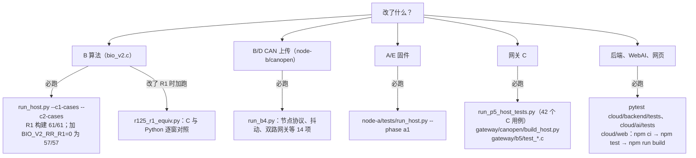
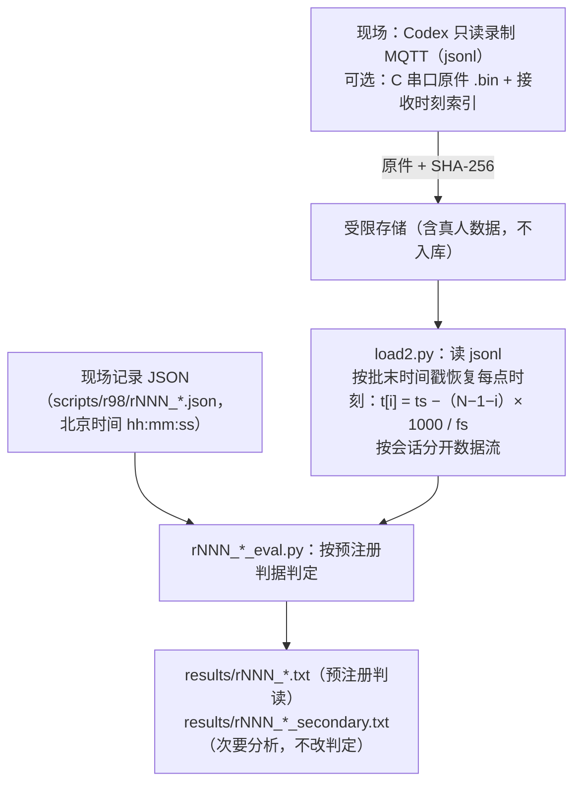
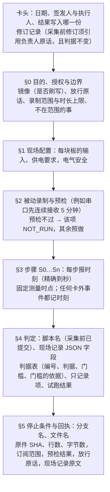

# 08 · 测试与验收方法

> 本篇讲项目怎么证明“能用”，以及以后改了代码要跑什么。分四层：主机自动化测试、CI、离线判读脚本、实板验收卡。
> 注意：`gateway/` 在当前工作区显示为已删除（未暂存），涉及网关的测试要先从 HEAD 恢复出该目录（`git checkout HEAD -- gateway`，需负责人确认）或在 HEAD 的副本中运行。

## 0. 一句话版

- 能在主机上测的都在主机上测：算法用 gcc 编成共享库，用 Python 喂数据；协议和网关用打桩编译。
- 实板测试写成“卡”：判读脚本和门槛在采集前提交，采集后只填现场时刻。
- 结果用固定的状态词表达，不把模拟器当成人体，不把 PUBACK 当成端到端收到。

---

## 1. 状态词

| 状态 | 含义 | 例子 |
|---|---|---|
| PASS | 预注册判据全部满足 | R128 G1、G2、G4–G7 |
| FAIL | 预注册判据未满足，结论如实保留 | R126 模拟器段（只因网关掉线） |
| NOT_PASS（已接受） | 未达标，负责人接受这一限制；判据不改，限制写清 | R128 G3 体温覆盖 87.1% |
| NOT_EVALUATED | 证据不全，无法判定：缺预注册判据、缺原件 SHA 或缺判读结果，任一项都算 | R124 真人 RR（计数方式不符） |
| NOT_RUN | 没有做 | 2 h、24 h 长测 |
| UNKNOWN | 做了，但原因或机制不明 | PUBACK 停滞的源头 |
| BLOCKED | 前提条件不满足，无法进行 | — |
| OPEN | 已登记、待排查的问题 | D 定时帧缺失 |

**必须区分的几组概念**（`AGENTS.md`）：
- HALT ≠ 停在 ROM；
- 模拟器 ≠ 人体；
- `SEND OK` ≠ 服务器收到；
- CAN ACK、PUBACK ≠ Broker、后端、WSS 端到端收到；
- MOCK / synthetic 不得冒充真人 LIVE。

**验收阶段的规则**（`docs/acceptance/ACCEPTANCE-PLAN-20261124.md` §0）：
- R125 之后功能冻结；
- 每项补测只做一次，最多重测一次。重测只用于现场操作失误，并且原结果保留，不删除。

---

## 2. 主机自动化测试



### 2.1 B 算法：`node-b/firmware/biov2/tests/run_host.py`

- **做法**：gcc 把 `bio_v2.c` 编成共享库，ctypes 驱动喂合成的 ECG/RESP 和历史重放数据。
- **运行**：

  ```bash
  NODE_B_TEST_OUT=<新的空目录> python3 node-b/firmware/biov2/tests/run_host.py --c1-cases --c2-cases
  NODE_B_TEST_OUT=<另一个空目录> python3 node-b/firmware/biov2/tests/run_host.py --c1-cases --c2-cases --define BIO_V2_RR_R1=0
  ```

  输出目录必须事先不存在，存在就报错。
- **预期**：
  - R1 构建 61/61，另有 1 项不适用（`expire_then_isolated_peak_no_old_rate`：R1 的 32 s 窗使这个 16 s 暂停用例失去意义）；
  - 关闭 R1 为 57/57。
  - 回执里还要报 `algorithm_sha256`（R125 卡 §3 为 `fa1a7f73…7efd`）。
- **相关**：`run_channel_isolation.py`（通道隔离）、`node-b/tests/run_pretest.py`（复位和时间边界的补充门）。

### 2.2 B 节点协议与双路网关：`node-b/tools/run_b4.py`

```bash
python3 -X utf8 node-b/tools/run_b4.py [--temperature] [--out DIR]
```

- **用例**（按顺序）：
  1. compile-node-b
  2. node-b-protocol（含 R125 的波形标志断言）
  3. node-b-jitter-protocol
  4. compile-ecg-gain4
  5. ecg-gain4-wire-and-json
  6. ecg-gain4-existing-backend
  7. compile-dual-gateway
  8. dual-gateway
  9. dual-gateway-5s-mqtt-pressure
  10. dual-gateway-jitter
  11. c-to-existing-backend
  12. （加 `--temperature` 时）existing-ui-from-Hub-snapshots
  13. i2s2-conflict-negative（预期退出 1）
  14. mixed-model-abi-negative（预期退出 1）
- **判法**：记录真实退出码，与改动前在同一环境中的基线对照，而不是要求全部为 0。
  - R125 时有两项后端用例因本机缺 `pydantic` 失败，两项负例前后都退出 1，均与改动无关。
- **陷阱**：脚本第 23 行把 gcc 写死为 `C:/mingw64/bin/gcc.exe`。在 Linux 上跑要改成 `gcc`，改动只放在本地副本，不提交。
- **输出**：`node-b/build/b4-host-<UTC>/`（被忽略的目录），含日志和夹具 SHA。

### 2.3 其他节点与网关

| 套件 | 运行 | 覆盖 |
|---|---|---|
| `node-a/tests/run_host.py --phase a1` | gcc 打桩编译 A 的真实 CANopen 源码 | A 的 PDO、时效、重采样；`tx_backpressure.c` 验证 CAN 阻塞时波形点不丢 |
| `node-b/temperature/test_gy641.c`、`test_temp_protocol.c`、`test_timing_simulation.py` | gcc / python | GY641 帧解析、温度 PDO、时序 |
| `gateway/mqtt/tests/run_p5_host_tests.py` | python，内部用 gcc | coreMQTT v2.3.1 + 真实传输层、ESP 打桩；42 个 C 用例：QoS0/1、PUBACK 匹配 / 迟到 / 缺失 / 重复 / 跨会话、半包、保活、有界断言 |
| `gateway/mqtt/tests/test_p5_integrity.py`、`test_p5_emcy_console.py`、`gateway/third_party/verify_coremqtt_integrity.py` | python | 第三方库来源完整性、EMCY 日志 |
| `gateway/canopen/build_host.py` + `tools/check_canonical.py` | python | CANopenNode 协议、离线路由；C 生成的规范帧能被后端接受 |
| `gateway/b5/test_*.c`（约 20 个） | gcc（命令未统一记录） | 策略、配置、链路控制、AT 压力 / 停止、异步出口、断网保留、波形 FIFO、SNTP 重试、诊断调度、五板出口、JSON 等价 |
| `gateway/dual_can/tests/*.c` | 由 `run_b4.py` 等编译 | bxCAN 重传、五板、模拟器 |
| `gateway/voice/tests/`、`gateway/microphone/test_*` | gcc / python | MPB1、TTS 停止查询、统一音频（麦克风未进正式镜像） |
| `gateway/mqtt/tests/run_broker_integration.py` | 需要本地 Mosquitto 2.0.21 | 真实 Broker 对照 30 项（不在 CI） |

### 2.4 云端

| 套件 | 运行 | 规模 |
|---|---|---|
| 后端 | `MONITOR_TESTING=1 python -m pytest cloud/backend/tests -q`；五板用例另跑 `MPM_NODE_PROFILE=five python -m pytest cloud/backend/tests/test_five_node.py cloud/backend/tests/test_broadcast.py -q` | 49 个测试函数（monitor 20、broadcast 17、operations 5、five_node 4、ac_nibp 3）；参数化后收集数更多（默认档约 102）。`test_five_node`、`test_ac_nibp` 只在五板档下有效 |
| WebAI | `MPM_NODE_PROFILE=five python -m pytest cloud/ai/tests -q` | `test_five_appliance.py` 18 项 |
| 网页 | `cd cloud/web && npm ci && npm test && npm run build` | ai、alarms、broadcast、demo、state、tri-host 等；`build` 为 `tsc --noEmit && vite build` |

- Python 依赖用项目 venv 和锁文件：`pip install -r cloud/backend/requirements-dev.txt -c cloud/backend/requirements.lock`。
- 网页用 Node 22（`~/.local/bin`）。不要用 sudo pip。

### 2.5 工具脚本自身的测试

- `node-b/tests/test_*.py`：约 100 个，大多是现场工具（安装器、门禁、录制、解码）的 Mock 测试，按文件单独运行。
- `tools/test_five_node_*.py`、`tools/security_gate/tests/`。

---

## 3. CI（`.github/workflows/`）

| 工作流 | 触发 | 跑什么 |
|---|---|---|
| `phase1.yml`（网关与云端检查） | push / PR 到 main，手动 | 后端 pytest；coreMQTT 完整性与 P5 主机测试；`gateway/canopen/build_host.py` 与 `check_canonical.py`；三个 WebAI 定向用例；网页 npm ci、test、build |
| `security-gate.yml`（显式安全门） | **只能手动**；要求精确的 40 位提交 SHA，并且 `authorize_scan=true` | `tools/security_gate`（模式 doctor / quick / pr / release） |

- **CI 不跑**：`run_b4.py`、B 算法主机测试、A 的主机测试、`gateway/b5` 测试。所以固件改动**必须在本地按 §2 手动跑**，不能只看 CI 是否变绿。
- **安全门不得擅自触发**（`AGENTS.md`），每次都需要负责人授权。
- CI 只读权限，action 按 SHA 固定版本，不接触任何板子或服务器。

---

## 4. 离线判读脚本（`node-b/docs/PI-REVIEW/analysis-r83-r96/`）

### 4.1 数据从哪来



- **环境**：Linux、gcc、Python 3.12 + numpy。本机用项目分析环境：

  ```bash
  cd node-b/docs/PI-REVIEW/analysis-r83-r96/scripts/r98
  /home/claudedev/workspaces/mmpm-review/.venv/bin/python3 -s -E r128_l1_eval.py
  ```

  不要用 `-I`，否则同目录的模块导入会失败。系统 python3 没有 numpy。
- **录制原件**放在被忽略的 `r83-capture/`，正式保存在受限存储，不入库。

### 4.2 主要脚本

| 脚本 | 用途 |
|---|---|
| `load2.py` | MQTT 录制加载器 |
| `resp_r1.py` | R1 的 Python 参考实现（默认 RPM_MIN=8；固件自 R125 起为 9.5，对照时要传入 9.5） |
| `r123_r1_equiv.py`、`r125_r1_equiv.py` | 用 C 的 R1 重放 MQTT RESP，与 Python 逐窗比较（R125：9,883 窗一致） |
| `r124_sim_eval.py`、`r126_sim_eval.py` | 模拟器验收；R126 加了连续性、“有效的 0”、ECG 模式误报 RR、波形资格四项 |
| `r122_eval.py` | 3 分钟真人卡：HR 有效 ≥80% 且与 PR ±10% 一致；RR 用节拍段，真值 = 累计计数 ÷ 3；缺计数 → NOT_EVALUATED |
| `r128_l1_eval.py` | 一小时长测 G1–G7；可读 C 串口；跳过并计数语音帧 |
| `r125_rr_variants.py` | RR 参数变体研究（只作决策依据） |
| `ecg_cands.py`、`ecg_eval.py`、`resp_eval.py`、`rr_*.py`、`clock_beat.py`、`qrs_polarity.py` | 历次离线研究 |

**试跑（dry run）**：新脚本先在旧录制上跑一遍，结果保存为 `*_dryrun_*.txt`。目的是确认脚本能完整执行、门槛的量级合理。试跑判 FAIL 是正常的，因为旧录制不是为新卡采集的。

---

## 5. 实板验收卡怎么写

### 5.1 卡的固定结构（以 R127 为例）



**R125 这类刷写卡另有**：
- 输入表：文件、行尾、SHA-256、改动；
- 构建矩阵 K0/K1/K3/K5，每项写预期 SHA，不一致即 STOP（见 `07`）；
- 主机测试的预期数量；
- **分级放行**：离线部分随卡签发即放行；“放行 R125 写入”放行写入和模拟器；“放行 R125 真人，志愿者X”放行真人；回退要另写“同意 R125 回退一次”。

### 5.2 写判据的要点

1. **先写判据，再采集**。判据的依据要写在卡上，例如 R127 G3 中 B 的 90% 来自 R125 录制上试跑的 93–95%。
2. **把“不出错误值”单列为一条判据**，例如 G5：ECG 段 RR 有效 0 帧，“有效的 0”为 0 帧。
3. **分清“有效率”和“准确度”**：没有参照仪器时，只判有效率和一致率。
4. **中断要剔除**：先判断链路中断（例如 >5 s 无数据），覆盖率等指标在剔除中断后计算，中断另作一条判据。
5. **记录项不判定**：例如 SpO₂ 分位数、语音帧数，写明“只记录”。
6. **次要分析不改判定**：事后发现的问题写进 secondary，正式判定保持预注册结果（R128 §3）。
7. **假设被推翻要显式更正**：原文划线保留，写清同日补记（R128 §3.2）。

### 5.3 现场规则（真人参与时）

| 规则 | 内容 |
|---|---|
| 放行 | 每张卡都要负责人当次写出放行原话，例如“放行 R125 真人，志愿者丙” |
| 代号 | 只用甲、乙、丙、丁，真实身份不入库 |
| 接触时长 | 累计 ≤30 分钟（R127 计划 15–20 分钟） |
| 电气 | 全链路不接市电；电脑用电池；GT 用移动电源；拔掉 J-Link；有人值守；无植入物 |
| 贴片 | 绿=RA、黄=LA、红=RL；酒精擦拭、晾干 30 s、纱布轻擦 3–5 次（R94 §2） |
| 呼吸计数 | 专人连续累计，每 30 s 报一次；节拍器定频；计数中断或重来 → NOT_EVALUATED |
| 结论范围 | 结论要带适用范围，例如“贴片后 3 分钟内、15 次/分节拍呼吸” |

### 5.4 模拟器约定

- ECG 60 bpm（必要时加 90、120）。
- RESP 1.0R，20 次/分 → 12 次/分。在模拟器上直接改档，B 不断电。
- 改 RESP 接线要给 B 断电再上电，并报两个时刻。
- 定标：≥1.0R 时约 300–330 r/R；0.5R 时 173 r/R，已不线性。
- ECG 模式下 RR 有效帧必须为 0。

---

## 6. 合同级验收（`docs/acceptance/ACCEPTANCE-REPORT.md` §2）

| # | 合同项 | 结论 |
|---|---|---|
| 1 | SpO₂ | 链路与显示 PASS；数值合理性 NOT_PASS（已接受） |
| 2 | NIBP | PASS（R128 7/7 一致；精度未评估） |
| 3 | 温度 | 链路与显示 PASS；物表温度，未标定为体温 |
| 4 | ECG / HR | PASS（模拟器 60/90/120；真人最后一轮 HR 99%） |
| 5 | RESP 原始波形 | PASS（≥1.0R 定标约 300–330 r/R） |
| 6 | RR | PASS（模拟器 20、12 次/分正确；真人由负责人裁定） |
| 7 | 显示 | PASS（无同帧录像） |
| 8 | 双模块节点 | 设计变更为五板，长测 1 h |
| 9 | CANopen 汇聚 | PASS |
| 10 | ESP8266 MQTT/TLS 上云 | PASS（限定窗口） |
| 11 | Broker / Nginx / 后端 / 网页 | PASS |
| 12 | 网络恢复 | 功能 PASS；恢复时间 NOT_PASS（已接受，551–582 s，目标 90 s） |
| 13 | 离线缓存 | 限定场景 PASS（断网约 203 s，标量 1,030/1,030） |
| 14 | 24 h 稳定 | NOT_RUN（已接受，以 1 h 代替） |

签认栏待负责人签署。

---

## 7. 改代码后的最小回归清单

| 改动位置 | 本地必跑 | 是否需要实板 |
|---|---|---|
| `bio_v2.c` | run_host.py（两种构建）；改了 R1 时加跑 equiv 对照；run_b4.py | 刷 B，并做模拟器验收卡 |
| `node-b/canopen/*` | run_b4.py；D 的构建 | 刷 B 和 D |
| `node-a/**` | node-a run_host.py；A 和 E 的构建 | 刷 A 和 E |
| `gateway/**` | run_p5_host_tests.py、build_host.py、check_canonical.py、相关 b5 测试 | 刷 C；sector3 不动 |
| `cloud/backend/**` | 后端 pytest；run_b4 的 c-to-existing-backend | 重部署 |
| `cloud/web/**` | npm test、npm run build | 重部署 |

**原则**：只跑受影响的必要回归，不因工具问题重做已验收的算法六窗、整片读回或旧软件矩阵（`AGENTS.md`）。
