# 12 · 数字速查与项目时间线

> 本篇只列数字和日期，每个数字都注明出处；原理见对应篇目。
> 镜像以 R125 K5（B）及验收报告 §5 所列身份为准。

## 一、数字速查

### 1.1 硬件与时钟

| 项 | 值 | 出处 |
|---|---|---|
| 主控 | STM32F407，1 MiB Flash，192 KiB SRAM（含 64 KiB CCM），设备码 0x413 | 验收报告 §5 |
| 采集节点时钟 | HSE 8 MHz + PLL → 168 MHz；APB1 42 MHz，APB2 84 MHz | 结项总览 1.1 |
| 网关 C 时钟 | HSE 8 MHz，**不启用 PLL** | `gateway/dual_can/system_hse.c` |
| B 应用上限 | 49,152 B（48 KB）；R125 K5 为 44,200 B | R125 卡 §2、验收报告 §5 |

### 1.2 串口与接口

| 链路 | 接口 | 参数 |
|---|---|---|
| A ← 血氧模块 | UART | 57600，17 B 帧 |
| B ← ADS1292R | SPI1 | 模式 1，约 656 kHz（84 MHz / 128），DRDY 接 PA3 / EXTI3 |
| D ← GY641 | UART | 9600，12 B 帧 |
| E ↔ HKB-08B+ | UART | 115200，FF C0 帧 |
| 各节点 → 本地屏 | USART1 PA9/PA10 | 115200（DACAI） |
| C ↔ ESP8266 | USART3 | 115200，SSL 透传 |
| C → TW-TTS | USART2 | 9600 |
| C 串口日志 | USART1 PA9（TX） | 115200 8N1；USB-TTL 只接 RX→PA9 和 GND |

### 1.3 CAN / CANopen

| 项 | 值 |
|---|---|
| 速率 | 500 kbit/s，CAN 2.0A |
| 节点号 | A=1，B=2，C=3，D=4，E=5 |
| 分段 | 段一（C.CAN1）：A、E；段二（C.CAN2）：B、D；GT-246-4 拆为 4 个约 60 Ω 子段 |
| TPDO COB-ID | 0x180 / 0x280 / 0x380 / 0x480 / 0x680 + 节点号 |
| B 的 PDO | 0x182 ECG 250 Hz；0x282 RESP 50 Hz；0x382 HR/RR 1 s；0x482 时间锚 1 s；0x682 标志 1 s + 变化即发 |
| 心跳 | 500 ms（OD 0x1017 = 0x01F4）；C 按 1.5 s 超时判离线 |
| TIME | COB-ID 0x100，C 每 10 s 在两段各发一次；节点 30 s 未收到即撤销可信时间 |
| PDO 新鲜期（C 判定） | 1.5 s |
| 段二负载 | 约 312 帧/s，约 41 kbit/s，约 8% |
| CANopenNode | v4.0（`9b8beed`） |

### 1.4 节点 B 算法

| 参数 | 值 |
|---|---|
| 采样 | 250 SPS；ECG、RESP 增益均为 4，±605 mV，约 72 nV/码 |
| 削顶 | \|码\| ≥ 8,304,721（满量程的 99%） |
| 断段 | 中断间隔 >6 ms，或样本间隔 >100 ms，或序号跳变 |
| 采集队列 | 128 帧（约 512 ms） |
| ECG 滤波 | 去直流 EMA α=0.01249；50/100 Hz 陷波 Q=35；5–25 Hz 带通 |
| 峰检门限 | max(30, 2.5×带内 RMS)；峰宽 12–160 ms；峰值 ≥1.05×门限 |
| HR 判稳 | 5 个间期；首次 ±20%，锁定后 ±30%；不应期 273 ms；最长间期 2 s；4 s 无新周期失效；漏检桥接 1.75–2.25 倍 |
| 预热 | HR 5 s，RESP 10 s |
| RESP 滤波 | 去直流 τ≈6 s；0.8 Hz 低通；r = 码 × 10⁶/2²³ |
| RESP 定标 | 约 300–330 r/R（≥1.0R）；0.5R 时 173 r/R |
| R1 窗口 | 32 s，步长 2 s，环形缓冲 1800 点（36 s × 50 Hz） |
| R1 网格 | 10 Hz × 320 点；补零 4096；频点 k=41..286，共 246 个；k 对应 0.1465k 次/分 |
| R1 门槛 | 点数 ≥1440；缺口 ≤1000 ms；极差 ≤3×(p95−p5)；(p95−p5)/2 ≥60 r；9.5 < RR < 39；峰 ±12 频点功率 ≥50% |
| R1 输出 | 3 窗都合格，且极差 ≤2 次/分，取中位数 |
| R1 RAM | 约 26 KB |
| 上 CAN | 数值失效保持 1.1 s；待发样本超龄 100 ms 丢弃 |
| 出值时间 | HR 约 12–13 s（60 bpm）；RR 约 39 s；一次波动后 RR 约 37 s 恢复；呼吸停止后 21 s 判无效 |

### 1.5 网关 C 与网络

| 项 | 值 |
|---|---|
| 出口吞吐 | 源端约 10.45 批/s；透传前出口约 8.07 批/s；透传后 10.458 批/s |
| 波形批 | ECG 100 点（0.4 s）；PPG、RESP 50 点（1 s） |
| 队列 | 实时 24 帧，历史 56 帧 |
| 断网保留 | CCM：标量 1,472 条 + 状态 736 条，各 28 B，共 61,824 B，约 240 s；时间锚保持 610 s |
| MQTT | 3.1.1；Clean Session；Keepalive 15 s；QoS1 在途 4 槽，每事务 5 s 超时 |
| 透传退出 | 静默 1 s → `+++` → 静默 1 s → `AT`，最多两次，失败则硬复位 ESP |
| 重连退避 | 2 → 4 → 8 → 16 → 30 s；稳定 300 s 后清零；AT 同步时无限次重连，AT 失步时软复位一次 |
| NTPv4 校验 | RTT ≤1 s；originate 匹配；stratum 合法 |
| UART 冷启动错误基线 | 约 222–225（R127 为 223） |
| 透传 CPU 占用 | 发送循环约 54% 的周期（逐字节轮询） |

### 1.6 云端与网页

| 项 | 值 |
|---|---|
| 主题前缀 | `mpm/v1/GW-C-001/` |
| 后端新鲜期 | 标量、波形 5 s；NIBP 90 s（严格小于 90 s 才有效） |
| 时间戳校验 | 不得超前 5 s；同一会话 seq 必须递增 |
| WSS | 快照每 100 ms；最多 32 个订阅者；首帧 5 s 内，≤4 KiB |
| MPB1 | 19 B 头 + ≤200 B 文本；TTL 15 s；C 侧 3 槽；同一参数 300 s 内最多播 1 条 |
| TW-TTS 应答 | 0x41 已接收，0x4E 播放中，0x4F 空闲 |

### 1.7 最终结果

| 项 | 结果 | 出处 |
|---|---|---|
| 真人 HR（丙） | 98.7%（154/156），与 PR 一致率 97.4% | R126 |
| 真人 RR（丙） | 判定区间 T0+90–180 s 100%（86/86）；T0+10–180 s 91.0%；准确度 100%（±2） | R126、结项总览 5.2 |
| 模拟器 HR | R125：99.5%；1 h：97.6%（1464/1500，全部为 60） | R126、R128 |
| 模拟器 RR 20 次/分 | R125：100%（133/133）；1 h：98.9%（1314/1328） | R126、R128 |
| 模拟器 RR 12 次/分 | R125：100%（98/98）；1 h：99.6%（444/446） | R126、R128 |
| 1 h 长测 | 七项中六项 PASS；断链 1 次 13 s 自恢复；ECG 丢失 1.4–2.6%；NIBP 7/7 一致 | R128 |
| 体温覆盖 | 87.1%（门槛 99%，已接受）；网页上 97.3% 的时间有效 | R128、结项总览 5.4 |
| D 帧比 | PDO3/PDO5 0.807，每 3 min 0.78–0.84 | R128 §3.2 |

### 1.8 镜像身份（SHA-256 前 8 位）

| 板 | 应用 | 整片 |
|---|---|---|
| A | `b20bfdb8`（33,444 B） | `47cde6b8`（归档） |
| B | `9619761b`（R125 K5，44,200 B） | `effd3792`（写后） |
| C | boot `ef85ab63`，code `9d190246`（源码 `2c97094`） | `659dc636`（归档） |
| D | `ae4e6d11`（24,552 B） | `993d7b74`（归档） |
| E | `da890a5e`（29,424 B） | **缺** |
| B 回退点 | R123 K3 `cbbafe29`；C2 `f81063c9` | — |

完整 SHA 见验收报告 §5。硬件 UID 只存于受限归档。

---

## 二、项目时间线

```mermaid
flowchart TB
    P0["9 月中下旬 · 起步<br/>原理图与资料入库，模拟云服务，系统合同 v0.7，网页六页"]
    P1["10 月 · 单板与协议<br/>固定 coreMQTT v2.3.1；BIO_V2 算法离线基线；呼吸改 RA–LL 路径；<br/>C 出口、sector3、三窗实采（B5）"]
    P2["11-02 至 11-07 · 五板合体<br/>麦克风台架；C 统一 CAN、音频、TTS；CAN2 60 Ω；启动顺序修复；五板现场"]
    P3["11-09 · R1–R14 出口攻关<br/>PI 审查开始；定位 AT 交互瓶颈；SSL 透传 115200 定型"]
    P4["11-09 至 11-11 · R15–R44 可靠性<br/>ESP 复位；断网保留方案 A；断链追查；WP-AW 长退避；WP-AX 冷启动修复；首次真人五板"]
    P5["11-12 至 11-13 · R45–R67 正式云与语音<br/>WP-AY0 正式云直连；sector3 提交字恢复；云端播报；开发板喇叭；结项重部署"]
    P6["11-14 至 11-17 · R68–R73 总线改造<br/>GT-246-4 杜邦线冒烟 FAIL → 双绞线验收"]
    P7["11-17 至 11-19 · R74–R97 真人 ECG/RR 攻坚<br/>诊断原因码上屏；C1、C2 算法；电极贴法对比；RESP 定标；C3 研究 FAIL；原因汇总"]
    P8["11-19 至 11-20 · R99–R111 换路与纠错<br/>RR 真值采集；R1 离线方案；C2 合入主线；导联色标纠正"]
    P9["11-22 至 11-23 · R112–R121 真人对照<br/>平躺对照；志愿者甲、丙、丁；C4 门限研究"]
    P10["11-24 · R123–R125 R1 上板<br/>模拟器 PASS；发现停顿、有效的 0、低频误报；R125 修复与波形解耦"]
    P11["11-26 至 11-27 · R126–R128 验收<br/>R125 写入；模拟器与丙真人；1 h 长测；验收报告、结项总览"]
    P12["11-28 · 维护手册<br/>handbook 第一批"]
    P0 --> P1 --> P2 --> P3 --> P4 --> P5 --> P6 --> P7 --> P8 --> P9 --> P10 --> P11 --> P12
```

### 关键节点细表

| 日期 | 轮次 | 事件 | 意义 |
|---|---|---|---|
| 09-18 | — | 首次提交：原理图、资料、驱动 | 起点 |
| 09-20 | — | 系统合同 v0.7 归档 | 验收依据（合同 §17） |
| 10-08 | P5 | coreMQTT v2.3.1 固定 | 设备 MQTT 定型 |
| 10-22 | — | BIO_V2 离线基线与历史故障重放 | 算法可回归的起点 |
| 10-23 | — | 呼吸改用手册 V2.2 的 RA–LL 路径 | RESP 首次出现可分析的周期 |
| 10-30 | B5 R5 | 三窗实采与双审计 | 单链路里程碑 |
| 11-06 | FIVE41 | CAN 启动顺序修复，五板现场结果 | 五板首次合体 |
| 11-09 | R6–R7 | DWT 分解出口耗时；SSL 透传候选 | 吞吐问题定性 |
| 11-09 | R14 | 115200 透传 W3 裁定 | 透传定型 |
| 11-10 | R24 | 断网保留方案 A | CCM 保留环 |
| 11-11 | R34–R39 | WP-AW 长退避与冻结 | 链路韧性 |
| 11-11 | R40–R43 | 冷启动停机 → WP-AX 修复 → 真人窗口 3 | 首次真人五板 |
| 11-12 | R45–R52 | 正式云直连；sector3 提交字恢复 | 正式部署 |
| 11-12 | R54–R65 | 云端播报，开发板喇叭 | 语音下行完成 |
| 11-13 | R66–R67 | 结项重部署；第一版结项文档（`docs/closeout/01`、`02`） | 第一次收尾 |
| 11-17 | R72–R73 | GT-246-4 双绞线验收 | 总线终端问题解决 |
| 11-18 | R82–R89 | 真人 HR/RR 排查，C1、C2 算法 | 算法攻坚开始 |
| 11-19 | R93–R97 | 模拟器自检正常；C3 研究 FAIL；原因汇总 | 认定瓶颈在信号源 |
| 11-19 | R102 | R1 离线方案（门槛先定） | RR 换路 |
| 11-20 | R106–R107 | 导联色标纠正（绿=RA、黄=LA、红=RL） | 纠正基础接线错误 |
| 11-24 | R123–R124 | R1 上板；发现三个问题 | — |
| 11-24 | R125 卡 | 三处修复 + 波形解耦 | 算法最终版 |
| 11-26 至 11-27 | R126 | R125 写入 PASS；模拟器 FAIL（仅因网关掉线）；丙 HR 98.7% | 最好的真人结果 |
| 11-27 | R127–R128 | 1 h 长测，六项 PASS，体温覆盖 FAIL（已接受） | 验收完成 |
| 11-27 | — | 验收报告草稿；结项技术总览；D 问题分支 | 结项材料 |

### 志愿者代号

仓库里只用代号：甲、乙、丙、丁。真实身份不入库。每次真人接触都需要负责人当次放行；累计接触 ≤30 分钟；只用电池供电，接触时拔掉 J-Link。
