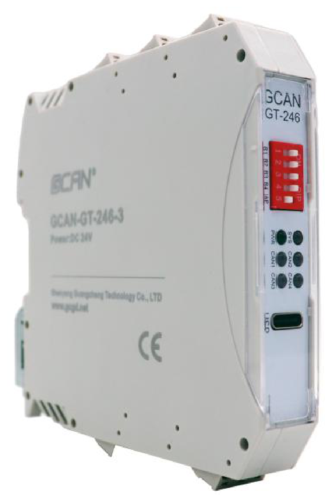
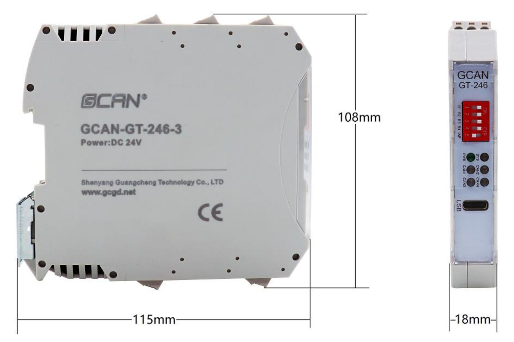
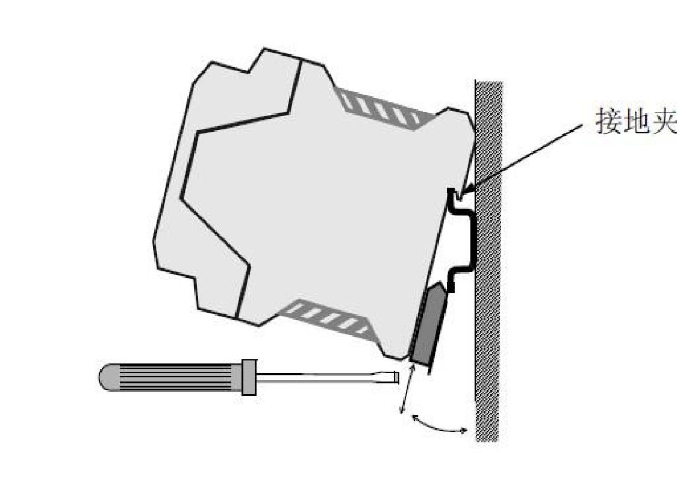
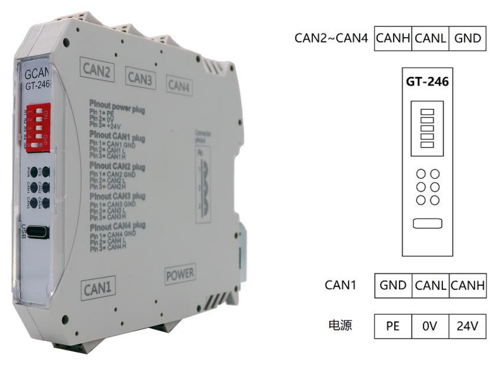
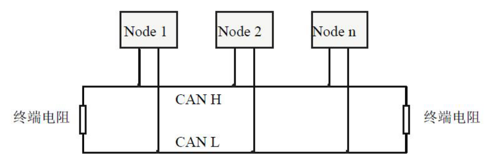
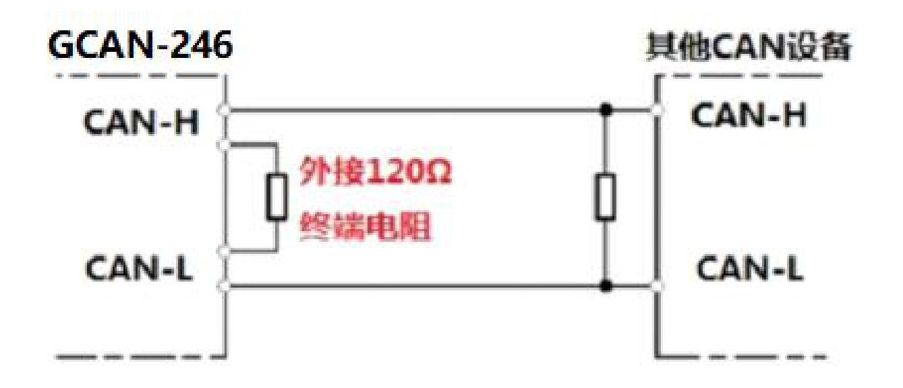
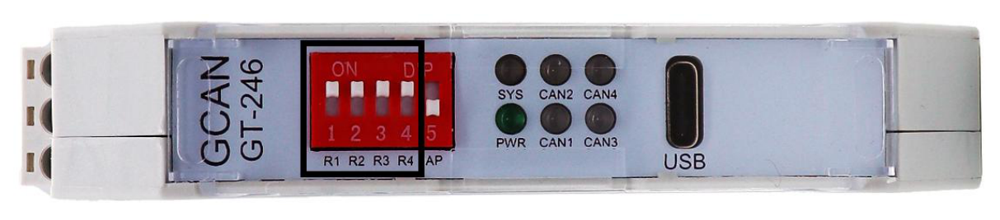

# GCAN-GT-246 系列网桥用户手册

> **受控文档声明（原手册封面与页眉信息）**  
> - **状态标识：** `受控`  
> - **制造商：** `GCAN®` 沈阳广成科技有限公司（Shenyang Guangcheng Technology CO.LTD.）  
> - **文档编号：** `JS-WI-00246-001-V1.10`  
> - **产品名称：** `GCAN-GT-246 系列` 网桥  
> - **文档版本：** `V1.10（2025/11/30）`  
> - **源文件：** `GCAN-GT-246系列-网桥用户手册-JS-WI-00246-001-V1.10.pdf`（共 13 页完整无删减转换；原始 PDF 归档文件保留于本地工作区未追踪目录 `医疗检测仪资料链接/`，本 Markdown 与配图供版本库直接查阅）

> **封面样机外观丝印信息（图录转写）：**  
> - 正面板顶部：`GCAN` / `GT-246`  
> - 红色 5 位拨码开关：`1 2 3 4 5`（上方标注 `ON`，右侧标注 `DIP`，对应丝印 `R1 R2 R3 R4 AP`）  
> - 状态指示灯：`PWR`、`SYS`、`CAN1`、`CAN2`、`CAN3`、`CAN4`  
> - 调试配置口：`USB`（USB-Type C 接口）  
> - 侧面壳体丝印：`GCAN®`、`GCAN-GT-246-3`、`Power:DC 24V`、`Shenyang Guangcheng Technology Co., LTD`、`www.gcgd.net`、`CE`

---

## 修订历史

| 版本 | 日期 | 原因 |
| :--- | :--- | :--- |
| V1.00 | 2025/09/01 | 创建文档 |
| V1.10 | 2025/11/30 | 添加选型参数 |

---

## 目 录（原手册页码索引）

- [1. 功能简介](#1-功能简介)（原手册 P4）
  - [1.1 功能概述](#11-功能概述)（原手册 P4）
  - [1.2 产品参数、选型](#12-产品参数选型)（原手册 P4–P5）
  - [1.3 典型应用](#13-典型应用)（原手册 P5）
- [2. 设备安装](#2-设备安装)（原手册 P6）
  - [2.1 模块尺寸](#21-模块尺寸)（原手册 P6）
  - [2.2 设备固定](#22-设备固定)（原手册 P6）
  - [2.3 GCAN-GT-246 接口定义及指示灯状态](#23-gcan-gt-246-接口定义及指示灯状态)（原手册 P7）
    - [2.3.1 GCAN-GT-246 接口定义](#231-gcan-gt-246-接口定义)（原手册 P7–P8）
    - [2.3.2 GCAN-GT-246 指示灯状态](#232-gcan-gt-246-指示灯状态)（原手册 P8）
- [3. 通信连接](#3-通信连接)（原手册 P9）
  - [3.1 CAN 连接](#31-can-连接)（原手册 P9）
  - [3.2 CAN 总线终端电阻](#32-can-总线终端电阻)（原手册 P10）
- [4. 技术规格](#4-技术规格)（原手册 P11）
- [5. 免责声明](#5-免责声明)（原手册 P12）
- [销售与服务](#销售与服务)（原手册 P13）

---

## 1. 功能简介

### 1.1 功能概述

广成科技 GCAN-GT-246 系列工业级网桥，核心功能是实现不同速率 CAN/CANFD 网络的数据转发，支持接口灵活配置，适配电力、工业控制等多场景互联需求。硬件的电源与每路 CAN 接口独立隔离设计，能抵御过流过压等干扰，保障工业环境下的稳定运行。

该系列通过型号细分满足多样组网需求。型号不同，价格不同：

- **GCAN-GT-246-2：** 集成 2 路 CAN 总线接口，均支持 CAN/CAN FD 协议，可通过软件自由配置两路接口间的数据转换；
- **GCAN-GT-246-3：** 集成 3 路 CAN 总线接口，均支持 CAN/CAN FD 协议，可通过软件自由配置三路接口间的数据转换；
- **GCAN-GT-246-4：** 集成 4 路 CAN 总线接口，其中 CAN1–CAN3 支持 CAN/CAN FD 协议，CAN4 只支持 CAN 协议；所有接口可通过软件自由配置转换，其单向转换时间为 2ms。

### 1.2 产品参数、选型

> 下表将原手册 P4 与 P5 跨页连续表格完整合并，所有字段、数值与标注均按原文保留。

| 大类 | 参数项 | GCAN-GT-246-2 | GCAN-GT-246-3 | GCAN-GT-246-4 |
| :--- | :--- | :--- | :--- | :--- |
| 通道 | 通道数 | 2 路 | 3 路 | 4 路 |
| 通道 | 协议 | CAN/CANFD | CAN/CANFD | CAN1、2、3：CAN/CANFD CAN4：CAN |
| 通道 | 功能 | CAN1 转 CAN2 | CAN1、2、3 配置自由转换 | CAN1、2、3、4 配置自由转换 |
| CAN | 标准 | 支持 CAN2.0A 和 CAN2.0B 帧格式 符合 ISO/DIS 11898 规范 | 支持 CAN2.0A 和 CAN2.0B 帧格式 符合 ISO/DIS 11898 规范 | 支持 CAN2.0A 和 CAN2.0B 帧格式 符合 ISO/DIS 11898 规范 |
| CAN | 波特率 | 10kps~1Mbps，支持自定义波特率（246-4 的 CAN4 不支持） | 10kps~1Mbps，支持自定义波特率（246-4 的 CAN4 不支持） | 10kps~1Mbps，支持自定义波特率（246-4 的 CAN4 不支持） |
| CAN | 转发延迟 | 0.1ms（1M 波特率） | 0.1ms（1M 波特率） | 0.1ms（1M 波特率） |
| CAN | 吞吐能力 | 8000 fps（1M 波特率，标准数据帧，DLC=8 下） | 8000 fps（1M 波特率，标准数据帧，DLC=8 下） | 8000 fps（1M 波特率，标准数据帧，DLC=8 下） |
| CANFD | 标准 | 支持 ISO/Bosch | 支持 ISO/Bosch | 支持 ISO/Bosch |
| CANFD | 数据长度 | 64 字节 | 64 字节 | 64 字节 |
| CANFD | 数据域波特率 | 最高 5Mbps，支持自定义波特率（246-4 的 CAN4 不支持） | 最高 5Mbps，支持自定义波特率（246-4 的 CAN4 不支持） | 最高 5Mbps，支持自定义波特率（246-4 的 CAN4 不支持） |
| CANFD | 转发延迟 | 0.1ms | 0.1ms | **2ms** |
| CANFD | 吞吐能力 | 64 字节，接收 6000 帧/秒，发送 4000 帧/秒 | 64 字节，接收 6000 帧/秒，发送 4000 帧/秒 | 64 字节，接收 6000 帧/秒，发送 4000 帧/秒 |
| 配置 | 配置方式 | 自研软件配置，USB-Type C | 自研软件配置，USB-Type C | 自研软件配置，USB-Type C |
| 配置 | 两端波特率 | 分别配置 | 分别配置 | 分别配置 |
| 配置 | 终端电阻 | 集成，拨码开关控制 | 集成，拨码开关控制 | 集成，拨码开关控制 |
| 电源 | 供电范围 | 24V DC（-15%/+20%） | 24V DC（-15%/+20%） | 24V DC（-15%/+20%） |
| 电源 | 电流 | 50mA（24VDC 典型值） | 50mA（24VDC 典型值） | 50mA（24VDC 典型值） |
| 电源 | 电源隔离 | 1500V DC | 1500V DC | 1500V DC |
| CAN 隔离 | CAN 隔离 | 3000V DC，每路 CAN 独立隔离 | 3000V DC，每路 CAN 独立隔离 | 3000V DC，每路 CAN 独立隔离 |
| 特殊功能 | ID 滤波 | 支持，255 组区间（理论无上限） | 支持，255 组区间（理论无上限） | 支持，255 组区间（理论无上限） |
| 特殊功能 | 透传模式 | 支持 | 支持 | 支持 |
| 特殊功能 | 扩展节点 | CAN 负载率 70%内无上限 | CAN 负载率 70%内无上限 | CAN 负载率 70%内无上限 |
| 特殊功能 | 总线状态 | 指示灯辅助诊断 | 指示灯辅助诊断 | 指示灯辅助诊断 |
| 特殊功能 | 隔离故障帧 | 支持 | 支持 | 支持 |
| 特殊功能 | 中继 | 支持 | 支持 | 支持 |
| 特殊功能 | 二次开发 | 支持 | 支持 | 支持 |
| 环境测试 | 工作温度 | -40℃~+85℃ | -40℃~+85℃ | -40℃~+85℃ |
| 环境测试 | 工作湿度 | 5%-95%RH，无凝露 | 5%-95%RH，无凝露 | 5%-95%RH，无凝露 |
| 环境测试 | 防护等级 | IP20 | IP20 | IP20 |
| 环境测试 | 振动 | 5Hz~8.4Hz，3.5mm 位移，恒定振幅；8.4Hz~150Hz，1g 加速度，X/Y/Z 三轴向，10 个循环/轴向 | 5Hz~8.4Hz，3.5mm 位移，恒定振幅；8.4Hz~150Hz，1g 加速度，X/Y/Z 三轴向，10 个循环/轴向 | 5Hz~8.4Hz，3.5mm 位移，恒定振幅；8.4Hz~150Hz，1g 加速度，X/Y/Z 三轴向，10 个循环/轴向 |
| EMC | 标准等级 | Zone B，IEC61131-2 | Zone B，IEC61131-2 | Zone B，IEC61131-2 |
| 安装方式 | 安装方式 | 标准 DIN 导轨安装方式，专为工业设计 | 标准 DIN 导轨安装方式，专为工业设计 | 标准 DIN 导轨安装方式，专为工业设计 |

### 1.3 典型应用

- CAN 与 CAN 网络设备互联
- 电力通讯网络
- 工业控制设备

---

## 2. 设备安装

### 2.1 模块尺寸

GCAN-GT-246 系列尺寸相同：(长)115mm\*(宽)18mm(高)108mm；如图 2.1 所示：

*图 2.1 GCAN-GT-246 模块尺寸图（长 115mm × 高 108mm × 宽 18mm；正面示 `GCAN GT-246`、`R1 R2 R3 R4 AP` 拨码、`PWR`/`SYS`/`CAN1`–`CAN4` 指示灯、`USB` Type-C 口；侧面示例壳体为 `GCAN-GT-246-3`，标示 `Power:DC 24V`、`www.gcgd.net`、`CE`）*

### 2.2 设备固定

GCAN-GT-246 模块安装方法如图 2.2 所示，可使用一字螺丝刀辅助将模块安装到 DIN 导轨上。

*图 2.2 GCAN-GT-246 模块安装（标注：**接地夹**；底部卡扣配合一字螺丝刀撬动卡入 DIN 导轨）*

### 2.3 GCAN-GT-246 接口定义及指示灯状态

#### 2.3.1 GCAN-GT-246 接口定义

GCAN-GT-246 系列模块只是 CAN 接口数量不同：

- **GCAN-GT-246-2** 集成 `CAN1` 和 `CAN2` 接口；
- **GCAN-GT-246-3** 集成 `CAN1`、`CAN2` 和 `CAN3` 接口；
- **GCAN-GT-246-4** 集成 `CAN1`、`CAN2`、`CAN3` 和 `CAN4` 接口；

以 GCAN-GT-246-4 为例：集成 1 路 DC24V 电源接口、4 路标准 CAN 接口、GCAN-GT-246-4 模块接线端子排如图 2.3 所示。

*图 2.3 GCAN-GT-246 模块接线端子排*

> **图 2.3 壳体丝印与正视接线方向完整转写（接线防呆要点）：**  
> 1. **壳体侧面丝印图例（以 GCAN-GT-246-4 为例，顶部为 `CAN2` / `CAN3` / `CAN4`，底部为 `CAN1` / `POWER`）：**  
>    - `Pinout power plug`：`Pin 1 = PE`、`Pin 2 = 0V`、`Pin 3 = +24V`  
>    - `Pinout CAN1 plug`：`Pin 1 = CAN1_GND`、`Pin 2 = CAN1_L`、`Pin 3 = CAN1_H`  
>    - `Pinout CAN2 plug`：`Pin 1 = CAN2_GND`、`Pin 2 = CAN2_L`、`Pin 3 = CAN2_H`  
>    - `Pinout CAN3 plug`：`Pin 1 = CAN3_GND`、`Pin 2 = CAN3_L`、`Pin 3 = CAN3_H`  
>    - `Pinout CAN4 plug`：`Pin 1 = CAN4_GND`、`Pin 2 = CAN4_L`、`Pin 3 = CAN4_H`  
> 2. **右侧正视端子排线序（面向 `GT-246` 正面板，从左到右）：**  
>    - **上方端子（`CAN2~CAN4`）：** `CANH` | `CANL` | `GND`  
>    - **下方 CAN 端子（`CAN1`）：** `GND` | `CANL` | `CANH`  
>    - **最下方电源端子（`电源`）：** `PE` | `0V` | `24V`

GCAN-GT-246 模块的电源接口由 1 个 3 Pin 插拔式接线端子引出，其接口定义如表 2.1 所示。

| 端口 | 名称 | 功能 |
| :--- | :--- | :--- |
| 电源 | PE | 屏蔽 |
| 电源 | 0V | 24V 直流电源输入负 |
| 电源 | 24V | 24V 直流电源输入正 |

*表 2.1 GCAN-GT-246 模块的电源接口定义*

GCAN-GT-246 模块 CAN/CANFD 接口由 3Pin 接线端子引出，其接口定义如表 2.2 所示。

| 端口 | 名称 | 功能 |
| :--- | :--- | :--- |
| CAN | GND | CAN1_GND 信号地 |
| CAN | CANL | CAN1_L 信号线（CAN 低） |
| CAN | CANH | CAN1_H 信号线（CAN 高） |

*表 2.2 GCAN-GT-246 模块的 CAN 信号分配*

#### 2.3.2 GCAN-GT-246 指示灯状态

GCAN-GT-246 模块具有 1 个 `PWR` 指示灯、1 个 `SYS` 指示灯、4 个 `CAN` 总线状态指示灯。

| 指示灯 | 颜色 | 状态 | 指示状态 |
| :--- | :--- | :--- | :--- |
| PWR | 绿 | 常亮 | 供电正常 |
| PWR | 绿 | 不亮 | 供电异常 |
| SYS | 绿 | 闪烁 | 设备初始化通过，进入工作状态 |
| SYS | 绿 | 其他 | 设备初始化失败 |
| CAN1~CAN4 | 绿 | 闪烁 | CAN 数据收发 |
| CAN1~CAN4 | 绿 | 不亮 | 无 CAN 数据收发 |
| CAN1~CAN4 | 红 | 常亮 | CAN 总线错误 |
| CAN1~CAN4 | 红 | 不亮 | CAN 总线未出现错误 |

*表 2.3 GCAN-GT-246 模块指示灯状态*

---

## 3. 通信连接

### 3.1 CAN 连接

GCAN-GT-246 模块接入 CAN 总线时仅需要将 `CAN_H` 连 `CAN_H`，`CAN_L` 连 `CAN_L` 即可建立通信。

CAN 网络采用直线拓扑结构，总线最远的 2 个终端需要安装 120Ω 的终端电阻；如果节点数目大于 2，中间节点不需要安装 120Ω 的终端电阻。对于分支连接，其长度不应超过 3 米。CAN 总线的连接如图 3.1 所示。

*图 3.1 CAN 网络的拓扑结构（`Node 1`、`Node 2`、`Node n` 挂载于 `CAN H`/`CAN L` 直线总线，总线最远两端接`终端电阻`）*

> **请注意：** CAN 电缆可以使用普通双绞线、屏蔽双绞线。理论最大通信距离主要取决于总线波特率，最大总线长度和波特率关系详见表 3.1。若通讯距离超过 1km，应保证线的截面积大于 Φ1.0mm²（原文：Φ1.0mm2），具体规格应根据距离而定，常规是随距离的加长而适当加大。

| 波特率 | 总线长度 |
| :--- | :--- |
| 1 Mbit/s | 25m |
| 500 kbit/s | 100m |
| 250 kbit/s | 250m |
| 125 kbit/s | 500m |
| 50 kbit/s | 1.0Km |
| 20 kbit/s | 2.5Km |
| 10 kbit/s | 5.0Km |
| 5 kbit/s | 13Km |

*表 3.1 波特率与最大总线长度参照表*

### 3.2 CAN 总线终端电阻

为了增强 CAN 通讯的可靠性，消除 CAN 总线终端信号反射干扰，CAN 总线网络最远的两个端点通常要加入终端匹配电阻，如图 3.2 所示。终端匹配电阻的值由传输电缆的特性阻抗所决定。例如双绞线的特性阻抗为 120Ω，则总线上的两个端点也应集成 120Ω 终端电阻。如果网络上其他节点使用不同的收发器，则终端电阻须另外计算。

*图 3.2 GCAN-GT-246 与其他 CAN 节点设备连接（图中标注：`GCAN-246` `CAN-H`/`CAN-L` 与 `其他CAN设备` `CAN-H`/`CAN-L` 互联，两端配置`外接120Ω 终端电阻`或内置终端电阻）*

> **请注意：** GCAN-GT-246 模块的 CAN 总线内部已集成 120Ω 终端电阻，通过拨码开关控制。如果节点数目大于 2，中间节点不需要安装 120Ω 的终端电阻。需要使用时，对应拨码开关拨至 `ON` 即可，如图所示。

*图 3.3 GCAN-GT-246 终端电阻拨码开关（面板左侧红色 5 位 DIP 开关上方为 `ON`、右侧为 `DIP`，位数 `1`–`5` 对应底部丝印 `R1`、`R2`、`R3`、`R4`、`AP`；图示位 1–4 拨向上方 `ON` 侧、位 5 位于下方；指示灯左侧列为 `PWR`、`CAN1`、`CAN3`，右侧列为 `SYS`、`CAN2`、`CAN4`；右侧为 `USB` 接口）*

---

## 4. 技术规格

| 类别 | 参数项 | 规格 |
| :--- | :--- | :--- |
| **通信接口特点** | 通信形式 | GCAN-GT-246-2：2 路 CAN/CANFD； GCAN-GT-246-3：3 路 CAN/CANFD； GCAN-GT-246-4：3 路 CAN/CANFD+1CAN |
| **通信接口特点** | 系列特点 | 通过配置软件，自由配置转换 |
| **电气参数** | 电源 | +24V DC（-15%/+20%） |
| **电气参数** | 电流 | 约 50mA（24V DC 典型值） |
| **电气参数** | 启动电流 | 约 2.5 倍持续电流 |
| **电气参数** | 建议保险丝容量 | ≤10A |
| **电气参数** | 电气隔离 | 电源端 1500VDC、CAN 总线端 3000VDC |
| **环境试验** | 工作温度 | -40℃~+85℃ |
| **环境试验** | 工作湿度 | 5%-95%RH，无凝露 |
| **环境试验** | EMC 测试 | Zone B，IEC61131-2 |
| **环境试验** | 抗振/抗冲击性能 | 5Hz~8.4Hz，3.5mm 位移，恒定振幅； 8.4Hz~150Hz，1g 加速度，X/Y/Z 三轴向， 10 个循环/轴向 |
| **环境试验** | 防护等级 | IP 20 |
| **环境试验** | 安装方式 | DIN 导轨 |

---

## 5. 免责声明

感谢您购买广成科技的 GCAN 系列软硬件产品。GCAN 是沈阳广成科技有限公司的注册商标。本产品及手册为广成科技版权所有。未经许可，不得以任何形式复制翻印。在使用之前，请仔细阅读本声明，一旦使用，即被视为对本声明全部内容的认可和接受。请严格遵守手册、产品说明和相关的法律法规、政策、准则安装和使用该产品。在使用产品过程中，用户承诺对自己的行为及因此而产生的所有后果负责。因用户不当使用、安装、改装造成的任何损失，广成科技将不承担法律责任。

关于免责声明的最终解释权归广成科技所有。

---

## 销售与服务

**沈阳广成科技有限公司**

- **地址：** 辽宁省沈阳市浑南区长青南街 135-21 号 5 楼
- **邮编：** 110000
- **网址：** http://www.gcgd.net（原手册印为 `www.gcgd.net`）
- **淘宝官方店：** <https://shop72369840.taobao.com/>
- **天猫官方店：** <https://gcan.tmall.com/>
- **京东官方店：** <https://mall.jd.com/index-684755.html>
- **官方服务热线：** `13019325660`
- **售前服务电话与微信号：** `15712411229`
- **售前服务电话与微信号：** `18309815706`
- **售前服务电话与微信号：** `18940207426`
- **售后服务电话与微信号：** `15566084645`
- **售后服务电话与微信号：** `18609810321`
- **售后服务电话与微信号：** `17602468871`
