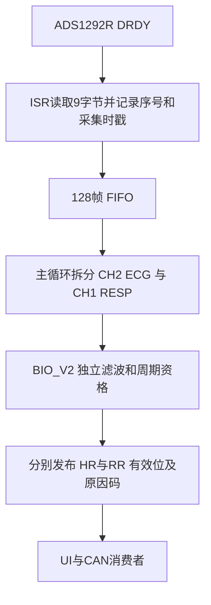

# Node-B ECG 与呼吸率综合复盘

日期：2026-10-16。依据本次实际读取的源码、模块/板级图纸及历次报告。历史实测按当轮记录引用，本次没有重新采样，也没有把旧报告中的执行步骤当作本轮硬件授权。

## 1. 当前判断

问题经历了三个不同层次：

1. **曾经采不连续。** 主循环迟读、没有真实帧队列，加上 PA1 共用网络影响 START，确实破坏了采样。ISR 取帧、FIFO 和改用 PG15 后，在限定窗口中已改善并通过连续性检查。
2. **取数工具曾损坏观察证据。** 运行中读取活动 RAM 会跨槽代混字；主机首次加载分析依赖还曾停顿，造成观察帧缺失。不能把这些全部归入 ADC 丢样或算法异常。
3. **连续原始帧并不总是合格输入。** 现有外部记录有强 50/100 Hz 和约 25 Hz 成分；无明确输入真值。开放输入轮 CH1 顶轨。旧 BIO_V2 的双通道共同削顶又使 ECG 被连带重置；最新代码已修复此项，但尚无该候选的对应真机复测记录。

因此，不能用一个原因解释全部历史现象，也没有证据将当前未闭环的问题唯一归因于传感器损坏、某根电源线或某个算法阈值。

## 2. 当前源码和固件身份

| 对象 | SHA-256 / 状态 |
|---|---|
| `firmware/biov2/实验固件/HARDWARE/bio_v2.c` | `3adca55cb1eb1fa3ed8e4148f837287d0454bcc2c08ae77a8f73deb1dac156a7` |
| `ads1292.c` | `f99c3d567338f95b4cbae5579554d15e3af4928f8b1a39e0f18b9dbd30192ced` |
| `spi.c` | `5e09707c47cec710172a4e78e7ca21c15c7359d964d0fbe8bf5c2498243a8ec0` |
| `ecg_frame_queue.c` | `cab4719c4151386acbac422f28af517a5b54c8c3c933a52a9207b1c0140e319f` |
| 最新候选 BIN，本次重建相同 | `438a8120f6df06ce219cdc30c0e5b697ac0e993f98d5a80521b10361536ae3ae` |
| 本次重建 ELF | `52811fc02249835c8481f4f5103949e13681fe5ee7e55dee5caab716bb0fb1db` |
| 先前归档候选 ELF | `5a3fbbc13fe57a6b3a5fdaf6ead7f80320bff6d622e0e0980fc089a8bcea18bc` |
| 今天 B 板实际运行镜像 | **未读取，未知** |

ELF 含构建路径等调试信息，本次 ELF 与历史不同；BIN 逐字节身份相同。两项分别记录，不将重建 ELF 写成原 ELF。完整来源清单见 `evidence/source-provenance.json`。

## 3. 数据链路与失效传播

`BioV2_Process()` 中，单路顶轨只重置本路；源 flags、源序号异常、超过 100 ms 的输入缺口/超时仍使两路共同失效。驱动对超过 6 ms 的 IRQ 间隔另设 flags；这两条门槛不能混为一条。

心率需完成预热、显著峰/峰宽、合法间隔、至少三个新间隔和稳定性资格。呼吸另有完整起伏与带内能量判据。`samples` 是收到的帧数，不是有效心拍数量；`valid` 是工程判据通过，不是外部参考已证实准确。

## 4. 为什么目前仍可能长期没有有效心率

当前代码以 `raw_power > 10000` 且 `line_power > raw_power * 0.95` 判为强干扰，清除心率周期资格。`line_power` 是去 DC 输入与陷波输出之差的均方估计，**不是精确的 49–51 Hz 频谱功率**。它可能包含相位与滤波过渡影响，不能直接指定电源为唯一原因。

在已保存的开放输入 8412 帧上，新算法脱机回放不再受 CH1 顶轨连带重置，但 HR 仍无效，末态原因 66=`MAINS|NO_CYCLES`。该输入没有连接外部有效 ECG 源；它说明保护路径如何工作，不能证明芯片不能采 ECG。

另有外部 CSV 37169 帧：历史分析在 30 秒后发现 ECG 49–51 Hz 功率约 94.45%、99–101 Hz 约 5.17%；旧冻结 BIO_V2 回放只有 857 帧短暂有效，约 16.821–20.247 秒输出 60。没有已知输入真值，也缺完整配套身份包，不能称作正确心率或已知模拟器精度测试。

## 5. 呼吸率问题的独立复盘

旧 `resp_rate.c` 已采用低通波形极大值，不能再把更早的绝对差分双峰缺陷写成今天仍存在。现存旧版仍有大直流初态、周期锚点被拒峰刷新、旧资格保留等历史限制。BIO_V2 用首点 DC 初始化、慢 DC/低通、谷到峰幅度和时长、独立新周期及超时重建取代旧状态机。

这解决了可复现的软件问题，但**尚没有已知呼吸阻抗输入的闭环精度证据**。CH1 持续顶轨时，放宽算法门槛不能恢复已丢失的幅度信息。ECG 电压工程源也不自动构成呼吸阻抗模拟器。

## 6. 下一步应攻克什么

优先补齐可核验的外部输入及模拟链路条件，然后用同一记录区分算法漏检。具体顺序见[证据矩阵与后续路线](04_证据矩阵与后续路线.md)。目前没有证据支持再整体重写 BIO_V2，先用受控输入判断哪些具体差异值得修复。

历史详细依据见 [2026-10-15 阶段复盘](../history/ECG阶段性原因复盘与未排除因素_20261015.md)；其中本地原件仍留本地，未因归档覆盖任何失败。
