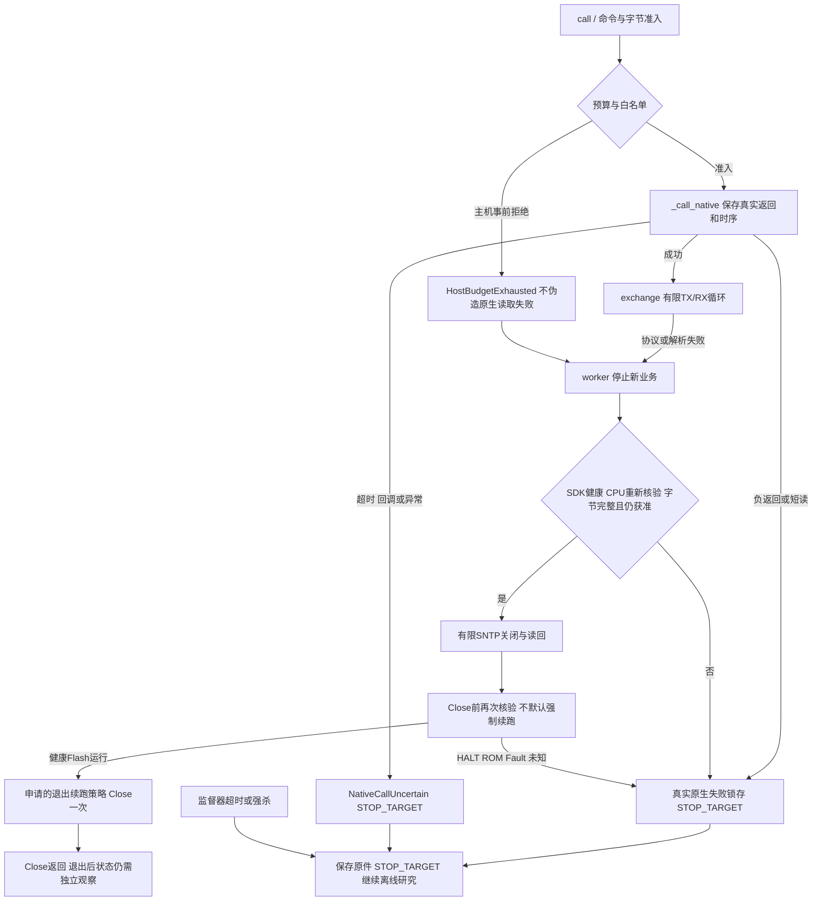

# B5 G3R6 A段综合诊断与下一次批量现场授权建议

日期：2026-10-27。分支`codex/node-b5-cloud-integration-20261026`；审计起点`0ede0a5027bc9383af61503152e123c27d2a0f4f`。本报告是本子阶段唯一综合交付，不替代历史交接或提供现场执行权限。

## 裁定

**A_OFFLINE_TOOL_FIX_PASS**。已通过旧版/新版实际Python包装器对照及114项相关离线回归，退出码0。未加载实际J-Link DLL、未打开设备/串口、未发AT/UDP、未SSH连接服务。本轮新增实板会话、Go、Reset、烧录、sector3、服务变更和B5START均为0。C断电仅依据负责人报告，不重新上电核验。

**B_HALT_CAUSE_EVIDENCE_CLOSED_OR_TRACKED：TRACKED，唯一根因仍UNRESOLVED**。已证明主机工具缺陷及其状态传播；尚未证明Close内部或之后如何产生真实HALT。C及后续TIME干净退出、公网新鲜NTP、gen5、云服务、G3和恢复均未因离线通过升级。保留`B4_CAN_PASS / B5_CLOUD_BLOCKED`；CPU ROM、冷启动、同窗双有效、绝对阻抗和故障注入仍分别登记原状态。

## 1. 已有原件复核出的确定事实

来源为R5两笔独立EFS事务的API日志、心跳、原始回复及回执；本轮只读本地文件，不重读设备UID/Flash/options。统计和来源SHA见[historical-audit.json](../evidence/B5-G3R6-A-OFFLINE/historical-audit.json)。

| 事实 | 第一次P0-A | 随后收尾窗口 |
|---|---|---|
| 真实记录的原生调用 | 6000 | 37 |
| 负返回/ReadMemEx短读 | 0 / 0 | 0 / 0 |
| UART字节 | 446 | 0 |
| 完整CRLF命令/未终止尾部 | 26 / 14字节首条DNS命令 | 0 / 0 |
| 主机原因/退出码 | `ESP_API_BUDGET` / 1 | `UDP_CPU_STATE_STOP` / 1 |
| 退出续跑开关 | false | false |
| SNTP关闭确认 | false | false |
| 显式Halt/Reset/Go调用 | 0 | 0 |

第一次已有15份时间样本，末4份达到冻结下界并递增，首次合法样本在启用后18.922秒；这是第一级时间门的历史实际证据，不能补签整笔事务成功。第二次实读DHCSR=`0x00030003`、VTOR=`0x08000000`、CFSR/HFSR=0、DWT_PCSR=`0xFFFFFFFF`。这证明当时Debug HALT；没有真实PC/MSP，不能说成ROM、算法丢失或HardFault。

两次心跳均有Close active及inactive记录，但旧Close没有原生整数返回记录，且没有Close后独立运行态证据。不能从“调用已返回”或“explicit_go=0”推出没有SDK隐式暂停/恢复。负责人后来断电，不能倒填为原180秒内已关闭SNTP。

## 2. 旧异常传播链与已证缺陷

旧`QueryLink.call`转到`NativeLink.call`，再调用受限`_call_native`。预算判断在DLL前；`read`捕获全部异常，统一置`read_failed=True`、`verified_running_flash=False`。DAP父类还会把事前预算拒绝误置`raw_failed`。

本轮用起点Git源码创建类实例而不执行构造器，不加载DLL，在6000次边界调用旧/新真实`read()`：

| 包装器 | 异常 | 新DLL调用 | read_failed | verified_running_flash |
|---|---|---|---|---|
| 起点旧版 | ValueError / ESP_API_BUDGET | 0 | true | false |
| 修正版 | HostBudgetExhausted / ESP_API_BUDGET | 0 | false | true（保留此前证明，不代表重新证明） |

见[budget-replay.json](../evidence/B5-G3R6-A-OFFLINE/budget-replay.json)。由此确定“预算拒绝误锁存→正常清理/退出路径失去资格”是软件缺陷。历史日志与源码支持该路径；**从此再到硬件HALT是待证关系**，不能把修复包装器当成已修硬件根因。

## 3. 修正后的预算与退出

- 增加`HostBudgetExhausted`、`NativeReadFailed`、`NativeCallUncertain`。主机拒绝不污染读/DAP状态；实际负返回、短读、原生异常、期限和错误回调分别保留返回和分类。绕过写Flash基类的全异常锁存，只保留当前受限API白名单。
- 每次MEM-AP UART字节实际为12调用，包含CSW/TAR恢复；用真实Python桥与假DLL计数验证。每字节TX最多4次状态读，RX按20ms间隔和显式次数上限。3秒最多150轮，每轮最多3次读取；5秒最多250轮。
- 单条命令上界`1 + 字节数×(4+12) + 3×ceil(timeout/0.02)`。开始命令前保留整条成本；每个字节开始前复核全部剩余字节及RX成本。非清理阶段另留完整关闭/读回、40次退出资源，以及12次失败前运行态检查，避免复核本身吃掉关闭预算。
- 本次冻结真实默认计划的清理预留为1482调用；详细逐槽模型见[budget-model.json](../evidence/B5-G3R6-A-OFFLINE/budget-model.json)。SDK总额仍12000；一般操作只用到11999，最后一调用给Close。原6000边界测试同理，在5999拒绝新业务，保留第6000次Close。
- 全计划最坏情况21615调用（不含入口），超过12000。因此不承诺最坏条件下跑完全部DNS；准入失败必须提前停止新业务、使用预留关闭并记录BLOCKED，不能提高额度冒充解决。SDK阻塞、真实错误、供电故障或监督器强杀仍可能破坏收尾；这时不保证CRLF/关闭，必须如实标未知并要求目标停止。
- 如已存在半条命令，禁止跳转拼接关闭命令；不能用随机CRLF清缓冲。SNTP已活动但连关闭余量都没有时，零新写入，保留未确认状态。
- `set_close_resume`只登记请求，Close前重读DHCSR两次、VTOR、Fault、PC采样、DISARMED。只有健康Flash运行才实际设置`SetRestartOnClose=1`；HALT/ROM/未知不强制续跑。运行时DWT采样不是实际PC。Close调用一次并计入总量，报错/超时/回调均不报成功；即便Close完成也标注退出后目标状态需独立观察。
- 监督器异常会回收其创建的子进程，不发任何目标控制。强杀结果不能借用旧成功回执，SNTP停止/目标状态按未知处理；即便SNTP确认关闭，Close失败仍要求目标停止。

当前新策略仅离线通过；所有旧授权的工具绑定均已过期，不复用旧`.used`或替换其源档案。

## 4. 连接/关闭行为与仍缺的硬件证据

SDK保护设置在Device选择前，包括`SetRestartOnClose 0`、`InhibitConnectRetries=1`、`ForceAttachTarget=1`；Open后再设置保护及`SetSkipDebugDeInit=1`，选择Device可能已连接，IsConnected为假才Connect，不能宣称这等于没有内部CPU动作。

SEGGER说明`SetRestartOnClose`控制退出恢复执行，语义相当于Go；`ForceAttachTarget`跳过目标初始化，`SetSkipDebugDeInit`改变调试退出行为。这些是文档语义，不能代替本板的后验观察。[SEGGER官方命令说明](https://kb.segger.com/J-Link_Command_Strings)。DHCSR的HALT与控制位按[Arm CMSIS CoreDebug定义](https://raw.githubusercontent.com/ARM-software/CMSIS_5/develop/CMSIS/Core/Include/core_cm4.h)解释。

历史缺真实PC/MSP/xPSR、DFSR、DEMCR、FPB以及Close介入前后状态。预算异常只发生在主机，不能单独证明其向MCU发出HALT；Close内部停核、已有断点/向量捕获、连接影响及其他硬件原因尚不能排除。不得从当前断电重开正常就宣称历史机制关闭。

## 5. 验证与本地迭代

114项相关测试退出0，包括原78项ESP回归及36项时间/预算/退出检查。覆盖5999/6000边界、完整AT/CRLF、逐字节模型、半条拒绝、SNTP活动且余量不足、预算提前停止后的关闭读回、真实负读/短读、DAP错误、原生异常/超时/回调、Close错误/超时/回调、隐式HALT、入口HALT/ROM/Fault/向量不符、现有完整Flash身份门不符，以及真实离线阻塞子进程被监督器杀死。均是Host/Mock，不签实板PASS。

首轮扩展回归暴露旧夹具缺少error字段及旧异常类型断言；另一次Close超时夹具缺一个时钟样本。已按真实接口更新夹具并复测，没有削弱停止条件。所有首次失败日志和后续结果均保存在本地journal/EFS，未因这些小问题单独提交或推送。

未修改固件、BIO_V2、ADS寄存器、TLS、CAN、配置或正式云端；未重跑旧Host/ARM/UI/算法六窗。仓库根`AGENTS.md`已加入治理约定；没有修改Codex全局配置。

## 6. 下一次一次性批量现场建议（DRAFT_DISABLED，尚未批准）

建议下一次由PI一次审批以下**有界诊断包**。本报告不是活动授权；执行前还须冻结专用只读/可选Go驱动与监督器离线回归、新工具SHA、地址表、私有现场附件和消费计数。当前时间工具仍不能读真实核心寄存器，不能直接复用作HALT驱动。

| 对象/分支 | 建议预算 | 技术条件与动作 |
|---|---|---|
| 现场准备 | 一次C上电；B保持断电 | 负责人一次核对全暗、JTAG在C、C原J5、C USB断开、ESP在板供电例外、CAN/地/BOOT不变。若需转接，只允许全断电等10秒后的冷态转接。不额外RESET，不把上电当根因实验PASS |
| L2诊断 | 总连接≤3，每次≤120秒，批总≤360秒；不自动重试 | 首次仅固定SWD只读，保存连接策略/SDK回调与DHCSR/VTOR/RCC_CSR/Fault/DFSR/DEMCR/FPB/uptime/DWT等；运行态不为读取真实PC而暂停。私有身份按已有批准引用核对，不公开UID/原码 |
| 正常Flash分支 | 最多2个无公网包的只读会话 | S1在命令开始前合成一次主机预算拒绝（不写UART/RAM），检查不会误锁存，健康退出；S2独立核对Close后的uptime推进/任务、入口和退出状态。第二次异常即不再追加测试；保留离线工作 |
| `EXIT_RESUME_IF_VERIFIED` | 每连接≤1次策略应用，合计≤3 | 只在实时健康Flash且DISARMED时允许退出恢复策略；必须明确其与Go等价的语义，不用“显式Go=0”隐藏此权限。没有相应批准时不擅自设1 |
| HALT互斥分支 | 停AT/业务；仅已暂停时读真实PC/MSP/xPSR | 若S1或S2发现HALT，停止正常分支。先取DFSR/DEMCR/FPB、真实核心寄存器、Fault/复位线索；DWT全F不能代替PC；不人为Halt复现 |
| 可选L3 `DEBUG_RESUME_ONCE` | 整批显式Go≤1；可占第3连接复核 | 仅PI明确勾选后，真实PC在受核验应用、MSP在有效SRAM、Fault/LOCKUP=0、无ROM、无异常断点/复位线索、Flash/sector3身份稳定、退出策略符合批准，方可一次Go；恢复后核对uptime/应用任务。条件缺一则零Go。成功不签根因修复 |
| 停止 | ROM/Fault/Lockup/身份漂移/供电异常/原生未知即停止目标 | 零自动Reset、零强设PC/MSP/VTOR、零重刷；不得耗尽3次来反复连接未知状态。保存原件并按预批物理停止办法由负责人断电，离线分析继续 |

本诊断包建议不含AT、Wi-Fi改动、SNTP启用或新公网包；先把工具退出和HALT证据补齐。B段通过或风险明确登记后，可一次审批另一完整C段包，将易失Wi-Fi、一次SNTP启用/关闭读回、固定查询次数和单个公网48B/nonce/窗口分别作为预定义子scope，减少逐步请示；目的地址/字节计划及清理时间须先冻结。此次未替该后续包生成活动授权。

Flash/sector3 gen5、G1恢复、真实B5START、R-CFG/R-APP/R-CLOUD仍各自独立审批。TIME与新鲜NTP实际通过后才生成gen5回退包；云服务先只读核验，至少625秒驻留余量，不能自动重启。G3维持ECG60/HR58–62、RR/TEMP INVALID、A OFFLINE、MOCK，300秒评价和420秒硬停，不降低准确性、时效或TLS门禁。

## 7. 来源、冻结与提交边界

工具及报告来源SHA见[evidence清单](../evidence/B5-G3R6-A-OFFLINE/bindings.json)，离线结果见[test-results.json](../evidence/B5-G3R6-A-OFFLINE/test-results.json)。受限EFS保留旧源码、全部失败与成功日志、历史原件校验清单；不覆盖R5文件。公开仅安全统计、SHA和合成测试回执，无密码、UID、SSID或真实端点。

本A段在稳定离线里程碑集中形成一次checkpoint与最多一次阶段推送，不将小错误逐次同步。提交/远端取回的真实结果另存在忽略的build及EFS回执，不在提交前预签。完成后维持负责人断电检查点，等待新批量批准；不进入真实云窗。
