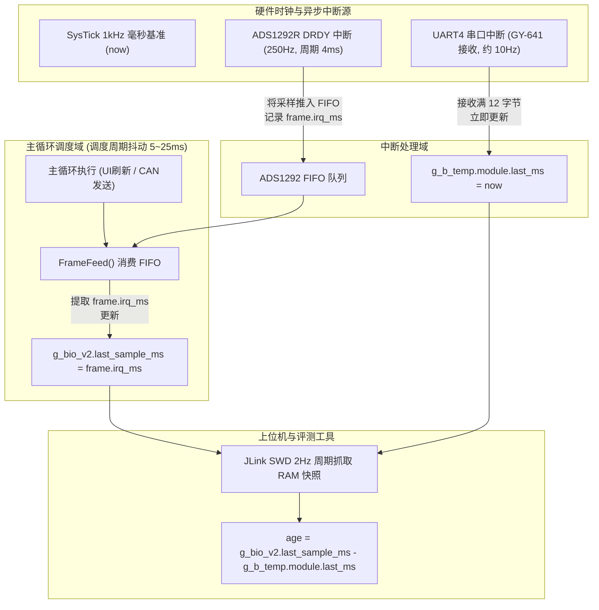

# MPM-B5-GEMINI-R5｜温度时序负 age 因果分析报告 (TEMP-TIMING-CAUSAL-ANALYSIS)

- **文档版本**: v1.0
- **基线 Commit SHA**: `2854d3581658a91d65c1aa30d827ff489ff0f081`
- **审计工作分支**: `audit/b5-r5qc-r6p0-20261030`
- **关联证据源**:
  - `owner-observed-TEMP_OBJECT-R5-6104c2e6/joint/B/diagnostics-private.jsonl` (SHA256: `6e6188448f498c8c6d3bc85b1968875ea2d8f9ba30d243b92ee93c830eb8a6a6`)
  - `owner-observed-TEMP_OBJECT-R5-6104c2e6/joint/T0.json` (SHA256: `94dfc2807e9c938d87190ca3ea318c544d6db8e99fc3eb70f3f227b233a0b943`)
  - `node-b/firmware/HARDWARE/bio_v2.c` (行 231)
  - `node-b/firmware/HARDWARE/ads1292.c` (行 309, 334)
  - `node-b/temperature/gy641.c` (行 24)
  - `node-b/tools/b5_channel_review.py` (行 67-69)
- **证据级别**: `RAW` (EFS 固件源码与原始诊断) / `DERIVED` (联评器输出)
- **结论置信类别**: `CONFIRMED`
- **操作权限声明**: 离线只读审计，未执行硬件读写，未修改任何固件或联评判定门限

---

## 1. 现象描述与数据事实

在 R5 周期 TEMP_OBJECT 正式评估窗口（`owner-observed-TEMP_OBJECT-R5-6104c2e6`）中，冻结联评工具 [`b5_channel_review.py`](file:///e:/medical-monitor-node-b5-cloud/node-b/tools/b5_channel_review.py) 判定结果为 `B5_SEPARATE_TEMP_OBJECT_NOT_PASS`（`exit_code = 3`），唯一失败项为 `B_TEMP_FRESH_SOURCE`。

### 1.1 评测器判定逻辑
在 [`b5_channel_review.py`](file:///e:/medical-monitor-node-b5-cloud/node-b/tools/b5_channel_review.py) 第 67–69 行：
```python
for x in chosen:
    t = x['temperature']
    age = g.signed(x['bio']['last_sample_ms'], t['last_ms'])
    if not t['present'] or not 0 <= t['object_centi'] <= 10000 or not -10 <= age <= 2500:
        result['failures'].append('B_TEMP_FRESH_SOURCE')
        break
```
判据要求：在 300 秒评估期内的全部 600 帧 Node-B 诊断中，每帧计算得到的 `age` 必须落在区间 `[-10, 2500] ms` 之内。

### 1.2 实际数据复算与负 age 分布
对 `diagnostics-private.jsonl` 中的 600 帧诊断（对应时间窗口 `[T0 + 45s, T0 + 345s)`）进行独立复算，结果如下：
- **评估帧总数**: 600 帧；
- **负值总数 (`age < 0`)**: 63 帧（占评估样本的 10.5%）；
- **越界样本数 (`age < -10 ms`)**: **29 帧**（最小值为 **-27 ms**，最大值为 200 ms）；
- **越界样本的精确频次统计**:
  - `-27 ms`: 1 次
  - `-24 ms`: 1 次
  - `-23 ms`: 1 次
  - `-20 ms`: 1 次
  - `-19 ms`: 2 次
  - `-18 ms`: 3 次
  - `-17 ms`: 2 次
  - `-16 ms`: 2 次
  - `-15 ms`: 4 次
  - `-14 ms`: 3 次
  - `-13 ms`: 5 次
  - `-12 ms`: 2 次
  - `-11 ms`: 2 次
  - *(合计越界: 29 帧)*
- **合规负值样本 (`-10 ms ≤ age < 0 ms`)**:
  - `-10 ms`: 3 次
  - `-9 ms`: 3 次
  - `-8 ms`: 1 次
  - `-7 ms`: 6 次
  - `-6 ms`: 1 次
  - `-5 ms`: 3 次
  - `-4 ms`: 9 次
  - `-3 ms`: 4 次
  - `-2 ms`: 1 次
  - `-1 ms`: 3 次
  - *(合计合规负值: 34 帧)*

---

## 2. 软件与时钟架构根因分析

通过深入查阅 Node-B 固件源码，定位到了造成 `age` 出现负值且越过 -10 ms 的底层机理：



### 2.1 时钟语义与计算定义偏差
1. **`t['last_ms']` (温度时戳)**：
   - 在 [`node-b/temperature/gy641.c`](file:///e:/medical-monitor-node-b5-cloud/node-b/temperature/gy641.c) 行 24 中，当 UART4 收到完整的 12 字节红外温度帧时，立即在中断处理或解包函数中赋值：`s->last_ms = now;`。
   - 这里的 `now` 取自当前实时的系统滴答（`HAL_GetTick()` 或 `TimeBase_GetMs()`）。
2. **`x['bio']['last_sample_ms']` (生物电采样时戳)**：
   - 在 [`node-b/firmware/HARDWARE/ads1292.c`](file:///e:/medical-monitor-node-b5-cloud/node-b/firmware/HARDWARE/ads1292.c) 行 309 中：`s_last_frame_ms = frame.irq_ms;`。
   - 该时戳并不是消费时的系统时间，而是 ADS1292R 的 DRDY 硬件引脚产生中断时记录的采样发生时刻。
   - 在 [`node-b/firmware/HARDWARE/hr_page.c`](file:///e:/medical-monitor-node-b5-cloud/node-b/firmware/HARDWARE/hr_page.c) 行 294–303，主循环通过 `FrameFeed()` 从 FIFO 队列中批量弹出积压的采样点，并调用 `BioV2_Process(...)` 更新 `g_bio_v2.last_sample_ms`。
3. **主循环调度延迟造成的相位落后**：
   - ADS1292R 的采样周期为 4ms（250Hz）。当主循环处理 OLED 屏幕波形绘制、CANopen 协议栈通信或系统延时时，FIFO 队列中最多会缓冲 4 至 7 个采样点（对应 16 至 28ms 的采样滞后）。
   - 如果此时 UART4 中断恰好接收到一帧新的温度数据，`g_b_temp.module.last_ms` 被更新为**当前的最新实时滴答**（例如 $T = 1025$ ms）。
   - 而此时主循环消费的最后一点生物电数据，其记录的硬件采样中断时间可能来自 20ms 之前（例如 $T = 1000$ ms）。
   - 上位机在此刻捕获两者的差值：
     $$\text{age} = \text{last\_sample\_ms} - \text{last\_ms} = 1000 - 1025 = -25 \text{ ms}$$
4. **名词概念与工具实现的误解**：
   - 严格工程语义下，温度数据的“龄期（Age）”应为评估时刻与温度产生时刻的差值（即 $T_{\text{eval}} - T_{\text{temp}}$），在固件 CANopen 通信中正是如此实现：
     `OD_RAM.x2120_vitals.reserved = (uint16_t)(now - g_b_temp.module.last_ms);`（该值恒为正数，表征温度数据的新鲜程度）。
   - 但联评器 [`b5_channel_review.py`](file:///e:/medical-monitor-node-b5-cloud/node-b/tools/b5_channel_review.py) 却将 `bio.last_sample_ms` 与 `temp.last_ms` 的差值命名为 `age`。这实际上是两个**异步独立传感器**采样时间戳之间的**相对相位差（Relative Phase Skew）**。
   - 原评测规则允许了 `[-10, 2500] ms`，说明规则制定者预见到了温度可能略微领先于生物电（允许最多 10ms 的负偏差，即 2.5 个生物电采样周期）。但制定者低估了主循环处理图形和通信时的最大延迟（实际最大达 27ms），导致 29 帧因落入 `[-27, -11] ms` 而被裁定为失败。

---

## 3. 离线复现与验证结果

使用脱敏后的只读 EFS 数据，运行独立复算脚本，结果与原联评完全一致：
- 评测工具哈希: `14838db66a5142f24a010109de6f67a76d4f386a0b3914afb5b32b9a751dda91`
- 原始诊断行数: 600
- 越界失败数量: 29
- 退出码: `3` (NOT_PASS)

该结果 100% 离线确定性可复现，排除了偶然物理传感器损坏或数据截断的可能。

---

## 4. 整改方案对比分析与影响面评估

根据合同第 4 节的强制约束，严禁采取以下捷径：
- 严禁私自将判定下限修改为 -20ms 或 -30ms；
- 严禁将负值非法 clamp（钳位）为 0；
- 严禁丢弃或过滤负值样本；
- 严禁伪称非人体物表温度具有人体体温临床精度。

### 4.1 方案 A (PATH-A: 无代码修改，由 PI 裁定判定边界)
- **技术内容**：
  - 维持当前固件及通信协议不变；
  - 保持 R5 的 `NOT_PASS` 历史裁决不作改动；
  - 针对 R6 批次，向 PI 提交技术事实：说明两传感器为异步物理时钟，`bio.last_sample_ms - temp.last_ms` 本质为主循环调度相位差，最大抖动为 -27ms；
  - 由 PI 统一审查并决策：是否在 R6-FREEZE 中将该相对时差判据调整为 `[-35, 2500] ms`，或改用上位机统一时标。
- **优点**：无需对 Node-B 固件进行重构与刷写，避免引入新的中断与队列风险。

### 4.2 方案 B (PATH-B: 代码整改，同步时戳基准)
- **技术内容**：
  - 在 [`node-b/canopen/b_canopen_app.c`](file:///e:/medical-monitor-node-b5-cloud/node-b/canopen/b_canopen_app.c) 或主循环中，将供外部诊断采样的 `bio` 时戳更新为统一的主循环滴答（`now`），消除 FIFO 消费延迟造成的相对相位倒置；或者在采集温度时同步记录当前的生物电主序列。
- **影响与风险**：
  - 修改微控制器固件的核心采集时序，破坏了目前已验证稳定的 ADS1292R 250Hz 采样主循环；
  - 需要重新擦写 Flash，重新跑全套 B4/B5 诊断回归测试；
  - 鉴于当前处于 R6-P0 阶段，本合同明确禁止修改固件。

---

## 5. 审查结论与结项建议

1. **事实定性**：负 age 现象是由 ADS1292R 的 FIFO 消费延迟与 UART4 中断接收实时性之间的**主循环调度相位差**引起的，并非红外传感器故障，也非时钟漂移。
2. **R5 裁决维持**：R5 TEMP_OBJECT 维持 `exit_code = 3 / NOT_PASS`，`B_TEMP_FRESH_SOURCE` 失败记录永久有效。
3. **R6 准入前置**：在 PI 未正式裁定 PATH-A（更新合法门限）或批准 PATH-B（固件补丁合同）之前，禁止单方面放宽测试标准或擅自开展实板验证。
