# MPM-B5｜ECG 队列过期、Broker 重放与 WSS 缺失批次集合级对账报告 (ECG-QUEUE-REPLAY-WSS-KEY-MAP)

- **文档版本**: v2.0-P0B
- **基线 Commit SHA**: `2854d3581658a91d65c1aa30d827ff489ff0f081`
- **审计提交 Commit**: `8954c8ea96af1eda99f00b927f19fecab3cc3215`
- **审计分支**: `audit/b5-r6-p0b-20261030`
- **repo_ref**: `Serendipity-min/medical-multi-parameter-monitor:node-b/docs/B5-R6-P0B/ECG-QUEUE-REPLAY-WSS-KEY-MAP.md`
- **source_sha256**:
  - `owner-observed-ECG60-R5-55d99a50/joint/C-lines-private.jsonl`: `91ca46ae2862d2b528b1227094d4d6baab6628fbba623f9723ec0fe670d90234`
  - `owner-observed-ECG60-R5-55d99a50/joint/cloud-events-private.jsonl`: `a681cbbca4ae37c227848f2fa4f40f3531b78292854ddb1dfa5bfa4a6d7bf309`
  - `owner-observed-ECG60-R5-55d99a50/joint/T0.json`: `b6771ce8d0fc638217bb41165ec52b65fe2a4d94b05a743a63fa9dd20b72c918`
- **review_tool_sha256**: `14838db66a5142f24a010109de6f67a76d4f386a0b3914afb5b32b9a751dda91`
- **evidence_type**: `RAW_AUDIT_VERIFIED` / `SET_DECOMPOSITION`
- **verified_by**: Gemini (Antigravity) 独立审计复核
- **unresolved_items**: ESP8266 内部 AT 阻塞与 Wi-Fi 空口丢包因缺乏空口抓包证据，归因保持 `UNKNOWN`

---

## 1. 现象纠正：三个独立集合的严格解耦 (`GATE-04`)

在先前的分析文稿中，曾出现将“Broker 6 条 REPLAY 消息”与“Gateway-C 队列 6 条过期”以及“WSS 缺失波形批次”草率等同的逻辑漏洞。
经对原始报文与数据流向进行集合级严格解耦，证实三者属于**不同数据流、不同协议层、不同物理含义的独立事件**：

```mermaid
flowchart TD
    subgraph Event1 ["集合 1: R5_REPLAY_SOURCE (标量流)"]
        Rep1["4 条 TEMP 标量 (seq 74..77)"]
        Rep2["2 条 RR 标量 (seq 74..75)"]
        Rep1 --> TopicRep["发布至 /replay/temp 与 /replay/rr 主题"]
        Rep2 --> TopicRep
        TopicRep --> FailMock["触发 BROKER_NOT_MOCK"]
    end

    subgraph Event2 ["集合 2: C_QUEUE_EXPIRED (单片机出口队列)"]
        C_Stall["Gateway-C 发生 8.375s 诊断断档"]
        C_Stall --> QueueHigh["队列积压从 5 暴涨至 17"]
        QueueHigh --> Exp6["6 个实时消息块因驻留超限被淘汰 (expired=6)"]
        Exp6 --> FailExp["触发 C_NEW_REALTIME_LOSS_OR_EXPIRY"]
    end

    subgraph Event3 ["集合 3: ECG_WSS_MISSING_KEYS (云端前端波形快照)"]
        WSS_Poll["WSS 按 100ms 轮询快照"]
        BrokerBurst["Broker 突发接收 751 批 ECG 波形"]
        BrokerBurst --> WSS_Poll
        WSS_Poll --> Miss10["10 批 ECG 波形未被快照采样捕获 (741/751)"]
        Miss10 --> FailBatch["触发 ECG_WSS_BATCH_MISSING"]
    end
```

---

## 2. 集合 1：`R5_REPLAY_SOURCE` 逐项明细表

在整个评估窗口接收到的 2867 条 Broker 消息中，共有 6 条非实时 MOCK 消息。其 stream 均为**标量数据**（RR 或 TEMP），**不包含任何心电或呼吸波形**：

| 序号 | 接收时间戳 (UTC_ms) | MQTT 主题 | 包含流 (`stream`) | 业务序号 (`seq`) | 声明来源 (`source`) | 负载时标 (`timestamp`) | 测量值 (`value`) | 触发失败项 |
|:---:|---|---|:---:|:---:|:---:|:---:|:---:|---|
| 1 | `1793273227626` | `mpm/v1/GW-B5-001/NODE-B/replay/rr` | `RR` | 74 | `REPLAY` | `1793273221000` | `None` | `BROKER_NOT_MOCK` |
| 2 | `1793273227853` | `mpm/v1/GW-B5-001/NODE-B/replay/temp` | `TEMP` | 74 | `REPLAY` | `1793273221000` | `24.45` | `BROKER_NOT_MOCK` |
| 3 | `1793273228397` | `mpm/v1/GW-B5-001/NODE-B/replay/rr` | `RR` | 75 | `REPLAY` | `1793273222000` | `None` | `BROKER_NOT_MOCK` |
| 4 | `1793273228804` | `mpm/v1/GW-B5-001/NODE-B/replay/temp` | `TEMP` | 75 | `REPLAY` | `1793273222000` | `24.42` | `BROKER_NOT_MOCK` |
| 5 | `1793273229238` | `mpm/v1/GW-B5-001/NODE-B/replay/temp` | `TEMP` | 76 | `REPLAY` | `1793273223000` | `24.48` | `BROKER_NOT_MOCK` |
| 6 | `1793273230229` | `mpm/v1/GW-B5-001/NODE-B/replay/temp` | `TEMP` | 77 | `REPLAY` | `1793273224000` | `24.35` | `BROKER_NOT_MOCK` |

**机制定性**：这 6 条消息是由 Gateway-C 本地的重发机制或历史重连滞留队列发出的重放标量，其时间戳落在停顿区间内，导致其发布时带上了 `/replay/` 前缀及 `source = REPLAY` 标识。

---

## 3. 集合 2：`C_QUEUE_EXPIRED` 队列淘汰记录

在 `C-lines-private.jsonl` 中，Gateway-C 队列记录追踪如下：
- **停顿前正常状态** (`monotonic = 1007265.234`):
  `B5 QUEUE high=5 replaced=0 overflow=0 expired=0 phase=0 unsynced=0 budget_refused=0`
- **停顿结束激增状态** (`monotonic = 1007277.906`):
  `B5 QUEUE high=17 replaced=0 overflow=0 expired=6 phase=0 unsynced=0 budget_refused=0`

**机制定性**：单片机内部环形队列在 8.375 秒无法发送期间发生严重积压（水位由 5 升至 17）。由于实时队列设置了生存期（TTL），有 6 个实时消息块由于在队列中滞留超时，被单片机调度器判定为过期淘汰（`expired = 6`）。

---

## 4. 集合 3：`ECG_WSS_MISSING_KEYS` 云端波形缺失批次明细

在评估期内，Broker 实际收到了 751 个合规的 ECG 波形批次（每批 100 点，250Hz）。评测工具对 WSS 快照进行逐批覆盖率匹配，发现 **WSS 快照仅捕获到 741 批，共丢失 10 批**。

缺失的 10 个具体波形批次 Key 全量列表如下：

| 序号 | 缺失的 Telemetry Key 标识 | 波形批次 `seq` | 负载起始时间戳 (`timestamp`) | 距评估起点时间差 | 对应业务时刻说明 |
|:---:|---|:---:|:---:|:---:|---|
| 1 | `('NODE-B', 'ECG', 'can-2271793220-1', 162, 1793273220675)` | 162 | `1793273220675` | 17.028 s | 恰好处于 8.375s 诊断断档期内 |
| 2 | `('NODE-B', 'ECG', 'can-2271793220-1', 167, 1793273222675)` | 167 | `1793273222675` | 19.028 s | 恰好处于 8.375s 诊断断档期内 |
| 3 | `('NODE-B', 'ECG', 'can-2271793220-1', 170, 1793273223875)` | 170 | `1793273223875` | 20.228 s | 恰好处于 8.375s 诊断断档期内 |
| 4 | `('NODE-B', 'ECG', 'can-2271793220-1', 171, 1793273224275)` | 171 | `1793273224275` | 20.628 s | 恰好处于 8.375s 诊断断档期内 |
| 5 | `('NODE-B', 'ECG', 'can-2271793220-1', 194, 1793273233474)` | 194 | `1793273233474` | 29.827 s | 恢复后突发推送期，WSS 轮询跳跃 |
| 6 | `('NODE-B', 'ECG', 'can-2271793220-1', 195, 1793273233874)` | 195 | `1793273233874` | 30.227 s | 恢复后突发推送期，WSS 轮询跳跃 |
| 7 | `('NODE-B', 'ECG', 'can-2271793220-1', 217, 1793273242674)` | 217 | `1793273242674` | 39.027 s | 恢复期 WSS 采样间隙丢失 |
| 8 | `('NODE-B', 'ECG', 'can-2271793220-1', 297, 1793273274672)` | 297 | `1793273274672` | 71.025 s | 后续偶发 WSS 采样跳步 |
| 9 | `('NODE-B', 'ECG', 'can-2271793220-1', 317, 1793273282671)` | 317 | `1793273282671` | 79.024 s | 后续偶发 WSS 采样跳步 |
| 10 | `('NODE-B', 'ECG', 'can-2271793220-1', 318, 1793273283071)` | 318 | `1793273283071` | 79.424 s | 后续偶发 WSS 采样跳步 |

> [!IMPORTANT]
> **集合对比结论**：
> 1. `R5_REPLAY_SOURCE` 计数为 **6**，全部为 **RR/TEMP 标量**；
> 2. `C_QUEUE_EXPIRED` 计数为 **6**，为 **单片机出口丢弃块**；
> 3. `ECG_WSS_MISSING_KEYS` 计数为 **10**，全部为 **ECG 波形批次**。
> 严禁再将标量重放（6条）与波形缺失（10批）混为一谈。

---

## 5. 多基准时钟对齐与时间线表述修正 (`GATE-05`)

为彻底消除“评测第 60 秒”等基准混淆，建立以下严格规范的多基准时间映射表：

- **基准 1 (Tarm)**: `1007194.812 monotonic` (UTC `1793273148704`) —— 单片机接收 `B5START ARMED` 时刻；
- **基准 2 (T0)**: `1007205.781 monotonic` (UTC `1793273158647`) —— 云端 WSS 授时锚点时刻；
- **基准 3 (Eval_Start)**: `1007250.781 monotonic` (UTC `1793273203647`) —— 300s 评价窗口起始时刻 (`T0 + 45s`)。

| 事件描述 | 上位机单调时钟 (monotonic) | 绝对时间戳 (UTC_ms) | 相对 Tarm 偏移 (`Offset_Tarm`) | 相对 T0 偏移 (`Offset_T0`) | 相对评价起点偏移 (`Offset_Eval_Start`) |
|---|:---:|:---:|:---:|:---:|:---:|
| **ARM 业务启动** | `1007194.812` | `1793273148704` | 0.000 s | -10.969 s | -55.969 s |
| **T0 锚点下发** | `1007205.781` | `1793273158647` | 10.969 s | 0.000 s | -45.000 s |
| **300s 评价窗口开始** | `1007250.781` | `1793273203647` | 55.969 s | 45.000 s | **0.000 s** |
| **诊断断档起始** | `1007265.031` | `1793273217897` | 70.219 s | 59.250 s | **14.250 s** |
| **诊断断档结束** | `1007273.406` | `1793273226272` | 78.594 s | 67.625 s | **22.625 s** |
| **诊断停顿持续时间** | **8.375 s** | **8375 ms** | - | - | **持续 8.375 s** |
| **300s 评价窗口结束** | `1007550.781` | `1793273503647` | 355.969 s | 345.000 s | **300.000 s** |
| **业务周期结束** | `1007565.781` | `1793273518647` | 370.969 s | 360.000 s | 315.000 s |
| **420s MCU 硬截止** | `1007615.187` | `1793273568079` | **420.375 s** | 409.406 s | 364.406 s |

---

## 6. 可观测性缺口与未来监测方案 (`GATE-11`, `GATE-12`)

1. **事实与推测严格分级**：
   - `CONFIRMED`: Gateway-C 诊断停顿 8.375s、队列积压超限淘汰 6 项、WSS 缺失 10 批波形、Broker 出现 6 条 REPLAY 标量；
   - `HYPOTHESIS / UNKNOWN`: ESP8266 AT 指令阻塞、2.4GHz Wi-Fi 空口竞争丢包、TCP 重传断流。
2. **外部可观测性必要仪器**：
   - 普通 Windows 主机运行 Wireshark 只能抓取本机网卡流量，无法捕获 ESP8266 模块与 AP 之间的 802.11 物理层重传及 Beacon 丢失；
   - 未来必须由具备 **Monitor Mode（监听模式）的专业无线网卡**或由**支持 tcpdump 镜像的受控路由器**实施空口抓包，才能最终定性网络根因。
3. **禁止擅自修改云端**：
   - 严禁在未经授权的情况下执行“强制踢除 MQTT 客户端”或“清理 Broker Retained 消息”。所有测试必须在隔离的全新命名空间或只读监听下进行。
