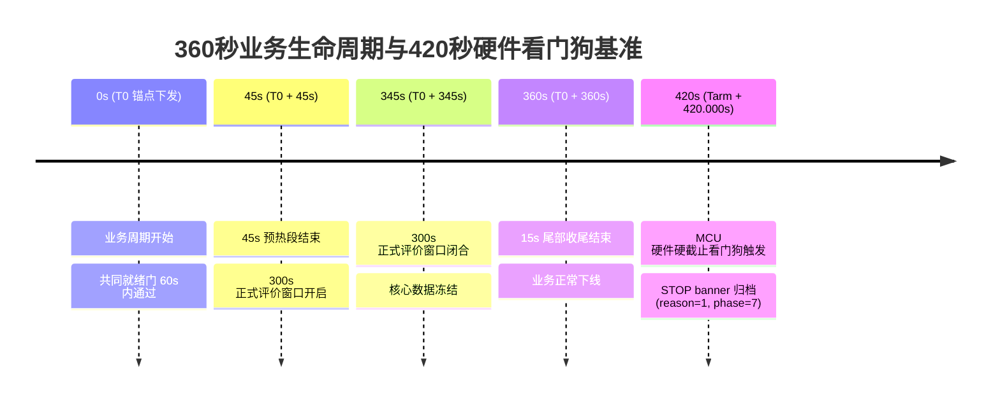

# MPM-B5｜R6 统一物理工况矩阵与冻结基线方案 (R6-UNIFIED-OPERATING-MATRIX.proposed)

- **文档版本**: v2.0-P0B
- **基线 Commit SHA**: `2854d3581658a91d65c1aa30d827ff489ff0f081`
- **审计提交 Commit**: `8954c8ea96af1eda99f00b927f19fecab3cc3215`
- **审计分支**: `audit/b5-r6-p0b-20261030`
- **repo_ref**: `Serendipity-min/medical-multi-parameter-monitor:node-b/docs/B5-R6-P0B/R6-UNIFIED-OPERATING-MATRIX.proposed.md`
- **source_sha256**:
  - `node-b/evidence/B5-GEMINI-R5/ECG60-WINDOW-01/criteria.json`: `962a830ff5f28e8f46e376ab2db11208561a41500d884701fe9d834b5a7b22c6`
  - `node-b/evidence/B5-GEMINI-R5/TEMP_OBJECT-WINDOW-01/criteria.json`: `92b94f9a5491d88ac87500f99f6fb6dc2423388dcbf7f8f883cddcaa3cc02def`
  - `node-b/evidence/B5-GEMINI-R5/RR15-WINDOW-01/criteria.json`: `172227b905524397c7c7ab17b237e0a8d1f07892c7997d58285d64e40bb724ee`
- **review_tool_sha256**: `14838db66a5142f24a010109de6f67a76d4f386a0b3914afb5b32b9a751dda91`
- **evidence_type**: `PROPOSED_MATRIX_DRAFT` / `BENCH_SPECIFICATION`
- **verified_by**: Gemini (Antigravity) 独立审计复核
- **unresolved_items**: 模拟仪物理阻抗标定与无线空口抓包设备待现场落实，标记为 `OPEN_TECHNICAL_QUESTION`

---

## 1. 统一批次原则与“禁止边测边改”铁律

为确保 R6 阶段所有三个模式在同一严密基准下执行，彻底根绝“测一个改一个”的工程违规，全系统遵守以下不可违背之原则：

1. **唯一单一批次冻结**：R6 将在统一批次标识符（`R6_BATCH_ID`）下固化软硬件、接线、工具与判据。任一元素变动均导致批次失效，严禁在同一批次内动态修改配置。
2. **三模式全量前置评审**：三个 profile 的工况与所有反例回执必须在实板测试前由 PI 集中一次性签发，严禁通过修改判据来获取虚假合格。
3. **推荐执行序列**: `TEMP_OBJECT` $\rightarrow$ `RR15` $\rightarrow$ `ECG60`（优先验证确定性高的时钟/接线通道，最后验证网络稳定性）。
4. **单次尝试不可逆**: 每个模式只允许一份独立一次性授权、一次冷态启动、一次复位和一次 `B5START`（`retries = 0, start_max = 1`）。任何意外中断均直接消费令牌并停机，不原地重试。

---

## 2. 三模式全物理工况矩阵表

| 模式标识 | 模拟仪设置 (SKX-2000D+) | 导联/探头端子连接 | 电源与冷态准入门槛 | 核心判定通过基准 (Criteria) | 失败即熔断条件 |
|---|---|---|---|---|---|
| **`ECG60`** | 心率: **60 bpm** 呼吸: 关闭 (0 bpm) 幅值: 标称 1.0 mV 起搏: 关闭 | 5 导联专用屏蔽电缆： RA $\rightarrow$ 右上肢端子 LA $\rightarrow$ 左上肢端子 LL $\rightarrow$ 左下肢端子 RL $\rightarrow$ 右腿驱动参考 V1 $\rightarrow$ 胸导联 | 必须在采前完全冷断电重启； Gateway-C 预检有效期 **$\le$ 3,600s**； 专属 2.4G Wi-Fi 覆盖（信道 6，<1m） | 300s 评价期； 连续 ECG 点数 $\ge$ 74,250； HR 有效且在 `[58, 62]` 范围； **RR 必须全程 INVALID/null**； C 诊断最大间隔 $\le$ 8.0s； WSS 波形批次 $\ge$ 742； 0 REPLAY，0 队列过期。 | C 诊断停顿 > 8.0s； WSS 波形缺批； 出现 REPLAY 数据； 队列出现 expired > 0。 |
| **`TEMP_OBJECT`** | 模拟仪关闭。 使用室温稳定的非人体物体表面（禁止手持或测体温）。 | GY-641 探头平稳固定在物表上方 2~3 cm； USART4 串口线平直，避免与电源线平行。 | 上电冷启动；探头静置 5 分钟达到热平衡； 禁止在测试窗口内触碰探头或产生强气流； 一次性令牌原子消费。 | 300s 评价期； 有效温度标量 $\ge$ 295 条； 物表量在 `[0, 10000]` centi-degC； **严格满足 `[-10, 2500] ms` 判据**； UART4 帧校验 0 错误； **不宣称人体体温绝对精度**。 | 诊断 age < -10ms 或 > 2500ms； 有效标量 < 295； UART 校验和错误递增。 |
| **`RR15`** | 呼吸率: **15 bpm** (严格废除 30bpm 笔误) 心率: 关闭 (0 bpm / Lead-Off) | 4 导联专用金属编织屏蔽电缆： RA $\rightarrow$ 呼吸注入 (+) LL $\rightarrow$ 呼吸调制回路 (-) LA $\rightarrow$ 悬空/接平线端子 RL $\rightarrow$ 模拟仪公共参考地 | 采前断电状态下规范接线； 模拟仪参数前置屏幕双人复核； 单次物理复位确认。 | 300s 评价期； 连续 RESP 点数 $\ge$ 14,850； RR 有效且在 `[14, 16]` 范围； **HR 全评价期必须为 INVALID/null (0 秒容忍)**； 0 队列过期。 | 出现任何非零/有效心率； RR 偏离 `[14, 16]`； WSS 快照心率有效。 |

---

## 3. 三模式公共准入与生命周期时标门

- **预热段**: 严格为 `[T0, T0 + 45s)` (45,000 ms)；
- **评价段**: 严格为 `[T0 + 45s, T0 + 345s)` (300,000 ms)；
- **尾部段**: 严格为 `[T0 + 345s, T0 + 360s)` (15,000 ms)；
- **MCU 硬截止**: 自 `B5START ARMED` 起算的 **420.000s** 硬件看门狗，绝对禁止混淆为 `45 + 300 + 15 = 420`。
- **公共判据底线**:
  - `B_min_saved >= 590` 帧；
  - `WSS_min_saved >= 2900` 个快照；
  - `scalar_min_messages >= 295` 条；
  - SNTP 时钟偏差 $\le 1500$ ms；
  - Gateway-C 预检有效期 **$\le 3,600$ s**（严禁沿用 R5 的 86400s 特许）。

---

## 4. 允许的采前冷态操作 vs 冻结后绝对禁止事项

### 4.1 允许的采前冷态操作 (必须在断电状态执行)
1. **设备完全断电**：关闭主电源适配器，拔除 USB 调试线，放电 10 秒以上完成彻底冷重启；
2. **跨窗口导联规范切换**：在断电状态下，按照模式矩阵调整模拟仪端子接线，检查屏蔽层牢固度；
3. **模拟仪参数预核验**：开机后在模拟仪屏幕上核对心率/呼吸率设定，确认处于目标预设值；
4. **单次只读预检**：取得预检授权后执行 `preflight`，确认固件 SHA256 与启动 Banner。

### 4.2 冻结后绝对禁止事项 (触发立即中止并追责)
- **禁止执行第二次 RESET**：单次尝试仅允许 1 次合规复位，出现第 2 次立即触发 `G3_C_UNEXPECTED_REBOOT` 停机；
- **禁止发送第二次 `B5START`**：单次尝试仅允许发送 1 次 8 字节 `B5START\n` 指令；
- **禁止临场更改网络或设备接线**：测试窗口开启后，严禁插拔任何接线或切换热点；
- **禁止单方面修改 Criteria 判定规则**：严禁私自放宽门限；
- **禁止擅自修改固件或刷写 Flash**：严禁在未获 PI 单独代码整改合同前修改代码。

---

## 5. 残留技术不确定项与影响分析 (`OPEN_TECHNICAL_QUESTION`)

| 编号 | 残留不确定技术项 | 影响范围分析 | 建议控制措施 |
|:---:|---|---|---|
| **OPEN-01** | **心电电缆屏蔽层对模拟仪参考地的交流耦合阻抗未经仪器实测** | 若现场屏蔽层阻抗偏高，在呼吸调制较深时仍可能产生偶发微伏级毛刺，诱发 QRS 误检。 | 严格保持导联线平直且远离电源线；在未获批准前严禁外接接地电阻。 |
| **OPEN-02** | **ESP8266 内部 AT 阻塞与外部 Wi-Fi 空口丢包因缺乏空口抓包无法单一归因** | 若现场无线环境恶化，可能重现 8.375s 诊断断档与波形缺批。 | 采用专属 2.4GHz 独立路由器（信道 6），使用具备监听模式的网卡同步录制 pcapng。 |
| **OPEN-03** | **实板硬件芯片激光丝印未肉眼核验** | 依赖寄存器读数证实为 STM32F407，存在极端外壳重标芯片理论可能性。 | 在 R6 机器清单中明确标记 `actual_hardware_confirmed = false`，直至实板开壳拍照留档。 |

---

## 6. 审查结论

1. 建立了覆盖三个模式与公共故障的统一工况矩阵，完成合同 `GATE-08` 与 `P0B-C` 任务。
2. 明确了采前冷态允许操作与冻结后绝对禁止事项，提供了透明的残留技术问题影响分析。
3. 方案保持 `PROPOSED` 状态，待 PI 审查裁定。
