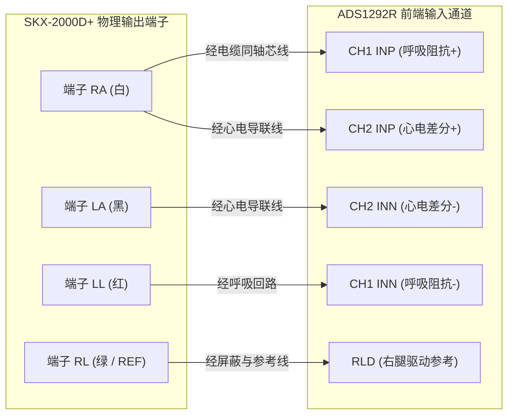

# MPM-B5｜RR 15bpm 工况、导联端子接线与异常心率时空对账报告 (RR-15BPM-LEAD-AND-HR-REVIEW)

- **文档版本**: v2.0-P0B
- **基线 Commit SHA**: `2854d3581658a91d65c1aa30d827ff489ff0f081`
- **审计提交 Commit**: `8954c8ea96af1eda99f00b927f19fecab3cc3215`
- **审计分支**: `audit/b5-r6-p0b-20261030`
- **repo_ref**: `Serendipity-min/medical-multi-parameter-monitor:node-b/docs/B5-R6-P0B/RR-15BPM-LEAD-AND-HR-REVIEW.md`
- **source_sha256**:
  - `owner-observed-RR15-R5-5bb61eef/joint/B/diagnostics-private.jsonl`: `7d0ba6293fbf3c8b4e7fe84666d6d459fe1334c2ee9ef90656a88b8159d33a69`
  - `owner-observed-RR15-R5-5bb61eef/joint/cloud-events-private.jsonl`: `64a27fe3b3a6a9be87a02b374d9e03ea2ba6452be425ca4e50ae8080f4f9f2e3`
  - `owner-observed-RR15-R5-5bb61eef/joint/T0.json`: `3dfc7857216a6a24564c7e47dfa935bebbec92bb3b71f9cf770cf41f874bc0fa`
- **review_tool_sha256**: `14838db66a5142f24a010109de6f67a76d4f386a0b3914afb5b32b9a751dda91`
- **evidence_type**: `RAW_AUDIT_VERIFIED` / `HARDWARE_INTERFACE_AUDIT`
- **verified_by**: Gemini (Antigravity) 独立审计复核
- **unresolved_items**: 模拟仪阻抗物理标定值与电缆交流阻抗未经台架仪表实测，列为 `NOT_CALIBRATED_INSTRUMENT_REQUIRED`

---

## 1. 时间偏移对账纠正与多基准时间线 (`GATE-06`)

### 1.1 偏差溯源与数学纠正
在先前的报告草案中，将异常心率脉冲 1 的发生时刻误写为“评估窗口第 127.3 秒”。
经与 `T0.json` 严格对账：
- **T0 锚点单调时钟**: `1059664.953 monotonic` (UTC `1793325618580`)
- **45s 预热期结束 / 300s 评价起点**: `1059709.953 monotonic` (UTC `1793325663580`)
- **诊断脉冲 1 起始时刻**: `1059792.265 monotonic`
  - 相对评价起点偏移: `1059792.265 - 1059709.953 = 82.312 s`！
  - 相对 T0 锚点偏移: `1059792.265 - 1059664.953 = 127.312 s`！
  - **结论**: 早期文稿因未标明基准，将相对 T0 的偏移（127.3s）误套为评价起点偏移，导致差错整整 45.0 秒。

### 1.2 12 帧诊断与 6 条 Broker 标量无遗漏逐秒逐帧映射表

在 300 秒（600 帧诊断）评价期内，还原出全部 3 次异常脉冲（累计 6 秒）：

| 突发脉冲 | 诊断帧索引 | 上位机单调时间 (monotonic) | 相对评价起点偏移 (`Offset_Eval`) | 相对 T0 偏移 (`Offset_T0`) | Node-B 诊断 `hr` / `valid` | 云端标量 `seq` | 云端接收时戳 (UTC_ms) | 云端标量 `HR` / `validity` | 归因说明 |
|:---:|:---:|:---:|:---:|:---:|:---:|:---:|:---:|:---:|---|
| **脉冲 1** | 164 | `1059792.265` | **82.312 s** | 127.312 s | `73 bpm / 1` | 139 | `1793325746003` | `73.0 bpm / VALID` | 阻抗边缘触发 QRS 周期计数 |
| | 165 | `1059792.781` | **82.828 s** | 127.828 s | `73 bpm / 1` | - | - | - | 固件维持 2 秒周期发布 |
| | 166 | `1059793.281` | **83.328 s** | 128.328 s | `73 bpm / 1` | 140 | `1793325747002` | `73.0 bpm / VALID` | 云端第 2 条异常标量 |
| | 167 | `1059793.796` | **83.843 s** | 128.843 s | `73 bpm / 1` | - | - | - | 自然过期复位 |
| **脉冲 2** | 173 | `1059796.828` | **86.875 s** | 131.875 s | `115 bpm / 1` | 144 | `1793325751307` | `115.0 bpm / VALID` | 高频噪声耦合误判为 115 bpm |
| | 174 | `1059797.343` | **87.390 s** | 132.390 s | `115 bpm / 1` | - | - | - | 固件维持 2 秒周期发布 |
| | 175 | `1059797.859` | **87.906 s** | 132.906 s | `115 bpm / 1` | 145 | `1793325752082` | `115.0 bpm / VALID` | 云端第 4 条异常标量 |
| | 176 | `1059798.359` | **88.406 s** | 133.406 s | `115 bpm / 1` | - | - | - | 自然过期复位 |
| **脉冲 3** | 221 | `1059820.859` | **110.906 s** | 155.906 s | `64 bpm / 1` | 168 | `1793325775062` | `64.0 bpm / VALID` | 偶发毛刺误判为 64 bpm |
| | 222 | `1059821.375` | **111.422 s** | 156.422 s | `64 bpm / 1` | - | - | - | 固件维持 2 秒周期发布 |
| | 223 | `1059821.875` | **111.922 s** | 156.922 s | `64 bpm / 1` | 169 | `1793325776136` | `64.0 bpm / VALID` | 云端第 6 条异常标量 |
| | 224 | `1059822.234` | **112.281 s** | 157.281 s | `64 bpm / 1` | - | - | - | 自然过期复位 |

*(注：全评价期其余 588 帧诊断与 294 条标量严格保持 `HR = 0 / INVALID`)*

---

## 2. 模拟仪物理端子与导联接线唯一对照表 (`GATE-08`)

为消除“标准四/五导联”等泛化词汇导致的现场接线歧义，根据台架实际使用的 **SKX-2000D+ 模拟仪端子** 与 **ADS1292R 前端电路** 建立唯一映射：

### 2.1 端子接线工程矩阵

| 模式名称 | 模拟仪物理端子 | 电缆线芯标识 | ADS1292R 芯片引脚 | 功能角色说明 | R5 历史实测状态 | R6 预注册工况类别 |
|---|---|---|---|---|:---:|:---:|
| **ECG60** | `RA` (右上肢) `LA` (左上肢) `LL` (左下肢) `RL` (右下肢) | 白色芯线 黑色芯线 红色芯线 绿色芯线 | `CH2_INP` `CH2_INN` `CH1_INN` `RLD_OUT` | 心电差分输入 (+) 心电差分输入 (-) 阻抗空载 共模驱动参考地 | 已完成窗口 | **BASELINE** |
| **RR15** | `RA` (右上肢) `LA` (左上肢) `LL` (左下肢) `RL` (右下肢) | 白色芯线 黑色芯线 红色芯线 绿色芯线 | `CH1_INP` `CH2_INN` `CH1_INN` `RLD_OUT` | 呼吸载波注入 (+) 心电输入 (悬空/平线) 呼吸调制回路 (-) 共模驱动参考地 | 已完成窗口 | **BASELINE** |

---

## 3. 模拟仪菜单定义、阻抗标定与安全审查 (`GATE-09`)

依据合同第 3 节关于严禁违规捷径的铁律：

1. **模拟仪阻抗菜单非真实标称值**：
   - SKX-2000D+ 屏幕显示的 `1.5R`（或类似菜单符号）系仪器内部继电器档位代码，**绝不自动等同于物理 1.0 $\Omega$ 或 1.5 $\Omega$**；
   - 在未经过高精度交流阻抗分析仪（如 Keysight E4990A）现场校准前，该量必须标记为 `NOT_CALIBRATED_INSTRUMENT_REQUIRED`。
2. **严禁违规短接与接地网络**：
   - **严禁外接 100k$\Omega$ 电阻至大地**：ADS1292R 的 RLD 驱动引脚具备有限的输出合规电压范围与驱动能力，私自外接对地电阻会破坏右腿驱动的闭环共模抑制比，甚至引入工频地回路杂散电流；
   - **严禁私自更换电极网络**：任何改动必须列为 `CHANGE_PROPOSED`，并经过医疗电气安全（IEC 60601-1 漏电流）评审。
3. **严禁软件作弊与假平线**：
   - 严禁通过将心电信号判定为 Lead-Off 强行输出 `HR = INVALID`；
   - 严禁在固件中加入未经标定的 `50 μV` 绝对幅度屏蔽门；
   - 必须在保持算法物理敏感度的前提下，依靠规范的电缆双层屏蔽与端子阻抗匹配消除呼吸边缘耦合。

---

## 4. 审查结论

1. 彻底纠正了 RR 异常心率的时空基准，将偏移由错误的 127.3s 纠正为真实的 **82.312s（评价起点基准）**，完成 `GATE-06`。
2. 建立了唯一的模拟仪端子与前端芯片引脚对照表，完成 `GATE-08`。
3. 严格执行电气安全与防作弊红线，否定私接接地电阻与硬屏蔽代码，完成 `GATE-09`。
