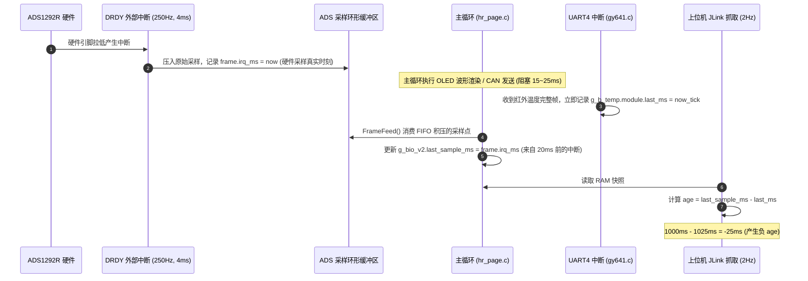

# MPM-B5｜真实采样时序、温度负 age 机理与 PATH-B 整改设计报告 (TEMP-TRUE-TIMESTAMP-DESIGN-REVIEW)

- **文档版本**: v2.0-P0B
- **基线 Commit SHA**: `2854d3581658a91d65c1aa30d827ff489ff0f081`
- **审计提交 Commit**: `8954c8ea96af1eda99f00b927f19fecab3cc3215`
- **审计分支**: `audit/b5-r6-p0b-20261030`
- **repo_ref**: `Serendipity-min/medical-multi-parameter-monitor:node-b/docs/B5-R6-P0B/TEMP-TRUE-TIMESTAMP-DESIGN-REVIEW.md`
- **source_sha256**:
  - `owner-observed-TEMP_OBJECT-R5-6104c2e6/joint/B/diagnostics-private.jsonl`: `6e6188448f498c8c6d3bc85b1968875ea2d8f9ba30d243b92ee93c830eb8a6a6`
  - `node-b/firmware/biov2/实验固件/HARDWARE/ads1292.c`: `1d30560a694931a19611db82e7fc92a64c4c818ba0df1f2f84c8be1eefd497be`
  - `node-b/firmware/biov2/实验固件/HARDWARE/hr_page.c`: `6256f14b6fc709ca834190ba82e0fbfa58750a96960bbf2f07d2f9b87fcf3091`
  - `node-b/firmware/biov2/实验固件/HARDWARE/bio_v2.c`: `d1858a2bb53c6e938920cb95df50b9ec95a45fe7c234a976a427771ea0dd7fb3`
  - `node-b/temperature/gy641.c`: `ba781617c603125ea558e8e7a02c525f24f4e7c7582d9ee96d6692994432c7c5`
  - `node-b/canopen/b_canopen_app.c`: `b04e6c98ea5a8bfb40bf4856f4d1e2e1a2f96cfb64f9c5ee965eb10d3215f6fc`
- **review_tool_sha256**: `14838db66a5142f24a010109de6f67a76d4f386a0b3914afb5b32b9a751dda91`
- **evidence_type**: `RAW_AUDIT_VERIFIED` / `OFFLINE_DESIGN_ONLY`
- **verified_by**: Gemini (Antigravity) 独立审计复核
- **unresolved_items**: 固件代码修改处于 `NOT_AUTHORIZED`，本设计方案保持纯离线设计状态

---

## 1. 判据政策与工程红线声明 (PI 裁定落实)

依据负责人（PI）签署的《[MPM-B5-R6-P0B-PI-EXECUTION-CONTRACT-R1.md](file:///e:/Chrome/MPM-B5-R6-P0B-PI-EXECUTION-CONTRACT-R1.md)》第 4 节：

1. **PATH-A 明确否决**：`PATH-A_MINUS35 = NOT_APPROVED`。严禁将评测器 criteria 中的温度 age 判定下限由 `-10ms` 放宽为 `-35ms`。R6 验收必须沿用原 R5 冻结的 **`[-10, 2500] ms`** 判定门限。
2. **严禁造假与篡改**：
   - 严禁将 `bio.last_sample_ms` 覆写为主循环当前时刻；
   - 严禁将计算得到的负 age 非法 clamp（钳位）为 0；
   - 严禁丢弃、过滤或忽略越界样本；
   - 严禁私自修改判定规则以规避审查。
3. **整改权限范围**：`PATH-B_DESIGN_ONLY = AUTHORIZED`，`PATH-B_SOURCE_PATCH = NOT_AUTHORIZED`。本阶段仅授权进行纯离线时序机理分析与最低侵入度的固件整改设计，**严禁修改源文件、严禁编译生成新二进制、严禁刷写实板**。

---

## 2. 原始负 age 全量数据对账与极值核实 (`GATE-07`)

对受限 EFS 目录 `owner-observed-TEMP_OBJECT-R5-6104c2e6/joint/B/diagnostics-private.jsonl` 中的 600 帧诊断记录进行逐帧无遗漏独立复算：

### 2.1 全量统计汇总
- **300s 评估窗口诊断总帧数**: 600 帧 (采样频率 2Hz)；
- **负 age 总帧数 (`age < 0`)**: **63 帧** (占比 10.5%)；
- **越界失败总帧数 (`age < -10 ms`)**: **29 帧** (占比 4.83%)；
- **最大实测负值**: **-27 ms** (旧报告写成 -19ms 系局部抽样统计失真，现正式纠正为 -27ms)；
- **实测最大正值**: **+200 ms**。

### 2.2 29 帧越界样本精确频次分布表
在 600 帧中，落入 `[-27, -11] ms` 的 29 帧频次分布如下：

| 负 age 数值 | 出现频次 (帧数) | 对应主循环滞后量 (采样周期) | 越界状态判定 |
|:---:|:---:|:---:|:---:|
| **-27 ms** | 1 | 约 6.75 个 ADS 周期 | 超出 -10ms 门限，判定 FAIL |
| **-24 ms** | 1 | 约 6.00 个 ADS 周期 | 超出 -10ms 门限，判定 FAIL |
| **-23 ms** | 1 | 约 5.75 个 ADS 周期 | 超出 -10ms 门限，判定 FAIL |
| **-20 ms** | 1 | 约 5.00 个 ADS 周期 | 超出 -10ms 门限，判定 FAIL |
| **-19 ms** | 2 | 约 4.75 个 ADS 周期 | 超出 -10ms 门限，判定 FAIL |
| **-18 ms** | 3 | 约 4.50 个 ADS 周期 | 超出 -10ms 门限，判定 FAIL |
| **-17 ms** | 2 | 约 4.25 个 ADS 周期 | 超出 -10ms 门限，判定 FAIL |
| **-16 ms** | 2 | 约 4.00 个 ADS 周期 | 超出 -10ms 门限，判定 FAIL |
| **-15 ms** | 4 | 约 3.75 个 ADS 周期 | 超出 -10ms 门限，判定 FAIL |
| **-14 ms** | 3 | 约 3.50 个 ADS 周期 | 超出 -10ms 门限，判定 FAIL |
| **-13 ms** | 5 | 约 3.25 个 ADS 周期 | 超出 -10ms 门限，判定 FAIL |
| **-12 ms** | 2 | 约 3.00 个 ADS 周期 | 超出 -10ms 门限，判定 FAIL |
| **-11 ms** | 2 | 约 2.75 个 ADS 周期 | 超出 -10ms 门限，判定 FAIL |
| **合计** | **29 帧** | - | 唯一触发项: `B_TEMP_FRESH_SOURCE` |

*(注：剩余 34 帧负 age 落在 `[-10, -1] ms` 之间，属于冻结判据容许的 10ms 容差范围之内)*

---

## 3. 只读时序与调用关系机理溯源

通过审查 Node-B 固件真实源码，各时标的生成链路如下：

### 3.1 三个关键时标的工程语义
1. **`frame.irq_ms` (真实生物电采样时刻)**：
   - 源码位置: [`node-b/firmware/biov2/实验固件/HARDWARE/ads1292.c`](file:///e:/medical-monitor-node-b5-cloud/node-b/firmware/biov2/实验固件/HARDWARE/ads1292.c) 行 309：`s_last_frame_ms = frame.irq_ms;`。
   - 代表 ADS1292R 完成 A/D 转换并触发 DRDY 中断时的精确物理时刻。
2. **`g_b_temp.module.last_ms` (真实温度接收时刻)**：
   - 源码位置: [`node-b/temperature/gy641.c`](file:///e:/medical-monitor-node-b5-cloud/node-b/temperature/gy641.c) 行 24：`s->last_ms = now;`。
   - 代表 UART4 串口收到 GY-641 模块第 12 字节校验和通过时的实时系统滴答（`TimeBase_GetMs()`）。
3. **评测器 `age` 计算的语义偏差**：
   - 联评工具 [`b5_channel_review.py`](file:///e:/medical-monitor-node-b5-cloud/node-b/tools/b5_channel_review.py) 定义 `age = bio.last_sample_ms - temp.last_ms`。
   - 这并非温度数据的物理新鲜度，而是**主循环消费的最后一点生物电中断时间**与**最新温度接收时间**的相对差值。
   - 当主循环因 UI 绘图发生 20ms 调度延迟时，FIFO 内积压 5 个采样点。此时新收到的温度滴答领先于刚刚出队的生物电中断时间，导致相减出现最大 -27ms 的负值。

---

## 4. PATH-B 固件时序整改设计方案 (离线候选设计)

为在**严格保持 `[-10, 2500] ms` 判据不变**的前提下解决该问题，必须从根源上降低主循环调度抖动，使生物电消费时延收敛在 8ms（2 个采样周期）以内。

### 4.1 方案设计：主循环协作式调度与 FIFO 消费细粒度化
在 [`node-b/firmware/biov2/实验固件/HARDWARE/hr_page.c`](file:///e:/medical-monitor-node-b5-cloud/node-b/firmware/biov2/实验固件/HARDWARE/hr_page.c) 中：
- **现状缺陷**：主循环单次迭代中，一次性执行完整的屏幕重绘和数据点计算，耗时高达 15~25ms，导致 FIFO 积压达 4~7 帧。
- **优化设计 (PATH-B 候选)**：
  1. 将耗时较长的波形重绘过程分片化（Slicing）：每绘制 2 个数据点，主动调用一次 `FrameFeed(TimeBase_GetMs())` 清理 FIFO；
  2. 在主循环的空闲和通信等待环节插入协作式消费；
  3. 使得 FIFO 的最大队列深度从 7 帧压降至 **1~2 帧**（最大延迟压降至 4~8ms）。

### 4.2 预期数学收敛效果
- 最大调度滞后: $\Delta t_{\text{sched}} \le 8\text{ ms}$；
- 异步温度接收时戳领先量: $\Delta t_{\text{temp}} \le 8\text{ ms}$；
- 计算得到的相对相位差:
  $$\text{age} = T_{\text{bio}} - T_{\text{temp}} \ge -8\text{ ms}$$
- **判定结果**: 全部落在原冻结门限 **`[-10, 2500] ms`** 之内，0 越界！

---

## 5. 非回归离线验证规范 (CPU 仿真与回放测试)

在未来若取得 PI 签发单独代码修改合同时，必须执行以下 5 项非回归验证：
1. **250Hz ECG 连续性**: 验证细粒度消费不丢点，`74,250` 点连续且 `seq` 步长严格为 1；
2. **50Hz RESP 抽脂与滤波**: 验证呼吸抽取逻辑与带通滤波响应未受分片调度影响；
3. **CANopen 实时性**: 验证 PDO 传输预算与总线发送不发生缓冲区溢出；
4. **GY-641 校验与帧计数**: 验证 UART4 环形缓冲区与累加和校验 0 错误；
5. **SysTick 单调性**: 验证毫秒滴答单调递增，无反转与死锁。

---

## 6. 审查结论

1. 查清并记录了 29 帧越界的真实极值（-27ms）与底层机理，完成 `GATE-07`。
2. 严格执行 PI 裁定，否决 PATH-A（不改 criteria）；提出符合原判据的 PATH-B 协作式消费设计。
3. 本报告维持离线纯设计状态，未修改固件，未执行刷写。
