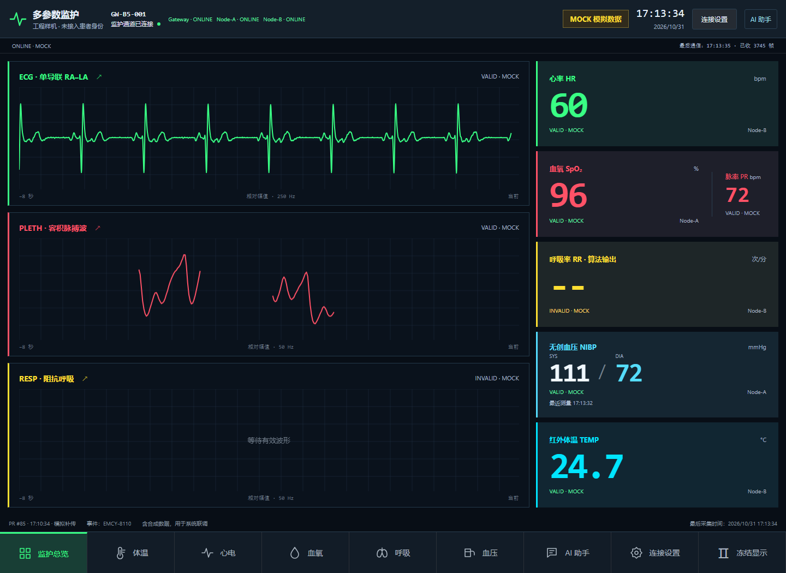
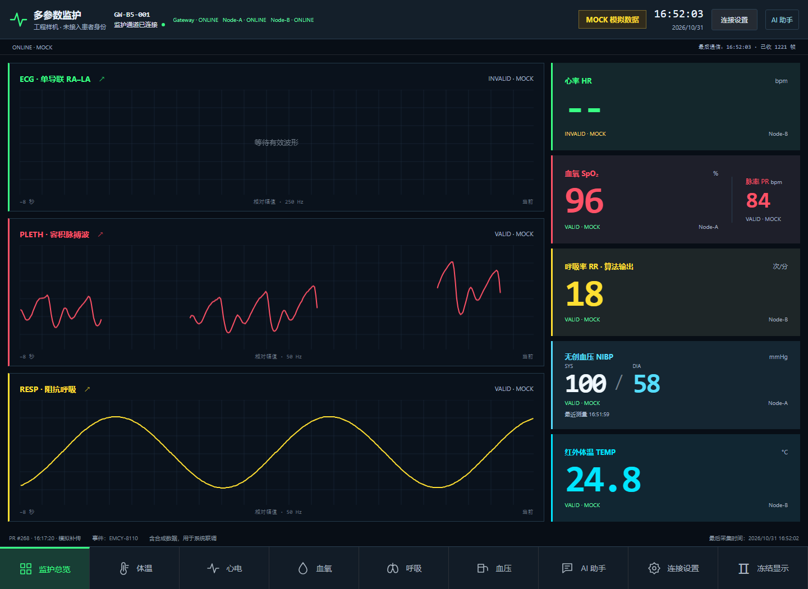

# A/B/C 两组实板联动与B温度屏回执（2026-10-31）

两组非人体端到端链路均为 **ENGINEERING_PASS / exit0**。随后按负责人追加指令安装B温度屏补丁，完成B-only显示及采样组件检查。此交付是独立候选分支，不是最终统一镜像或正式合并。

## 两组真实链路

实装组合为 **A42608 / B41012 / C44520**。两段独立500kbps CAN（A→C CAN1、B→C CAN2），初次断电终端检查由负责人报告均约60Ω。Gateway-C、MQTT Broker、Backend、真实WSS及网页均实际运行；没有向浏览器注入传感器数据。每组45秒预热、300秒评价及15秒尾段，C业务硬停止420秒。

| 组别 | 真实原码匹配 | 温度源匹配 | A屏与网页新血压 | Backend接收 | 拒绝/丢弃 | 采集/联评退出码 |
|---|---:|---:|---:|---:|---:|---|
| ECG60 | 74993点 | 300/300 | 111/72 mmHg | 3496 | 0/0 | 0/0 |
| RR18 | 15000点 | 300/300 | 100/58 mmHg | 3561 | 0/0 | 0/0 |

- ECG60：ADC 249.975 Hz，物体温度24.51–30.29℃，实际WSS评价快照2967份。
- RR18：ADC 249.987 Hz，物体温度24.54–30.98℃，实际WSS评价快照2967份。

波形通过B实际ADC帧/IRQ时间与实际CAN队列重建，核对块SHA、采样序号、原始状态和数值；250Hz ECG、50Hz RESP的原判据及时间戳未改。温度逐条核对原始UART校验和、C入口、Broker及WSS。血压分别为本组新完成结果，匹配A完成tick/boot/seq/packed SYS-DIA及负责人报数；90秒后过期清空得到实见。A/B均在线，前会话失效流保持清空，没有用旧值续活。

血压源为HKB-08B+与负责人确认的非人体安全气路，由负责人手动开始；没有进行UART5帧注入或自动充气。压力准确度无独立校准真值，本次通过的是报数及链路一致性。温度为GY641协议的原始物体温度To，未标定为人体体温。SpO₂97%/PR86仅为负责人提供的动态参考，不作为同步精度验收。

C的STOP均为420000ms、reason1、phase7、unsynced0、pending0。源端STOP快照仍含live/cache项，不代表所有RAM队列为空；正式评价时段外的停止尾部未冒充完整送达。停止后的离线状态也已观察，最终由负责人断电。

实际网页证据：

## 发现、修复及保留失败

- 第一启动被负责人意外断电/复位打断，退出1；原码约664ms周期、HR90，未冒称ECG60，也未判成固件自发复位。
- 第一完整ECG60窗口采集退出0、联评3：温度入口诊断丢失，另有两次三读跨过发布更新。保留原件和NOT_PASS。ABC诊断允许在AT同步但PUBACK待确认的空档输出；温度观察上限改四读，仍须连续完整发布身份一致、校验正确，不删除坏原件。
- 第一完整RR18窗口采集退出0、联评3：101/2967 WSS快照的TEMP源龄超过原5秒限制而STALE。确认A最新值保留旧队位会超越较旧B标量；仅ABC同级标量按原时间排序，保持状态优先、波形公平轮转、ACK规则、数值/ABI/时间戳及5秒阈值。后续两组复测均通过，旧失败不改写。
- 后续ECG60一次启动前等待退出1：已过期的可选PPG误阻塞新会话；修正只忽略已失效的A可选流，旧会话若有效仍拒止。定向7项Host检查退出0，原尝试未进入评价。
- C一次更新前只读发现系统ROM，退出1且无目标写入；负责人手动复位后，只读确认Flash运行、双读一致才安装。J-Link转接关联属于现场判断，ROM根因仍未独立确认。
- COM缺失启动在SDK/串口/START之前退出1，接回C USB_UART后恢复。浏览器守护进程EOF及系统代理转发失败均保留；后续独立Playwright上下文显式绕过代理，TLS/WSS真实鉴权，不改系统代理、不忽略证书。

实际网络主程序的诊断饥饿反例旧版退出3、新版退出0；旧队位反例退出3、原时间排序退出0。真实CoreMQTT三次停顿300秒、错误ACK及过载负例退出0；相关ARM构建、双CAN驱动及入口检查通过。没有重复65+17历史算法测试。各次原生日志、原始ADC/UART/Flash/UID及敏感配置均在本地受限EFS，Git仅含必要脱敏回执。

## 追加B独立温度屏

旧工程`hmi.c/tem_page.h`及负责人确认定位到USART3 PB10/PB11、独立温度屏0/10；B41012B原先只有HR/RR屏输出。新增可选`--temp-screen`构建，通过现有GY641解析与厂商HMI编码更新物体温度，过期/缺失清空，避免沿用36.5。三个真实解析器→显示→协议Host检查退出0，ARMCC构建0错误/0警告、exit0。

负责人授权今天主链路结束后B-only安装。新B41516仅写应用sector0/1/2，写后完整读回、身份及分区外/Options验证通过，安装退出0。实际RAM地址移动4字节，独立profile和后续入口已绑定新AXF/符号，未沿用旧地址；离线绑定检查没有SDK/串口/START。

15秒B-only检查31份诊断：**exit0、249.967Hz**，ADC/SPI/队列/长间断新增错误均0，HR均60。负责人目视温度屏实时25.6/25.7交替、HR屏60，与同次To25.58–26.01℃及一位小数编码一致。这里只恢复主页实测值/状态，示例统计清空；未声称完整历史趋势、温度设置/暂停或临床报警恢复。

**B41516没有重新进行两组CAN/云复验。** 两组全链路结论仍明确归属B41012B；B41516通过的是追加的本地显示/采样检查。最终统一镜像或正式合并前应另行安排当前三板版本回归，不自动进入下一阶段。

## 当前镜像与收尾

| 对象 | 当前字节数 | BIN SHA256 |
|---|---:|---|
| A恢复候选 | 42608 | `953c6acc23dcbfcd5a30f138b03f8a6de9430637b0da5477afb2f09b3f431eeb` |
| B两组主链路版本（历史） | 41012 | `1dbbf27177caa429f037ac72c43581a519e8ff70ac6224411c9c4ffe9529432d` |
| B当前温度屏候选 | 41516 | `e452c2eafd07868c642c530c09c7ec31b07f919cb41886c849fe84b817644fcd` |
| C当前双CAN/诊断/队序候选 | 44520 | `5f4690eca0a00334ff1a9b653be2a0b99cba034b869ae4592dd36a042a147442` |

负责人确认板卡、屏及温度模块全断电；C USB、J-Link电脑端拔出，板端J-Link留B，L留LA，B↔C CAN维持B-only隔离状态。停止本任务独立Backend/TLS单元及浏览器转发；SSH退出0，正式服务活跃、PID及所有配置/ACL校验保持不变。原测试账户保留，未做正式云配置修改。

保留问题：旧RR24-R2 108/120、RR30-R1 94/120、旧TEMP180异常、RR模式HR源真值SOURCE_UNKNOWN/ROOT_CAUSE_UNRESOLVED、ROM成因及SDK原生Open/Close残余影响、绝对温度/压力/电压标定、B41516三板复验。没有模式强制屏蔽HR、伪造Lead-Off或更改旧冻结评测结果。

结果回执见本目录JSON；原始受限档案入口在本机忽略文件`node-b/build/abc-two-group-pointer.json`。源码位于`codex/abc-two-group-integration-20261031`，未合并、未发布最终统一包。
