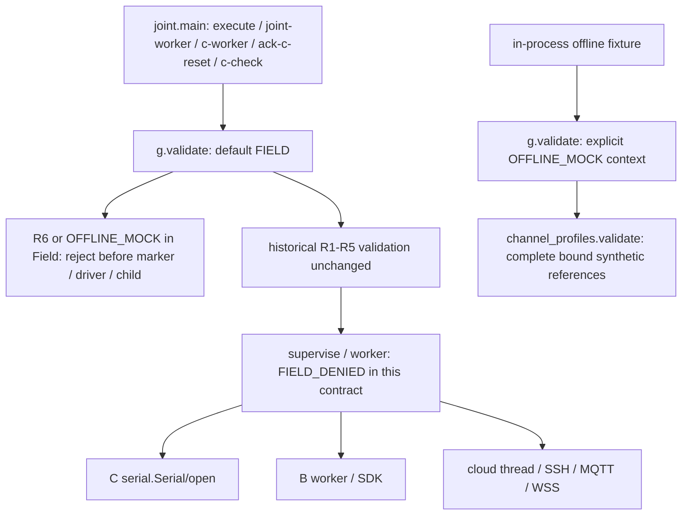

# G3 真正入口与拒止链

基线逐函数依据见 [ENTRY-DOSSIER](audit-context/ENTRY-DOSSIER.md)，修复前表见 [修改前审查](CODEX-R6-PATCH-PREIMPLEMENTATION.md)。

`execution_context` 是调用方显式参数，不能由授权JSON自选。现场CLI未增加Mock参数；所有既有现场CLI仍调用默认FIELD。R6在FIELD下无条件拒止，因此不存在本轮自填`pi_signature=ok`、nonce或field标志就能放行的分支。Profile直接调用同样默认拒止R6。

定向测试在内存中调用真实main，授权读取、工人、保存/子进程被替身封锁；未运行真实现场命令。五种入口均返回1，未触发设备构造、START、标记写入或工人启动。真实G3→Profile离线阳性沿全部绑定检查通过，结论只为PASS_MOCK。不是完整300s联合成功流程或真实E2E通过。

## 尚未实现的真实授权设计

`TRUSTED_PI_VERIFIER = DESIGN_PROPOSED`。未来需由PI另行选择和冻结仓库外授权信任根，核对固定Git树、完整制品/工具/DLL清单、板卡私有身份、scope、时效、唯一nonce和原子消费。不能把非空文本、普通摘要或应用自身写出的文件当签署。现有worker仅检查`.used`存在的行为也不能证明其内容、nonce和父授权匹配。

本轮不引入签名基础设施、不写真实token，不将`OFFLINE_MOCK`视作驱动沙箱。内部joint_worker/b_worker/c_preflight/cloud.run仍依赖调用者；不可绕过入口直接调用。151项测试运行器设置外层拒止护栏，并明确它不是对抗任意恶意Python代码的OS沙箱。新的可信授权和P1-B独立入口未完成前保持NO-GO。
