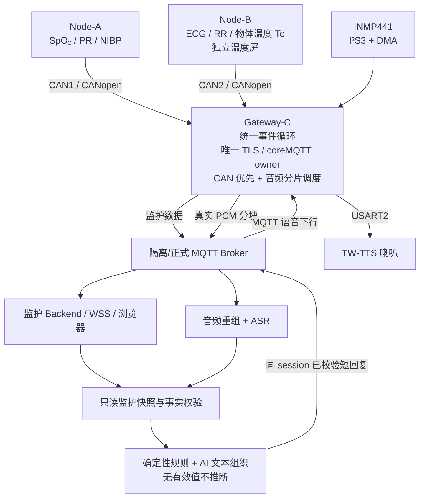

# FINAL-P2｜多参数监护仪三板 + 语音统一集成执行合同（简化版）

> **制定日期**：2026-11-02  
> **性质**：交给 Codex/现场人员执行的下一阶段开发与验收合同；**本文件不代表代码已整合或实板已通过**。  
> **目标仓库**：[Serendipity-min/medical-multi-parameter-monitor](https://github.com/Serendipity-min/medical-multi-parameter-monitor)  
> **唯一建议开发起点**：`codex/final-system-20261102`，`baccc7bc6ca2a14da6779664eead919a3240ccf4`（执行时先核对分支 HEAD 是否有更新）。  
> **推荐开发分支**：`codex/final-unified-c-runtime`（从上述 HEAD 新建；不覆盖原分支）。  
> **当前现场**：A/B/C、模块均断电；现装 A42608 / B41516 / C44520；C 已恢复原双 CAN 固件；没有统一镜像，没有合并 `main`。

## 0. 执行结论

**从 FINAL-P1 的未完部分继续，不重启 FINAL-P0。** 下一步不是重新检查电容、电阻或重复单板 ASR/STOP，而是将双 CAN、麦克风、音频上行、AI 回复、TW-TTS 统一为 **C 板的一套可实际运行固件**，然后依次做 **C 单板 → B41516+C → A42608+B41516+C** 的实机验收，最后制成三板版本配套的发布包。

本轮采用**轻量验收**：一次离线构建与针对性回归、每个层次一次有效实机验收，失败只修对应缺陷后复测；记录 `PASS / NOT_PASS / DEFERRED`、版本、关键观测及一份简明报告。**不设置 PI 签发、nonce、每轮哈希审批、测试次数配额或额外 Security Gate**。刷写前的身份、已有完整备份、目标扇区范围核对属于必要硬件保护，不是重复的软件门禁。`main` 合并和最终正式生产云服务替换另行决定。

## 1. 已有成果：直接复用，不再重复证明

| 组件/试验 | 已取得的真实状态 | 下一轮需要做什么 |
|---|---|---|
| A42608 | A 全片 Flash、Options、身份和已知恢复点复核通过 | 保持当前功能；用于最终现场血压/血氧测试 |
| B41516 | 含独立 USART3 温度屏，B-only 实采/屏幕检查通过；显示 25.6/25.7、HR60 | 必须补新 B 的 B+C、A+B+C 云端验收 |
| C44520 | 双 CAN 当前基线，完整恢复一致 | 作为 C 新固件回滚点 |
| 旧三板数据链路 | ECG60、RR18 两组均 `ENGINEERING_PASS`；但当时是 **A42608+B41012+C44520** | 不重做旧版全部回归，改验当前 B41516+新 C |
| C INMP441 | 本地录音、C 直传 125 块/64000 B、ASR、AI 简短确认、TW-TTS 人工可闻，独立台架 PASS | 并入 C 双 CAN 程序；不把单板 PASS 冒称并发 PASS |
| C STOP | C-only 取得 `STOP → 0x41 ACK → 0x21 查询 → 0x4F IDLE`，三场真实运行退出 0 | 不再独立重复证明；只测试新统一程序中的中断、断网和并发停止 |
| C 静态合体 | MIC/TTS 完整 API + 双 CAN 链接通过，48KiB 应用余 **216 B**；普通 SRAM 静态余 **18,344 B**；PCM=64,000 B 在 CCM，DMA=2,560 B 在普通 SRAM | **仍未链接音频 MQTT 上行/现场控制，不能烧录或当作运行成功** |
| 云端监护事实提取 | 已有 `cloud/ai/snapshot.py`、`cloud/ai/facts.py`；服务端核对源、有效性、时间戳 | 复用接入语音问题，明确后端实际部署版本 |

特别说明：`P1-STATUS.md` 曾记录 SRAM 余 18,216 B，但更新的结构化 `P1-C-AUDIO-LINK-PROBE.json` 和当前截图为 **18,344 B**。不必专门重复旧审计；**以新整合固件重新生成的 ELF/map 为最终数值**。

**依据**：

- [最终进度](https://github.com/Serendipity-min/medical-multi-parameter-monitor/blob/codex/final-system-20261102/node-b/docs/FINAL-SYSTEM-20261102/CURRENT-RESULTS.md)、[P0 只读基线](https://github.com/Serendipity-min/medical-multi-parameter-monitor/blob/codex/final-system-20261102/node-b/docs/FINAL-SYSTEM-20261102/P0-STATUS.md)、[P1 STOP/静态链接](https://github.com/Serendipity-min/medical-multi-parameter-monitor/blob/codex/final-system-20261102/node-b/docs/FINAL-SYSTEM-20261102/P1-STATUS.md)
- [最新内存/Flash 实测清单](https://github.com/Serendipity-min/medical-multi-parameter-monitor/blob/codex/final-system-20261102/node-b/docs/FINAL-SYSTEM-20261102/P1-C-AUDIO-LINK-PROBE.json)
- [旧两组三板真实联动](https://github.com/Serendipity-min/medical-multi-parameter-monitor/blob/codex/final-system-20261102/node-b/docs/CODEX-ABC-TWO-GROUP-20261031/TEST-REPORT.md)、[B41516 温度屏实测](https://github.com/Serendipity-min/medical-multi-parameter-monitor/blob/codex/final-system-20261102/node-b/docs/CODEX-ABC-TWO-GROUP-20261031/B-TEMP-SCREEN-FIELD-RESULT.json)
- [C 麦克风/AI/TTS 独立成功记录](https://github.com/Serendipity-min/medical-multi-parameter-monitor/blob/codex/final-system-20261102/node-b/docs/CODEX-C-INMP441-20261102/VOICE-RESULTS.md)

## 2. 最终目标架构

**固件原则**：C 的双 CAN、ESP8266/TLS、coreMQTT、MIC 和 TTS 共用同一个系统节拍、连接上下文及串口/中断所有权；A/B 原采集和屏幕程序保持不变，除非实测发现明确缺陷。B 的 USART3 温度屏与 C 的 USART3 ESP 是**两块不同 MCU**，不能误判为同板管脚冲突。

## 3. 工作授权边界（简单且明确）

允许 Codex 自主完成：分析源代码、最小改动、离线编译、针对性 Host 测试、创建开发分支、复用已有上传与回退工具、启动/停止任务专用隔离云服务、修复失败并复测、整理报告和推送开发分支。

涉及实物时遵守以下四条即可：

1. 现场保持断电直到人员按实施顺序接线。**已确认的麦克风电容、电阻数值不再重复核对**；首次恢复 MIC 供电只核实当前实际接线/3.3V/参考地、是否与板载外设占用冲突，不带电插拔。未知 PCB/外部电路不写成“已验证”。
2. 每块板安装新候选时，只需用已有工具确认 **板卡身份 + 当前完整回退备份 + 实际将擦写的扇区**；不再无意义地重复全盘哈希/PI 文件审批。正常运行期间避免使用会改变 CPU 运行状态的 SDK/J-Link；有条件时用 USB-UART/网络只读观察。
3. **sector3（0x0800C000—0x0800FFFF）与 Options 必须保留**。不能因为 sector4 先前读取为全 FF，就擅自扩大写入范围。若确需写 sector4，先交付一次明确的分段布局和安装范围，由负责人**一次性确认后**再执行，不对每次软件测试重复授权。
4. 不修改正式 Broker ACL、生产云服务、旧冻结评测结论；禁止自动启动人体血压测量或自动气泵加压。血压由负责人在既有**非人体安全气路**中手动触发。

## 4. 执行阶段与交付

### FINAL-P1B｜离线完成 C 唯一网络状态机和 Flash 布局（当前立即执行）

**任务 A — 以原双 CAN 程序为主入口整合语音**

- 以 `gateway/b5/network_main.c` 的三板监护入口为主体；提取/复用 `gateway/microphone/bench_main.c`、`network_main.c`、`network_transport.c` 的录音与消息流程；保留 `gateway/voice/tts_queue.c` 最新 STOP 修复。**最终只有一个 `main`、一个 SysTick、一个 ESP/TLS/coreMQTT owner；不能并排链接两套独立 main。**
- 加入明确的录音/上传/待回复/播放/停止状态，事件循环持续服务 CAN1/CAN2；录音失败不等于整个监护网关离线；掉线保留清晰的失败/重连状态，不造假“发送完成”。
- 原 C 音频链路：2 秒 16kHz PCM16，125 个 512 B 音频块，QoS1 ACK、重组 CRC/session 对账；**不能用逐块最长 5 秒的阻塞循环饿死 CAN**。允许小批量、有界轮询、待 ACK 队列和背压，先消化 CAN 再推进音频。
- CAN IRQ 保持高于 MIC DMA IRQ（原静态候选 CAN=3、音频=8），现场确认中断时序和队列高水位。CCM PCM 仅 CPU 读写，I²S DMA 仅操作普通 SRAM；中断里不执行联网、文本生成或大块 PCM 拷贝。
- 统一 TTS UART2 收发，复用已通过的 ACK/查询/IDLE 和失败锁止，避免新语音入口覆盖修复；网络中断时 STOP 和 CAN 仍能推进。
- C 侧音频与监护主题由同一 MQTT 客户端管理，正确设置入站/出站 QoS1 状态表、订阅 ACK、消息 ID，保留证书和主机名验证；避免旧独立语音的临时配置覆盖正式 B5 配置/授时判据。
- 检查当前 B5 测试程序的 **420 秒业务停止窗**，为长时间联合观察提供明确、可控的集成运行模式；保留安全停止能力，不把测试模式时限当成最终样机必须停机的行为。

**任务 B — 解决 Flash 容量，不碰配置扇区**

- 原离线探针命令仅用于参照：`python gateway/dual_can/build_arm.py --b5 --egress-final --tri --audio-link`。它产生 **48936B 链接探针，并非可运行音频上传固件**；新版本需增加真实集成构建目标，不能直接给现有探针签发实板资格。
- 优先采用现有 LTO、`-ffunction-sections/-fdata-sections`、死代码回收、删除重复入口/测试打印、共享 ESP/MQTT/协议代码；保留必要诊断，先尝试 48 KiB 单区容纳。
- 若含完整音频上行与控制后仍超出 48 KiB：做**非连续 Flash 分段链接**，只使用当前应用扇区 0–2 与经明确确认可用的 sector4；保留 sector3 原配置字节与所有其他未知扇区。给出 `.elf/.map`、每段起止地址、CPU 启动/向量及数据加载关系；生成 **地址明确的 HEX 或分段烧录文件**。**禁止把跨越 sector3 空洞的整块 `.bin` 直接从 sector0 连续写入**。
- 软件容量未解决前不装板。RAM 同时记录普通 SRAM 静态使用、CCM、DMA 可达性、堆栈余量；运行水位留给下一阶段实测。不要为了“塞进 48KiB”删除关键状态校验、超时保护或改动既有 CANopen 数据语义。

**本阶段交付**：C 统一候选 ELF/HEX（或明确分段镜像）、map、最小构建命令、少量针对性测试、FLASH/RAM 资源表和一个提交。输出 `OFFLINE_READY` 或 `NOT_READY+原因`。不操作实板。

### FINAL-P1C｜C 单板统一固件运行验收

按现场确认顺序接回 MIC/TW-TTS/ESP，保持 A/B 断电、CAN 隔离。先验证 C 统一固件的联网、录音、125 包上行、ASR 回复、真实喇叭播放及 STOP；然后在 C 自身 CAN 处理入口引入可复现的定向 CAN 接收/回放负载，观察并发时 audio、CAN、ESP、TTS 的延迟、排队和错误计数。

**合格标准**：真实音频同 session 的长度/CRC 与云端匹配；实际 TTS 可闻；STOP ACK+IDLE 成立；CAN 服务不会因音频上传而持续饿死，队列/栈高水位可报告；正常联网和断网恢复不死锁。单板通过只能标 `C_UNIFIED_RUNTIME_PASS`，不可标三板通过。结束按需要恢复或保留受控候选，记录当前实装固件版本。

### FINAL-P2｜B41516 + 新 C 联动（优先消除新温度屏版本差异）

保持 A 断电，在当前 B41516（带 USART3 独立温度屏）与新 C 上验证真实 ECG60、RR18、GY641 **物体表面温度 To**。先快速检查心率/呼吸屏、独立温度屏、CAN、Broker、WSS，再以一个 300 秒有效窗口采集/比对实时源数据；有明显冲突时停止本组并修复后重测。

**必须关联的事实**：B 温度屏显示、B UART4 原帧、B→C CAN、MQTT、Backend/WSS 的值及时间；温度过期/断线时不残留旧 36.5，网页不能把 `To` 称作已经标定的“人体体温”。验证原先的 TEMP 标量排队修复没有被新音频抢占回退；保留原 5 秒有效性语义，不人为放宽。

**合格标准**：至少一个有效连续窗口，ECG/RR/TEMP 与源记录相符、画面真实更新、无因音频新引入的持续积压/源错位；B41516 新版完成真正 CAN+云端闭环。记录原历史 TEMP180 末帧问题是否在本轮再现；若未覆盖 180 秒独立旧场景，仍保留为历史待专项解释，不伪造关闭。

### FINAL-P3｜A42608 + B41516 + 新 C 三板联动与 AI 问答

在 B+C 通过后再接 A；核对双 CAN 共地/终端/总线健康，仅由负责人手动进行非人体血压测量。建立完整一次 **A+B+C→Broker→Backend/WSS→服务端事实层→ASR 问答→TTS 喇叭** 的实际会话，记录是否因为语音上传影响血压、ECG、呼吸和温度更新。

**先修云端问答的真实空缺**：当前 `cloud/microphone/worker.py` 只把 ASR 文本嵌入“已收到测试内容”的工程提示，并不读取监护事实。改为服务端按同一 gateway/session 从 `cloud/ai/snapshot.py` 读取**可信实时快照**，经过 `cloud/ai/facts.py` 的来源、状态、单位、有效期校验，再根据识别问题选取事实；不得从浏览器注入数字，也不能让模型凭空编造指标。

**血压演示规则**：使用“成年人家庭测量、中国教学演示”范围，区分家庭参考与医院诊断。可按既有 P2 草案对 **收缩压≥135 或舒张压≥85 mmHg** 的家庭单次读数描述为“达到家庭升高参考值”，但必须声明单次测量不能诊断高血压；低于该阈值只能说“未达到本次演示升高参考”，**不自动宣告正常或偏低**。若需演示“偏低”，先在 Host 的明确 MOCK 规则中定义，不用尚无统一判据的真实测量硬判断。NIBP 是最近一次完成结果，不是连续实时血压；维持现有 90 秒时效。`STALE/OFFLINE/REPLAY/MOCK` 不当作当前真人读数。血氧数据未经真实性或准确性证明时如实标注，不套用临床准确度主张。

**回复长度要解决但不要过度设计**：当前 `cloud/microphone/protocol.py` 仅接受 **1–60 字节 UTF-8 回复**；C 的 `mic_reply_packet_valid` 只接受最多 76 字节整包；TW-TTS `TTS_TEXT_MAX` 为 240 字节。先采用 60 字节以内、数字/单位/类别不被 AI 改写的简短确定性语句，例如：`高压111，未达家庭升高参考值。`。只有这确实不够用时才设计一个有版本号、分片/长度/上限/CRC/ACK 的简明回复扩展，不能仅把缓冲上限改大却不改协议及接收验证。AI 可以改写自然语言语气，但数值、单位、类别必须由确定性事实层锁定；模型不可用时返回可信短模板。

**实机问答最少覆盖**：

| 场景 | 可验证答案/行为 | 允许的来源 |
|---|---|---|
| “当前高压是多少？” | 读出同次最新完整 NIBP 的收缩压，不能使用旧会话 | 现场 LIVE |
| “高压偏高吗？” | 按已冻结家庭演示阈值比较；不作诊断 | 现场 LIVE；边界值另用 MOCK Host 测试 |
| “现在体温多少？” | 报当前 GY641 **物体温度**，不称人体核心体温 | 现场 LIVE |
| 血压已过期/节点离线 | 明确“暂无有效的当前读数”，不拿旧值回答 | 实机与 Host 负例 |
| 语音中途断网/STOP | CAN继续服务，音频可失败并能安全停止和恢复 | 实机故障注入 |
| ASR/AI/回复异常 | 不播报未经验证的数字或临床判断 | Host 负例 + 必要现场 |

**合格标准**：一次完整真实三板窗口内，页面指标与源端相符，当前实际血压的问答答案与**同会话快照**一致，现场实际听到喇叭内容；不存在音频造成的异常 CAN 丢失/失效值复活。分类跨阈值只用有来源标签的 Host 样例补测，不要求通过危险压力实验造高值。ASR 单次 2 秒音频曾耗时 36.862 秒，**目前只能称有界异步问答，不能宣传实时低延迟语音助手**；记录总往返与可用性，延迟优化放在功能贯通之后。

### FINAL-P4｜缺陷收尾、配套镜像与合并前审核

- 只对本轮造成失败的缺陷做针对性修复；旧 RR24/30、RR15 下 HR 来源真值、旧 TEMP180、SDK 隐式副作用、体温/血压绝对标定若仍未关闭，用 `DEFERRED` 列明影响，不把旧失败改写为 PASS。**如果某未关闭项影响本轮声称的功能，就不能对那个功能签 PASS。**
- 完整三板+音频连续运行先完成一次 30 分钟工程稳定性观察，覆盖临时断网、重连、音频反复发起、NIBP 时效和页面更新。如果按既定 P6 预发布稳定性目标交付，再在发布前安排**一次 24 小时 soak**，而不是在每个小阶段重复长测。
- 最终镜像不是单个烧给 A/B/C 的通用 BIN：应为 **A 固件 + B 固件 + C 统一固件** 组成的版本匹配发布包。包括三板 ELF/HEX/BIN（按实际映射）、map/说明、构建入口、必要的刷写/恢复入口、三个固件身份与容量、硬件接线与显示语义、云端部署版本/配置说明、最终联调回执。敏感音频、完整 Flash、UID、口令留受限本地位置，不提交 GitHub。
- 云端现有部署目录无 Git metadata，事实提取器 CRLF/LF 归一化和 AST 一致，不等于所有部署文件都是当前分支。只在隔离环境验证本轮新增语音问答与监护事实接口；正式发布时另做一次**部署文件版本映射**与受控切换，不随手重启生产五项服务。
- 按实际功能整合差异处理其他长期分支，**不得直接把旧 Paho/旧 CANopen OD/旧 A/B 全分支合并覆盖最新实现**。合并 `main` 前要求统一发布包与实测报告匹配、阻断缺陷清零、回滚可复现；创建 PR 审查后再合并，**本合同不授权自动 merge main**。

## 5. 简化验收清单（本轮只维护这一张）

- [ ] 新的 **C 可运行统一固件**离线构建成功（不是 `--audio-link` 静态探针）；Flash 映射不写 sector3/Options；RAM/CCM/DMA 布局清楚
- [ ] 一个 MQTT/TLS owner、一个 SysTick/主入口，CAN 优先；音频上传和 MQTT ACK 不阻塞 CAN
- [ ] C-only：真 MIC→真实 ASR→校验回复→TW-TTS 可闻，STOP + IDLE，网络故障可恢复
- [ ] B41516+C：温度屏、ECG/RR/TEMP、CAN、云端、网页形成真实同窗结果
- [ ] A42608+B41516+C：NIBP 最新完成读数、两路 CAN、其他监护指标与网页一致
- [ ] AI 问答按只读实时事实返回数字与保守分类，模拟/过期/无值不冒充真人当前读数
- [ ] 音频与监护数据并发时无新引入的硬性采集丢失、数据串源、过期值复活或长时间阻塞
- [ ] 至少一轮连续稳定性观察，能回滚；最终三板发布包与云版本映射一致
- [ ] 提交本轮缺陷及遗留列表、测试结果、代码提交；完成审核后**再申请**合并 `main`

验收状态统一为：`PASS`（本阶段有实测）、`NOT_PASS`（发现可重现失败或证据不足）、`DEFERRED`（与本轮目标不冲突的明确限制）；禁止 `HOST_PASS` 冒称硬件 PASS，或把旧两组 B41012 的成绩写到 B41516 名下。

## 6. 失败处置：只走最短有效路径

| 遇到问题 | 直接行动 | 不做什么 |
|---|---|---|
| 48KiB 不够 | 先删重复并链接优化；若仍不够设计分段 ELF/HEX，单次审批新的 sector4 写入范围 | 不覆盖 sector3，不连续烧跨洞 BIN |
| CAN 因音频超时 | 限制每轮 MQTT/audio 工作量；CAN 优先、背压、队列限界 | 不放宽旧源时间戳/有效性要求 |
| MIC PCB 信息仍不全 | 暂以无 MIC 的 CAN/云端路径开发，等当前实际接线确认后做实 MIC | 不让未知物理接线带电实验；已确认元件值不重算 |
| 调试器/SDK 可能干预 | 维护时单板使用 J-Link；运行时尽量断开调试探针，改串口和网络读取 | 不以“SDK无副作用”作为无证结论，也不要求无限取证 |
| 云 ASR/AI 慢、输出超长 | 先记录真实耗时，使用短回复与确定性模板；随后按收益优化 | 不造“秒回”，不放开任意模型数字 |
| 旧 RR24/30/HR 来源问题 | 保留老失败，修复相关路径才补一组有针对性的真实复测 | 不全部重跑历史65+17/多率矩阵 |
| 新三板或屏幕复测失败 | 仅回到该层修改并复测 | 不一失败就从 P0 全盘重启 |

## 7. 开工指令（可以原样交给 Codex）

> 从 `codex/final-system-20261102` 当前 HEAD 建立独立开发分支，执行本文 FINAL-P1B→P1C→P2→P3→P4。不要再重复 FINAL-P0、单板 STOP 或历史两组三板旧镜像完整评测。首要目标是**可运行的统一 C 固件**：双 CAN+ESP/TLS/coreMQTT+MIC DMA/PCM+QoS1 音频上行+回包+TW-TTS，共享单一网络与调度入口。首先离线完成改造并生成实际 ELF/map，解决 48KiB 问题；静态链接探针不可烧录。
>
> 实物仅在当前接线安全和回退点确认后逐级验证：C-only → 当前 B41516+C → A42608+B41516+C。复用既有两组三板成功链路和云端事实提取代码，增加真实 ASR 问血压/温度的同会话取数与短回复。不要将 GY641 物体温度描述为人体体温，NIBP 单次演示不作医疗诊断。电容/电阻值已确认，不重新测量或重新签发；出现 Flash sector4 扩展需求时仅提交一次精确布局申请。使用隔离云，不改正式服务或 main。
>
> 每完成一层就主动推进下一层；常规代码缺陷自主修复并复测，不必反复请示。遇到物理接线、额外扇区擦写、人体/气路风险时再请负责人确认。最终交付 `FINAL-UNIFIED-RESULTS.md`、简洁测试汇总、三板配套镜像、实际提交 SHA、未解决问题与回滚步骤。**没实测就写 NOT_RUN，不把单板/Host 成绩代替三板通过。**

---

### 本合同边界

本文完成的是**依据当前 GitHub HEAD 的执行规划和验收口径制定**，不是声称已完成新的软件整合、烧录或三板/语音并发测试。本次没有更改仓库、远端分支、生产服务、`main` 或实物状态。任何新的通过结论必须以 Codex 后续真实构建与现场回执为准。
