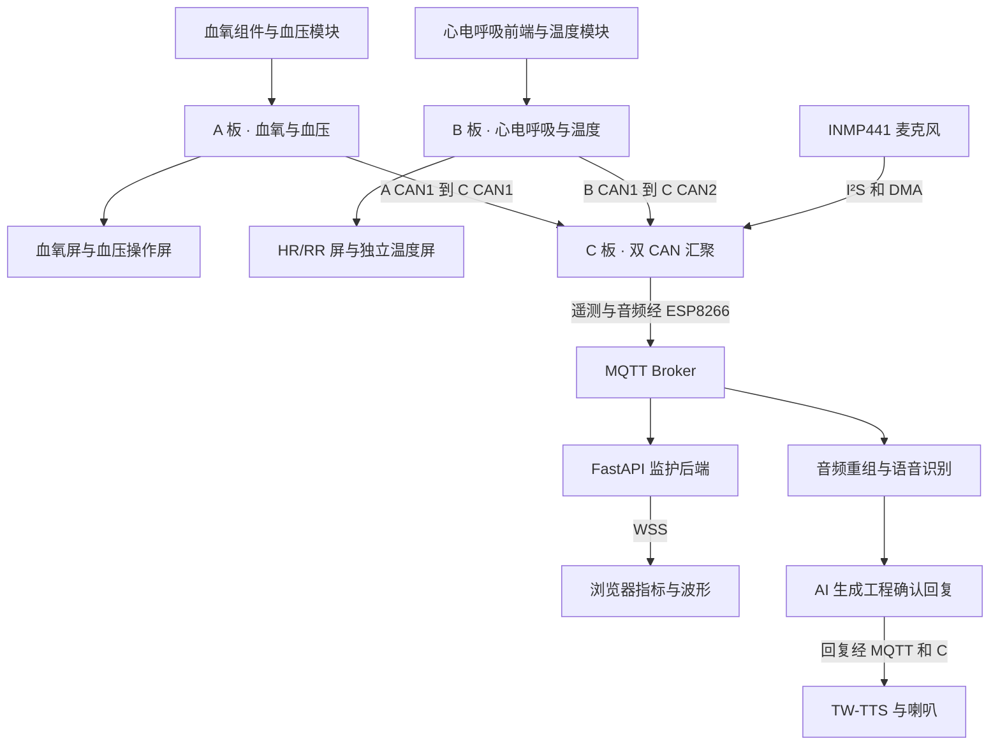

# 多参数监护样机 · 技术栈与技术路线

**汇报基准**　2026-11-03 工程交付标签 `baseline/abc-unified-pre-split-v1`，提交 `26e695ffda43a7a76aa54d1c4e3a5631ac0dc42e`。同一套 C 固件在三个真实 300 秒窗口里完成采集、上云、浏览器显示和语音回复。五板是下一版目标。根 README 仍有早期 Paho 与合成测试源说明，当前实装以固定提交的制品清单和实测记录为准。[M0 实测报告][report] · [制品清单][manifest]

## 1. 从传感器到屏幕和喇叭

图中实线表示 M0 窗口已贯通的路径。测量和音频共用 C 的联网资源，云端分别处理两类数据。

举例说，ABC RR18 窗中显示的 **98/62 mmHg** 可以沿 A 完成 tick、报文和网页反查，90 秒后失效。同窗的语音也走完真实 ASR、AI 和 TTS。让 AI 读取这次测量，判断是否符合项目约定范围并播报，仍需把新鲜度、单位、来源和回答绑定到同一个事实快照，并单独实测。[M0 实测报告][report] · [AI 事实层][facts]

## 2. 技术栈与职责

| 层级 | M0 实际采用 | 选择与实现要点 |
|---|---|---|
| A 测量端 | STM32F407、血氧组件、HKB-08B+、两屏 | 产出 SpO₂、脉率、PPG 和血压。血压由现场人员在本地屏启动，记录源端完成时刻和代次，重复包不能延长血压寿命。血氧模块确切型号仍待实物确认。 |
| B 测量端 | STM32F407、ADS1292 系列 ECG/RESP、GY641、两屏 | ECG 250 Hz、RESP 50 Hz，保留原始 IRQ 时间与采样序号；HR、RR 按各自有效性发布。GY641 经 UART4（PC10/PC11）读物体温度 To，独立温度屏用 USART3（PB10/PB11）。B41516 已替换旧固定 36.5 显示。 |
| 板间通信 | 双独立经典 CAN，500 kbit/s，CANopenNode，静态 OD、PDO、心跳、NMT、TIME | A 为节点 1，B 为 2，C 在两段都是业务节点 3。PDO 运送数据，心跳及 NMT 状态用于判断节点是否在线；时间同步与源采样时刻共同支撑云端新鲜度判断。C 以两个协议端口汇聚，两个物理网段彼此独立。 |
| C 网关 | STM32F407ZGT6、裸机单连接 coreMQTT v2.3.1、MQTT 3.1.1 QoS 1、ESP8266 AT/TLS | 3 个遥测在途槽和 1 个音频槽按各自 packet ID/PUBACK 释放，医疗数据优先；有界队列和历史缓存使 RAM 可控。MCU 型号相同无法代替 PCB 版本核对。 |
| C 语音 | INMP441、I²S/DMA、TW-TTS 及 USART2 | 每窗录 2 秒、16 kHz，125 块合计 64,000 B；暂停重连、录音结束和播放结束分别取证。ESP 使用 USART3，TTS 使用 USART2。 |
| 云与 Web | Mosquitto、Python FastAPI、后端 Paho MQTT、WSS、TypeScript 5.9.3、Vite 7.3.5、Canvas | 后端接收和校验消息，再把快照和波形批次交给浏览器。任务环境允许仅 loopback 的服务间明文 MQTT，隔离 TLS 入口与浏览器 WSS 分工明确。源码有 7 个路由，含总览、温度、心电、血氧、呼吸、血压、AI。 |
| 云端语音 | 隔离 MQTT worker、CPU ASR、豆包 Provider、MQTT 下行 | 音频有序装配、校验后交 ASR，再调用 AI。C 收到工程短回复并驱动 TTS；三窗都有 ACK/DONE 及人工可闻核对。 |

实现出处：[板卡接线与角色][handoff] · [双 CAN 源码][can] · [coreMQTT 锁定版本][mqtt] · [网关运行入口][egress] · [后端依赖][deps] · [前端构建][web] · [路由][router] · [波形渲染][canvas] · [语音 worker][worker]

## 3. 从 P4 到 M0 的演进

| 里程碑 | 解决了什么 | 如何定位 |
|---|---|---|
| P4 集成与 P5 裸机迁移 | 汇聚板间协议、网关、云端和 Web 成果。早期网关采用 Paho，P5 把嵌入式客户端迁到裸机 coreMQTT；P4 当前分支头已含 PR #6 的条件性工程验收。后端 Python Paho 与嵌入式客户端是不同组件。 | [P4 合流提交](https://github.com/Serendipity-min/medical-multi-parameter-monitor/commit/67f5f57bd82c) |
| P6 语音与 H3 | 建立云端文字/TTS 和 A 到 C 的集成路径；P6 名称本身不能证明 M0 正在运行 FreeRTOS 内核。 | [P6 交付](https://github.com/Serendipity-min/medical-multi-parameter-monitor/commit/1a5d7d16a1df) · [H3 归档](https://github.com/Serendipity-min/medical-multi-parameter-monitor/commit/a5cdd5b0b1ad) |
| B 专项到双 CAN | 打通 ECG/RESP 采集、HR/RR 有效性、温度和独立屏，把真实波形的采样顺序、时间和身份送到 C。 | [Node-B 专项](https://github.com/Serendipity-min/medical-multi-parameter-monitor/tree/26e695ffda43a7a76aa54d1c4e3a5631ac0dc42e/node-b) · [物理端口与数据字典][dual] |
| C 独立语音与统一候选 | 先以独立镜像验证真实录音、上行、识别与可闻回复；再把语音并入统一 C，并用软件接收负载验收 C 单板。 | [独立录音闭环](https://github.com/Serendipity-min/medical-multi-parameter-monitor/commit/be552179d77b) · [统一 C](https://github.com/Serendipity-min/medical-multi-parameter-monitor/commit/c0b36430cb82) |
| M0 三板基线 | 使用真实 A/B 输入，修正 IRQ、调度、授时时间差、WSS 波形批推送及评测逻辑；交付可恢复的三板开发底座。 | [M0 实测报告][report] · [交接第 9–11 节][handoff] |

## 4. 三个窗口的实测范围

各场共同在线并预热 45 秒后进入 300 秒评价。源端没有插值补点。每场采集、B 关闭、STOP、最终联评退出码均为 0。[窗口汇总][summary]

| 同一 C 镜像的窗口 | 可核对 ECG / RESP 点数 | 温度源匹配 / WSS 最大源龄 | Backend 实收 | 首次报告播放完成 |
|---|---:|---|---:|---:|
| B+C，ECG60 | 74,757 / 14,962 | 297/297 · 3.892 s | 3,139 | 147.735 s |
| A+B+C，ECG60 | 74,615 / 14,879 | 297/297 · 4.819 s | 3,333 | 293.093 s |
| A+B+C，RR18 | 74,513 / 14,931 | 298/298 · 4.636 s | 3,321 | 283.734 s |

- **采集与显示。** ECG60 按 ECG/HR 判定，RR18 按 RESP/RR 判定。B 温度屏人工读数 30.2 ℃落在对应窗口源温度 29.91–30.29 ℃ 内。ABC ECG60 的最新血压为 101/64 mmHg，RR18 为 98/62 mmHg。血压值追溯、显示和失效已验，人工启动次数、压力与温度绝对精度仍待验证。
- **并发资源。** 当前 C 总加载量为 54,892 B（boot 392 B、code 54,500 B）；sector4 剩 11,036 B。预留栈 8 KiB、堆 24 KiB 后普通 SRAM 剩 15,808 B，CCM 剩 1,536 B。ABC ECG60 的语音仅余 6.907 秒。三窗实时队列溢出和 Backend 拒收/丢弃增量均为 0；两次 ABC 历史缓存仍有 340、317 次覆盖，A 的全历史 PPG 连续性未获证明。[实测报告][report]

## 5. 架构下一站

保留两段主干和 C 的双 CAN。A+E 在 C.CAN1 共线，B+D 在 C.CAN2 共线。A 继续产出 SpO₂/PR/PPG，B 保留 ECG/RESP，D 接管温度模块与独立屏，E 接管血压模块、屏及本地启停。在新配置中把 TEMP 来源切到 D、NIBP 切到 E，逐层核对 PDO、在线状态、MQTT Topic、后端白名单、网页和事实问答。当前 C 中 `node = bus + 1`、在线判断只接受 1/2，且云端仍按 A/B 验证来源，这是扩展的实际改动点。M0 标签可直接作为迁移起点。[网关节点映射][can] · [AI 来源规则][facts]

[report]: https://github.com/Serendipity-min/medical-multi-parameter-monitor/blob/26e695ffda43a7a76aa54d1c4e3a5631ac0dc42e/node-b/docs/M0-ABC-BASELINE-20261103/FIVE-NODE-RESULTS.md
[handoff]: https://github.com/Serendipity-min/medical-multi-parameter-monitor/blob/26e695ffda43a7a76aa54d1c4e3a5631ac0dc42e/node-b/docs/MPM-M0-ABC-BASELINE-CONTEXT-HANDOFF-20261103.md
[manifest]: https://github.com/Serendipity-min/medical-multi-parameter-monitor/blob/26e695ffda43a7a76aa54d1c4e3a5631ac0dc42e/node-b/docs/M0-ABC-BASELINE-20261103/RELEASE-MANIFEST.json
[summary]: https://github.com/Serendipity-min/medical-multi-parameter-monitor/blob/26e695ffda43a7a76aa54d1c4e3a5631ac0dc42e/node-b/docs/M0-ABC-BASELINE-20261103/CURRENT-WINDOW-SUMMARY.json
[dual]: https://github.com/Serendipity-min/medical-multi-parameter-monitor/blob/26e695ffda43a7a76aa54d1c4e3a5631ac0dc42e/gateway/dual_can/README.md
[can]: https://github.com/Serendipity-min/medical-multi-parameter-monitor/blob/26e695ffda43a7a76aa54d1c4e3a5631ac0dc42e/gateway/dual_can/b4_gateway.c
[mqtt]: https://github.com/Serendipity-min/medical-multi-parameter-monitor/blob/26e695ffda43a7a76aa54d1c4e3a5631ac0dc42e/gateway/third_party/coreMQTT/upstream.json
[egress]: https://github.com/Serendipity-min/medical-multi-parameter-monitor/blob/26e695ffda43a7a76aa54d1c4e3a5631ac0dc42e/gateway/b5/network_main.c
[deps]: https://github.com/Serendipity-min/medical-multi-parameter-monitor/blob/26e695ffda43a7a76aa54d1c4e3a5631ac0dc42e/cloud/backend/requirements.txt
[web]: https://github.com/Serendipity-min/medical-multi-parameter-monitor/blob/26e695ffda43a7a76aa54d1c4e3a5631ac0dc42e/cloud/web/package.json
[router]: https://github.com/Serendipity-min/medical-multi-parameter-monitor/blob/26e695ffda43a7a76aa54d1c4e3a5631ac0dc42e/cloud/web/src/router/hashRouter.ts
[canvas]: https://github.com/Serendipity-min/medical-multi-parameter-monitor/blob/26e695ffda43a7a76aa54d1c4e3a5631ac0dc42e/cloud/web/src/waveform/renderer.ts
[worker]: https://github.com/Serendipity-min/medical-multi-parameter-monitor/blob/26e695ffda43a7a76aa54d1c4e3a5631ac0dc42e/cloud/microphone/worker.py
[facts]: https://github.com/Serendipity-min/medical-multi-parameter-monitor/blob/26e695ffda43a7a76aa54d1c4e3a5631ac0dc42e/cloud/ai/facts.py
