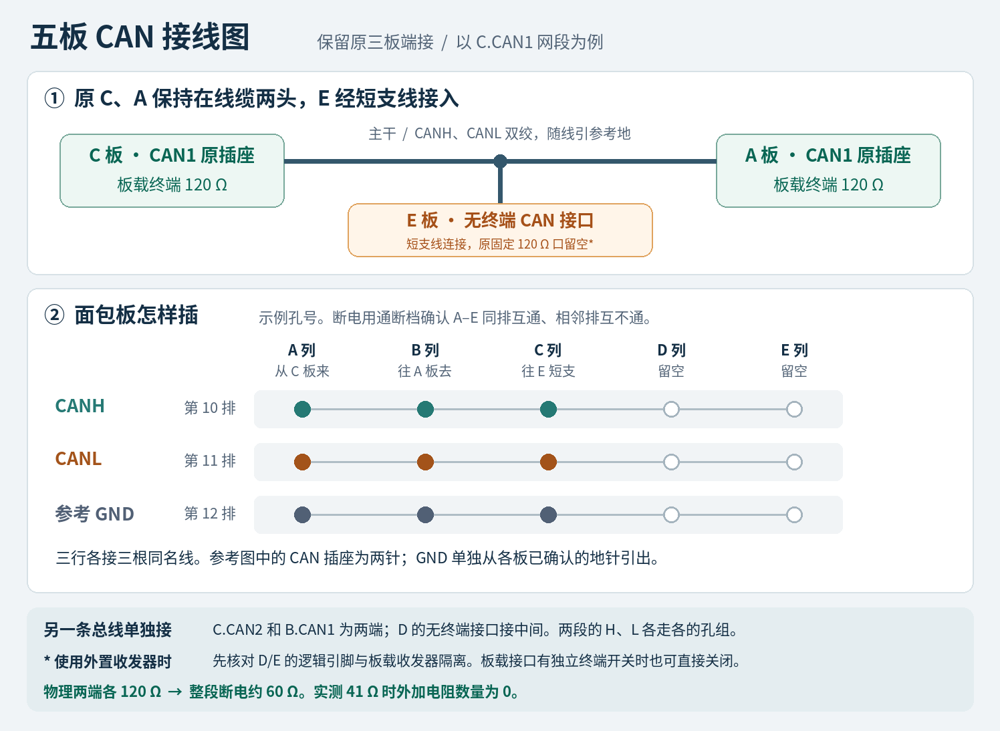

# FIVE-NODE-06｜固定 120 Ω 底板接线与下一轮执行合同

**2026-11-04 执行更新：** 负责人已反馈六个原口各120 Ω，C1–A1与C2–B1各60 Ω，并纠正41 Ω测量组合为C1/B1/D1。M1离线候选与接线步骤见[07执行回执](07-M1-Offline-and-Owner-Wiring-20261104.md)；实板尚未安装或联调。下文保留本合同发布时的历史记录。

**立即可做**　新窗口在已有 `E:/medical-monitor-five-node`、`codex/five-node-single-module-v1` 上完成 M1 离线移植。现场先确认板型与端接，再按下文接线。五板继续采用 **C.CAN1 收 A 血氧、E 血压；C.CAN2 收 B 心电/呼吸、D 物体温度**。建议保留原三板的两组端点，将新增的 E、D 作为各自总线中部的节点。

**依据**　三板冻结于 `26e695ff`，M0 三个 300 秒工程窗口已通过。接手提交 `e5f42625dc4fb222899d8c3dfe771600346ab5b2` 已完成 Git 清理，远端 34 个分支。本合同承接 04 的软件和最终验收设计，覆盖其端接摆位、D/E 原程序备份与 C 资源旧数值。文中“已核对”指仓库源码、制品与图纸；实板 PCB 版本、单板阻值和实际线长留给当期现场记录。[05 接手回执][05] · [04 总合同][04]

## 一、为什么不能在三个板载口上直接并线

按仓库《STM32F4 神舟号原理图 V2.0》PDF 第 5 页左下角 `CAN&USB`，接线端子内部的电阻接法如下。图纸的针号从针 1 标记认，不能由插座朝向猜左右。[电路图第 5 页][pcb5]

| 图纸接口 | 收发器 | 电阻两端的网络 | 同一区域的排针 |
|---|---|---|---|
| CAN1 两针插座 | U3，TJA1050 | R7（120 Ω）一端到 CANH/插座 2，另一端到 CANL/插座 1 | P6 选 MCU 的 USB/CAN1 信号；拔帽后 R7 仍接在原插座 H、L 之间 |
| CAN2 两针插座 | U2，TJA1050 | R1（120 Ω）一端到 CANH/插座 2，另一端到 CANL/插座 1 | P4 连 MCU PB12/PB13 与 CAN2 的逻辑收发信号；它也不控制 R1 |

“关闭终端”在有 `TERM` 开关的板上，是断开**电阻的一条支路**，收发器仍然接在 CAN 上。参考图中看不到这种开关。用导线碰接 R7 的两个焊盘，电流就会绕过电阻，直接短路 H/L；拔掉 P6 则会断开收发信号，原 CAN 插座上的 120 Ω 仍然存在。MCU 断电、禁用 CAN 或关闭软件节点也移不走这只固定电阻。

**41 Ω 的解释。** 两只 120 Ω 并联为 60 Ω，三只并联为 40 Ω。负责人报告的组合是 **C.CAN1＋B.CAN1＋E.CAN1**，实测 41 Ω 与三个固定终端相符。这个读数无法单独证明各板都是这版图纸，亦不能确定此刻面包板仍是当时的接法。当前外加电阻 **0 只**。再并 120 Ω 只会得到约 30.6 Ω，给 H 或 L 串电阻也不能纠正端接位置。[NI 高速 CAN 端接说明][ni]

## 二、一个插座怎样接两个节点

**在电缆中间做分线点。** C.CAN1 只插一组 H/L 导线，沿主干接到 A.CAN1；在中间接一点很短的支线到 E。这样 C、A、E 都能直接看到该段的报文，A 不承担中继。网段 2 用同样的接法。板上两针口只提供 H/L，参考地从另一个已确认的 GND 针引出。

| 网段（500 kbit/s） | 主干左端，120 Ω | 中部节点，无有效终端 | 主干右端，120 Ω |
|---|---|---|---|
| 1 | C.CAN1 原插座 | E 的 CAN1，经短支线；E 接血压及屏 | A.CAN1 原插座，AFE4490＋UNO 血氧前端 |
| 2 | C.CAN2 原插座 | D 的 CAN1，经短支线；D 接 GY641 及屏 | B.CAN1 原插座，ADS1292 系列心电/呼吸 |

以常见面包板左侧每排 A–E 五孔相通为例。**先用空板做通断检查**，列字母 A/B/C 是孔位，和板卡名称无关。将汇接点放在新节点附近，支线尽量缩到几厘米。主干两端之间可以经过两段双绞线，端点由真实线缆决定；若 E 实际在远处，应把主干经过 E 或调整端点，不要从原中点拖一条很长的支线。

| 孔组示例 | A 列接 C 板 | B 列接原端点 | C 列接新中部节点 |
|---|---|---|---|
| 第 10 排 | C.CAN1 的 H | A.CAN1 的 H | E 无终端收发器的 H |
| 第 11 排 | C.CAN1 的 L | A.CAN1 的 L | E 无终端收发器的 L |
| 第 12 排 | C 的参考 GND | A 的参考 GND | E 的参考 GND |
| 第 20 排 | C.CAN2 的 H | B.CAN1 的 H | D 无终端收发器的 H |
| 第 21 排 | C.CAN2 的 L | B.CAN1 的 L | D 无终端收发器的 L |
| 第 22 排 | C 的参考 GND | B 的参考 GND | D 的参考 GND |

H 行与 L 行之间没有跨线，两个网段的信号行互不串接。参考地按原非隔离台架接法共地；GND 连通本身不意味着两段 CAN 混线。各板维持原供电方案，3V3/5V 输出不互并，泵电流不经过面包板。面包板服务于短线台架；最终距离另用实际长度的双绞线和可靠端子验证。[TI 物理层与支线说明][ti]

## 三、中部板的 120 Ω 如何处理

1. **若实板确有独立 TERM 开关。** 按该板丝印/原理图关闭 E、D 所用接口的终端。逐块单独断电测到约 120 Ω 消失，再接入原主干。C/A 和 C/B 两端仍各保留一只。仅在有实物依据时采用这一办法。
2. **若与仓库图纸同版，优先免焊。** 给每块新增板各用一块高速 CAN 收发器模块，要求 MCU 逻辑与 3.3 V 兼容，模块端接可关闭或无板载 120 Ω，支持 500 kbit/s。复用 D/E 的 MCU CAN1，外置收发器的 H/L 接主干；各自板载 CAN1 两针插座拔空。原 R7 留在板上，它的 H/L 此时没有连进总线。仅把外置模块的 H/L 并到原板插座会保留额外的 R7。
3. **若要求所有板都用原插座且不能改板。** 三个固定 120 Ω 口加无源分线无法满足单段两端端接。眼下用原插座做两板点对点测试即可。如确需同时接三个原口，每条逻辑总线可评估一台双侧端接独立可控的**有源透明 CAN 中继器**：原 C–A 段两端保留 120 Ω，中部短接中继器的一侧并关闭该侧终端；另一侧开启 120 Ω，与 E 板的 120 Ω 构成第二物理段。另一条总线同理。各段分别量约 60 Ω，核对供电、500 kbit/s 与传播延迟后实测。此选项增加硬件，面包板本身不能完成中继。[中继器手册示例][repeater]
4. **焊接改造作为另选。** 若以后允许改板，由具备贴片焊接条件的人员确认对应版本和位号，只断开中部接口终端的一端即可。两条网段合计需处理两个中部接口。保留端点的 120 Ω。当前合同默认免焊，无需拆 R7/R1。

### P6 免焊接法，仅适用于可确认与参考图一致的 D/E

PDF 第 4 页将 USB_D− 标为 PA11、USB_D+ 标为 PA12；第 5 页把这些网络带到 P6。现有 A/B 驱动已将 PA11 配为 CAN1_RX、PA12 配为 CAN1_TX，均为 AF9。由此可在**新板**上复用原 CAN1 引脚，节点号仍按 D=4、E=5 另配。P6 是 MCU 侧逻辑信号排针，外置模块必须提供 TXD/RXD 与 CANH/CANL 两侧。[图纸第 4 页][pcb4] · [图纸第 5 页][pcb5] · [A 驱动][drvA] · [B 驱动][drvB]

| 新板一侧 | 外置模块一侧 | 方向及条件 |
|---|---|---|
| P6.4，PA12 / CAN1_TX | TXD 或 D | MCU 输出 → 收发器逻辑输入 |
| P6.3，PA11 / CAN1_RX | RXD 或 R | 收发器逻辑输出 → MCU 输入 |
| 已确认的 3V3 与 GND | VCC 与 GND | 此接法适用于明确使用 3.3 V 供电、3.3 V 逻辑的模块。其他模块按自己的数据表；确认 EN/STB/RS 等已处于正常收发模式 |
| P6.1、P6.2，原 U3 逻辑侧；P6.5、P6.6，USB 插座侧 | 留空 | 断电、拍照记录原跳帽并取下该 P6 上的桥帽。确认 3/4 不再通过跳帽连 U3 或 USB_SLAVE。保留板载 CAN1 插座空置，USB_SLAVE 不接 |
| 外置模块 CANH、CANL | 面包板相应 H、L | 模块独立测量不能呈现一只未处理的 120 Ω；确保不会把两个收发器的 RXD 输出绑在一起 |

编号以实物 pin 1 方位及断电通断为准，不能按图片左/右盲插。外置模块丝印的 TX/RX 有时取自另一端视角，按模块图纸的**输入/输出**确认。收发器芯片型号本身不能保证整块小模块没有 120 Ω。若屏幕、USB 或其他外设已占用拟用针脚，或板型不符，先继续点对点与离线任务，待拿到该版本接线依据后再定。这里的外置接口只替换物理收发器，无需 A/B 软件转发。[3.3 V 高速 CAN 收发器示例][transceiver]

## 四、现场先做的一组断电测量

先拍一张原状照片，标出板 A/B/C/D/E、端口号和电缆两端。隔离各路电源、USB、调试器及可能反供电的附件，确认无电压后再使用电阻档。检查 B.CAN1 的 H/L 当前是否仍接 C.CAN2，有没有又经面包板接到 C.CAN1。把“上次的测量组合”和“今天的实际接线”分开填。

| 测量动作 | 应记的数值或现象 | 如何决定下一步 |
|---|---|---|
| 分别隔离 C1、C2、A1、B1、D1、E1 及线束、附件 | 每个口独立跨 H/L 读数；另记 PCB 版号、R7/R1 实物位置、TERM 跳帽有无 | 固定板载终端通常约 120 Ω。裸线束 H 对 H、L 对 L 导通，H 与 L 互不短接；带端接附件另记 |
| 只接旧 C1–A1、C2–B1，两段分开量 | 分别记 H–L；检查两段的同名信号线没有通过面包板金属条直接相连 | 每段通常约 60 Ω。若约 120 Ω，先排除断线或遗漏端点；确认仅缺一个端点时，在该物理端 H/L 跨接一只 **120 Ω、1%、¼ W** 或启用端接 |
| 依次接入 E、D 的无终端短支线 | 每次记录“接入前 → 接入后”的 H–L 数值与接口类型。另记主干及最长支线长度 | 约 60 Ω → 仍约 60 Ω，才继续核对位置和线序。若变为 40–41 Ω，移除刚接入的支路，查多余终端。近 0 Ω、读数异常或与图不符则保持断电 |
| 通电联调条件满足后 | 各段各节点的 heartbeat/PDO、来源、TEC/REC、bus-off、FIFO 及应用错配计数 | 断电读数只能说明静态负载；同速率、正确端接、实际线长上的通信需用真帧验证 |

## 五、发给下一窗口的执行顺序

本次交付接线讲解与合同。下一窗口先做 **M1 离线实现**。现场接线、上电及首写按当期实板安排集中执行，同一范围内的普通软件缺陷由执行人修复并定向复测。终端器件未到不阻塞软件开发。

| 顺序 | 工作与已有入口 | 完成条件 |
|---|---|---|
| 1．M1 离线 | 沿用 M0 工程，A=1 仅发 SPO2/PR/PPG，B=2 仅发 ECG/RESP/HR/RR，D=4 复用 GY641 的 UART4 和独立屏，E=5 复用 HKB-08B+ 的 UART5、原血压操作屏及本地启停。C=3 保留两个 CANopen 实例，每段以“段＋节点”选心跳、PDO 与在线状态。同步修 MQTT Topic、Backend 白名单、WSS、Web 的物体温度和来源标签 | 五板目标构建及 C map；定向 Host 正反例覆盖错段、错来源、同段另一节点掉线、同代重复包、旧值复活和失效。保留 A/B 原始波形与采样率。复用 [网关][gw]、[消息模型][model]、[后端][backend]、[页面][web] |
| 2．现场暂时只有原板载接口 | 当期准许实物操作后，先断电、暂将 B 从 C.CAN2 移开，连 **C2–D1** 测温度；再将 A 从 C.CAN1 移开，连 **C1–E1** 测血压。两端均有 120 Ω 时直接用两个原插座。D/E 原程序无需备份；确认目标板、电平与该板写入区。两次局部测完按记录还原，避免把旧线和临时线同时留在同段 | D 屏显示真实物体温度并随目标变化，D 的 PDO 与网页值匹配；E 用非人体工装人工启停，E 屏、完成代次、收缩/舒张压与网页一致，90 s 到期。仅签点对点/单节点通过 |
| 3．三节点共线 | 可用无终端接口后，先接 C2/B/D，再接 C1/A/E。按实际是否有 TERM 开关选择原口或 P6 外置路径。硬件移植保持“一项测量只有一个有效发布者” | 每段约 60 Ω，两节点在同段各自可见。D 离线仅温度失效，E 离线仅血压失效；其他节点继续传输。把错段检测、掉线恢复与错误计数放进简表 |
| 4．五板同窗及语音 | 两段合流，按 04 复用 ECG60、RR18 两个工况与既有 45 s 预热、300 s 评价。M0 的 2 秒录音曾上传 234.463 s，血压仅从 E 完成起 90 s 有效。先由服务端从真实快照读数，回包绑定 E 的启动/完成代次及截止时刻，C 在送 TTS 时复核 | “E 测完再问，当次仍有效并可闻报数”和“已过期正确拒答”分别出结果。规则待定时只报可信数字/单位或失效原因，偏高/偏低/正常分类暂不启用；禁止语音启泵。若仅过期拒答通过，保留当前值正例未通过，不放宽 90 s |

### 本轮 M1 交付与资源对照

- 提交一次软件阶段结果，附五板候选/镜像标识、各板用途与实际写入范围、C ELF/map、节点/Topic 对照、定向回归与未验证项。硬件记录按“未做、局部通过、同窗通过”填写。沿用 M0 标签用于回退，不重做已完成 Git 清理。
- C 以实际选定制品计 **boot 392 B、code 54,508 B、Flash 合计 54,900 B、sector4 余 11,028 B**；普通 SRAM 扣除堆栈后另余 15,808 B，CCM 余 1,536 B。新 build 用自己的 map 对照。C 的 sector0/4 分段恢复方式只适用于 C。[制品布局][layout]
- 本轮聚焦节点归属、固定端接、真实性和时效。RR15 源端真值、RR24/30 旧失败、TEMP180 末帧、A 历史覆盖、绝对标定及 24 h 长稳各自保留原状态。最终阶段交付 A/B/C/D/E 独立配套镜像和恢复说明，五板验收后再决定合入 main。

**给 Codex 的启动句**

> 在现有 E:/medical-monitor-five-node 工作树确认干净并快进 codex/five-node-single-module-v1。以 05、06 为最新交接，04 为完整技术合同。先完成第 1 项 M1 离线实现、五个目标构建和相关 Host 回归，记录 C 资源实数。现场人员并行填写 06 的断电测量表；没有终端解决方案时可以留待点对点窗口。按实际已做到的层次汇报，不重跑 M0，不以旧程序备份作为 D/E 前置条件。

[05]: https://github.com/Serendipity-min/medical-multi-parameter-monitor/blob/e5f42625dc4fb222899d8c3dfe771600346ab5b2/node-b/docs/FIVE-NODE-MIGRATION/05-Takeover-and-Git-Integration-20261104.md
[04]: https://github.com/Serendipity-min/medical-multi-parameter-monitor/blob/e5f42625dc4fb222899d8c3dfe771600346ab5b2/node-b/docs/FIVE-NODE-MIGRATION/04-Five-Node-Contract.md
[pcb4]: https://github.com/Serendipity-min/medical-multi-parameter-monitor/blob/26e695ffda43a7a76aa54d1c4e3a5631ac0dc42e/node-b/hardware/STM32F407_原理图.pdf#page=4
[pcb5]: https://github.com/Serendipity-min/medical-multi-parameter-monitor/blob/26e695ffda43a7a76aa54d1c4e3a5631ac0dc42e/node-b/hardware/STM32F407_原理图.pdf#page=5
[drvA]: https://github.com/Serendipity-min/medical-multi-parameter-monitor/blob/26e695ffda43a7a76aa54d1c4e3a5631ac0dc42e/node-a/STM32F407_HOSPITAL/HARDWARE/CANopen/CO_driver.c#L107-L113
[drvB]: https://github.com/Serendipity-min/medical-multi-parameter-monitor/blob/26e695ffda43a7a76aa54d1c4e3a5631ac0dc42e/node-b/canopen/CO_driver.c#L107-L113
[gw]: https://github.com/Serendipity-min/medical-multi-parameter-monitor/blob/26e695ffda43a7a76aa54d1c4e3a5631ac0dc42e/gateway/dual_can/b4_gateway.c
[model]: https://github.com/Serendipity-min/medical-multi-parameter-monitor/blob/26e695ffda43a7a76aa54d1c4e3a5631ac0dc42e/gateway/data_model/model.c
[backend]: https://github.com/Serendipity-min/medical-multi-parameter-monitor/blob/26e695ffda43a7a76aa54d1c4e3a5631ac0dc42e/cloud/backend/app/models.py
[web]: https://github.com/Serendipity-min/medical-multi-parameter-monitor/blob/26e695ffda43a7a76aa54d1c4e3a5631ac0dc42e/cloud/web/src/ui/parameters.ts
[layout]: https://github.com/Serendipity-min/medical-multi-parameter-monitor/blob/26e695ffda43a7a76aa54d1c4e3a5631ac0dc42e/node-b/docs/M0-ABC-BASELINE-20261103/candidate-c-startup-order/unified-layout.json
[ni]: https://www.ni.com/en/support/documentation/supplemental/09/can-physical-layer-and-termination-guide.html
[ti]: https://www.ti.com/lit/an/slla270/slla270.pdf
[transceiver]: https://www.ti.com/product/SN65HVD230
[repeater]: https://www.peak-system.com/produktcd/Pdf/English/PCAN-Repeater-DR_UserMan_eng.pdf
