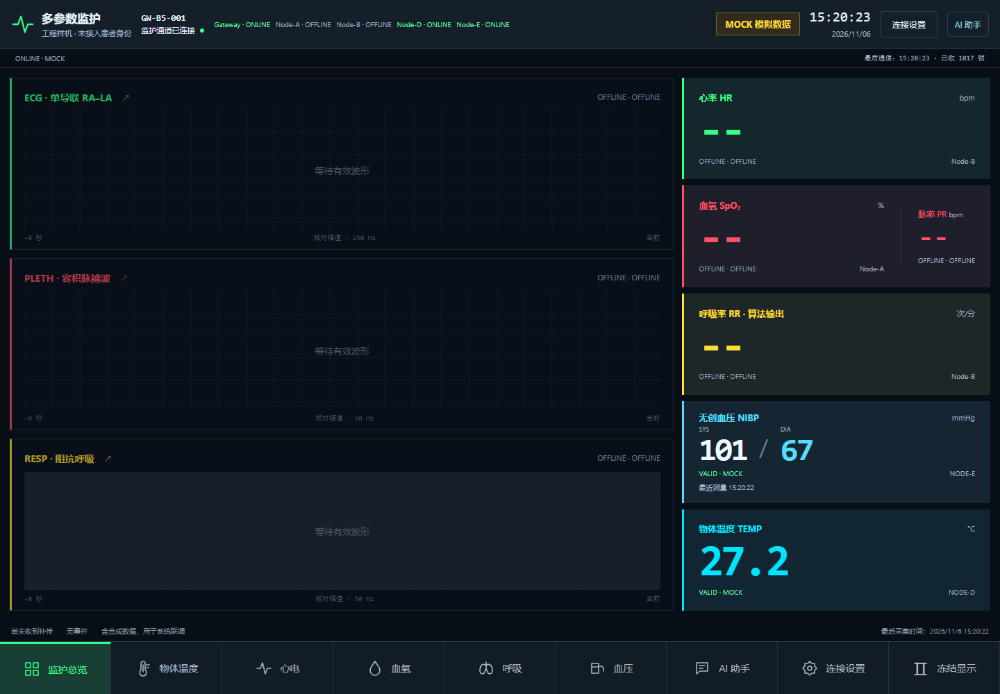
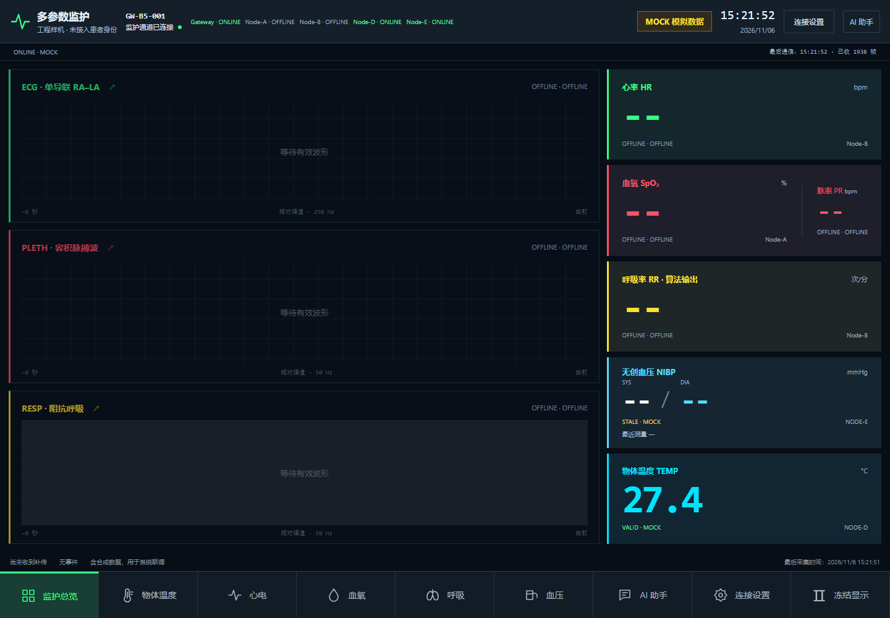

# E血压101/67点对点与90秒失效实测（2026-11-06）

**分项结论：E本地结果、C/E点对点、隔离Broker→本机后端→真实网页同次匹配及原90秒失效通过。** 控制器原生退出1、TTS STOP未确认的事实保留；不签整机、语音或正式五板300秒通过。负责人随后确认全部断电，未自动重试。

## 实物与镜像

- C.CAN1↔E.CAN1：61Ω；C.CAN2↔D.CAN1：60.9Ω，沿用负责人断电实测，参考地保留。A/B断电，H/L未接回；J-Link电脑端不接，E USB232BOOT不接电脑。C USB_UART为COM15。
- E血压模块/操作屏与原非人体工装；D为GY641物体温度与独立屏。泵只由负责人在E屏本地手动操作一次。
- C正常五板M1：boot392B＋code55,480B；D为24,544B；E为29,416B，Node5。沿用已验证安装，原始Flash/Options和恢复入口仍保留；本窗没有下载、复位或写配置。
- A仍是33,436B发送修复，B仍是40,032B五板角色，本窗均未参与。实际镜像SHA和分区范围见 [PREPARATION-MANIFEST.json](PREPARATION-MANIFEST.json)。

## 完成事件匹配

| 层级 | 本窗实测 |
|---|---|
| E屏人工观察 | **SYS101 / DIA67 mmHg** |
| C镜像 | Node-E，boot=3、gen=1；completion tick **157006**，packed **43910130**，拆分为1010/670（0.1mmHg） |
| 发布身份 | `can-2948209266-3`，NIBP seq1，来源Node-E；仅1次有效NIBP发布，无REPLAY或FAULT |
| Broker载荷 | `[101.0,67.0]`，VALID、MOCK、synthetic=true，原始完成时间戳保留 |
| 真实网页 | 收到同session/seq/点值；实际DOM为101/67、VALID、来源NODE-E |

这是非人体输入的端到端数值一致性，不是血压绝对准确性或临床标定证明。原协议可观察到boot generation、completion tick和同值打包身份；没有读取E内部result_generation或完整原始模块UART，不虚称取得这些证据。

## 原90秒失效

- 首个有效网页快照的源龄为1093ms。
- 同次读数在源龄 **90,074ms** 的网页快照首次转为STALE，value=null，E节点与网关仍为ONLINE。
- 实际网页DOM在源龄 **90,693ms** 首次采到高压/低压均“--”，状态STALE，来源仍为NODE-E；DOM按约1秒间隔留证，不将该采样时间冒充精确状态切换时刻。
- C后续E诊断中，completion仍为157006、nibp_seq仍为1，但flags由520变为512、packed变为0。首条确认有效位已清除的诊断源龄为94,143ms；该诊断约5秒一次，不据此声称源端到94秒才失效。
- 后续保留约95秒的测量后观察内，未出现同次旧值再次VALID或新NIBP发布。只说明截至本窗结束未复活，不外推长期或所有故障场景。

已人工查看并冻结两张真实页面截图：

## 链路、参考温度与原生退出

- 评价实际持续145.953秒：T0后约13.125秒观察到E进入测量，约50.938秒主机确认收到新结果，此后观察95秒。人工等待、测量完成与到期观察已分别计时，不再由旧125秒条件截断。
- C两路各31次诊断的TEC/REC峰值0/0，发送失败/FIFO溢出0；Router高水位4，overflow/replaced/expired/unsynced均0。没有读取E/D自身TEC/REC，也没有模拟示波器/差分裕量证据。
- D温度Broker实收146条，27.13–27.45℃；其中145条网页VALID值精确匹配。首条seq32在T0+64ms到达，节点状态尚为STALE，网页已收到该key但将值遮蔽，不能记为有效显示。它不是永久丢失的温度消息，也不隐瞒这个启动过渡。
- 本窗因此为NIBP 1/1精确匹配，参考温度145/146有效匹配＋1条启动遮蔽；不能笼统签147/147有效显示。接收端共301条MQTT、2155个网页快照包含状态及重复快照，不作为医疗流批数。
- C STOP横幅确认，UART已关闭；TTS STOP ACK/QUERY/IDLE未确认，初始化与最终状态均无ACK、stop_failed=1。没有录音或播报，该问题独立保留。
- Windows进程句柄读取的真实原生退出码：**C控制器1，接收端0**，两个进程均已退出。控制器数据阶段完成后因TTS停止确认不足保留退出1，不修改原始receipt来制造整项PASS。
- 负责人按收尾提示回复“已完成”，记录为全部断电；发热、复位、泵/屏异常观察没有另行补充，按UNKNOWN保留。

## 当前状态和剩余项

当前全部断电、USB电脑端拔开，保留C1–E1、C2–D1两条约60Ω线束，不自动重测或恢复41Ω并线。没有commit/push，main、正式云、ACL、密钥未修改；没有整体合并ABC/R6分支。

E本轮结果可作为P1的非人体本地/点对点/失效工程证据；A/D此前短窗结果及A源端全窗证据不足分别保留。正式五板300秒仍等待D/E真正无终端或可关闭120Ω的接口；本窗没有ECG/RESP/PPG、麦克风、语音、自动冷启动或五板并发，不关闭这些未解决项。

实际回退仍按原授权写区：A/B sector0–2、D/E sector0–1、C sector0/4，保留Options与区外内容；不在本窗自动回退。C留机为正常M1，不能误用旧CAN60临时诊断镜像。E原旧应用按负责人决定无需备份；已验证E M1镜像是当前可恢复入口，不能宣称能恢复未保存的原旧应用。

详细时刻、源龄、分层状态、原生回执与证据SHA见 [DE-NIBP-101-67-result.json](DE-NIBP-101-67-result.json)。完整原始UART/MQTT、DOM、执行源码、身份/Flash及凭据留在既有EFS，本机忽略的运行指针记录目录。
