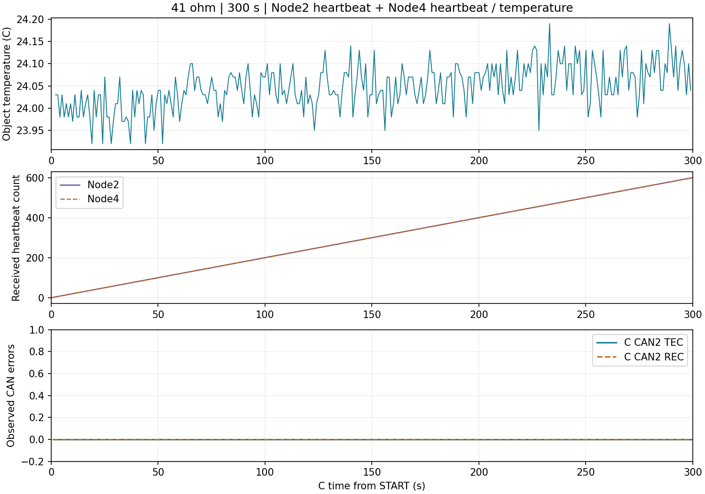

# 41 Ω 三节点 300 秒观察（2026-11-05）

**结论：`THREE_NODE_41OHM_300S_OBSERVED`。** 本次 300 秒采集内，C 持续收到 B、D 心跳及 D 温度小报文，未观测到 C 端 CAN 错误、溢出、串口丢包或源重启。结论限定于本次负载、接线与窗口；不是正常端接合格或长期运行通过，也不覆盖 ECG/RESP 连续 CAN 波形。

负责人在完成一次15秒观察后，明确要求重心改为41 Ω下300秒连续观察，不再重复正常端接测试；在说明延长超规格运行风险后，负责人确认断电，并按新安排确认三板重新上电、41 Ω接线未改、全程在场、无异常。300秒作为新阶段执行一次，没有自动循环或重试。原合同中的15秒/短观察限制不冒充这次300秒的许可来源。

## 同窗结果

| 指标 | 41 Ω、300 秒实测 |
|---|---|
| 拓扑 | C.CAN2 + B.CAN1（Node2）+ D.CAN1（Node4）；H/H、L/L、共地；三原口固定120 Ω |
| 阻值 | 负责人此前断电实测41 Ω，本窗前确认接线未改 |
| CAN速率 | 500 kbit/s，未降低速率 |
| 窗口 | 固件硬限时300,000 ms，收到START和STOP；只发送一次START，无提前停止命令 |
| B心跳 | 600条，均为PREOP（127）；相邻C接收时刻间隔499–503 ms，无超过1500 ms的间隔 |
| D心跳 | 600条，均为OP（5）；间隔499–501 ms，无超过1500 ms的间隔 |
| D PDO | 温度300条、时间锚300条、质量/代次301条 |
| 温度资格 | 298条有效模型，全部与原温度PDO的值/校验匹配；23.92–24.19 ℃，有效源龄1–219 ms |
| 初始无效值 | START后70 ms有一条TEMP=0、源龄字段65535的无效哨兵；不是65秒旧温度。首条有效模型在2075 ms，未将初始化值作为有效读数 |
| C错误 | 观测TEC/REC峰值0/0，busoff=0、RX溢出=0；TX ACK633、失败0 |
| 取证完整性 | 6865包；CRC错误、序号缺口、采集丢弃、截断均0 |
| 源状态 | 全程日志复核未发现boot-up/异常NMT状态或代次变化；B/D非零EMCY未触发停止 |
| ECG/RESP CAN波形 | 0帧，符合本窗小报文配置；B本地BIO仍按既有程序运行，但未同步采集其ADC原码 |
| B/D自身TEC/REC | 此窗未同步SWD读取，不能将C端0反填为三板全部0 |
| 电气模拟质量 | 未测差分波形/眼图、供电裕量或收发器温升；人工报告无明显异常 |
| 云与语音 | 未运行，不作为云端、网页或TTS实测 |

图中的温度为GY641物体温度To，不是人体体温标定。第三行仅为C.CAN2观测计数，不能代替B/D独立计数或模拟电平测量。

## 本轮已验证的前置工作

- D屏：P5接通原USART3/RS232路由后，负责人确认23.6–23.8 ℃实时变化，固定36.5问题消失；没有重刷屏幕固件。
- D CAN：负责人发现P6原为PA11/PA12接USB D−/D+，后改接CAN_RX/CAN_TX。修正后实际D身份/镜像匹配，C–D断电实测61 Ω；60秒接收Node4心跳120、温度PDO60，有效模型59，C/D观测错误计数均0。
- B新M1：正常两端连接60秒，ECG14968帧、RESP2994帧；评价区间35次HR均60 bpm，ECG/HR有效，C/B观测错误计数均0，B采样约250.086 SPS。此次C–B改接的数值未单独补报，沿用此前已知约60 Ω两原口。
- 41 Ω初次15秒：两源心跳各30、温度PDO15、有效模型14，C观测错误计数0。之后依负责人新要求扩大为本次300秒，未改为ECG连续流。

原始负例保留：D正常链路初次预检TEC=75时没有武装，后续未清零/复位，6次只读均为0，再执行合格窗口；不能把整个上电历史写成全程0。调试器曾误接B，保存了B HALT/ROM的PC/MSP/向量及原生记录；负责人更正路线后，B正常供电时镜像与Flash运行态通过，未自动Go或重刷B，也未声称历史ROM根因已关闭。详见 [60 Ω控制结果](RESUME-60OHM-RESULTS.json)。

## 留机状态与恢复入口

负责人最终确认：**C/B/D及外围已断电，人工无异常；三板41 Ω并线保留，未恢复C2–B1两板状态。** 没有继续通电做61 Ω复测。原合同T4的两板接线恢复尚未做，不将整份合同签为全部关闭；后续上电前必须重新确认这套仍是三终端接线。

| 板 | 留机程序 |
|---|---|
| C | `C300_SMALL`隔离诊断：sector0/4，boot392 B、code24836 B；一次开始后300秒停止主动发送，仍可ACK；不是完整M1云网关，也不是原M0应用 |
| B | M1 Node2，`FIVE_NODE_B.bin`40032 B；本轮未再次刷写 |
| D | M1 Node4，`FIVE_NODE_D.bin`24544 B；P5屏路由及P6 CAN路由已修正 |
| A/E | 本轮未处理 |

C300安装前核对身份、当前C15全片和Options；仅sector0/4写入，安装后完整读回、Options及区外内容一致。Halt/Reset/Go各1，WriteMem2，均为该次受控安装动作；观察窗口自身的Reset/Go/Flash命令为0。M0底座标签 `baseline/abc-unified-pre-split-v1` → `26e695ffda43a7a76aa54d1c4e3a5631ac0dc42e` 保持不变。

公共回执：[300秒取证](BD300-capture-result.json)、[温度/心跳复核](BD300-analysis.json)、[镜像与执行清单](BD300-manifest.json)、[先前15秒](BD15-capture-result.json)。完整原件、UID、Options、SDK日志及当前恢复引用只在EFS，入口为本机忽略文件 `E:/medical-monitor-five-node/node-b/build/phy01-current-pointer.json`，不得公开原件。

本轮仍遵守不新增commit、不push。现有本地checkpoint `bd1ee21`是暂停前的提交；后续工具、源码和报告留在工作区。未来恢复C时必须以当前C300安装回执作before引用，不能沿用早先C15的恢复脚本参数；恢复M0也应使用冻结M0镜像的受控install方案，不盲用回到更早C44520的legacy restore。
