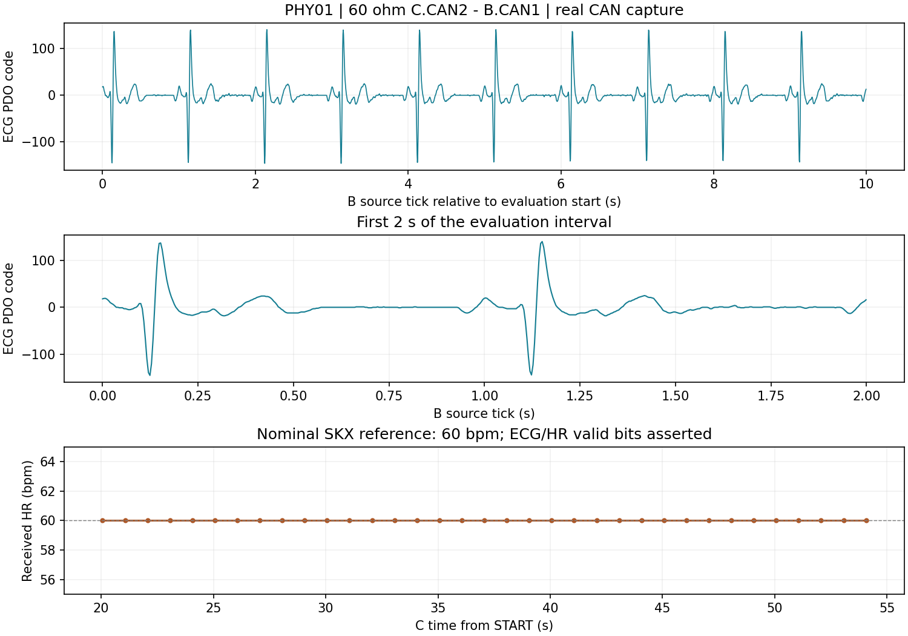

# PHY01 现场记录（2026-11-05，进行中）

**最新记录：** 负责人恢复后完成两组新M1正常端接控制、41 Ω 15秒及新授权的300秒观察。最终全部断电、三板41 Ω线束保留；当前以 [41 Ω最终观察记录](41OHM-RESULTS.md) 和本机current pointer为准。下文是前一阶段原始记录，保留历史资格与未决项。

本轮非人体台架，SKX 普通 ECG 60 bpm / 1 mV，黄 L 接 LA。M0 标签仍是 `baseline/abc-unified-pre-split-v1` → `26e695ffda43a7a76aa54d1c4e3a5631ac0dc42e`，未修改。C 实物已安装本次隔离诊断镜像，不能称作仍运行 M0 或完整 M1 网关。

| 项目 | T1：60 Ω 正常对照 | T3：40 Ω 三节点 |
|---|---|---|
| 接线 | C.CAN2–B.CAN1；负责人断电测得约 60 Ω；D H/L 移开、断电 | NOT_RUN |
| 版本 | 新五节点 C 诊断镜像；B 使用现场原程序，待后续 SWD 核验 | NOT_RUN |
| 实际窗口 | 一次 B4START，MCU 硬时限 60,000 ms，实际 STOP 已收到 | NOT_RUN |
| CAN | 500 kbit/s，仅 CAN2 协议；Node2 心跳 120 条，ECG 14,966 帧、RESP 2,993 帧 | NOT_RUN |
| C 错误 | TEC/REC 观测峰值 0/0；RX 溢出 0；TX ACK 128、TX failed 0、busoff 0 | NOT_RUN |
| 采集完整性 | 19,758 包；CRC、采集环丢包、串口序号缺口均 0 | NOT_RUN |
| 评价区间 | START 后 20–55 s；ECG 8,754 点，源 tick 估计 250.093 SPS；相邻间隔 8,740 次 4 ms、13 次 3 ms，无大于 4 ms 缺口 | NOT_RUN |
| ECG/HR | 35 次 HR 均 60 bpm，ECG/HR 有效位均置位；192 次 C 模型值/时戳检查匹配，无不匹配 | NOT_RUN |
| RESP/RR | 无效，仅记录，不作为当前普通 ECG 模式的呼吸验收 | NOT_RUN |
| D/温度/屏 | D 未接入；传感器 PC10/PC11 已记录，屏的独立接线待确认 | NOT_RUN |
| 供电与线长 | 负责人报告 C/B 上电无异常；未取得电压波形、线长或温升测量 | NOT_RUN |
| B 自身错误/原码 | 本窗 J-Link 在 C，B ESR/ADC 原码未同步采集 | NOT_RUN |
| 物理信号质量 | CAN 数据接收与连续性通过；示波器差分波形、眼图、电平裕量未测 | NOT_RUN |
| 云端 | 未启动网络、MQTT、Backend 或 AI/TTS | NOT_RUN |
| 结论 | `TWO_NODE_60OHM_CAN_CAPTURE_PASS_B_SOURCE_REVIEW_REQUIRED`，仅限定接收链路与名义 HR 观察 | 尚未进入 |

图中 ECG 为 CAN PDO 中的代码值，不能换算成经过标定的 1 mV 幅值。SKX 的 1 mV 是负责人所述设置。本窗不证明 B 原始 ADC 完整性或医学准确度，也不合并 HR/RR 同窗有效性。

C 诊断程序复用 `b4_gateway.c`、`b4_bxcan.c` 与原独立 bench，使用五节点解码；仅本地测试纪元，不可进入云端。CAN1 静默且过滤器/IRQ 关闭。待命不发协议，单次开始后 60 s 停止新发送并取消邮箱；停窗仍 ACK 对端，不能代替人工断电。错误计数、溢出、发送失败或采集丢失会提前停窗，`X` 为一次停止入口，不自动重试或重武装。

本次 C 仅写 sector0/4：boot 392 B、code 24,784 B。安装前身份、当前全片和 Options 匹配，安装后全片/Options 验证通过；显式 Halt/Reset/Go 各一次，WriteMem 两次，其余扇区保留。镜像 SHA 与源码构建收据见 [T1-manifest.json](T1-manifest.json)，实际采集裁定见 [T1-result.json](T1-result.json)，信号表征见 [T1-signal-summary.json](T1-signal-summary.json)。完整 Flash、UID、Options、原始串口和 SDK 日志仅在 EFS 私有目录，本机入口为忽略文件 `node-b/build/phy01-current-pointer.json`。

离线检查：原 bench 与 PHY60 的真实协议、tick 回绕和硬时限；CAN1 禁发、仲裁/ACK/失败、STOP 取消邮箱；取证编码/串口入口及五节点网关 Host 均通过。未将这些离线检查写成实物结果。

下一步先断电转接 J-Link 到 B，核对 B 当前镜像与恢复原件，再安装匹配 Node2 的 M1 生产者。C/B/D 收发器实物丝印及 D 独立温度屏引脚仍待明确。负责人已接受一次短时 40 Ω 风险，保留该决定，不重复索取；但尚未满足全部进入条件，不得据此直接接回 D 上电。

T2/T3/T4 尚未执行；最终须断电恢复 60 Ω 并确认现场收尾。本页随现场进展追加，不覆盖原始回执。

**暂停更新（2026-11-05）：** 负责人明确暂停，保存本地，不再提交或推送。此后 B/D 已安装 M1，B 本地 ADC/HR、D 本地 GY641 通过；D 屏仍固定36.5，D CAN末态ESR含BOFF位，均尚未解决。收发器TJA1050实物身份已确认，屏的M0接口已查到，D板P5/P6实际路由尚待现场核对。上表保留原 T1 会话事实，不能当作新 B/D 已通过联动。完整当前状态、未决项和恢复入口见 [暂停交接](PAUSED-HANDOFF.md)。
