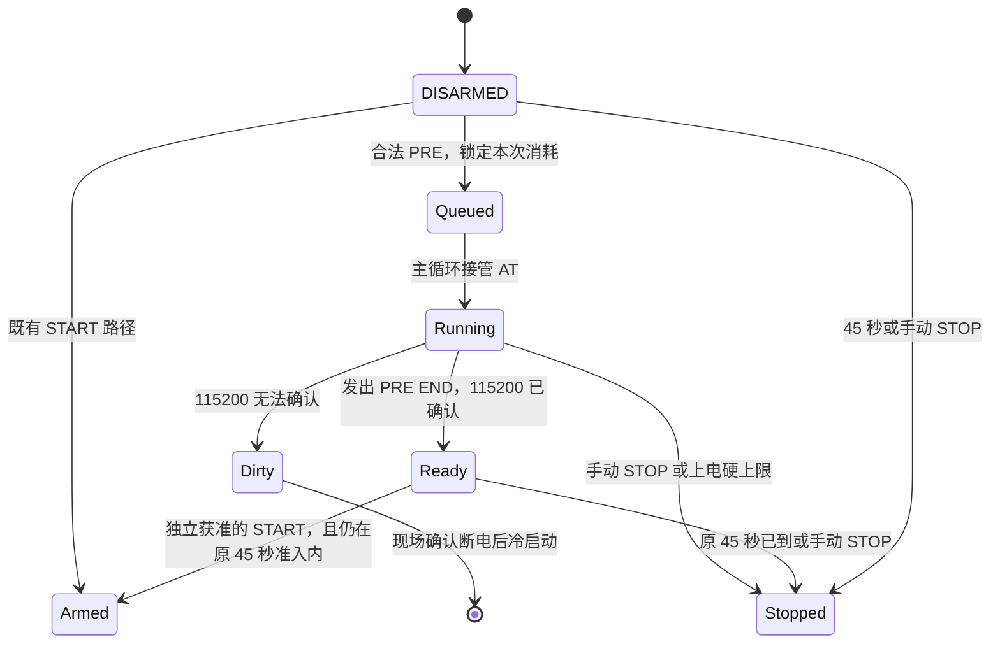

# FIELD01 PREFLIGHT 实现架构

2026-11-09 · 架构设计，候选尚未实现。规格以 PI 的 `feefd17` 为准，代码底为 `codex/pi-r1-offline-fixes@78a6d00`。现场状态采用负责人报告，C 断电，USB_UART、J-Link 均未接入。PI 要求 Host、Windows ARM、VPS 交叉构建及评审通过后进入 S0。Windows 构建决定现场镜像预算。[PI PREFLIGHT 设计](https://github.com/Serendipity-min/medical-multi-parameter-monitor/blob/feefd17d3442466954955efce79723d4d36bef34/node-b/docs/PI-REVIEW/PREFLIGHT-DESIGN-20261109.md)

## 固件状态与计时

- **命令入口。** `local_control()` 保留 16 字节缓冲和既有按长度判定，只新增精确匹配的 11/15/15 字节命令 `FIELD01 PRE`、`FIELD01 PRE 230`、`FIELD01 PRE 500`。匹配后置一次性标记并排队。完整命令必须在原启动 45 秒内到达。同步 AT 由 DISARMED 外层主循环执行。串口回调可处理 STOP，START、KEY 和重复 PRE 在排队或运行中均不能推进状态。运行中保留同一个 AT 所有者。
- **W-01 / DC-1 / DC-7。** 当前 FIELD01 在 DISARMED 阶段会通过 `platform_poll()` 进入 `service()`，但 `runtime_ready=false` 使它提前返回。当前阶段到不了 `field01_poll()`、业务 UART 错误处理或 CAN 诊断。启动路径的 `b4_hw_init()` 在接受 START 后。实现时仅在 PRE 排队或运行时为 `service()` 增加 DISARMED 分支，用于响应 STOP，随后直接返回。PRE 错误只写 PRE 结果。Host 必须通过真实回调链注入 Wi-Fi 失败、UART 错误和 CAN 溢出，断言 `network_fault`、`stop_due`、`armed`、`field01_t0` 未被故障推进，并单独验证显式 STOP 能抢占 AT。[当前 service](../../../gateway/b5/network_main.c#L370) · [当前启动入口](../../../gateway/b5/network_main.c#L458)
- **DC-2 / DC-3。** 当前 `b5_hard_tick()` 在 START 前也会在上电 45 秒时锁存 TIMER，`at_command()` 还检查 `b5_business_remaining()` 并预留 2 秒。必须同时处理两处。排队时冻结 PRE 截止 `min(受理时刻 + 60 s, 上电 + 210 s)`，仅在 PRE 所有权存续期间使用这一诊断截止。诊断时限到达只结束 PRE。210 秒硬停和显式 STOP 一直有效。PRE 返回后立刻恢复原 45 秒 START 准入和原 T0、150 秒及 210 秒规则。PRE 若跨过上电 45 秒，允许完成受限诊断，同次 START 资格已过期。未发送 PRE 的启动保持原计时和串口回执。[计时函数](../../../gateway/b5/field01_window.h) · [硬计时与业务预算](../../../gateway/b5/network_main.c#L79) · [AT 预算](../../../gateway/mqtt/src/platform.c#L314)
- **尾段预算。** 设计值为 CWJAP 最多 20 秒，普通查询 1 秒，STA 2 秒，GMR 压测每笔最多 300 ms，波特率往返各预留独立确认时间。最后 9 秒留给恢复与回执，包含原 AT 层的 2 秒余量。各命令按当前绝对剩余时间裁剪，预算不足时输出已完成数量和阻断原因。PRE 串口输出也需采用有界写入。显式 STOP 或硬上限到达后禁止新增 AT，若此时速率未确认回到 115200，则记录 `NEED_POWER_CYCLE`，由现场断电。普通 Wi-Fi 失败与人工或时间停止分别记录。

## AT 通路与速率恢复

**W-02 / DC-4。** 在 `gateway_transport.c` 复用现有 AT 同步、GMR 数字版本提取和 sector3 CWJAP 命令构造。按“同步与回显、版本、配置留 RAM 与 STA、加入”拆小步骤，让 START 和 PRE 分别安排顺序和时限。START 保持原日志、命令顺序、超时与失败短路。PRE 在关联前先读 UART 五元组，使用同一个受限 AT 接收缓冲，CWJAP 的临时命令用后清零。保留现有 START 的证书、授时、TLS、MQTT 门禁。新 PRE 只进入入网前半段，CAN、音频和联云都无入口。[现有网络入口](../../../gateway/mqtt/src/gateway_transport.c#L817)

**现场白名单需补齐三条准备命令。** PI §5.1 当前未列 `ATE0`、`AT+SYSSTORE=0` 和 STA 设置。设计将它们列为 PRE 的最小准备动作，STA 使用 `AT+CWMODE=1,0`，避免模式切换时自动尝试 ESP 已保存的其他热点。必须先收到 `SYSSTORE=0` 的完整 OK，再执行 STA 和 CWJAP。任一前置失败则跳过关联，继续可安全执行的独立查询。若 dev 镜像拒绝带 auto_connect 参数的 STA 命令，本步记失败，保留现有 START 路径。现场卡须明确这三个命令及 ESP RAM 写入边界后才准入。START 路径继续用原 STA 指令。[ESP-AT CWMODE](https://docs.espressif.com/projects/esp-at/en/release-v2.3.0.0_esp8266/AT_Command_Set/Wi-Fi_AT_Commands.html#at-cwmode-query-set-the-wi-fi-mode-station-softap-station-softap) · [ESP-AT CWJAP](https://docs.espressif.com/projects/esp-at/en/release-v2.3.0.0_esp8266/AT_Command_Set/Wi-Fi_AT_Commands.html#at-cwjap-connect-to-an-ap)

**WP-C1。** STM32 侧保持 OS16，115200、230400、500000 的 BRR 分别为 `0x45`、`0x23`、`0x10`，8 MHz 下约为 115942、228571、500000 baud。80 MHz 整数分频只用于 ESP 的构建期估算。Espressif 示例驱动有整数分频依据，本台 1 MB dev 镜像的实际时钟和分频仍为 UNKNOWN。双方相对误差的估算和查询确认均限制在 2% 内。业务侧原有 115200 和线时计算统一使用默认波特率，速率切换只从 PRE 所有者进入。[ESP8266 SDK 示例](https://github.com/espressif/esp8266-rtos-sample-code/blob/master/02Peripheral/AnalogReadSerial/driver/uart.c) · [UART_CUR 手册](https://docs.espressif.com/projects/esp-at/en/release-v2.3.0.0_esp8266/AT_Command_Set/Basic_AT_Commands.html#at-uart-cur-current-uart-configuration-not-saved-in-flash)

1. 在 115200 确认 AT 和五元组。设置值只来自固件白名单。发出候选 `AT+UART_CUR` 后等待完整 OK 与 STM32 的 TX 完成，再按有界保护间隔切 USART3。保护间隔先取可构建配置的 **20 ms**，作为待验证的起点。手册未规定此数值。
2. 切速时仅清本次切换残留的 RX/解析状态，保留累计硬件错误。恢复 IRQ 状态后，以候选 BRR 执行一次 AT 并回读五元组。记录 ESP 报告的实际值。将实际返回值用于校验所选白名单档的 BRR，允许 2% 内的分频差。超界报 MISMATCH，原始五元组只作为证据，不能增加可执行档位。
3. 依 PI 语法区分 `NO_REPLY`、`NO_SWITCH`、`MISMATCH`、`RESYNC_FAIL`。没有完整 setter ACK 时保留当前本地速率，只允许一次有界的 115200 重新同步与查询。ACK 后候选速率不通，同样最多一次回原速率确认。候选速率已经可通信时，用同一切换过程执行一次恢复。必须在 115200 下重新获得 AT 的 OK 和相符的 8N1、无流控五元组，才报 `PRE RESTORE result=OK`。只改回本机 BRR 或只看到 setter 的 OK 均不够。
4. AT 收到完整 ERROR/FAIL 时可继续独立诊断。若超时、短写、过长或解析失去边界，保留真实 unsync 状态，禁止把普通下一条命令当作重新同步。只有 PRE 专用的一次受控恢复可重新建立帧边界。若仍不能确认默认速率，置 `preflight_dirty` 并拒绝同次 START。显式 STOP 不等待恢复。

**W-04 / W-05 / DC-6。** 官方手册给出了 CWJAP 一般连接行为，对已连同一 AP 再发 set 在该 dev 构建中的时序没有承诺。保留 START 的重新入网逻辑。本批每次 PRE 后由现场断电，后续独立 START 使用新启动。即使实现允许剩余 45 秒内在同一次启动中手动 START，也须按原入网门禁重验，PRE 结果不代替后续就绪。IPv4 只匹配当前事务中行首 `+CIPSTA:ip:"…"` 的完整行，验证四个十进制八位组、结束引号与行尾，再判断非全零。结合本次 CWJAP 成功才报告入网就绪，避免静态地址单独通过。UART 五元组同样验证当前事务的完整行及字段范围。回显、过长、旧回复、IP/BSSID/SSID 只进入解析边界，控制台只发 PI §2.2 枚举与数字。需注意现有 `reply_begin()` 只归零长度，PRE 不能在未收到本次新字节时从 `at_response()` 读取上一事务内容。[ESP-AT CIPSTA](https://docs.espressif.com/projects/esp-at/en/release-v2.3.0.0_esp8266/AT_Command_Set/Wi-Fi_AT_Commands.html#at-cipsta-query-set-the-ip-address-of-an-esp-station) · [回复缓冲](../../../gateway/mqtt/src/platform.c#L240)

**W-06 / W-07。** 沿用 PI 回执语法。目标速率确认后执行 50 笔 GMR，候选档前后各有 AT 同步，开始前的协商 AT 可作为前置。以 STRESS 段 UART 错误差值、尝试次数、失败数和单调耗时报告。高水位在短临界区切出本段测量，读完合并回既有累计最大值。每次事务同时要求终态和可解析 GMR 版本。压力反映连续短回复下 ESP→STM32 的接收行为，事务间有命令往返间隙，载荷没有逐字节 CRC。TX 重载、CAN 并发、容量均归其他验收。S1 回执完整和 `DC-1` 成立时可以交付诊断证据，即使 Wi-Fi 失败导致 `PRE END BLOCKED`。S3 仅在 S2 协商成功、50 笔完成、无失败、`uart_err=0`、恢复 OK 后进入。

## 主机与现场入口

- **独立事务。** `field01_preflight.py` 只含三条 PRE 命令的写入表。保持现有 `field01_short_window.py`。复用 EFS 路径校验、单调时钟、独占标记和被动串口记录方式。事务预先固定候选镜像 SHA-256、速率和操作预算。主机就绪后由负责人插 USB_UART，打开新枚举的 COM15。看到本次新 DISARMED 横幅后，先写一次性发送标记，再尝试一次完整写入。短写、断连、异常新横幅、终态缺失均停止本事务，标记保留。
- **回执。** 限长读取，按完整行和字段范围解析 `PRE`，同时绑定目标速率、boot_ms、镜像摘要与新事务身份。未知行留 EFS，公共回执只有经验证的字段、原件 SHA-256、原生退出码、工具版本和断电状态。看到 `PRE END` 或 210 秒总上电截止即收尾。上电预算从现场许可计时，并与实物插入时间对账。COM 消失只作旁证，断电以负责人确认更新。
- **W-03，安装及回退。** S0 使用已归档 C 双读、身份、sector3 CRC、全片及 Options 比对，冻结 boot 392 B + code 56,072 B 的原五板制品和整片回退档案。现有工具获准后用 `--phase install --execute --sector4-approved`，只写 sector0/4，并全片、Options 读回。回原五板用 `--phase install` 重装原分段制品，`--backup` 指原备份，`--current-install` 指最后成功的当前候选回执。将回退后整片与原五板 `prior` 对照。旧 `--phase restore` 对应更早备份。安装工具末尾既有 Reset/Go 会启动镜像，记入上电账，S1 另用新启动。异常身份、HALT/ROM、Flash 漂移或电气异常立即停止目标并留档。[安装工具](../../../gateway/microphone/unified_install.py#L59) · [历史回退入口](../FIVE-APPLIANCE-20261107/FIELD01-RESULTS.md)
- **S0–S3 准入。** 保留 PI 建议的最多 2 个候选、每镜像最多 8 次上电、每次最多 210 秒、回退最多 2 次、截止 2026-11-16。每次启动一条 PRE。未触发立即停机条件的可恢复故障，按 PI 上限最多在新启动和新事务重试一次。按负责人本轮列出的停止条件执行，首次 `PRE RESTORE=FAIL` 即停本次现场批次，保存回执并安排人工断电。S4 需另行确认，批内无 START、KEY 或 TLS/MQTT。

## 离线实施与验收

| 顺序 | 工作与出口证据 |
| --- | --- |
| WP-G / WP-H | 把现有 Wi-Fi 失败夹具接入 `test_unified.py`，同入口再加入 PRE 的 C 夹具。当前 `.github/workflows` 未引用该入口，本设计将其列为本地/PI 离线验收。已核对远端 R1 清单中 126 个 path/producer/command 字段，发现 0 个空字段或裸 `/.c`。现有两处 Wi-Fi 测试文件名完整，清单原件保留。以 Windows 原始 map、ELF 与 GCC `-###` 口径对照 VPS。 |
| WP-I / WP-C1 | 用基线 ELF 复核 ISR 指令及周期估算。为现有 mock 增加当前两端速率、切换时点、旧速率乱码、缺失回复和恢复分支。验证三档 BRR、2% 门、白名单和阶段超时。默认 115200，业务出站候选与 P3 重跑留在后续容量验证。 |
| WP-F | 先验证命令边界、重复与人工 STOP，再接 PRE 同步执行。Host 覆盖 CWJAP 1–4/无子码，UART 查询缺失/畸形，CIPSTA 全零/非零/回显，协商四类失败，115200 恢复与锁定。注入 45 秒边界、PRE 60 秒、上电 210 秒，验证原 START 序列、基线、T0 和 CAN 隔离。Python 串口替身覆盖只写一次、旧启动、短写、超时、缺行与脱敏。 |
| 评审 | 重跑 `test_unified.py`、Wi-Fi 与 PRE 夹具，出 Windows ARM 和 VPS 交叉构建。记录真实退出码、源码/产物 SHA、IRQ、sector4、SRAM、栈及回退身份。评审通过、现场白名单落定后再请求负责人接线。 |

## Windows 基线与中断余量

- **Flash。** 原 Windows ELF 的 sector4 为 **57,776 B**，余 **7,760 B**。按 ELF 各输出段 LMA 裁剪 map 输入段，合并地址重叠后，归属为项目 LTO 52,514 B、`libc_nano.a` 4,324 B、`libgcc.a` 812 B、其他对象 70 B、CRT 8 B、填充 48 B。合计与制品一致。直接累加含合并字符串的 map 输入行会得到 62,789 B。VPS 原来的 map 汇总须用同一方法重算后才可定量拆分差值。Windows 原链接 receipt 已保存完整 argv。对原 argv 加 `-###` 复核，GCC 链路加载 LTO plugin，展开为 `-lm` 和多轮 `-lgcc -lc_nano [-lnosys]`。对实际选取的 Windows `libc_nano.a` 执行 `objdump -h`，`.gnu.lto*` 命中 0。应用侧使用 LTO，此库成员作为已编译对象链接。
- **预算草案。** PRE、协商、解析与回执预计增加 3–6 KiB Flash、32–128 B 静态 SRAM，复用 4096 B 回复和 8192 B RX 环。额外栈暂按最多 512 B 预留，等 ARM 构建和 `.su` 验证。以 Windows 实编增量和既有 6,144 B 设计预算裁定，现阶段数字为估算。
- **WP-I。** Windows 14.2.Rel1 的 ISR 反汇编显示，8192 B 的 RX 环是 2 的幂，两个取模已变为 `UBFX`。正常收字节并更新高水位路径约 **36** 条指令，软件环满约 **29** 条，同时伴随硬件错误分别约 **44 / 37** 条。估算按 1 周期/指令起步，内存访问额外 3 周期、APB 额外 6 周期、跳转额外 3 周期、软件栈进出合计额外 8 周期、异常进出合计 24 周期。正常与环满约 **131 / 109 周期**，伴随硬件错误约 **154 / 132 周期**。这些是给定延迟假设下的保守估算，实测 WCET 与优先级寄存器仍为 UNKNOWN。USART3 代码只启用 IRQ，可用经过授权的只读 NVIC IPR 取证或固件输出数字优先级。CAN1/2 RX0 配置为 3。
- **CAN 条件。** 8N1 下 230400、500000 分别约 347、160 CPU 周期/字节。正常路径模型占约 **38% / 82%**，500000 的硬件错误路径约 **96%**。500 kbit/s 标准无载荷帧按最短 47 位含帧间隔估算，两次接收间距约 94 µs，空 FIFO 收到首帧到第 4 帧约 282 µs。假设 USART3 优先级为复位默认 0，忽略其他阻塞，用相位保守上界 8/16 次 UART 干扰估算，该窗口剩约 1,208/160 周期供 CAN 和其他任务。实际还受 CAN ISR、两段同发及临界区影响，500000 下存在溢出风险，不能据此计算实板延迟上界。单纯把 `%` 改写成掩码在本基线没有可证明的收益。若 S4 测得风险，再用 DWT 分别量测 ISR、第一帧释放延迟和 FIFO 溢出，之后评审优化及优先级。
- **复核入口。** 现有 Host mock 只模拟固定 115200 的字节耗时，缺少波特率切换行为。最小新增是一个速率可控的 AT 替身和三个验收层，分别覆盖 C 状态机、USART3 接口替身和 Python 串口替身。无需新增调度器、缓存或 RTOS。[基线制品清单](../FIVE-APPLIANCE-20261107/PI-R1-EVIDENCE-MANIFEST.json) · [USART3 IRQ 源码](../../../gateway/mqtt/src/platform.c#L108) · [Arm 中断延迟](https://developer.arm.com/community/arm-community-blogs/b/architectures-and-processors-blog/posts/beginner-guide-on-interrupt-latency-and-interrupt-latency-of-the-arm-cortex-m-processors) · [STM32 RM0090](https://www.st.com/resource/en/reference_manual/rm0090-stm32f407-advanced-armbased-32bit-mcus-stmicroelectronics.pdf)
