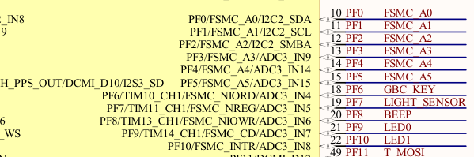
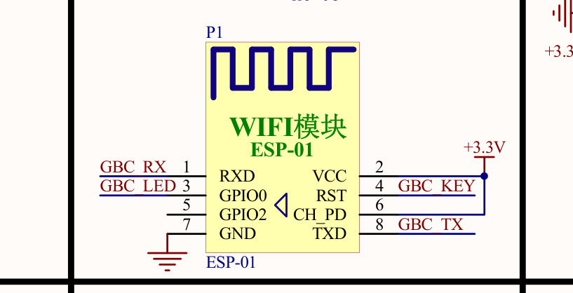
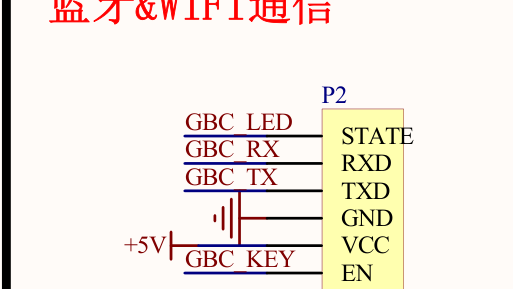

# R16 §5　C 板 ESP-01S 接线复核

负责人确认 Wi-Fi 模块直插板载插座，现场没有额外引线。板图是《STM32F4 神舟号原理图 V2.0》，六页，SHA-256 为 `7737115dc272d6daff1f3bb08b7c8c23c10415c10bca57c3d72979adf53b46b2`。与本机参考 PDF 一致。 [原理图](../../hardware/STM32F407_原理图.pdf)

| 信号 | 图纸结论 |
| --- | --- |
| ESP RST | 第 5 页 **P1.4 → GBC_KEY**，第 4 页同名网络连接 **STM32F407ZGT6 PF6（芯片第 18 脚）**。ESP-01S 的 RST 对应 ESP8266EX 的低有效 `EXT_RSTB`。 |
| ESP EN / CH_PD | 第 5 页 **P1.6 → +3.3 V**，与 P1.2 VCC 直连。图纸上没有 GPIO、隔离跳帽或独立开关控制这一路。 |
| 外接点 | 第 5 页 **P2 蓝牙插座的 EN 焊盘**也标 `GBC_KEY`，与 P1.4 同网。P7.52 标 `PF6`，但该处网名与 MCU 侧 `GBC_KEY` 不同，仅凭图纸不确认该排针与 RST 连通。未见专用 ESP 复位跳帽或测试点。 |

P1 脚号采用开发板插座定义。模块规格书的 DIP-8 脚序不同，按信号名与插入方向核对。图纸表明存在 PF6 硬复位路径，修正 R16 的原先判断。现场 PCB 版次、P2 是否装有其他模块、PF6 拉低后的实际复位行为仍待确认。按本轮要求，WP-AL 实现 STM32 软件恢复路径。

## 原理图裁图

第 4 页 MCU 的 PF6 与 `GBC_KEY`。

第 5 页 P1 的 RST、CH_PD 与 3.3 V。

第 5 页 P2 的同网引出点。

