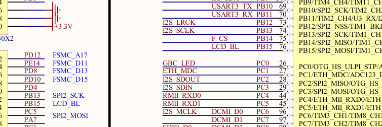

# R17 离线回执

## WP-AL2　接入退避与启动摘要

Wi-Fi、SNTP、TLS 或 MQTT 初次建链失败后，只要 AT 边界确认可用，接入按 2、4、8、16、30 秒退避，之后每次 30 秒，直至建链或 STOP。接入失败不消耗已建立会话的重入额度。实际 AT 失步仍走有界硬复位及软件后备。

已经建立的会话掉线仍受短期上限控制。前两次掉线后退避 2、4 秒，第三次在同一恢复周期内掉线即进入 LINK 停止。连续在线 300 秒清零。若一次掉线后热点继续不可达，只在退出已建立会话时记一次额度，随后的接入尝试使用独立退避。

启动前 60 秒内，约每 5 秒的 `B5 DIAG` 带 `boot_rst`（RCC 复位标志，十六进制）、`boot_escape`（完整转义已发出）、`boot_at`（AT 已确认）、`boot_resume`（接受软件续接记录）、`boot_reentries`（启动时带回的额度计数）。转义未确认时 `boot_at=0`。网络未建链和启动失败停机后仍可读取这些字段。后续短批应使用板上开关断电启动。J-Link 的无记录软件复位仍锁存。

Host 对端模拟热点不可达 300 秒，接入尝试超过三次，恢复后 MQTT 建链成功，会话额度保持零。另模拟三次已建立会话的短期掉线，前两次重连，第三次拒绝重入。300 秒清零、STOP 与串口恢复验证继续通过。另核对了无启动横幅时的 DIAG 字段与 60 秒截止。R16 额外十项 Python 回归来自 [统一安装测试](../../../gateway/microphone/test_unified_install.py)，文件名已补进原回执。

## WP-AN　PF6 复位与 GPIO0

第 4 页 **PC0（STM32F407ZGT6 第 26 脚）**标 `GBC_LED`，第 5 页同网连接 **P1.3 / ESP GPIO0**，也连到 P2 蓝牙插座的 STATE。板图未画该网络的独立上下拉。STM32 RM0090 的 GPIO MODER/PUPDR 复位值表明 PC0 在 MCU 复位后为输入、无内部上下拉，现有启动代码不驱动 PC0。ESP-01S 规格书第 12 页示出模块的 GPIO0 上拉。实际模块和 P2 装配状态决定上电电平。 [板图原件](../../hardware/STM32F407_原理图.pdf) · [P1/P2 连线](R16-HARDWARE-20261110.md)

复位时配置 PC0 为带弱上拉的输入，读高后才将 PF6 配成开漏并拉低。按 21 个 1 ms tick 保持低电平，确保至少 20 ms，再释放。复位前 GPIO0 为低时跳过 PF6 脉冲。脉冲期间或释放后读到低，保持或重新拉低 RST，并禁止可能释放 PF6 的 STM32 软件复位。普通释放后只在 3 秒内收到 `ready` 且随后 AT 确认才放行。等待 `ready` 时丢弃启动波特率噪声，仍受原 3 秒截止约束。

退出失败时优先走 PF6。没有按住 RST 的情况下，硬复位未确认且软件额度、STOP 门控均允许时，才走 R16 的 STM32 软件后备。Host 使用同一 GPIO 序列验证开漏、脉宽及 GPIO0 低电平门控，生命周期替身验证了启动噪声、`ready`、AT 及按住 RST 时的软件后备禁止。实际 PCB 版次、P2 装配、GPIO0 电平、PF6 脉冲和 `ready` 时序待实板确认。命令态发送转义前缀后的实物行为也待验证。

## WP-AO　四槽与 PPG 短批设计

生产 `--pass-lifecycle` 候选默认四槽。F-P115、F-P230 沿用原配置。沿用 R16 的四槽资源与模型结果，其槽位隔离对 11.5 批/s 稳态包络有效，无法解决 60.5 批/s 的 PPG 极端短批过载。 [R16 模型与资源](R16-AM-OFFLINE-20261110.md)

PPG 限速仅设计。建议在 C 组批处给短批独立设置每滚动 1 秒最多一批的门控。50 点满批继续原路径。可合并的条件是采样时间连续、同一来源及会话、有效性一致，且累计点数不超过 50。已确认间断、质量翻转或来源切换的片段之间保持边界。超额短批显式计数，并保留批号缺口，禁止补点或把旧值包装成新批。候选预算按满批 1 批/s、短批最多 1 批/s，五板含 NIBP 的持续输入预算约 12.5 批/s，事件和秒边界突发另计。

发送批次保持原 50 Hz、真实末点时间戳、样本和 VALID/INVALID。短批被抑制会改变部分数据的到达时刻与覆盖率。INVALID 边沿优先使用下一个短批额度，并在它发出前禁止用后续 VALID 抹掉已知失效。若直到现有时效边界仍无法发出，走既有失效处理。实现前由 PI 审核允许的 INVALID 延迟、样本损失、短批与满批竞争和最大等待；离线验收应涵盖 100 ms 静默、连续质量抖动、代次变更及 300 秒高负载下的时效。本轮未改 PPG 生产路径。

## 构建与复核

构建命令沿用 R16，`--pass-lifecycle` 现在编入四槽。Windows 与 VPS 均使用 Arm GNU 14.2.1。Host C 23 组，Python 79 项及 12 个子例通过。当前候选用于 PI 复现，待短批另行放行。 [R16 构建命令](R16-AL-OFFLINE-20261110.md)

| R17 生产候选制品 | SHA-256 |
| --- | --- |
| boot | `40351f6c67eddd697cc067e555bf8130525bbe09a7f90bb51579e06fe47264ac` |
| code | `163d1bffcd9267686c14e68ffb6857f379bfbd7edc3be38be997230d625062ac` |
| HEX | `f8db42feef4ad38e771c03a5ea619c686bc96883b83b7ee32b8ac3644b35953f` |

code 52,336 B，sector4 余 13,200 B。F-P115 和 F-P230 的 boot、code、HEX 均与冻结摘要一致。VPS 源码归档 949,036 B，SHA-256 `6b396e32287968aa5d9f9c10cfa98917a7c7d8c4e1ccd611f0b2b5ea1b36a9fe`。

实板 **NOT_RUN**。上电、刷写、START 和 Broker 本轮未执行。
