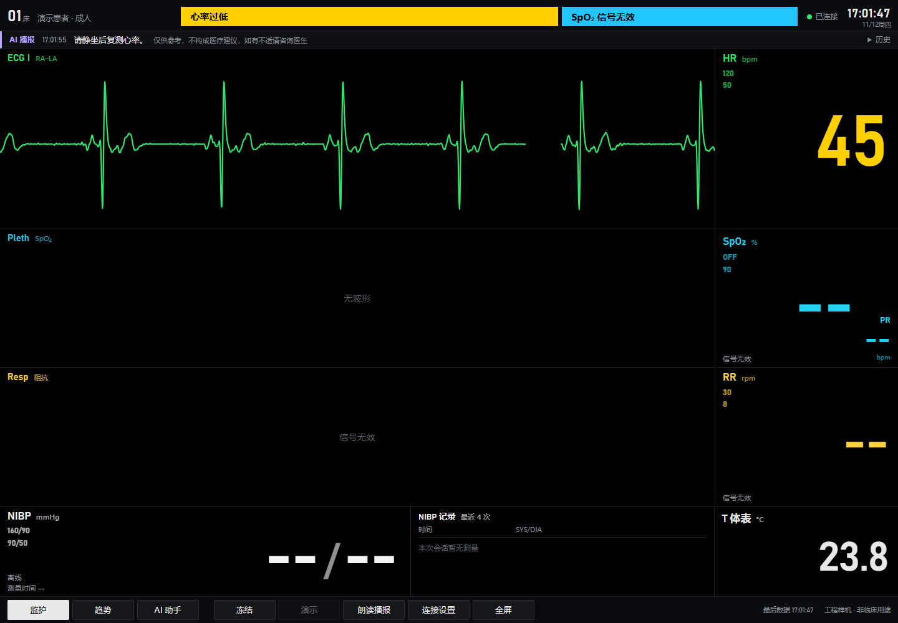

# R59 · W-AY run3 回执

## S6 开启

**PASS，2026-11-12。** 按 [R59 §1](https://github.com/Serendipity-min/medical-multi-parameter-monitor/blob/14f6bce25e7f47ea50706c94b6cf6e9b3db82097/node-b/docs/PI-REVIEW/R59-WAY-RUN3-CARD-20261112.md) 执行。负责人确认 C 断电、无人体连接；COM15 未枚举，初始无令牌 WSS 为 `OFFLINE`。

- 操作对象为 `wp-ay-s4-d30f7e7/backend.env`。写入前核对与 S4 部署态基线逐字节一致，并另存本轮备份 `/opt/medical-monitor/backups/wp-ay-s6-r59-pdm40vdl/backend.env`。写入后核对为 S4 基线仅追加一行 `MONITOR_BROADCAST_HR=1`。运行进程已加载该开关。
- 服务器北京时间 16:51:08.754 完成重启。健康 `ok`，MQTT 已连接。C 断电时无令牌快照返回 `broadcast:null`、`broadcast_history:[]`，网关 `GW-C-001` 为 `OFFLINE`。页面仍加载 P3 资源。
- 开窗前 SSH 时间取样中最短往返为 604 ms，服务器比本机快 +8.190 至 +8.794 s。后文时间线区分两套时钟。

| 服务 | 开启前 PID | 开启后 PID |
| --- | ---: | ---: |
| `medical-monitor-h3-webbackend.service` | 1333401 | 1337555 |
| `medical-monitor-h3-webai.service` | 1244393 | 1244393 |
| `medical-monitor-mqtt.service` | 3253 | 3253 |
| `nginx.service` | 3383 | 3383 |

## W-AY run3 现场

**R59 §3 通过。** ECG 全程由模拟器提供，D 测室温，无人体连接。E 板和血压泵保持关闭。PI 记录于 VPS 北京时间 16:52:45.5 开始，同期快照服务器时钟为 16:52:45.7。PI 文件为 `node-b/build/w-ay/w-ay-run3.jsonl`。负责人在普通 Chrome 开启朗读并确认有声。

### 时间线

除另有标记外均为 Windows 本机北京时间。服务器比本机快约 8.2–8.8 s。人工拨动或调整的秒数未记录时，保留分钟级回报和对应的自动观测。

| 本机时刻 | 事件 |
| --- | --- |
| 约 16:54 | 负责人确认 ECG 模拟器和 C 已上电，按卡片设定 75 bpm。COM15 于 16:54:35.591 枚举。 |
| 16:55:16.777 | 首次收到网关 ONLINE，距 COM15 枚举 41.186 s。 |
| 16:55:19.007 | 首个有效 LIVE 75 bpm。至切换提示前，至少连续观测 126.386 s，HR 播报 0 条。 |
| 16:57:26.022 | 提示先核对模拟器屏幕设定值，再切到 45 bpm。 |
| 约 16:58 | 负责人报告切换完成，确认模拟器屏幕显示 45 bpm。切换实际秒数 UNKNOWN。 |
| 16:58:32.696 | 首个有效 LIVE 45 bpm，对应快照服务器时间 16:58:40.889。 |
| 16:59:00.851 | 本机记下操作者的 45 bpm 确认，设定保持不动。 |
| 17:01:47.631 | 收到唯一一条 HR 播报，服务器时间 17:01:55.808。 |
| 17:02:08.301 | 本机记录现场确认听到该条心率播报，只读一次。 |
| 17:04:07.287 | 提示切回 75 bpm，距操作者确认至少 306.436 s。 |
| 约 17:04 | 负责人报告切回，确认模拟器显示 75 bpm。17:04:43.773 恢复有效 LIVE 75 bpm，至断电未见新增 HR 播报。 |
| 约 17:05 | 负责人确认 C、模拟器及其余设备均已断电。COM15 于 17:05:29.172 消失。各开关实际秒数 UNKNOWN。 |
| 17:05:42.031 | 播报与历史清空，距 COM15 消失 12.859 s。页面播报条于约 13.0 s 隐藏。 |
| 17:05:53.648 | 网关 OFFLINE，播报保持为空。 |

### HR 验收

按首个有效 45 bpm 后的五个连续 60 s 分箱，以 HR 采集时间戳去重。

| 分钟 | VALID / 总帧 | VALID 比例 |
| --- | ---: | ---: |
| 1 | 48 / 61 | 78.7% |
| 2 | 60 / 60 | 100% |
| 3 | 60 / 60 | 100% |
| 4 | 60 / 60 | 100% |
| 5 | 60 / 60 | 100% |
| 合计 | 288 / 301 | 95.7% |

- 切换初段共 13 条 INVALID，首五分钟内最长连续 VALID 45 bpm 为 285.786 s。持续观察到切回提示前，最长连续 VALID 45 bpm 达 320.443 s。
- 首个有效 45 bpm 后 **194.919 s**，产生恰好一条 `notice` 级 HR 播报，原文「请静坐后复测心率。」。来源为 LIVE、非合成、VALID。现场确认普通 Chrome 听到且只读一次。该时长落在预登记的 120–200 s 内。
- 两段 75 bpm 均无新增 HR 播报。截图中的黄色「心率过低」在 HR 播报之前已随模拟器读数出现。HR 播报显示在独立播报条，浏览器取证确认其文本未进入报警区。
- 45 bpm 正向补测通过。120 bpm 输入有效性不稳的根因仍为 UNKNOWN。此前 192 已按 R59 §0 更正为模拟器误调记录。
- 结项保留项为开发板 TTS、喇叭和音频下行，正式镜像的 `audio_enabled=false`，喇叭需 5 V 供电，此路径 **NOT_RUN**。付费模型路径按 R59 搁置，**NOT_RUN**。

### S6 收尾

服务器北京时间 **17:06:21.902**，移除 `MONITOR_BROADCAST_HR=1`，仅重启监护后端。复验 `backend.env` 与 S4 部署态备份、本轮开启前备份逐字节一致，进程环境中已无 HR 开关。健康 `ok`，MQTT 已连接。C 断电时无令牌 WSS 为 `OFFLINE`，`broadcast:null`、`broadcast_history:[]`。

| 服务 | 收尾前 PID | 收尾后 PID |
| --- | ---: | ---: |
| `medical-monitor-h3-webbackend.service` | 1337555 | 1341021 |
| `medical-monitor-h3-webai.service` | 1244393 | 1244393 |
| `medical-monitor-mqtt.service` | 3253 | 3253 |
| `nginx.service` | 3383 | 3383 |

### 现场证据

下图来自只读浏览器，画面仅包含 ECG 模拟器与室温数据。朗读结果由现场普通 Chrome 的操作者独立确认。

| 证据 | SHA-256 |
| --- | --- |
| HR 播报截图 | `2f5d144e3f02e67c9a2c20995f619f20c29afb37d6260cd7949dd72e3b924dab` |
| HR 播报前的 TEMP 截图，显示既有低心率报警 | `511e96459520fae8aa7c4e21a990c3e81186582ed467c1541979f7050dc31a47` |
| 播报条清空截图 | `0f0407512ba0b36ffdfc3a7fc11f4456f09d60919c3bb54e36eae5f39acc8fae` |
| 本机 WSS 快照，8,308 帧 | `1e61f7995a86cd2e69840044fcbbb9dce858f0026be6b2e1a7a69726a3a7a4f8` |
| 本机事件记录 | `557a2a38459227beb9aabd46927d1933c243a35588ba769558bd677003ec6452` |
| 页面取证记录 | `ede41fc5f1827b6f9b412df8856c9282215611fe2fdff92b51551c3c4d2aace0` |

原始记录保存在本机受限归档 `WP-AY-W-20261112-run3`。现场与服务收尾均已完成，可通知 PI 停止独立记录并复核。
