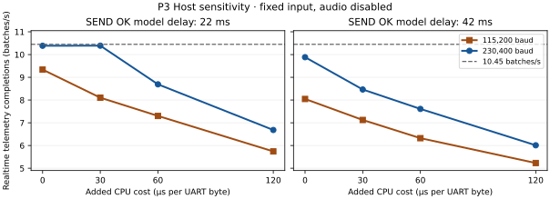

# R6 WP-P、WP-Q 离线验证回执

2026-11-09 · 实现源码 `a199a6faa2db8fa7f69730ae124ab3b30ce996ab`。R6 生产候选仅启用 230400，默认构建仍按 115200 起步并沿用原 AT 流程。保持裸机和 HSE 8 MHz。[R6 任务卡](https://github.com/Serendipity-min/medical-multi-parameter-monitor/blob/6c4d49e/node-b/docs/PI-REVIEW/R6-20261109.md) · [WP-R 设计评估](R6-WP-R-TRANSPORT-DESIGN-20261109.md)

## 实现与验证边界

| 类别 | 结果 |
| --- | --- |
| WP-P Host | 15 组 C 用例原生退出 0。新夹具运行真实 AT 解析和 USART3 寄存器替身，覆盖 flow 0/1、拒绝 2/3、`SYSSTORE=0` 失败、20 ms 保护路径、丢 ACK、乱码、缺失回复、STOP、热重启和有界回退。原 PREFLIGHT 用例通过。 |
| Host Python | 61 项及 8 子例通过，原生退出 0。P3 新扫描 22 组均退出 0，已发送载荷的身份和重复错误为 0。 |
| Windows ARM | 五种目标构建与 IRQ 向量核验通过。 |
| VPS ARM | 同一源码、同版 Arm GNU 14.2.Rel1 / GCC 14.2.1 与 SPL V1.4.0 重编，五种目标各自的 boot、code、HEX 与 Windows 位级一致。 |
| 本轮实板 | **NOT_RUN**。230400 生产协商、DWT 周期、容量、CAN 并发均无新实测。R5 的结果是 PRE 的 AT 级实测。 |

`--esp-230400` 在入网前以 `AT+UART_CUR?` 核验 8N1、流控及速率。先确认易失模式，切速只允许 230400，setter 和回读保持初始 flow。守护间隔为 20 ms，依次确认 TC、RX 安静、BRR、AT 同步和五元组。失败先查 115200；如果模块仍在候选档，仅在重新证实该档通信后发一次恢复 setter。无法证明恢复时报告 `GW FAIL UART_NEGOTIATE`，本次启动停止网络协商，CAN 和本地控制仍推进。MCU 或 ESP 单边重启时允许一次探测另一已知档，已失败后不会循环探测。生产目标不含 PRE 指令或 500000 档。独立 FIELD01 源码与回归入口保留，R5 镜像制品 SHA 仍按原回执识别。[生产协商](../../../gateway/mqtt/src/production_uart.inc) · [共用五元组](../../../gateway/mqtt/src/uart_negotiation.inc)

## P3 同负载 Host 扫描

扫描沿用 P3 的合成到达、真实 Router/coreMQTT/AT 所有权与虚拟 ESP。8N1 的字节间隔按整数 µs 取整，115200 为 87 µs、230400 为 43 µs。在 TX 和 RX 逐字节路径各自加入同一个额外 CPU 参数，按线时串行相加；原 25 µs 协作步长和其他模型参数保留。这是敏感性模型，额外成本 0 仍含原步长，实际线时与 CPU 可以重叠。以下均为 Host 批/s。

| 额外 µs/字节 | 115200 · SEND OK 22 ms | 230400 · 22 ms | 115200 · 42 ms | 230400 · 42 ms |
| ---: | ---: | ---: | ---: | ---: |
| 0 | 9.338 | 10.387 | 8.047 | 9.884 |
| 30 | 8.103 | 10.391 | 7.124 | 8.464 |
| 60 | 7.301 | 8.691 | 6.323 | 7.609 |
| 120 | 5.741 | 6.683 | 5.230 | 6.010 |

在这两个 SEND OK 参数和四个扫描点中均未跨过 10.45 批/s。230400、22 ms 下 0 与 30 µs 两档的差异仅 0.004 批/s，两档在窗口结束时均交付 492/495 个波形帧；据此无法给出达标的 CPU 开销阈值。60 µs 后速率与波形完整性同时下降。原 P3 五组输入在 CPU 附加值 0 下的双档重跑如下，波形输入均为 495。

| SEND OK / 音频请求 | 115200 批/s | 波形／音频确认 | 230400 批/s | 波形／音频确认 |
| --- | ---: | --- | ---: | --- |
| 22 ms / 0 | 9.338 | 462 / 0 | 10.387 | 492 / 0 |
| 22 ms / 64 | 8.798 | 432 / 64 | 10.260 | 492 / 64 |
| 22 ms / 125 | 8.812 | 433 / 65 | 10.087 | 491 / 125 |
| 42 ms / 0 | 8.047 | 392 / 0 | 9.884 | 488 / 0 |
| 42 ms / 125 | 8.009 | 390 / 13 | 9.048 | 442 / 99 |

扫描入口为 `python -X utf8 node-b/tools/five_appliance_p3.py --cpu-scan --out <new-output-dir> --cc <gcc>`。机器回执在本机忽略目录 `node-b/build/r6-a199a6fa-p3/results.json`，SHA-256 `2be83c794140340e767dc890eb5b1c8b2b70b2886177d5539b44656cb182764c`。[P3 基线](../FIVE-APPLIANCE-20261107/P3-REPORT.md)

## DWT 口径

`--transport-profile` 启用 DWT CYCCNT，在现有 `B5 DIAG` 行末追加数字。Host 使用零计数桩。计数从本次 MCU 启动累计，可用相邻快照的无符号差分处理回绕。周期区间为包含式，抢占与重叠窗口不能直接相加。

- `svc_cyc / svc_n` 计实际业务回调入口到退出，排除未调用回调的重入路径。
- `tx_cyc / tx_b` 计同步发送调用及实际写入 DR 的字节，含部分发送。 `txe_cyc` 单列其中等待 TXE 的区间。跨切片 `rx_step` 的命令发字不计入这一组。
- `await_cyc / await_b` 计成功取到字节的 await 循环，包括该次 service 调用和逐字节解析，排除空环等待和终态收尾；`rxstep_cyc / rxstep_b` 计消费字节的 rx_step 调用，含终态处理，调用方的 service 另计。
- `irq_cyc / irq_n` 计 USART3 ISR 体内区间与入口次数，含无数据入口，未计入异常进栈、退栈与末端计数开销。快照短暂屏蔽中断以配对读取 IRQ 计数。
- AT+GMR 命令含 CRLF 为 **8 B**。R5 的原件是 STM32 控制台，未记录 ESP 回复原字节，R5 实际回复长度保持 **UNKNOWN**。未来生产版 `gmr_rx_b / gmr_n` 记录成功 AT+GMR 的解析器回复字节与调用数，只导出数字。

profile 给诊断行增加字节并在热路径读取 DWT；取证时需把插桩扰动单列。合并构建相对仅协商版增加 **616 B Flash、64 B 静态 SRAM**，Flash 比 R6 的 600 B 预计值多 16 B，仍在 sector4 内。GCC `.su` 的 `diagnostic` 静态帧为 1,432 B，较未插桩的 1,104 B 增加 328 B；运行时栈峰值未测。

## Windows / VPS 镜像预算与摘要

构建基本命令为 `python -X utf8 gateway/dual_can/build_arm.py --b5 --egress-final --tri --unified --split-flash --five-node --five-appliance`。VPS 输入为 `git archive --format=tar.gz a199a6fa gateway`，927,334 B，上传前后 SHA-256 为 `18bd867a159cd6490364709b6b953ff1d2511170b672b2fc9337b06a7f47d09e`。同组 Windows 和 VPS 的 Flash 制品一致，ELF 容器可因工具平台不同而不同。

| 构建 | sector4 B | 余量 B | .data + .bss B | CCM B | Windows 目录 | VPS 目录 |
| --- | ---: | ---: | ---: | ---: | --- | --- |
| 默认 115200 | 58,048 | 7,488 | 83,004 | 64,000 | `b4-c-arm-20261109T075052592719Z` | `b4-c-arm-20261109T075117315670Z` |
| `--esp-230400` | 59,124 | 6,412 | 83,032 | 64,000 | `b4-c-arm-20261109T075059617864Z` | `b4-c-arm-20261109T075124545366Z` |
| `--transport-profile` | 58,656 | 6,880 | 83,068 | 64,000 | `b4-c-arm-20261109T075106441318Z` | `b4-c-arm-20261109T075131954946Z` |
| 两开关 | 59,740 | 5,796 | 83,096 | 64,000 | `b4-c-arm-20261109T075113215791Z` | `b4-c-arm-20261109T075139383971Z` |
| `--field01` 回归 | 61,980 | 3,556 | 82,448 | 64,000 | `b4-c-arm-20261109T075119810299Z` | `b4-c-arm-20261109T075146843117Z` |

协商选项相对默认增加 1,076 B sector4、28 B 静态 SRAM。默认与 `18a1896` 的离线对照均为 58,048 B，二进制 SHA 有差异；默认的 115200 和旧 AT 序列由构建门控保留。独立 PRE 回归构建与已实测 R5 镜像 2 是不同制品，均仅作离线记录。

| 构建 | boot SHA-256 | code SHA-256 | HEX SHA-256 |
| --- | --- | --- | --- |
| 默认 | `557904bfaef1c70a1096a3af2bb57baf8d46960ee9b2f048a8752fe9ea78a508` | `46c19a03202b25073c7a721c0d5ecba073ba76e553fec8c41d244884ed57f775` | `274754628c780b66b4772733aaf69675f6d82d05b25efc7933597e409c7e8869` |
| 230400 | `2bde3b3fbfe8eeac34441ab1d3663c692038b41f8bd488e39ed78a51ea7d23bd` | `64e82e309c54b8d4fa334326886ebf3adb26b98c368479d714e4ee5e800800ce` | `0becc43dd1574cbb35ae4b66488bf229457ff9070adcdb732fd9e5f32f3a5f53` |
| profile | `80b42f7f91654e4adfde881e73deae216b906a77170ab4411f54ea02535bfcd2` | `780bef3820e6efebf5e8bd5e497c539985eba89e38b98458a968e28c8a04516c` | `a33d31e7fd3278798b35789ddfaa80998da2c958535e77ec2361b0cd208f0b1a` |
| 两开关 | `fc6185e019f82fe72fbdec002d2103ed4552f7738edb1bae289613105dd965b9` | `8e2743fe8b582a1dbd6f1edea72c2d781be0945ad957d896b6dd16116afb8c56` | `2831d677f6d3c82a79ee6b72931d9eafd2a5da1478c88c70f8514d8e4eb78508` |
| FIELD01 | `4bb7b2b9dff875d021ed4dfeba266c072ca29f351a3ad6e525580e53a0c597dd` | `9d001fa3c14327853aedbc24806fdc9697edea86130a21d34b61240c3f3944ed` | `a5f7a69c25627a013fff0331aaa1e119c7b86ed1fca3314e4d72ffeed4ec8a1c` |

下一次五板上电、刷写及真实 DWT 测量须待 PI 起草批次卡和负责人授权。当前所有 R6 制品为离线构建。
