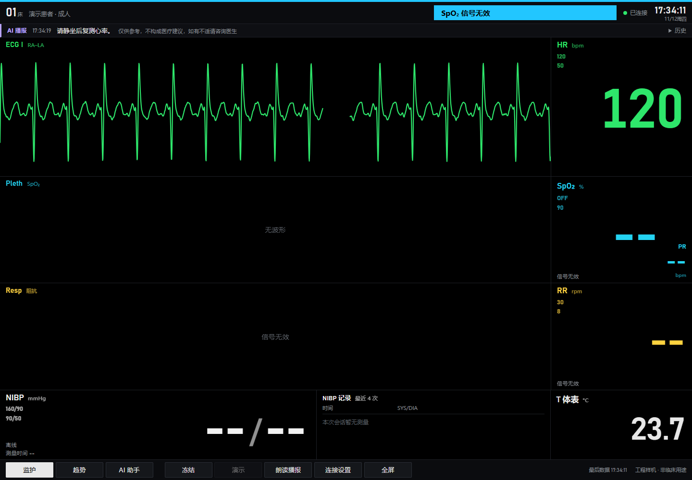

# R61 · W-AY run4 回执

## S7 开启

**PASS。** 按 [R61 §1](https://github.com/Serendipity-min/medical-multi-parameter-monitor/blob/35fe6d4/node-b/docs/PI-REVIEW/R61-WAY-RUN4-CARD-20261112.md) 执行独立的 run4 开关步骤。C 未枚举 COM15，正式 WSS 为 `OFFLINE`。当前 `backend.env` 与 S4 基线逐字节一致，备份到 `/opt/medical-monitor/backups/wp-ay-s7-r61-v1pqh0da/backend.env` 后，仅追加 `MONITOR_BROADCAST_HR=1`。服务器北京时间 17:25:22.087 完成重启。运行环境确认 HR 开关已加载，健康 `ok`、MQTT 已连接。断电无令牌快照为 `broadcast:null`、`broadcast_history:[]`。

| 服务 | 开启前 PID | 开启后 PID |
| --- | ---: | ---: |
| `medical-monitor-h3-webbackend.service` | 1341021 | 1345280 |
| `medical-monitor-h3-webai.service` | 1244393 | 1244393 |
| `medical-monitor-mqtt.service` | 3253 | 3253 |
| `nginx.service` | 3383 | 3383 |

## run4 现场

**R61 §3 PASS。** B 只接 ECG 模拟器，D 测室温，E 和血压泵保持关闭，人体未接入。PI 独立记录在 VPS 北京时间 17:26:49.3 开始，对应快照服务器时间 17:26:49.6，文件为 `node-b/build/w-ay/w-ay-run4.jsonl`。现场在普通 Chrome 开启朗读并确认有声。

下表为本机北京时间。快照服务器时钟在本窗口比本机快约 8.2 s，与 S6 测得的 +8.190 至 +8.794 s 相容。操作者提供分钟级开关时刻，具体秒数以可观测的 COM15 或 WSS 代理时刻记录。

| 时刻 | 事件 |
| --- | --- |
| 约 17:27 | 负责人更正后的上电时刻。COM15 于 17:27:45.636 出现。 |
| 17:28:26.605 | 首次收到网关 ONLINE。 |
| 17:28:28.532 | 首个有效 75 bpm，至切换提示前至少连续 123.859 s，HR 播报 0 条。 |
| 17:30:33.122 | 提示核对屏显后切 120 bpm，随后保持设定不动。 |
| 约 17:31 | 负责人确认稳定输出。首个有效 120 bpm 在 17:31:02.573，对应服务器时间 17:31:10.750。本机于 17:31:25.017 记下确认。 |
| 17:34:11.677 | 收到唯一 HR 播报，服务器 17:34:19.760，距首个有效 120 bpm 为 189.010 s。 |
| 17:37:30.730 | 确认后至少 365.713 s，提示切回 75 bpm。 |
| 约 17:38 | 负责人确认完成切换。17:38:45.506 恢复有效 75 bpm，至断电无新增 HR 播报。 |
| 约 17:39 | 负责人确认全套断电。COM15 于 17:39:29.629 消失。 |
| 17:39:41.773 | 播报和历史清空，距 COM15 消失 12.144 s，页面播报条约 12.500 s 后隐藏。 |
| 17:39:53.622 | WSS 为 OFFLINE，播报保持为空。 |

模拟器型号、档位波形、实际导联和幅度均未取得现场回报。网页显示 `ECG I / RA-LA`，B 屏独立照片为 UNKNOWN。

### 120 bpm 有效性与播报

从首个有效 120 bpm 起分为六个 60 s 窗，以 HR 采集时间戳去重。

| 分钟 | VALID / 总帧 | 比例 |
| --- | ---: | ---: |
| 1 | 53 / 60 | 88.3% |
| 2 | 60 / 60 | 100% |
| 3 | 60 / 60 | 100% |
| 4 | 61 / 61 | 100% |
| 5 | 60 / 60 | 100% |
| 6 | 60 / 60 | 100% |
| 合计 | 354 / 361 | 98.1% |

- 7 个 INVALID 都在首分钟，最长连续有效 120 bpm 为 350.967 s。固定档六分钟内有效读数均为 120 bpm。切回 75 的过渡期另观察到短暂无效和 125 bpm，未纳入固定档统计。
- 生成一条 `notice`，原文「请静坐后复测心率。」；来源为 LIVE、非合成、VALID。负责人确认普通 Chrome 听到了，现场播放次数没有独立录音。页面取证显示播报在独立播报条。
- 对照 run2 的 153/256 个有效样本、最长连续有效越界 51.580 s，本轮固定设定后未复现持续无效。run3 的 45 bpm 对照是 288/301、首五分钟最长连续有效 285.786 s。各轮档位及窗口不同，run2 的无效根因仍为 UNKNOWN。

### S7 收尾

服务器北京时间 17:40:11.222 移除 `MONITOR_BROADCAST_HR=1`。仅监护后端重启，PID 1345280 → 1348667。webai、Mosquitto、Nginx PID 分别保持 1244393、3253、3383。文件与 S4 部署态基线、S7 前备份逐字节一致，运行环境确认 HR 键已移除。健康 `ok`，MQTT 已连接，C 断电时无令牌 WSS 为 OFFLINE、`broadcast:null`、`broadcast_history:[]`。

### 证据

本机受限目录 `WP-AY-W-20261112-run4` 保存原始记录。现场与 S7 收尾均已完成，可通知 PI 停止记录并复核。

| 证据 | SHA-256 |
| --- | --- |
| HR 播报截图 | `389bd2e30484f3561c93c2f1650c24121bdf79ae195597a878a0115057d863ef` |
| 播报条清空截图 | `cca4775848136bf20a37de2fbf0d809e267bfabad3eb7957cdf1050027f2cd8b` |
| 本机 WSS，8,190 帧 | `cc8673b310410628cba584c25bffce3539befa7963f6c9897fdeedd7cadb2b46` |
| 本机事件记录 | `39fb1e560b896b5b7697acdc1d93d9f731f1c36be706282b556d695ef2945c20` |
| 页面事件记录 | `da860ca8b0419635adfcd368208e0d1ab3beb045a110cd54b25353abd901951b` |
