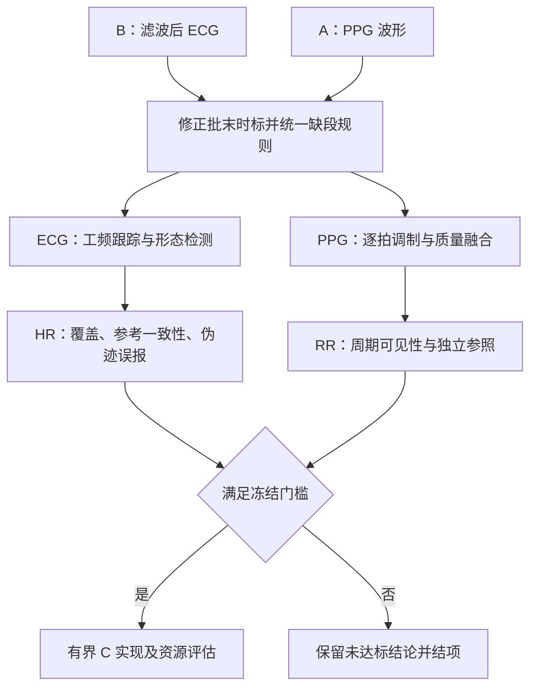

# ECG / RR 真人测试问题复核与下一轮离线验证方案

**日期：2026-11-19**  
**审查基线：Serendipity-min/medical-multi-parameter-monitor，main@bf9df580533671e8b5176d6544c0344de7578a19**  
**性质：研究结论与执行建议；候选算法尚未在受限真人录制上验证。**

## 1. 负责人结论

建议再做一轮范围明确的离线研究。仓库和外部资料支持三条具体路线：

1. **先修正离线分析的时标、缺段和质量处理。** 网关的批末时间戳被分析脚本当作批首；PPG变长批次时，错误不再只是固定延迟。
2. **ECG：自适应工频残留消除，加形态证据。** 用UNSW / NeuroKit作成熟离线对照，再评估短模板与质量拒绝。
3. **RR：优先完整验证A节点PPG的逐拍呼吸调制融合。** 上传支路保留幅度与基线信息；旧试验没有覆盖完整的RIAV、RIIV、RIFV与质量融合。

当前保持“真人ECG-HR、阻抗RR未达长期有效要求”。**有值得尝试的新方案，不等于已证明能修好。** 现有录制缺乏可靠独立呼吸真值，PPG-RR最初只能筛选可行性，不能直接签发真人准确度通过。

第一轮不需要换芯片、加导联、提高采样率或重新烧录。500 SPS、相位/增益改变及模拟前端改动放在新数据证据之后；若低成本离线候选仍不满足门槛，则按收窄后的R96口径结项。

## 2. 本次实际核验范围

### 2.1 分支、合并和CI

| 项目 | 已核验状态 |
|---|---|
| PR #21 | 已合并，普通双父合并提交 |
| main | bf9df580533671e8b5176d6544c0344de7578a19 |
| 两个合并父提交 | 10b6880f62d4ac635e23d6e85598e6bd29be6f01；7653427e0a267168469a33daea497da5d4620aed |
| claude/closeout-ai-wss-test-fix | 分支存在，末提交7653427 |
| PR末提交检查 | test-and-build、semgrep-cloud-platform/scan均success |
| 合并提交检查 | test-and-build success；本次查询未见该合并提交自身的semgrep检查，不能把PR检查描述成另一条运行 |
| 相对合并前main | 112个文件变更，9982行增加、5行删除 |
| 本次独立主机复跑 | 归档C2的57/57通过；historic=null，即没有真人/历史原码回放 |

来源：[PR #21][P1]、[PR test-and-build][P2]、[PR semgrep][P3]、[合并提交test-and-build][P4]。CI证明对应检查通过，不证明真人ECG/RR达标。

### 2.2 阅读与边界

三个子智能体分别核查ECG算法与评测、RR/PPG路线、ADS1292R采集；主审交叉检查R83–R97重点文档、分析源代码与结果、A波形路径、C网关模型、前端时间轴、原厂和论文资料。

本次没有读取受限EFS/服务器中的志愿者原始录制，没有改变远端分支、生产固件或硬件。README所列9份录制保持既有受限存放方式。[项目交接][R97]、[数据与复跑说明][RREADME]。

本报告区分：**已证实**（代码、回执、规格或实跑结果）、**计算/推断**（明确假设下的解释）、**建议试验**（尚未在本项目真人数据上证实）。

## 3. 先修正审查依据中的五个问题

### 3.1 现场C2和默认固件源文件不是同一份

现场C2的明确归档是：

    node-b/docs/PI-REVIEW/analysis-r83-r96/scripts/r89/src/bio_v2_c2.c

R89/R90通过构建注入使用该候选；R90记录应用产物40,576B。默认固件目录的bio_v2.c仍有冻结版规则，不能直接当成现场C2起点。[R89][R89]、[R90][R90]、[归档C2][C2]。

下一轮清单写明输入数据版本、C2源文件、构建入口和产物即可，避免改错源文件。

### 3.2 已确认：离线时间展开违反现有协议

证据闭环：

- gateway/data_model/model.h明确时间戳为波形批次末样本时间；
- b4_gateway.c逐点覆盖f->timestamp=utc，满批时发送；
- model.c原样发布该时间；
- 前端monitorStore.ts正确从末点向前恢复；
- 分析load.py和若干PPG loader却用timestamp+i×step。

每一批正确公式为：

    t[i] = timestamp - (N - 1 - i) * 1000 / sample_rate

N必须取该条消息实际len(samples)。[模型][MODEL]、[网关][GW]、[前端][WEBTIME]、[分析loader][LOAD]。

| 满批类型 | N、采样率 | 错误展开造成的整体后移 |
|---|---|---:|
| ECG | 100点、250Hz | 396ms |
| PPG | 50点、50Hz | 980ms |
| RESP | 50点、50Hz | 980ms |

满批ECG/PPG相对偏移可多出584ms。五板构建允许PPG在缺段、质量边界和静默时发布短批，偏移会随N变化；不能对所有PPG统一减980ms。

**影响边界：**固定满批只造成单流平移，通常不改变单流频谱和间隔；自由搜索延迟有时可以吸收常量偏移。变长批却可能制造缺口、重叠和峰时刻扰动。具体9份录制受多大影响须按原始批长复算。此问题不改变板上HR/RR已经无效的现场事实。

首项交付应比较修正前后：批长分布、缺口数量、PPG峰间距、跨模态延迟、QRS集合平均、HR与PR配对结果。旧结果保留，不覆盖。

### 3.3 MQTT原始记录不等于ADC原码

ECG的y是现有滤波后检测带输出，RESP的r也是滤波后输出。量纲反换只能撤销缩放，不能恢复已经去除的直流、频带和原始诊断量。[loader][LOAD]、[C2][C2]。

| 试验 | 现有录制支持程度 |
|---|---|
| y后置工频残留消除、QRS检测、形态/SQI | 可做检测器级验证 |
| 修正时轴后的ECG/PPG时点互证 | 可探索，须处理同步和验证循环 |
| PPG逐拍调制与RR融合 | 可探索 |
| 滤波后RESP周期/瞬变分类 | 可探索 |
| 改ADS采样率、增益、相位、模拟RLD | 不能由旧录制验证 |
| 改滤波前DC恢复、原始CH1伪迹抵消 | 不能完整验证，需对应原码 |

不得将y/r再经过一次原始前端，称为整条固件等价回放。

### 3.4 C3各候选的缺段和资格处理不完全一致

直接代码审查发现：[入口][C3DATA]、[C夹具][C3DRV]、[周期估计D][C3D]。

- 数据入口丢弃validity、seq，只保留时间和值；
- C2夹具仅运行心搏路径，绕过完整输入质量、削顶和缺段处理，预热也不完全相同；
- D遇缺段往窗内补零，并保留部分旧窗/输出状态；
- 部分检测器reset没有清除全部学习和间期状态；
- 有效率按收到样本统计，不是整段观察时间覆盖；
- 部分白噪声结果只含10个种子，R95要求40个。

这不会把C3的失败变成通过；它说明下一轮必须统一分段、重置、新鲜度和统计分母。

还要区分**输入质量**与**旧算法派生有效性**。已确认B的CAN发布代码把ECG波形有效位绑定到hr_ok与hr_reason，把RESP有效位绑定到rr_ok与rpm_reason。因此MQTT INVALID不等于“没有可分析的样本”，不能全部剔除而失去救回机会。应保留这些波形进行检测器研究，另外识别输入缺失、削顶和来源状态；旧录制无法恢复的原始诊断量标UNKNOWN，不默认通过。[B的有效性映射][BCAN]

### 3.5 两个结论不能外推

**“SNR 1–2”不是通用算法极限。** 现有脚本用PPG对齐集合平均峰值除以整段y标准差，分母包含QRS和残余工频。更准确的名称是“集合平均峰值/总RMS比”；不能直接与论文的dB信噪比比较，时轴修正后也应重算。

**“任何算法都无法”超出了试验范围。** R96仅证明已评估C3候选未达门槛，不能否定未试的成熟检测器、形态方法或合格多信号融合。[R95][R95]、[R96][R96]。

## 4. ECG采样与长期无效：原因判断

### 4.1 高置信度：输入不稳，峰检与资格组合适应不足

R87有较好真人结果，其他贴片/志愿者/时段显著变差，模拟器却稳定。C2峰门限为max(30, 2.5×RMS)，再检查峰宽、间期窗和新鲜度。QRS相对总RMS不够突出时，大量心搏不能跨门限；放宽门限或只要求节律稳定，又会接受准周期伪迹。[R97][R97]、[C2][C2]、[R96][R96]。

R93证明采集链路具备正常工作能力；不能证明人体高接触阻抗下的共模转差模、两侧阻抗不平衡、RLD环路已全部正常。TI也明确讨论电极、线缆和输入RC失配对共模抑制的影响。[TI-RLD][S3]

### 4.2 寄存器没有显见的基础配置错误

| 参数 | 当前设置 | 判断 |
|---|---|---|
| CONFIG1 | 0x01，250SPS | 合法 |
| CH1/CH2增益 | 4 | 当前呼吸组合处于推荐范围 |
| RLD_SENS | 0xEC | RLD已开，仅取CH2正负输入共模 |
| RESP1/RESP2 | 0xEA/0x03 | 内部调制解调、32kHz、112.5°、内部RLD参考 |
| 导联脱落电流 | 关闭 | 不可假定状态位能可靠检测电极脱落 |

不能再把“开启RLD”当新修复。配置合理也不等于实物接触、反馈网络、时钟和环境耦合已测量通过。[驱动][ADS]、[TI数据手册][S1]

### 4.3 新增优先假说：采样时钟与固定陷波失配

TI内部时钟在25℃的精度规格为±0.5%。若使用内部时钟，配置250SPS不保证实际250.000；固件系数却固定按250Hz生成。[TI，打印页9][S1]

按C2实际50Hz陷波系数计算：

| 假设实际采样率 | 对应物理陷波中心 | 真实50Hz分量的幅频增益 |
|---:|---:|---:|
| 248.75SPS | 49.75Hz | −7.51dB |
| 249.50SPS | 49.90Hz | −14.79dB |
| 250.50SPS | 50.10Hz | −14.82dB |
| 251.25SPS | 50.25Hz | −7.57dB |

**这是数学敏感度计算，不是设备测量。** 它表明轻微时钟失配可能显著降低固定陷波效果；不能据此说本设备已偏了±0.5%。

验证顺序：

1. 在修正时轴后的连续y上检查实际数字工频及变化；
2. 如已有受限原件包含DRDY序号、设备时间/DWT，用长窗估计实际Fs；
3. 没有这些字段则标实际Fs未知，不能用MQTT收包率代替；
4. 原码或后续采集阶段再区分电网频漂、采样时钟偏差和其他干扰。

ADS由DRDY中断采集，HR间期使用设备采样时刻；不是简单软件每4ms读一次。固定250主要影响滤波系数、抽取与名义波形网格。

### 4.4 250SPS谐波混叠尚未证实是根因

ADS1292R是ΔΣ转换器，经过sinc³抽取，不能当作无抗混叠的250Hz裸采样。[TI §8.3.5][S1]

按原厂传递函数计算，名义250SPS时：

| 模拟输入 | 可能折叠至 | sinc³幅度衰减 |
|---:|---:|---:|
| 200Hz | 50Hz | −37.86dB |
| 300Hz | 50Hz | −48.43dB |
| 245Hz | 5Hz | −101.43dB |
| 255Hz | 5Hz | −102.47dB |

这是理想小信号计算，不含饱和/非线性，也不能排除很大谐波；但R97的混叠拍频解释需要量级、连续频谱和实际时钟证据。40–60秒幅度起伏不足以唯一证明第四/第六谐波折叠。

因此**500SPS不作为第一步**。如后续试验，应同步调整滤波、抽取、时标、缓存及传输预算，可研究本地500采集、合格抗混叠低通后抽到250。将旧y插值到500不能证明新采集有效。

## 5. ECG新方案：成熟对照与轻量候选

### 5.1 ECG-A：跟踪残余工频，保留严格误报评价

R95提过自适应陷波，R96实际展示五点梳状，两者不等价。原始研究支持干扰频率、幅度、相位跟踪，但不能将论文增益直接当作本项目结果。[Martens等2006][S4]

候选结构：

    旧y → 条件启用工频跟踪/正余弦抵消 → C2或新检测器

原型可用：

    line[n] = a[n] cos(phi[n]) + b[n] sin(phi[n])
    clean[n] = y[n] - line[n]

受限频率跟踪器更新相位，LMS/NLMS类规则估计a、b；仅在工频附近有显著窄带能量时启用。限制学习速度，对大瞬变抑制更新，避免把QRS吸收到噪声估计。搜索范围、更新参数在跑真人结果前冻结。

消融分别比较C2、自适应+C2、新检测器/SQI、自适应+新检测器/SQI。固定频点数时可做到每样本几十次运算、数百字节状态；这是工程估算，须由C实现和实测确认。

R95已显示工频压低后仍可能大量错检，所以必须同时评价正确性、覆盖和阴性误报，不能仅凭频谱变干净判通过。

### 5.2 ECG-B：用UNSW / NeuroKit作成熟离线对照

2024年原始研究比较18个开放QRS检测器，UNSW与NeuroKit总体表现较好，低质量单导联数据仍困难。[Kristof等2024][S5]

复用入口：[UNSW Python作者实现][S6]、[检测器比较代码][S7]。

在相同连续段、250Hz输入、相同缺段/质量规则下对比C2。初始基准不启用自动插入/删除心搏的“纠错”，避免混淆检测与事后修补。作者README示例有生成360Hz、调用250Hz的参数不一致，本项目必须按实际数据填写。

批处理实现可能用未来样本或较大缓存；它是离线对照，不能直接宣布满足F407实时与2KB限制。

### 5.3 ECG-C：短模板与多项质量证据

轻量候选采用“有QRS形态支持才接受节律”的原则：

1. 短模板或归一化相关检查QRS形状，处理极性变化；
2. 结构不同的检测器提供逐拍/逐间期一致性；
3. 联合窄带干扰、幅度/宽度、平线、削顶、缺口和新鲜度；
4. 模板仅从可信心搏更新，差信号或换贴片时冻结/重建；
5. 没有新可信ECG心搏，最迟4秒失效，不用预测心搏续有效。

低复杂度形态模板质量评价已有原始研究，借鉴其设计，不移用特定ICU数据的准确率。[Menon等][S8]

资源估算：64点模板、64点缓冲各256B；单模板每秒约64×250=16000次乘加，另加状态和质量特征。有机会控制新增RAM于2KB内，完整预算须实测。

**bSQI不能独立保证无伪迹。** 两个检测器可能同时识别规律干扰；模板也可能学错。因此阴性对照应包括准周期尖峰、倍频/半频和形态相似伪迹，不能只用白噪声。

### 5.4 ECG-D：PPG逐拍互证单列验证

先在主机/C/云侧探索，不假定B已有消费A-PPG的入口。

从PPG波形找脉搏时点；先修批次时间轴，再估计设备偏移、处理延迟和脉搏到达延迟的总和。在有界窗口匹配，并要求ECG本身有局部波形证据。PPG不能凭空补一个“ECG心搏”并把B标有效。

多模态研究支持质量控制与延迟映射；ECG电活动与外周脉搏也可能合理不一致，不能无条件判ECG错误。[Johnson等2014][S9]

**避免循环验证：**A参与选心搏后，A的PR不能继续作为唯一准确度真值。应有独立QRS标注、模拟器或同步外部参考；不可辨片段标无法判定，并计入覆盖损失。

产品备用值可以叫“PR，来源血氧”，不能据此宣布B的ECG成功。

## 6. RR当前困难的合理解释

### 6.1 周期信息不足，不能只改一个门限

C2的required=3是首次资格；5槽窗口填满后，最多最近5个间期都须在中位数±20%，呼吸没有HR漏拍桥接。自然不规则呼吸可能频繁失效，但仓库还记录到缺乏清楚周期，严格资格不能被认定为唯一根因。[C2][C2]、[R88][R88]

R91的1R数据：

| 设置 | 滤波后正弦振幅 | 残差SD |
|---|---:|---:|
| 20次/分，1.0R | 325r | 234r |
| 12次/分，1.0R | 326r | 26r |

振幅近乎相同，残差约差9倍，不能说“0.8Hz低通滤掉了20次/分”。最低20内部码相对约330r幅度也不高，减小20不是优先修复。[R91][R91]

大阶跃后约55秒恢复说明慢状态值得诊断；原始DC重置的完整效果不能由滤波后r反推。

### 6.2 “1R”不能未经核实写成“1Ω”

项目注明模拟器R定义和基阻未知。结果文本里的r/Ω标签不改变这个限制；仍应说“约330r对应模拟器1R”，换滤波后不能自动沿用比例。[R91][R91]、[定标输出][RCAL]

TI说明典型呼吸阻抗变化约0.1–1Ω，并讨论两/四电极实现；这不能使本项目未知R自动获得欧姆标定。[TI SBAA181][S2]

### 6.3 两电极是局限，不是已判定的死因

两电极会混入接触阻抗变化；四电极可改善，但需改硬件。当前不能从“模拟器正常、人体差”推出两电极方法原理上不可行。

现有r可先检查瞬变、周期能量、缺口、心搏同步残留。解调相位、激励/测量路径、线缆阻抗和原始CH1心源性抵消，需要对应原码或后续台架数据。不要重复只加高通/平滑/放宽±30%，再把出现的数字当正确RR。

## 7. RR首选：PPG逐拍呼吸调制融合

### 7.1 现有数据条件确实存在

A节点路径为：

    UNO IR字段 → 独立CAN环 → 接收时基重采样 → 固定比例缩放 → MQTT PPG

这条支路不经过屏端0–255动态归一化，也不经过屏端高通，保留研究幅度和基线调制的条件。[UNO][UNO]、[A-CAN][ACAN]

**50Hz是接收时基重采样，不是已证明的传感器原生采样率。** 模块内部处理、ADC时刻与接收时刻的差异仍有限制。[A可靠性说明][AREL]

### 7.2 旧试验不足以否定完整路线

r87_ref.py先把PPG降到10Hz，再用100ms网格检峰，仅比较基线与IBI频谱，未完整提取RIAV、脉搏质量与融合，并会跨长缺口插值。[旧PPG脚本][PPGOLD]

100ms峰时刻量化会损害RIFV；长缺口插值可制造慢趋势。下一轮应补齐这些步骤，不重复同一条频谱检查。

### 7.3 可执行流程

1. 按每批N恢复末时标，保留会话、质量和序号。
2. 在50Hz波形找峰谷，不先降到10Hz。局部峰时刻插值不当作新增真实分辨率。
3. 检峰可用独立带通；幅度和基线从未动态归一化支路取。
4. 每个合格脉搏形成：

| 特征 | 示例定义 | 主要限制 |
|---|---|---|
| RIAV | 峰减相邻谷 | 接触变化也会影响幅度 |
| RIIV | 峰谷均值或一致定义的基线 | 漂移、增益跳变可能伪装呼吸 |
| RIFV | 相邻合格脉搏间期 | 对误检、时间量化敏感 |

5. 拒绝指夹调整、削顶、长缺口、畸形/重复峰；插值上限事前冻结。
6. 仅对逐拍特征降采样；32秒窗为主、64秒窗为对照。
7. 分别评价周期显著性、脉搏质量、候选一致性，融合可信特征。
8. 可预注册“至少两条合格特征相差≤3次/分才输出”作为首个保守候选；这是工程设计，不是通用标准，也不能保证两条同源伪迹不会一致。
9. 输出估计、统计窗口、更新时间、来源、质量和拒绝原因。

主机阶段以RRest/Smart Fusion作参考，再设计简化版本。[RRest][S11]、[Charlton等2016][S10]

### 7.4 文献支持可行，不能保证本项目成功

Charlton等提供呼吸特征—周期估计—融合的系统比较。Pimentel等使用多调制与质量控制，32秒窗下两个独立数据集的记录级MAE中位数约1.5和4.0次/分。跨数据集差异明显，不能许诺本项目自动达到±2或±3。[Charlton等][S10]、[Pimentel等2017][S12]

### 7.5 窗长、新鲜度和呼吸暂停需分清

32–64秒窗属于慢变化呼吸率估计。每2秒更新不代表2秒生理响应延迟，10秒屏气不能要求立即归零。

- 输入断流、指夹脱落或输入质量失败，按实时失效规则处理；
- 持续有效输入下的呼吸变化另测响应时间；
- 记录统计窗口和来源；
- 不将该PPG候选当作呼吸暂停检测。

### 7.6 资源与部署位置

先在私有离线环境研究，不改生产数据。64秒×50Hz×4字节，仅单条原始缓存就12.8KB，完整算法不能直接宣称符合B新增2KB限制。

有收益后，流式版本只保存脉搏/低频特征，复用工作区，再核对A或C的map预算。算法用A的PPG，不要求第一步就运行在A。新增来源RR还要同步网关、后端、UI及播报的source/validity映射，不能伪装成B阻抗RR。

## 8. 方案优先级

| 方法 | 优先级 | 理由 |
|---|---|---|
| 修复时标、缺段和评测 | 立即 | 确定代码证据，可用旧录制完成 |
| ECG自适应工频+形态/SQI | 高 | 有明确未覆盖方法 |
| PPG逐拍调制融合RR | 高 | 幅度支路可用，旧试验不完整 |
| ECG/PPG时点互证 | 次高 | 先修时轴，避免循环验证 |
| 滤波后RESP分类/瞬变诊断 | 辅助 | 可分清失败类型，未必恢复真实周期 |
| ECG-derived respiration | 低 | QRS不稳，5–25Hz已去除低频基线 |
| 500SPS、相位/增益对照 | 后续 | 需新原码和整条滤波/时基调整 |
| 四电极、多导联、换芯片 | 后续改版 | 超出本轮主要目标 |
| 深度网络、重型时频方法 | 暂不投入 | 数据/标注与资源收益未证明 |
| 只放宽门限或自相关报数 | 不单独推进 | 已有周期伪迹失败证据 |

EDR可在R87清晰片段附加比较，但不宜让依赖可靠QRS的方法承担当前QRS很差时的主救援任务。

## 9. 下一轮执行顺序与门槛

### 阶段0：建立可比回放入口

PI在原受限环境使用9份录制，原件不入库。

交付：确认每批末时标、N、采样率、会话、质量和序号；修正时轴；禁止跨会话拼接和跨长缺口补零/插值；区分输入质量与旧算法派生有效性；同时重跑C2和主要旧候选，保留新旧结果。

这是离线分析修复，不应改变网关既有时间协议。

### 阶段1：ECG、PPG-RR并行筛选

ECG比较C2、自适应+C2、成熟检测器、形态/SQI、合并候选；PPG辅助单列。

RR逐拍提取三种调制，逐条和融合结果都报告；B失败的RR不能作为真值。



### 阶段2：提前冻结评价

以下是PI冻结用建议，不是已取得的结果或临床标准。

#### ECG

| 项目 | 建议规则 |
|---|---|
| 增益 | 沿用R95：R89/R91/R94至少两份提升≥20个百分点，R87不退化；以修正后同入口C2为基线，不机械沿用旧65.8% |
| ECG-only候选与A-PR一致性 | 保留旧≥85%、绝对误差中位数≤3bpm；这是“与A的PR一致性”，不是金标准准确度 |
| PPG辅助分支 | A不能同时作唯一辅助与唯一真值；无独立参考则准确度NOT_EVALUATED |
| 误报 | 导联断开评价段有效率0%；接回伪迹段不报出参考±10%外的数值；准周期伪迹各档不劣于修正后C2 |
| 噪声 | 完整40种子，有效率均值≤0.2%、最长连续有效≤4秒；必要时补电极运动、肌电噪声 |
| 新鲜度 | 新可信ECG心搏停止后最迟4秒失效；预测不能续有效 |
| 阳性和回归 | 模拟器60±1、有效率不低于修正后C2；C候选通过57项既有与必要新增反例 |
| 资源 | 因果版本有收益才做ARM构建；应用≤48KB、新增RAM目标≤2KB，计入缓冲、栈和库开销 |

不要看到结果后将85%改为“略不差于80%”再称原门槛通过；若原参考或配对不合适，应先说明依据、重订指标，再启动新轮。

公开多类型噪声可参考[PhysioNet NSTDB][S13]，用于实现压力验证，不替代项目真人验证。

#### RR

现有录制先做候选筛选，报告全时长覆盖、窗合格率、最长无输出、各特征周期、阴性输出和拒绝原因。无同步参照不发布准确率PASS。

后续有独立同步参照时，可事前冻结工程目标示例：

- 范围6–40次/分，主窗32秒、64秒对照；
- 质量合格静息段有效窗比例目标≥80%；
- 有效窗误差≤3次/分比例目标≥90%；
- 每人单独报告MAE、偏差、覆盖与误差尾部；
- 无呼吸调制的合成脉搏、周期性基线伪迹、指夹调整和断流单列。

上述是待PI确定的工程目标。节律指令、主观“按12次/分呼吸”、PPG与RESP同谱峰，都不能自动当作精确真值。

#### 共同报告要求

报告全部观察时间覆盖、连续有输入条件覆盖、有参考时正确且有效时间占比、条件误差、误报时长；每次录制/每位志愿者分开列示。不能将不可判定和缺段悄悄删出总分母。

9份录制已反复研究，属于回顾性开发资料，不能再包装成全新盲测集。候选有收益后，再用后续独立记录确认泛化。

### 阶段3：只推进有证据的候选

离线有收益后再实现有界C，核对因果性、延迟、资源及新鲜度。实板/人体的新验证沿用项目相应安排；本报告未执行。

若只能靠放宽质量、重命名PR或把周期伪迹当呼吸提高覆盖，判失败并结束该轮，不能以“终于有数字”代替达标。

## 10. 建议结项口径

建议将R96中“任何算法都无法”收窄为：

> 在当前采集条件和既有数据上，C2及已评估C3候选未同时满足真人HR有效覆盖、参考一致性和伪迹拒绝要求。模拟器验证表明链路具备正常工作能力，但人体接口和真实输入质量仍是限制。新增审查发现离线时标和缺段评价需修正；PPG呼吸调制融合、自适应工频消除及形态判别尚有可验证空间。后续以低成本离线候选能否达到事前冻结门槛为准；无法达到时保留“真人ECG/RR未达标”的工程结项状态。

## 附录A：独立验证与计算复现

### C2主机回归

在隔离本地副本、归档C2源上运行：

```bash
NODE_B_TEST_OUT=<新目录> python3 node-b/docs/PI-REVIEW/analysis-r83-r96/scripts/r89/run_host_c2.py --source node-b/docs/PI-REVIEW/analysis-r83-r96/scripts/r89/src/bio_v2_c2.c --c1-cases --c2-cases
```

返回：

```json
{"pass":57,"total":57,"failed":[],"historic":null}
```

结论仅为归档C2主机回归通过；真人未复跑，没有新的候选收益数字。

### 陷波与sinc³计算

```python
import math
import cmath

b = (0.9865955975, -0.6097496124, 0.9865955975)
a = (1.0, -0.6097496124, 0.9731911951)

for fs in (248.75, 249.5, 250.5, 251.25):
    z = cmath.exp(-2j * math.pi * 50 / fs)
    h = (b[0] + b[1]*z + b[2]*z*z) / (a[0] + a[1]*z + a[2]*z*z)
    print(fs, 20 * math.log10(abs(h)))

fmod, decimation = 128000.0, 512
for f in (200, 245, 255, 300):
    h = abs(math.sin(math.pi*f*decimation/fmod) /
            (decimation * math.sin(math.pi*f/fmod)))**3
    print(f, 20 * math.log10(h))
```

这是小信号模型，不含饱和、非线性、实际器件/时钟偏差或测量噪声。数学零点处的极深衰减不作为硬件实测指标。

## 附录B：资料索引

### 项目证据

| 资料 | 用途 |
|---|---|
| [R97交接][R97]、[README][RREADME] | 系统、数据边界、复跑入口 |
| [R89][R89]、[R90][R90] | C2来源与现场产物 |
| [R91][R91] | RESP定标单位、噪声、恢复 |
| [R95][R95]、[R96][R96] | 已冻结门槛、候选结果 |
| [C2源码][C2] | 门限、间期、质量和新鲜度 |
| [模型][MODEL]、[网关][GW]、[前端][WEBTIME]、[loader][LOAD] | 批末时间语义冲突 |
| [UNO][UNO]、[A-CAN][ACAN]、[A可靠性说明][AREL] | PPG幅度路径与时基限制 |

### 外部原始资料与作者代码

| 来源 | 本报告使用范围 |
|---|---|
| [TI ADS1292R][S1] | 时钟、寄存器、sinc³ |
| [TI SBAA181][S2]、[SBAA188B][S3] | 阻抗呼吸、RLD与外部失配 |
| [Martens 2006][S4] | 自适应工频频率/幅相跟踪 |
| [Kristof 2024][S5] | QRS检测器比较及低质量限制 |
| [UNSW作者实现][S6]、[比较代码][S7] | 可复用离线基准 |
| [Menon等][S8] | 低复杂度形态模板质量评价 |
| [Johnson 2014][S9] | 多模态映射和融合边界 |
| [Charlton 2016][S10]、[RRest][S11] | 呼吸调制、估计、融合 |
| [Pimentel 2017][S12] | PPG多调制及跨数据集差异 |
| [PhysioNet NSTDB][S13] | 多类型噪声验证 |

Exa检索请求返回条目数合计136，含重复和排除项，不代表全文通读136篇；主审另核对原厂和论文页面。选入方案依据数据适配、可回放、可解释与实现成本，没有移用论文准确率作为本项目承诺。

[P1]: https://github.com/Serendipity-min/medical-multi-parameter-monitor/pull/21
[P2]: https://github.com/Serendipity-min/medical-multi-parameter-monitor/actions/runs/44499858348/job/135476455434
[P3]: https://github.com/Serendipity-min/medical-multi-parameter-monitor/runs/135476436751
[P4]: https://github.com/Serendipity-min/medical-multi-parameter-monitor/actions/runs/44500158455/job/135477497306
[R97]: https://github.com/Serendipity-min/medical-multi-parameter-monitor/blob/bf9df580533671e8b5176d6544c0344de7578a19/node-b/docs/PI-REVIEW/R97-HANDOFF-ECG-RR-ROOT-CAUSE-20261119.md
[RREADME]: https://github.com/Serendipity-min/medical-multi-parameter-monitor/blob/bf9df580533671e8b5176d6544c0344de7578a19/node-b/docs/PI-REVIEW/analysis-r83-r96/README.md
[R88]: https://github.com/Serendipity-min/medical-multi-parameter-monitor/blob/bf9df580533671e8b5176d6544c0344de7578a19/node-b/docs/PI-REVIEW/R88-20261118.md
[R89]: https://github.com/Serendipity-min/medical-multi-parameter-monitor/blob/bf9df580533671e8b5176d6544c0344de7578a19/node-b/docs/PI-REVIEW/R89-B-C2-AND-RESP-CAL-CARD-20261118.md
[R90]: https://github.com/Serendipity-min/medical-multi-parameter-monitor/blob/bf9df580533671e8b5176d6544c0344de7578a19/node-b/docs/PI-REVIEW/R90-20261118.md
[R91]: https://github.com/Serendipity-min/medical-multi-parameter-monitor/blob/bf9df580533671e8b5176d6544c0344de7578a19/node-b/docs/PI-REVIEW/R91-20261118.md
[R95]: https://github.com/Serendipity-min/medical-multi-parameter-monitor/blob/bf9df580533671e8b5176d6544c0344de7578a19/node-b/docs/PI-REVIEW/R95-20261119.md
[R96]: https://github.com/Serendipity-min/medical-multi-parameter-monitor/blob/bf9df580533671e8b5176d6544c0344de7578a19/node-b/docs/PI-REVIEW/R96-20261119.md
[C2]: https://github.com/Serendipity-min/medical-multi-parameter-monitor/blob/bf9df580533671e8b5176d6544c0344de7578a19/node-b/docs/PI-REVIEW/analysis-r83-r96/scripts/r89/src/bio_v2_c2.c
[LOAD]: https://github.com/Serendipity-min/medical-multi-parameter-monitor/blob/bf9df580533671e8b5176d6544c0344de7578a19/node-b/docs/PI-REVIEW/analysis-r83-r96/scripts/load.py
[C3DATA]: https://github.com/Serendipity-min/medical-multi-parameter-monitor/blob/bf9df580533671e8b5176d6544c0344de7578a19/node-b/docs/PI-REVIEW/analysis-r83-r96/scripts/c3/data.py
[C3DRV]: https://github.com/Serendipity-min/medical-multi-parameter-monitor/blob/bf9df580533671e8b5176d6544c0344de7578a19/node-b/docs/PI-REVIEW/analysis-r83-r96/scripts/c3/drv.c
[C3D]: https://github.com/Serendipity-min/medical-multi-parameter-monitor/blob/bf9df580533671e8b5176d6544c0344de7578a19/node-b/docs/PI-REVIEW/analysis-r83-r96/scripts/c3/algo_d.py
[MODEL]: https://github.com/Serendipity-min/medical-multi-parameter-monitor/blob/bf9df580533671e8b5176d6544c0344de7578a19/gateway/data_model/model.h
[GW]: https://github.com/Serendipity-min/medical-multi-parameter-monitor/blob/bf9df580533671e8b5176d6544c0344de7578a19/gateway/dual_can/b4_gateway.c
[WEBTIME]: https://github.com/Serendipity-min/medical-multi-parameter-monitor/blob/bf9df580533671e8b5176d6544c0344de7578a19/cloud/web/src/state/monitorStore.ts
[ADS]: https://github.com/Serendipity-min/medical-multi-parameter-monitor/blob/bf9df580533671e8b5176d6544c0344de7578a19/node-b/firmware/biov2/实验固件/HARDWARE/ads1292.c
[UNO]: https://github.com/Serendipity-min/medical-multi-parameter-monitor/blob/bf9df580533671e8b5176d6544c0344de7578a19/node-a/STM32F407_HOSPITAL/HARDWARE/UNO/uno.c
[ACAN]: https://github.com/Serendipity-min/medical-multi-parameter-monitor/blob/bf9df580533671e8b5176d6544c0344de7578a19/node-a/STM32F407_HOSPITAL/HARDWARE/CANopen/canopen_app.c
[AREL]: https://github.com/Serendipity-min/medical-multi-parameter-monitor/blob/bf9df580533671e8b5176d6544c0344de7578a19/node-a/README_RELIABILITY.md
[PPGOLD]: https://github.com/Serendipity-min/medical-multi-parameter-monitor/blob/bf9df580533671e8b5176d6544c0344de7578a19/node-b/docs/PI-REVIEW/analysis-r83-r96/scripts/r87_ref.py
[RCAL]: https://github.com/Serendipity-min/medical-multi-parameter-monitor/blob/bf9df580533671e8b5176d6544c0344de7578a19/node-b/docs/PI-REVIEW/analysis-r83-r96/results/r89_cal_clean.txt
[S1]: https://www.ti.com/lit/ds/symlink/ads1292r.pdf
[S2]: https://www.ti.com/lit/an/sbaa181/sbaa181.pdf
[S3]: https://www.ti.com/lit/an/sbaa188/sbaa188.pdf
[S4]: https://research.tue.nl/en/publications/an-improved-adaptive-power-line-interference-canceller-for-electr/
[S5]: https://journals.plos.org/digitalhealth/article?id=10.1371/journal.pdig.0000538
[S6]: https://github.com/peterhcharlton/unsw_python
[S7]: https://github.com/floriankri/ecg_detector_assessment
[S8]: https://pmc.ncbi.nlm.nih.gov/articles/PMC9734499/
[S9]: https://www.cinc.org/archives/2014/pdf/0281.pdf
[S10]: https://pmc.ncbi.nlm.nih.gov/articles/PMC5390977/
[S11]: https://peterhcharlton.github.io/RRest/
[S12]: https://pubmed.ncbi.nlm.nih.gov/27875128/
[S13]: https://physionet.org/content/nstdb/1.0.0/
[BCAN]: https://github.com/Serendipity-min/medical-multi-parameter-monitor/blob/bf9df580533671e8b5176d6544c0344de7578a19/node-b/canopen/b_canopen_app.c
