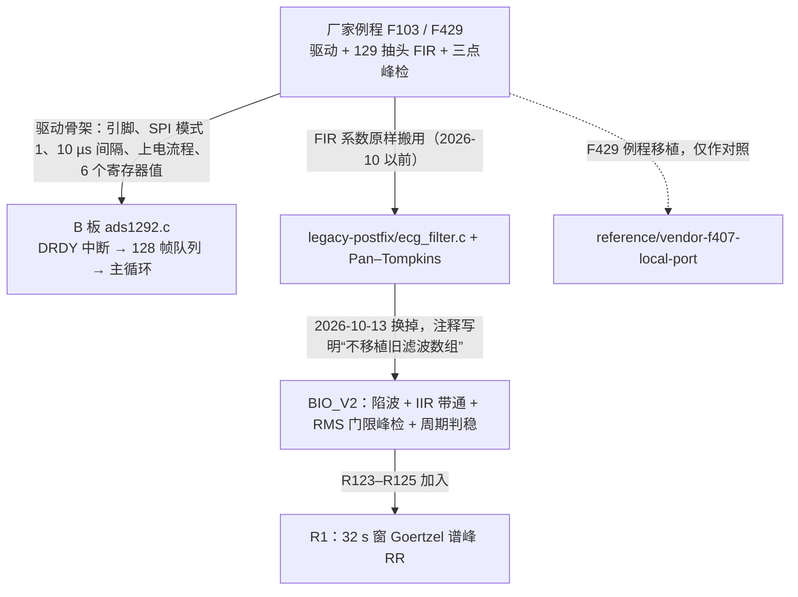

# 厂家例程对照、离线算法比较与真人信号瓶颈分析

**日期：** 2026-11-28（北京时间）
**起因：** 工程师提出“参考厂家 F103 例程移植到 407”。需要回答三个问题：B 板程序与厂家代码是什么关系；厂家算法能否用来优化 ECG/RR；当前真人测量的瓶颈在信号还是在算法。
**范围：** 只读源码和已有 MQTT 录制，纯离线完成。没有连接设备、烧录或采集。算法仍按 R125 冻结，本文不改固件。
**对照对象：** 冻结镜像 R125 K5。源码见 `node-b/firmware/biov2/实验固件/`，当前分支 `bio_v2.c` 的默认编译 `BIO_V2_ALC=0`。

---

## 0. 结论

1. **B 板程序不是厂家例程的移植版。** 驱动骨架参考了厂家代码：引脚、SPI 模式、命令间隔、上电流程，以及 6 个寄存器的取值。数据交接、校验、寄存器取舍和全部算法都是项目自己写的。早期 `legacy-postfix` 用过厂家的 129 抽头 FIR，2026-10-13 换成 BIO_V2 后不再使用。
2. **厂家的心率算法在任何一组数据上都不如 BIO_V2。**
   - 模拟器：厂家 95–97% 正确，BIO_V2 为 100%。
   - 真人 R125：厂家 79–85%，BIO_V2 为 97.4%。
   - 信号差的 R123：厂家中位数报出 484 bpm；BIO_V2 判为无效，这是正确的行为。
3. **厂家没有呼吸率算法**，例程注释也写明真人只能看心电。按厂家思路补一个峰计数，在干净的模拟器正弦上能做到 93–100% 正确；但没有呼吸时它也一直报数，R1 的误报为 0。真人上基线为 44–79%，R1 为 100%。
4. **厂家调试助手**是一个串口实时波形查看器，只能看、不能存。我们的 B 板不输出它能识别的协议，对项目帮助很小（§4）。
5. **瓶颈在采集到的信号，不在算法。**
   - 心率：有效率随信号 SNR 单调上升，没有一个窗是“信号好却判无效”。
   - 信号差的原因不是 QRS 太小，而是带内噪声和工频残留大，而且同一个人不同次之间差别可达 10 倍以上。
   - 呼吸：幅度从来不是问题。被拒的窗里，38% 是主峰落在 ≤9.5 次/分的慢漂上，36% 是谱不集中。
6. **算法剩余的空间很小。** SNR 2–3 时有效率 45–71%、准确率 94–97%，算法略偏保守。此前那些替代算法都是在色标接反时期评估的，改正后没有重比过（§7）。

---

## 1. 厂家资料内容

| 位置 | 内容 |
|---|---|
| `ADS1292R模块资料V4.1_ECG/测试程序/STM32F103/` | 三个 F103 例程（标准外设库 + CMSIS-DSP）：`_usart`（串口输出，供调试助手）、`_LCD`（液晶，只显示心电）、`_LCD_UART`（液晶加串口） |
| `…/测试程序/STM32F429/` | F429 例程（HAL 库），算法与 F103 版相同，SPI5、DRDY=PE9 |
| `…/测试连接/` | 接线照片；注意事项：须用硬件 SPI，人体测试时用电池或线性电源 |
| `…/原理图PDF/`、`…/芯片手册/` | 模块原理图、ADS1292 手册 |
| `…/调试助手/`（已在 `.gitignore`） | `ADS1292调试工具2022.exe` 和 CH340 驱动 |

四个例程的驱动完全相同，算法也相同。各版只在显示方式上有差别：LCD 版每 30 点处理一块，只有心电，并多一条“BPM<200 才刷新”。

仓库里另有 `node-b/reference/vendor-f407-local-port/`：由 **F429 例程**移植到 407，而不是 F103 例程，里面还带着本地的诊断改动。它只用于 2026-10-13 的对照（`node-b/history/第二轮模拟源数据分析与厂商算法对照_20261013.md`），没有编进 B 板镜像。

---

## 2. B 板与厂家代码的关系

### 2.1 沿用的部分

- 接线：PWDN=PA0，CS=PA2，DRDY=PA3/EXTI3，SPI1 用 PA5/6/7。
- SPI 模式 1：CPOL 低，第二沿采样。
- 命令字节之间留 10 µs。
- 上电流程：PWDN 复位 → SDATAC → 读 ID（0x73）→ CONFIG2=0xE0 → 写其余寄存器 → RDATAC → 拉高 START。
- 在 DRDY 下降沿中断里连续读 9 字节。

### 2.2 改动的部分

| 项 | 厂家 | B 板 | 原因 |
|---|---|---|---|
| CH1SET（呼吸） | 0x60，增益 12 | 0x40，增益 4 | 增益 12 时解调出的直流分量会削顶成方波（09 P-05） |
| CH2SET（心电） | 0x00，增益 6 | 0x40，增益 4 | 给电极直流偏移留余量（10-10 A/B 对照） |
| RLD_SENS | 0xEF，两个通道都参与 | 0xEC，只用 CH2 | 不让呼吸通道的调制混进右腿驱动，与 TI 的推荐一致 |
| LOFF_SENS | 0x0F | 0x00 | 不开脱落检测电流；`ADS_LOFF_DC` 编译开关保留了 6 nA 的选项 |
| START | PA1 | PG15 | 本板 PA1 与板载 PHY 共用（09 P-02） |
| SPI 速率 | 32 分频 | 128 分频（656 kHz） | 寄存器读写和数据读取用同一个安全速率 |
| 寄存器写入 | 写完不回读；ID 不对就死循环 | 逐项回读，重试一次，失败则不启动 | 杜绝配置静默失败 |
| 数据交接 | 一个全局变量 + `flog` 标志 | 128 帧队列，带序号、时刻和 flags | 防止覆盖和双通道错帧，缺口能被发现 |
| 数据表示 | 补码异或 0x800000 后转 float32 | 符号扩展为 int32 | 见 §3 第 4 条 |

CONFIG1、CONFIG2、LOFF、RESP1、RESP2、GPIO 这六个寄存器与厂家取值相同。

---

## 3. 厂家算法要点与缺陷

| 部分 | 做法 | 问题 |
|---|---|---|
| 心电滤波 | 129 抽头 FIR，名称写的是 5–40 Hz | 实测通带约 3.8–29.2 Hz，直流增益 0.015，延迟 256 ms |
| 心率 | 三点局部极大值，且要高于“上一段最大值 − 峰峰值/3”；极值每 2000 点（8 s）刷新一次；BPM = 60000 / (点数 × 4)，每检出一个峰就更新一次 | 没有不应期、平均和有效判断，也没有超时；`Peak`、`BPM_LH`、`BPM` 没有初始化；只认正向峰 |
| 呼吸 | 129 抽头低通（约 1.9 Hz，直流增益 1.16），只输出波形 | 没有呼吸率；例程注释：“只能测试显示人体的心电波形” |
| 数值精度 | 码值加 0x800000 后约 840 万，再转 float32 | 这个量级上 float32 的分辨率是 1 个码。干净的慢变呼吸波低通后，97% 的相邻点完全相等，三点比较全部落在平顶上 |

另外，2026-10-13 的报告已经列过几处结构性问题：单 `flog` 标志交接时可能被覆盖、读到错帧；`point_cnt` 在中断和主循环之间有竞争；单字节 SPI 长超时，返回值被忽略。

---

## 4. 厂家调试助手

只做了静态分析：文件类型、内嵌字符串和界面资源。**没有运行这个程序。**

| 项 | 结果 |
|---|---|
| 文件 | `ADS1292调试工具2022.exe`，25.0 MB，PE32+ x86-64 GUI，SHA-256 `7159c79f06b88fa351a2de43906a9c0f52b7137e2180f60e9d2be00063e3f6c4` |
| 构成 | Qt 5 静态链接，QSerialPort 读串口，QCustomPlot 画曲线，MinGW-w64 GCC 7.3.0 编译 |
| 界面 | 串口设置（端口；波特率 115200 / 230400 / 57600 / 9600，默认 115200）；功能选择单选“心电图 / 呼吸波”；实时数据“心率 bpm”“温度”（与厂家其他模块共用）；按钮：打开、开始、暂停、清屏、auto、y 轴复位、xy/x/y 轴缩放、关于 |
| 程序内部 | 主窗口槽函数有 `on_openButton_clicked`、`on_start_clicked`、`on_pause_clicked`、`on_showData`、`set_time`；另有读串口线程 `SerialThread::read_serial_data` |
| 操作说明（内嵌原文） | 左键拖拽；右键框选放大（Esc 取消）；在坐标轴上滚轮缩放；“切换功能（心电或呼吸波）时请关掉串口！” |
| 协议 | 对应 `_usart` 例程的输出：`B: %8d`（呼吸）、`A: %8d`（心电）、`C: %6.2f`（心率），115200 波特，没有分隔符和校验 |
| 保存和导出 | 界面资源和字符串里没有保存、导出或文件相关的控件，推断不能录数据 |

**它做什么：** 把厂家例程从串口发出的已滤波波形画成一条实时曲线，心电和呼吸二选一，同时用数码管显示例程算出的心率。

**对本项目的帮助很小：**
1. **不能直接接 B 板。** B 的 USART1 接的是串口屏，数据走 CAN，不输出 `A:/B:/C:` 协议。要用它，只能往板上刷厂家例程，这需要单独放行。而且它显示的是厂家 FIR 后的波形和厂家的心率，后者在真人上只有约八成准确（§5）。
2. **不能存数据。** 没法做定量分析。现有的网页实时波形、MQTT 录制和离线脚本已经全面覆盖它的功能。
3. **唯一可能的用途**是把一块备用 F407 + 模块刷上厂家例程，作为“模块是否正常”的第二意见。但 R93 的模拟器自检已经验证过 B 的硬件链路（带内 RMS 27.6 µV，板噪约 7 µV），贴片时的实时反馈网页也能做。**不建议为此投入。**

这个程序是第三方二进制，已被 `.gitignore` 排除，不入库。确实要用，只在 Windows 上从厂家资料包里运行。

---

## 5. 离线比较：厂家算法 vs BIO_V2 / R1

### 5.1 方法

- **数据：** 本地 MQTT 录制（`r83-capture/`，不入库）。
  - 模拟器：R123、R125，以及 R127 的一小时长测。R127 使用的是冻结版 R125 K5，含 27 分钟心电和 32 分钟呼吸。
  - 真人：R123、R125，都是志愿者丙。
- **我们的结果：** 直接取录制里板子当时输出的 HR/RR 帧，不重算。
- **厂家心率：** 按例程逐行复刻：offset-binary → 129 抽头 FIR → 三点峰检，u32 截断，阈值和刷新规则都照搬。未初始化的变量取 0。周期用时间戳计算，没有缺口时与厂家的点数 × 4 等价。usart 版和 LCD 版都跑。
- **呼吸基线：** 厂家没有，由本项目补，**不是厂家代码**。厂家 2 Hz 低通后接同一套三点峰检，做两版：
  - “原样”：极值每 8 s 刷新，不设不应期；
  - “改良”：极值每 32 s 刷新，最小间隔 1.5 s。

  为避免数值伪影，基线用 float64、不加偏置（§3 第 4 条）。≤2.5 s 的上传缺口在 50 Hz 点上线性插值补齐。
- **评分：** 在板上 HR/RR 帧的时刻（1 Hz）取各方法的当前值。
  - 厂家的输出是一直保持的值，所以每个时刻都有数。
  - 厂家某个间期如果跨过上传缺口，该时刻不计分，因为板上算法拿到的数据没有这些缺口。
  - 正确的标准：模拟器心率 60±2、呼吸为设定值 ±1；真人心率与 A 板脉率 ±10%（±1 s 内配对）；真人呼吸 ±2。真人呼吸真值：R125 为负责人裁定的实测约 12 次/分（R126 §3.3）；R123 为现场抽样计数的均值 15.2（R124 §4.3）。

### 5.2 心率

| 数据 | BIO_V2：有效 / 有效时正确 | 厂家 usart 版：正确 | 厂家 LCD 版 |
|---|---|---|---|
| 模拟器 R123 | 100% / 100% | 96.2%（25/26） | 96.2% |
| 模拟器 R125 | 99.5% / 100% | 95.4%（167/175） | 97.7% |
| 模拟器 R127，27 分钟 | 97.6% / 100% | 96.9%（1287/1328） | 97.1% |
| 真人 R125，验收窗 170 s | 98.7% / **97.4%** | 78.6%（114/145） | 84.6% |
| 真人 R125，全程 820 s | 55.7% / 91.5%（正确 281，错误 26） | 51.1%（正确 225，错误 215） | 69.8% |
| 真人 R123，信号差 | 6–8% / 77–80% | 2–5%，中位数 484 bpm | 16–26% |

- 在模拟器上，厂家的逐拍结果最高 5% 在 76.5 bpm 以上，即偶有多算或漏算一拍。它从不报“无效”，这 3–5% 的错值都会直接显示出来。
- 真人全程：BIO_V2 的正确值比厂家多，错值只有厂家的约八分之一。

### 5.3 呼吸

| 数据 | R1：有效 / 正确 | 基线·原样 | 基线·改良 |
|---|---|---|---|
| 模拟器 R125，20 / 12 次/分 | 100% / 100% | 98.5% / 94.7% | 100% / 92.6% |
| 模拟器 R127，20 / 12 次/分 | 98.9–99.6% / 100% | 95.8% / 100% | 93.4% / 92.6% |
| **模拟器只开心电（没有呼吸）** | **误报 0 帧** | R127 全部 1553 s 都在报数，中位 58.8 | 全部在报数，中位 25.5 |
| 真人 R125（真值约 12） | 100% / **100%** | 44.2% | 79.1% |
| 真人 R123（真值 15.2） | 37% / 84.6% | 11.4% | 54.7% |

R123 模拟器那一份录在 R1 首版上传丢点严重的时期（09 P-08），插值补缺口会伤到基线，只能得到 59–79%，没有列入上表，详见结果文件。

### 5.4 局限

- **输入不是原始码。** MQTT 上的心电是 BIO_V2 检测带（陷波 + 5–25 Hz）波形，呼吸是 0.8 Hz 低通后抽到 50 Hz 的波形，都不是 ADC 原始码。厂家链路在这样的输入上跑，比它自己的前端更干净，所以表里的厂家结果是它的**最好情况**。
- **样本量小。** 真人只有 2 次，同一位志愿者。心率参照是 PPG 脉率，不是人工标注的心电。

---

## 6. 瓶颈：信号还是算法

### 6.1 方法

- **录制：** 色标改正后（R107 起）的全部 7 次真人录制：R108、R110 丙、R112 丁、R116 甲、R119 甲、R123 丙、R125 丙。只取电极贴在人身上的时段，开头的模拟器核对段已剔除，R108 中途摘下的那一段也剔除。
- **分窗：** 20 s 一窗，共 285 窗。
- **信号质量指标：**
  - SNR：以 A 板 PPG 峰为时标，对 QRS 做集合平均得到的峰值，除以 10 s 块标准差的中位数（`r109_eval.ensemble` 的稳健口径）；
  - QRS 峰峰值；
  - 5–25 Hz 带内 RMS；
  - 45–55 Hz RMS，即陷波后的工频残留。
- **为什么归因是干净的：** 冻结版没有开 ALC，上传的心电正是板上 `heartbeat()` 所用的同一条波形。

### 6.2 心率：有效率跟着信号走

| 信号 SNR | 窗数 | 板上 HR 有效率 | 有效时与 PR 一致 |
|---|---|---|---|
| < 1.5 | 100 | 7.2% | 68.3% |
| 1.5–2 | 90 | 16.5% | 82.2% |
| 2–2.5 | 63 | 44.7% | 93.7% |
| 2.5–3 | 30 | 70.5% | 96.9% |
| 3–4 | 2 | 72.2% | 92.3% |

SNR ≥ 3 的窗里，没有一个是“HR 有效 < 20%”的。也就是说，没有“信号好却判无效”的情况。

### 6.3 信号差在哪里

| | HR 有效 ≥80% 的窗（27 个） | HR 有效 <20% 的窗（161 个） |
|---|---|---|
| QRS 峰峰值中位 | 422 µV | **579 µV**（反而更大） |
| 5–25 Hz 带内 RMS | 68 µV | **197 µV** |
| 工频残留中位 | 23 µV | **54 µV** |

1. **噪声大，不是 QRS 小。** 模拟器的带内 RMS 只有 27.6 µV，其中板噪约 7 µV。真人多出来的部分来自肌电、动作和电极接触。
2. **工频耦合进来，而且时大时小。**
   - 残留越大，有效率越低：5–15 µV 时 45.5%，15–40 µV 时 34.9%，>40 µV 时 15.4%。
   - 上传波形经过了陷波（−19 到 −25 dB）和 25 Hz 二阶低通（50 Hz 处约 −12 dB）。由此估算，输入端的 50 Hz 差模在毫伏量级（**估算，没有直接测过**）。
   - 机理见 R103：两个电极的接触阻抗不平衡，把共模工频转成了差模。原来怀疑的“250 SPS 谐波折叠拍频”，R103 已经否定。
3. **同一个人，不同次差别巨大。**

   | 志愿者丙 | HR 有效 | QRS | 带内噪声 | 工频残留 |
   |---|---|---|---|---|
   | R110 | 5.9% | 805 µV | 276 µV | 84.8 µV |
   | R123 | 9.0% | 595 µV | 185 µV | 31.7 µV |
   | R125 | **95.7%** | 396 µV | **65 µV** | **8.5 µV** |

   人没变，变的是贴片和接触的状态以及环境。其他例子：R116 志愿者甲贴好后 QRS 从约 600 µV 降到约 350 µV，HR 跌到 15–20%；R119 志愿者站起换椅子，噪声升到 3 倍（R117、R120）。
4. **各次总览**（窗中位）：

   | 录制 | HR 有效 | 与 PR 一致 | QRS | SNR | 带内 | 工频 |
   |---|---|---|---|---|---|---|
   | R108 | 29.1% | 85.6% | 631 | 1.76 | 167 | 53.2 |
   | R110 丙 | 5.9% | 94.7% | 805 | 1.32 | 276 | 84.8 |
   | R112 丁 | 29.2% | 87.1% | 355 | 1.96 | 67 | 62.5 |
   | R116 甲 | 20.3% | 86.3% | 387 | 1.66 | 104 | 21.1 |
   | R119 甲 | 25.1% | 90.6% | 650 | 1.21 | 287 | 51.3 |
   | R123 丙 | 9.0% | 93.9% | 595 | 1.64 | 185 | 31.7 |
   | R125 丙 | 95.7% | 96.7% | 396 | 2.69 | 65 | 8.5 |

   幅度单位为 µV。R112 丁的带内噪声低，但 QRS 也小，工频偏高。

### 6.4 呼吸：信号不小，被慢漂淹没

用 R1 的 Python 参考实现（`resp_r1.py`，下限 9.5 次/分，与固件一致）在同样的真人时段上逐窗跑，统计每个窗被哪一道门拒掉。上传缺口造成的窗另计。

| 结果 | 占比（共 3302 窗） | 说明 |
|---|---|---|
| 通过 | 21.4% | R125 安静状态下 89% |
| edge（主峰越界） | **38.4%** | 1269 窗里 1268 窗的主峰 ≤9.5 次/分，中位 6.0，即慢漂盖过了呼吸 |
| quality（谱不集中） | 36.3% | q 中位 0.33，通过窗为 0.65。原因是呼吸不规律或混有其他成分 |
| transient（瞬态） | 3.9% | 动作 |
| amplitude（幅度不足） | **0%** | 一次也没有 |

- 真人呼吸半幅中位 650–1745 r（R119 有大的基线跳变，为 42149 r），模拟器 20 次/分为 503 r，所以**幅度从来不是问题**。
- 慢漂（<0.1 Hz）占比：R125 为 6%，其余各次 18–47%。
- 需要说明：这些时段里有屏气、站起等卡上动作，那时 R1 给出无效本来就是对的，所以 21% 是偏低的估计。

---

## 7. 提升路线（按投入从小到大）

1. **贴片规范：** 酒精脱脂，用新的 Ag/AgCl 电极，贴好后静置再测，固定导联线不让它晃动，远离插排。R125 做到 96%，说明这条路可行。
2. **屏蔽导联线；两路输入 RC 对称化**（先拆板核对网络，见 `ECG-RR-CEILING-AND-HARDWARE-OPTIMIZATION-20261120.md` §四 阶段 2）。针对工频耦合。
3. **呼吸改用四电极阻抗法**，从源头上压住电极接触阻抗的慢漂。
4. **算法：** 在色标改正后的数据上，按事先写定的门槛，重新离线评估中等 SNR（2–3）段的覆盖。预期收益是几个百分点，而且需要重开冻结的算法，由负责人决定。

厂家例程和调试助手都不在这条路线上。

---

## 8. 复现

在 `node-b/docs/PI-REVIEW/analysis-r83-r96/scripts/r98/` 下运行，使用项目 venv 的 `python3 -s -E`，需要 numpy 和 scipy。录制放在 `../../r83-capture/`（受限，不入库）。

| 脚本 | 结果文件（`../../results/`） | 内容 | 耗时 |
|---|---|---|---|
| `vendor_cmp.py` | `vendor_cmp.txt` | §5 | 约 8 s |
| `bottleneck_hr.py` | `bottleneck_hr.txt` | §6.2–6.3 | 约 40 s |
| `bottleneck_resp.py` | `bottleneck_resp.txt` | §6.4 | 约 1 min |

结果文件只含汇总数字和志愿者代号。厂家 FIR 系数在运行时从 `ADS1292R模块资料V4.1_ECG/测试程序/STM32F103/STM32F103_FIR_ADS1292_usart/User/main.c`（GB18030 编码）读取，不另抄一份。

**排错记录：**
- `vendor_cmp.py` 第一版的缓存键用了 `id(w)`。对象被回收后 id 会被复用，R127 因此读到了上一个文件的呼吸结果。现在每个文件开始时清空缓存。
- R108 开头 18 分钟是模拟器核对段（B 接模拟器显示 60，A 戴在真人手上），会被误判成“有效但与 PR 不符”，§6 已按现场时刻剔除。
